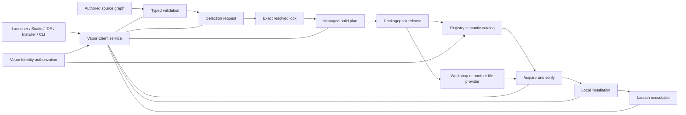

# Vapor ecosystem architecture plan — owner review draft

**Status:** Planning artifact only. No product code, manifests, server state, issues, builds, tests, publishing, or deployment were changed for this review.

**Review target:** Agree on the semantic and ownership model before implementation is authorized. This document is intentionally deeper than the short execution summary; the owner should review the decision points and proposed order, not treat every implementation name below as fixed.

**Evidence inspected:** Current Vapor Client checkout and its Vapor, Vapor-GUI, Vapor-CLI, Vapor-Examples, Vapor-Studio, and Vapor-Installer subprojects; current Loo-Cast workspace; Vapor Platform Server Identity, Registry, and Docs projects; current content/resolver/packaging/service/UI code; current semantic-workbench and content-graph drafts; selected historical planning/glossary material. Historical drafts were treated as evidence, not authority. The repository contains existing dirty/untracked work; it was left untouched.

## 1. Executive direction

Treat Vapor as one semantic ecosystem with a single local Vapor Client service and a canonical content/build/runtime model. The service owns discovery, identity binding, dependency selection, acquisition, builds, installation, launch, publishing orchestration, diagnostics, and operation history. Launcher, Studio, IDE, Installer, chooser, and CLI become distinct frontends over those same contracts; they differ in audience and presentation, not in their interpretation of content.

Keep the ten content kinds exactly as they are. Give them precise graph semantics that distinguish what something *is* from what it depends on, which alternative is selected, what gets built, what gets distributed, and what is installed. Packs are typed manifests: they select and constrain content but do not contain that content’s source or compiled libraries. Packagepack is the playable-selection manifest and its release also has the finished target-specific executable. Source and reusable compiled artifacts belong to the referenced Content releases (including Crates) and are separately retrievable. “Composition” can remain conversational language for the Packagepack selection, not a second root identity.

This is not one “content pass” that absorbs the IDE, scripting, service, and UI into one patch. The recommended program has one shared semantic foundation, then four ordered implementation streams: content graph and package lifecycle; code ownership/build/runtime and Rhai/Rust boundaries; service/operation/identity integration; product workbench and shared UI. Their contracts are designed together, but each stream has explicit entry and exit evidence. The first implementation tranche is the content/package lifecycle because every later surface depends on its identities and resolved build plan.

## 2. Diagnosis: what is demonstrated, and what remains a hypothesis

### Confirmed mismatches

| Dimension | Evidence in the current tree | Consequence |
|---|---|---|
| **Conflated identity** | Current docs define a durable `Composition` separate from a Packagepack; current protocol persists root Packagepack, resolved graph, local launch settings, installation state, and a default composition record. Your current direction says the Packagepack itself is the playable selection. | “Default” plus a selected Packagepack can describe the same thing twice. Subscription, fork, update, launch, and cleanup ownership become ambiguous. |
| **Under-typed graph** | The current authored edge is largely `id + relationship string + optional + version`; `dependency_kind_allowed` has broad fallback acceptance for most non-Crate kinds. Requiredness, optionality, target cardinality, pack membership, feature choice, incompatibility, and build use are not all one explicit model. | Frontends and validators can interpret the same edge differently; some invalid graphs pass early and fail late. |
| **Flattened resolution** | Resolution skips every optional edge, selects highest satisfying versions edge by edge, and explicitly does not globally backtrack or unify versions. Graph shape validation then checks effective Engine/Game counts. | It cannot express a user-selected subset or mutually exclusive path as first-class inputs, and a locally valid choice can make the wider graph impossible. |
| **Package lifecycle split** | Packaging copies one artifact’s source root and stages only that artifact’s already-built `binaries`/`libraries`. It does not show one end-to-end build plan that resolves all selected content, builds reusable libraries, links the Packagepack executable, and records exact provenance. | “I have the content” and “I can launch the Packagepack” are separate facts with opaque failure points; a player must never be forced to compile the default composition. |
| **Docs/source disagreement** | The published book says Packagepack is metadata-only and Composition is a separate durable launchable object. The roadmap says no Rhai parser/executor/capability implementation exists, while the IDE has Rhai parsing/semantic projections and Loo-Cast has an embedded workbench. | Authors receive stale doctrine; generated docs and source semantics drift apart. |
| **Ownership crosses levels** | Loo-Cast’s `loo-cast-game` is a small adapter while gameplay implementation remains in `spacetime-engine`; the current package graph does not make that ownership obvious. | Engine/game boundaries are hard to reason about and a new game author cannot tell where game rules belong. |
| **Service is shared, evidence is not fully shared** | CLI and GUI clients both use the local service. The service has operation IDs, resource reservations, cancellation/status, source/origin/composition fields, and bounded output queues. Operation summaries/history are bounded in memory; output is streamed to connected clients through bounded queues. | The basic service boundary exists; disconnected/reopened surfaces may lack the operation’s complete replayable history, and users still see surface-specific partial explanations. This calls for a replay/retention design, not a new service architecture by default. |
| **Conflict handling is narrower than the desired work queue** | The service reserves resource keys and rejects a conflicting concurrent operation; there is a `Queued` phase in the protocol but no general durable/fair queue was found in the current registry path. | Safe unrelated work can be blocked by coarse action gating, while a conflicting request gets an error instead of being accepted into a visible queue. The target should queue safe work and explain/queue conflicting work only when ordering is meaningful. |
| **Workshop filtering is an integration defect to trace, not a missing primitive to invent** | `vapor_steam` already builds paged UGC queries, applies canonical content-kind tags, and queries subscribed item tags; the current user reports that UI type filtering still fails. | Trace selected UI filter → protocol request → service normalization → Steam query → result projection → UI state. Preserve and repair the working query contract unless that trace proves its shape is wrong. Steam tags can mirror canonical Registry types but cannot replace that authority. |
| **IDE foundation exists, semantic authority is split** | `vapor_gui_core` has editor, semantic, workspace-tree, and console components; IDE uses Rust Analyzer through the service and has TOML/XML/Rhai projections. The semantic workbench plan already forbids builds on open and asks for typed Cargo/LSP diagnostics. | The next IDE design should build on these foundations and decide which service contract supplies authoritative semantic objects; it should not duplicate parsing/compiler behavior in egui. |
| **Toolchain capability and provisioning UX disagree** | `vapor_core` already pins `x86_64-pc-windows-gnullvm` support and a checksummed LLVM-MinGW bundle for both Linux and Windows hosts. User reports still include Windows “unsupported host” and missing-target-tool failures during promotion/setup. | Do not solve this by inventing a second toolchain. Trace role selection → installation-owned metadata → host detection → bundle provisioning → build target validation, and report the exact unsupported host/target distinction. Verify from a clean Windows installation. |
| **Server responsibilities are separated but not yet a full semantic registry** | Registry README assigns it canonical Vapor identity and external-provider linkage, while Identity owns people, sessions, linked accounts, roles, and authorization. Identity explicitly distinguishes authorization from Steam publishing authority. | Workshop is transport/catalog evidence; it should not become the authority for Vapor type, compatibility, ownership, or authorization. The server plan must preserve the Identity/Registry split. |

### Strong hypotheses to verify in the first implementation audit

- Some current workflow actions still do redundant discovery, build, or install work because each operation recomputes a different projection of the graph.
- The schema and provider layers may have duplicated semantic validation beyond the concrete mismatches above. The implementation audit should map each rule to exactly one owner before rewriting it.
- “Composer” may currently be coupled to Developer because Cargo is treated as source editing rather than as a managed build capability. Your correction is clear: Composer may use Cargo compositionally, including manifest changes, but does not author Rust source.
- Some “works on Linux” behavior may rely on Linux process, path, or toolchain assumptions; cross-target behavior should be proven by artifact contracts and Windows user-flow execution rather than inferred from Linux packaging.

Do not treat LOC as a direct quality target. Use it as a prompt to inspect whether duplicated policy, parallel representations, or unnecessary generic machinery can be removed. Delete behavior only after its user-visible contract and callers are mapped.

## 3. Semantic axes that must stay separate

A canonical model must not collapse these into one “content” object:

1. **Content identity and kind:** the stable Vapor ID, one of the ten kinds, authored version, owner, and provenance.
2. **Relationship/constraint graph:** required target, ordinary required dependency, optional capability, alternative choice, conflict/exclusion, compatibility, and build/link use.
3. **Selection:** exact user/author choice of branches, optional features, mod sets, and target platform. A Game can select an Enginepack (including chosen EngineMods) as its engine path; a Packagepack can select that same path explicitly.
4. **Source project:** editable files and their Git/source-control/workspace location, identified separately from the content manifest and built release.
5. **Build plan and result:** selected content artifacts, pinned toolchain/environment, per-target link outputs, diagnostics, fingerprints, and reproducibility facts.
6. **Distribution record:** Registry identity and release facts plus Workshop (or future provider) files/IDs, tags, visibility, and acquisition locator.
7. **Local acquisition/installation:** downloaded bytes, verified artifact hashes, package installation, and user-owned retention policy.
8. **Execution instance:** selected Packagepack release and local launch preferences such as arguments, window behavior, profiling, or save location.
9. **Authority:** which actor may author, publish, install tools, grant roles, or operate a privileged endpoint.

A source workspace is not an install. A Steam subscription is not proof that the bytes match a registry release. A build artifact is not a content kind. A Packagepack is not a Cargo crate. A local workspace binding is not the Packagepack’s launch identity. These distinctions are product-wide invariants, not just type-system preferences.



The diagram is a data/authority flow, not a proposed deployment split: the Client service is one normal local application process, started by the entrypoint as needed; Registry and Identity are remote platform authority, while Steam is a distribution provider. Every box produces typed data/events for the next stage; frontends do not reconstruct rules from filenames or UI labels.

## 4. Fixed content vocabulary and intended semantics

No type is added or removed in this plan. Names below are the owner’s definitions restated as implementation obligations.

| Kind | Required semantic role | Relationships and output that must be explicit |
|---|---|---|
| **Packagepack** | Root manifest for one playable selection. Informal “composition” refers to this same selection. Its published runnable projection includes the finished, linked executable for each declared target. | Selects one effective Engine path and one effective Game path; may select compatible content and other packs. It does not embed constituent source or libraries. Its manifest and executable are release-bound; source is obtained from the referenced content sources. |
| **Enginepack** | Typed manifest offering an Engine and engine-level additions as selectable composition inputs. It is not a container of their code. | Identifies required members and options. A consuming Game/Packagepack may select none, some, or all compatible EngineMods. Bundling does not imply every member is jointly compatible. |
| **Gamepack** | Typed manifest offering a Game plus gameplay additions as selectable inputs; it contains no constituent code. | Same selection semantics as Enginepack for GameMods. A downstream Packagepack can select compatible members. |
| **Modpack** | Typed manifest grouping additions for a particular experience on an existing Engine+Game path; it contains no constituent code. | Membership may contain mutually exclusive content paths. The pack does not force all members into the resolved selection. It needs a declared compatibility context and a selection method. |
| **Engine** | Reusable engine/API/framework Content: defines what the runtime can do and supplies its implementation artifacts. | May use Crates and a declared Engine base/runtime contract. It can be authored in Rust and may expose host APIs to Rhai; language is not its identity. |
| **Game** | Content that uses an Engine/Enginepack selection to define what is actually done as gameplay and supplies its implementation artifacts. | Requires exactly one effective engine path: a bare Engine or an Enginepack that resolves to one base Engine and selected EngineMods. It can require some of that pack’s endorsed mods. It can contain Rust implementation and Rhai-authored behavior/data where the Engine’s host API allows it. Game source must live in its own ownership boundary, not be hidden in Engine merely to avoid a crate split. |
| **EngineMod** | Reusable engine-level extension Content and compiled implementation: adds what an Engine can do. | Has a typed target to its base Engine and explicit required/optional API compatibility. A Game may require an EngineMod offered by its selected Enginepack. It may expose APIs to higher-level game code or scripts. |
| **GameMod** | Gameplay-facing Content and compiled implementation: adds what a Game does. | Has a typed Game target; may additionally depend on EngineMods or Crates when its actual implementation needs them. |
| **ExtensionMod** | “Mod of mod” Content and compiled implementation, targeting a mod generically. | Target kind is constrained to EngineMod, GameMod, or another ExtensionMod; cardinality and cycle policy must be explicit. The graph must make transitive target lineage inspectable. |
| **Crate** | Vapor-managed ordinary Rust Content crate/library, usable without Engine/Game semantics. It owns source and its compiled library artifact. | Rust-native source and Cargo metadata. May be linked by Engine/Game/Mods/Packagepack according to a typed build edge. It does not require the engine stack merely because Vapor manages it. |

One point cannot be inferred safely from the current code: whether every Rust-bearing Engine/Game/Mod is itself one Cargo package, or whether each such content kind declares one or more supporting Vapor `Crate` identities. Your earlier “no raw crates; modules should be Vapor-managed Crate content” points toward a first-class link between semantic content and reusable Crate artifacts. The implementation plan must draw this mapping explicitly and avoid both extremes: hiding helper crates from Vapor, or forcing every Rust source file/module to become its own distributed content identity.

### Ownership boundaries

- **Engine source owns mechanisms and APIs.** Examples: simulation systems, render/physics integration, generic scripting host, lifecycle and capability primitives.
- **Game source owns a concrete use of those mechanisms.** Examples: rules, game-specific entities, progression, missions, player-facing modes, content policy.
- **Mods are ordinary content in their declared layer.** An EngineMod changes reusable engine capability; a GameMod changes gameplay. ExtensionMod targets an existing mod and carries its own semantic compatibility contract.
- **Packs declare selection, constraints, and release composition.** Their membership does not silently copy or redefine member ownership.
- **Crates are Rust packaging units, not a shortcut for every domain boundary.** A content kind has a Vapor lifecycle; Cargo is its implementation/build system where applicable.

### Source authority and the Superworkspace

Use one canonical Superworkspace location (`~/Vapor` by default), initialize it there by default, and allow the owner to change that one location explicitly. Multiple registered Superworkspaces are invalid. The service discovers it; everyday users should not have to type repo paths to find installed content or projects. The current working directory is consulted only for an operation whose target is semantically a source workspace; if discovery is ambiguous or absent, fail with a clear choice instead of silently doing something elsewhere.

Keep three projections distinct inside that one Superworkspace: remote repository sources, locally authored source graphs, and acquired/installed runtime content. If a graph node is locally authored, its owned source closure and descendants must be locally authored too; a source graph cannot silently mix a local parent with remote-authored descendants. Remote releases can still be acquired into the Library for playback/composition, but acquiring binaries does not claim source ownership. A source workspace tab, a Packagepack install, and a Workshop subscription are three different views of shared content identities.

The Loo-Cast example should be an early ownership proof: move game rules and game-specific content into `loo-cast-game` where evidence says they belong; leave generic simulation/render/physics/script host machinery in `spacetime-engine`; keep only a launch adapter in Packagepack. The migration may expose that an existing Engine API is actually game-specific; classify and move those surfaces too. Do not preserve a wrong boundary to make the first split look small.

## 5. Dependency model: alternatives and recommendation

The model needs typed relationships instead of one string interpreted differently at each stage. Proposed edge dimensions:

- **Role/target kind:** e.g. Game requires one effective engine path (Engine or Enginepack); Enginepack provides exactly one base Engine; GameMod extends one Game; ExtensionMod extends one valid Mod.
- **Purpose:** runtime, build/link, authoring/tool, optional feature, pack membership, or compatibility-only reference. One edge may satisfy more than one purpose, but each purpose is explicit.
- **Requirement:** mandatory or optional, with target cardinality independent of whether the edge itself is mandatory.
- **Selection:** fixed target, one-of group, zero-or-more selected options, or named pack path.
- **Constraint:** identity, semver range, capability/API contract, and provider/release provenance.
- **Conflict:** explicit exclusion or incompatible feature/path; conflicts are constraints, not fake dependencies.

These are the competing resolver directions:

| Avenue | Shape | Strength | Cost/risk |
|---|---|---|---|
| **A. Keep current greedy walk** | Choose the latest satisfying version per edge; omit every optional edge. | Small, deterministic, easy to explain. | Cannot reliably resolve shared version constraints, conflicts, or selected alternatives; keeps the confirmed semantic gap. Not recommended as the final resolver. |
| **B. Enumerated named variants only** | Authors list every supported combination as a named path; selection chooses one path, then current-style resolution walks it. | Easy to present curated options and easy to reason about for tiny packs. | Enumerating “none, some, or all” subsets grows combinatorially and makes authors maintain duplicate variants. Not viable as the only model. |
| **C. Full constraint solver** | Typed requirements, features, conflicts, version constraints, and target compatibility become one constraint problem; solver backtracks globally. | Handles interacting packs and reusable shared dependencies correctly; path choices become principled. | More solver code, cost bounds, explanation UX, lockfile semantics, and harder debugging. A generic SAT-style language can become its own ecosystem of accidental complexity. |
| **D. Feature selections plus typed constraints (recommended)** | Packs expose independently selectable optional members and explicit one-of groups. Authors may add `requires`, `excludes`, and compatibility constraints; common curated sets may be named shortcuts. The caller selects a set of features/options; resolver globally backtracks across version and graph constraints without exposing arbitrary Boolean logic to authors. | A consumer can select none/some/all without enumerating every subset; exact lock and explanations remain explicit. | More complex than edge-by-edge resolution. Feature identity/scope, nested-pack propagation, default selection, and solver diagnostics need precise rules and cost limits. |

**Recommended contract:** Authors describe a graph of typed required relationships, independently selectable optional features/members, explicit one-of groups, and `requires`/`excludes` compatibility constraints. The caller supplies a `SelectionRequest` (Packagepack, target triple, selected option IDs, update policy); safe named presets may fill that request but do not replace it. The resolver returns a `ResolutionLock` containing exact release identities, selected and omitted edges with reasons, effective Engine/Game, compatibility evidence, target-specific build requirements, and solver diagnostics. A lock is immutable evidence for build/install/launch; changing choices or versions produces a new lock. This models Enginepack’s “none, some, or all EngineMods” directly and lets a Game require only the EngineMods it actually uses.

Resolution should be deterministic under a defined policy (e.g. explicit pins first; otherwise highest compatible release, with stable identity tie-break). Solver work must have bounded nodes/time and report “search limit reached” distinctly from “no solution.” A human-readable conflict trace must show the shortest useful chain of constraints that made a branch impossible. The resolver must never silently drop a required target or choose a different optional path just because it was available.

**Decisions that need owner review:** Are independent optional selections authored in each pack and finalized by the Packagepack, or should the Packagepack own every choice directly? Should extension chains be arbitrarily recursive subject to acyclicity, or have a small maximum depth? Does a compatibility requirement mean semver only, or semver plus declared API/capability version? My recommendation is: packs own option IDs and local one-of groups; Packagepack lock records the final effective selection; curated named presets can be provided for usability; recursive ExtensionMod chains with cycle prohibition and a diagnostics-friendly depth warning (no arbitrary semantic cap); semver plus explicit API contract where one exists. A Game may choose a bare Engine or an Enginepack as its single effective engine path; when using an Enginepack it binds to the pack’s one base Engine and explicitly requests any required EngineMods it uses. The graph must not count the pack and its base as two effective Engines.

### Example selection to review

```text
Packagepack: loo-cast
├── Enginepack: spacetime-stack
│   ├── Engine: spacetime-engine
│   ├── EngineMod: terrain-streaming (optional)
│   ├── EngineMod: high-speed-collision (optional, required by the chosen Game)
│   └── EngineMod: legacy-physics (excludes high-speed-collision)
├── Gamepack: loo-cast-gameplay
│   ├── Game: loo-cast-game (requires high-speed-collision)
│   └── GameMod: moons-and-orbits (optional)
└── Crate: shared-math
```

The authored pack can offer all options, but the Packagepack’s lock records only the selected compatible set (for example, `terrain-streaming + high-speed-collision + moons-and-orbits`). The Game’s required EngineMod becomes part of the selected closure; conflicting `legacy-physics` is rejected with a chain showing that it excludes a Game-required feature. `shared-math` is built as a reusable Rust library; the final Packagepack executable links the exact libraries for this target. If the Game’s metadata points to a specific Enginepack rather than the Packagepack declaring it, both references must resolve to the same Enginepack/base lineage. This is the graph rule the owner should approve; exact TOML syntax can be designed after it is settled.

## 6. Packagepack, source, build, and release lifecycle

### Identity proposal

- Stable Vapor content ID identifies a kind and named artifact.
- A versioned Content release identifies immutable source revision and target/toolchain-specific compiled artifacts. Source repository revision and built artifact are distinct, cryptographically bound records.
- A versioned pack release is an immutable typed manifest selecting exact Content releases and options. Its editable manifest lives in its source repository; Enginepack, Gamepack, and Modpack releases do not embed constituent source or compiled libraries.
- A Packagepack is the typed manifest for the playable selection; its release additionally references the finished target-specific executable. Its manifest source and runnable artifact are separate projections bound to one release. There is no second “composition root” identity that duplicates it.
- A local **installation record** identifies one exact resolved Packagepack release/lock on this device, installed files/hashes, Auto-Install ownership, and target.
- A local **launch preference record** can attach device-specific arguments, display options, profiler setting, or save path to a Packagepack installation. It must not rename or fork the published content identity.
- Opening a creator workspace binds an editor session to source; it cannot silently replace selected Packagepack or launch preferences.
- Forking creates a new authored Packagepack identity with provenance to the source release and selected graph. It is explicit and visible.

This replaces “Default” as a second playable object: the user has one persistent selected Packagepack reference (initially the shipped Loo-Cast Packagepack). If multiple installed Packagepacks exist, selection is a local reference to one of them. A product may call it “selected game” or “selected Packagepack”; it should not invent another user-facing entity. Whether device-specific launch settings are stored as a sidecar to the Packagepack or as installation-local metadata is a final owner decision; the latter is recommended.

A published pack release is immutable. Adding/removing a member or changing options produces a new manifest revision; it does not mutate the old release or any referenced Content. The Library can acquire Content first, then offer compatible packs for “Add to…”. Composer selects and combines existing manifests plus prebuilt Content artifacts into a new pack. If the root is a Packagepack, its build stage links the selected prebuilt libraries into a finished target executable; Composer does not compile constituent source or author Rust source. A non-Packagepack result remains a manifest. Launcher may hand off a selection to Composer, but must not hide composition behind a player “Install” action. A ready Packagepack remains the direct player path.

### Subscription, Auto-Install, and retention

Treat a Packagepack subscription as ownership of the playable selection and its dependency closure. For each constituent, record why it is present: direct user install/retention, Packagepack ownership, or another explicit owner. Auto-Install means the user delegates version-following and cleanup for that dependency to Vapor; it is not merely a hint to download it.

- A newly acquired Packagepack may set Auto-Install for eligible constituents it brings in. If several subscribed/installed Packagepacks use the same constituent, each is an owner.
- Enabling Auto-Install is permitted only for an already acquired/subscribed item. It does not silently create an unsolicited download. If a user directly installs a constituent for intentional use, that explicit action establishes user ownership, subscribes/acquires it as appropriate, and leaves it retained rather than auto-collected.
- Turning Auto-Install off for a constituent currently owned by a Packagepack converts it to an explicit user-retained owner and subscribes/acquires it directly; it remains after that Packagepack is removed. An independently installed item is user-retained by default and cannot be toggled into dependency-owned Auto-Install unless it becomes a dependency of an installed/subscribed Packagepack.
- When a Packagepack is unsubscribed/uninstalled, remove that owner from each dependency. A constituent still owned by another Packagepack or directly by the user remains. If its final owner was Auto-Install, Vapor unsubscribes it from Workshop and removes its downloaded/cache bytes. If a manual owner remains, it stays subscribed/acquired.
- Version-following uses all active selected graph constraints. Auto-Install constituents update only when one exact candidate satisfies every owner; otherwise the update is blocked with a conflict explanation. Updating a Packagepack creates a new lock; it does not mutate the old release record in place.
- The “Library” is one service projection of acquired/available content, not a separate semantic universe. Source workspaces belong to the creator workspace browser and must not leak into the player’s installed-content list.

Subscription changes, dependency ownership changes, selected lock changes, and content cleanup must commit as one service operation with a preview/report. A crash must be recoverable without leaving “unsubscribed but retained forever,” “deleted but still owned,” or duplicate Workshop/Library entries.

### Artifact strategies

| Avenue | Workshop/release representation | Trade-off |
|---|---|---|
| **Workshop carries every artifact** | Each typed Workshop item carries the manifest and/or its full content folder; subscribing downloads that item’s files. | One provider and familiar subscription flow; duplicates shared libraries across consumers and forces source/runtime bytes into Workshop items whether needed or not. |
| **Workshop manifest + GitHub source/releases (recommended candidate)** | Workshop provides discovery, type tags, previews, and a compact release pointer; Registry binds Vapor identity and Steam identity to Git repository/revision and immutable per-target release assets. Composer downloads prebuilt Content artifacts as needed; Packagepack install fetches its ready executable. Pack-manifest source can live in Git too. | Fits split source/artifact lifecycles and selective target downloads; adds GitHub/Registry availability, auth, rate/size, version-retention, and multi-provider failure cases to own. Need validate access model and release immutability before choosing it as the default. |
| **Workshop manifest + Vapor artifact store** | Workshop remains discovery/transport identity; Registry resolves each typed release to Vapor-managed content-addressed source and binary storage. | Strongest semantic control and future provider flexibility; creates significant hosting, storage, authorization, mirror, and operations work. |
| **Hybrid/mirrored release artifacts** | Registry records canonical hashes and can resolve an artifact from Workshop, GitHub Releases, or Vapor storage according to policy. | Best long-term resilience and provider choice; risks building a generic artifact platform too early. Keep the contract provider-neutral, but do not implement multi-mirror complexity before one release path is proven. |

Steam UGC exposes developer metadata that can be returned in queries without downloading/installing item content; `DownloadItem` and `GetItemInstallInfo` operate on the Workshop item, which the implementation guide describes as a folder of files. The documented API does not present a per-file selective download operation. This supports testing a Workshop discovery manifest that points to Registry/GitHub artifact releases, but does not establish all size, privacy, or entitlement constraints. Validate the actual workflow and limits before locking the provider split. See [Steamworks UGC API](https://partner.steamgames.com/doc/api/isteamugc?language=english) and [Workshop implementation guide](https://partner.steamgames.com/doc/features/workshop/implementation).

**Packagepack manifest/lock should bind:** content IDs/kinds/versions; complete selected graph; the pack-manifest Git revision; referenced Content repository/revision identifiers; content artifact digests; generator/compiler/toolchain version; target triples; build flags/features; final executable digest and entry point; runtime files; compatibility/API contract; release signature/provenance; and license/notices as required. Avoid self-reference in the fingerprint: define canonical normalized inputs and output digests in separate fields, then hash a canonical envelope. Pack source is the manifest; packs do not contain referenced source or libraries.

### Build outputs by semantic kind

Every Rust-bearing reusable Content release needs a target-specific, provenance-bound library/module artifact when it is meant to be composed; a Packagepack release additionally needs its final executable. “Library artifact” means a Rust-linkable output under the compiler’s supported model (for example, an `.rlib` or another explicitly chosen object format), not an assumption that every Rust crate should be packaged as a C ABI `staticlib`. Exact Rust toolchain, target, feature/configuration set, and link contract are part of artifact identity; no cross-version compatibility is assumed. Packs are manifests and do not produce content libraries.

- Each Rust-bearing Engine, Game, EngineMod, GameMod, ExtensionMod, or Crate declares an implementation-to-Cargo mapping. A semantic artifact may own its primary Cargo package and reference reusable Vapor Crates for helpers; it need not turn every source module into a separate Crate identity. It publishes reusable compiled outputs only when its contract says it is composable independently, keyed by supported target, toolchain, and selected features.
- Enginepack, Gamepack, and Modpack describe selectable Content references and options. They have no compiled payload. Never publish an ambiguous “pack library” that secretly contains incompatible branches.
- Packagepack selects exact prebuilt libraries/modules, then Vapor’s pinned composition toolchain links them into the final target executable. Publish that executable as a separate Packagepack release artifact; editable source remains in the source repositories for the pack manifest and referenced Content.
- Composer accepts compatible prebuilt artifacts whose content identity, exact version, target, pinned Rust toolchain, enabled features, and link/API contract match. A missing compatible artifact is a blocker for composition; it does not silently trigger source compilation. The content author/build pipeline or its trusted CI must publish the missing artifact first.

This gives the player path (download the ready Packagepack executable) and Composer path (reuse already-built constituent libraries and link a new executable) without making a player’s machine a source-build environment. The current public wheel example proves only direct Engine + Game + GameMod composition; the fixture tranche must add Enginepack, Gamepack, Modpack, ExtensionMod, standalone Crate, and Packagepack-manifest cases, and prove “none/some/all” EngineMod selection plus a conflict without enumerating every combination. Whether any fixture is publicly published to Workshop is a separate distribution choice: local-only fixtures validate graph semantics; a small public Packagepack validates the full acquisition/play lifecycle.

### One canonical pipeline

`Author Content source → pinned content build publishes target libraries → author pack manifests referencing Content releases → request selection → solve exact lock → Composer verifies/downloads selected prebuilt libraries → pinned linker composes Packagepack executable → bind executable + lock to Packagepack release → Registry registers provider locations → acquire/verify → install → launch`.

Every operation consumes/produces the same typed IDs, lock, artifact records, and diagnostics through the Client service. Player “Install” downloads/validates a ready Packagepack executable; it never implies Cargo. Composer edits pack manifests/Cargo composition metadata and links prebuilt Content libraries; it does not compile constituent source or edit Rust source. A missing compatible library is reported with the owning Content release/source and required toolchain tuple, then resolved in the Content author/build workflow.

### Build trust and security decision

A pinned Rust toolchain gives reproducibility, not a sandbox. Cargo build scripts, proc macros, compiler plugins, and generated build code can execute host code. The plan must not describe “Vapor-managed Cargo” as safe by itself. In the clarified model this risk belongs to the Content author/build pipeline, not ordinary Composer composition: Composer consumes prebuilt libraries and links the Packagepack executable, while Developer or trusted CI builds source Content.

Options:

1. **Trusted Content build, Composer/Player consume signed prebuilt artifacts.** The Content author or trusted CI explicitly owns source-build trust; Composer/Player verify and consume published libraries/executables without executing constituent build scripts. Simplest match for the requested role split.
2. **OS sandboxed build worker.** Network/filesystem/process capabilities constrained using OS facilities. Stronger isolation, but Linux and Windows parity and host maintenance are substantial.
3. **WASM-only untrusted code and no native source build for casual Composer.** Strongest portable boundary, but incompatible with arbitrary Rust library linking until a capability/WASM ABI is specified.

**Recommendation:** Establish explicit trust tiers now: Composer consumes verified prebuilt Content artifacts; Developer/CI builds source only under an explicit trust decision, in a clean, credential-scrubbed, offline-by-default managed environment, with provenance recorded. Treat a real OS sandbox as a distinct security workstream and never promise sandboxing until cross-platform behavior is proven. There is no implicit “build from source to make Composer succeed” fallback.

## 7. Rust, Rhai, WASM, and the capability pipeline

Content kind does not choose a language. Engine, Game, and their Mods may contain Rust, Rhai, data, or a combination; the kind describes responsibility and dependency position. Rust owns Bevy systems and native execution where static typing/lifetimes/scheduling matter. Rhai composes declared behavior/data through host-provided APIs. A hook’s schedule and phase, cardinality, signature, identity, and caller policy belong to a typed host contract; they are not inferred from a script filename.

### Three-stage model to carry forward

This model reflects the user’s prior direction but is still a design constraint to validate against the older source docs:

- **Layer 1 — engine implementation:** Rust-defined immutable host/core for a given engine binary. It establishes primitive types, lifecycle, compiler/loader boundaries, capability validation, and the maximum allowed surface. A different Engine author can implement their own Layer 1 in their engine source.
- **Layer 2 — static composition:** Rust source authored in content crates and statically linked into the Packagepack executable. Rhai may run in a special authoring/code-generation scope to define supported Rust-facing declarations or generate Rust for this layer. Layer 2 is fixed for that built executable; it is not runtime-unloadable.
- **Layer 3 — dynamic runtime shell:** explicitly loaded/unloaded Rhai behavior and Rust compiled to WASM, with capabilities/imports granted by the host. Its dynamic graph may reconfigure inside limits established by the core. WASM imports do not imply unrestricted OS APIs.

The actual capability graph is the structure crossing stages: Rust defines a bounded root contract; Rhai authoring scopes compose declared APIs/handles; generated/static Rust or WASM imports are checked against that contract; runtime invocation gets fresh scoped handles. Handles encode identifiers/data, not retained Rust references. Access expires at the end of its allowed call window; scripts can retain data and reacquire access only through a later host-approved invocation. Phase/schedule and semantic scope are part of that window. Persistent state is explicit hook-local/context-provided state; reload starts fresh unless authored migration runs.

### Critical choice: what Rhai can define

- **A. Rhai as data/behavior only:** simplest and safest, but does not satisfy the agreed Rust-generation escape hatch.
- **B. Restricted compile-time authoring scope (recommended):** Rhai declares/constructs typed API/capability graph nodes; a Rust-owned generator validates them and emits a constrained Rust facade/schema or source fragments. The pinned toolchain compiles the result. It cannot add an unregistered host primitive or expand Layer 1. Generated outputs are reproducible and inspectable.
- **C. Recursive arbitrary self-extension:** Rhai defines new syntax/capability evaluators, which can define further evaluators recursively. Most expressive and closest to the user’s philosophical goal, but risks unbounded evaluation, capability expansion, hard-to-review generated code, and a second bespoke type system. Keep it as a future outer-layer research avenue; initial implementation must make recursion shallow/wide, versioned, quota-bounded, and unable to cross Layer 1’s fixed allow-list.

**Recommendation:** Start at B with a graph descriptor as the stable cross-stage value. Model “custom syntax” as syntax sugar expanding into graph declarations, not arbitrary mutation of Rhai’s parser or Rust’s grammar. Preserve an explicit future extension point for C only after a real use case and safety proof. The compiler toolchain version is pinned by Vapor, but generated code and build scripts still need trust, resource limits, provenance, and deterministic invalidation.

### Hook and handle contracts

A hook declaration needs a stable typed fingerprint over: name/identity, input/output schema, allowed implementer cardinality, schedule, phase, capability graph, state schema/migration hook, and version. A hook can allow any implementer, one implementation, or a named finite set; the host should reject cardinality/signature mismatches at authoring/build time, not at runtime. The graph of nested APIs is intentionally shallow and broad, composed per hook from only the host capabilities it needs. No Bevy references, Rust borrows, filesystem handles, or ambient globals cross into Rhai.

## 8. Local service, Registry, Identity, and operations

### Ownership contract

- `vapor_client_domain` owns value-level rules and transitions.
- `vapor_client_application` owns use-case orchestration contracts.
- `vapor_client_provider` owns OS, Steam, filesystem, toolchain, and server adapters.
- `vapor_client_service` is the single local process owning durable state, operation scheduling, tool/process lifetime, workspace access, and frontend IPC.
- Protocol contracts are stable typed requests/events/snapshots, not GUI-specific models.
- CLI and each GUI frontend call the same service operations. Any direct provider bypass is an explicit, audited exception; the long-term goal is one execution path.
- Identity authorizes people/actions; Registry catalog records canonical content identity, release/provider linkage, and ecosystem reconstruction. Steam Workshop stores/discovers/acquires files and tags but does not define Vapor semantics. Vapor controls semantic type filters from Registry metadata; Steam tags can mirror those types for native Workshop browsing.

### Operation model

Preserve the current good foundation: operation ID, caller origin, composition correlation, phases, cancellation, progress, resource conflict reservations, output levels, source/process, typed diagnostics, and raw tool payload. Extend it with a bounded replayable journal and explicit operation tree:

- stable service-run ID + monotonically sequenced event cursor; reconnect can request events after cursor and receive an explicit gap marker if retention expired;
- parent/child operations (e.g. “publish Packagepack” → solve, build Linux, build Windows, upload files, register release) with dependencies and weighted progress, not fabricated global percentages;
- event source/origin/scope (Launcher, Studio, IDE, Installer, CLI, launched content, service subsystem), operation/content/workspace IDs, process ID/name, stream, level, structured diagnostic, and raw bytes/text reference;
- bounded in-memory hot ring and a durable bounded journal (SQLite is likely aligned with current service state, but append-only files are a real alternative); apply retention/size controls and scrub secrets before persistence;
- snapshot + cursor handshake to close races between initial snapshot and event subscription;
- exactly one operation scheduler owns resource keys and queue eligibility. Queued user actions are accepted when safe; only conflicting actions disable. Long actions never block the GUI event loop.

**Journal avenues:** in-memory only (simple but loses post-exit/debug history); append-only structured JSONL (transparent, easy to tail/rotate but needs indexing and crash-safe writes); SQLite (query/filter/atomic with existing state infrastructure but adds DB coupling). Recommendation: keep operation state authoritative in the service; use SQLite tables for bounded operation/event records if the existing persistence layer can safely own them, otherwise a dedicated JSONL event store behind the same interface. Choose only after measuring volume and startup/recovery behavior.

### Ownership map

| Fact | Authoritative owner | Consumers |
|---|---|---|
| Ten content kinds, IDs, typed edges, constraints, lock format | `vapor_content` / client domain | CLI, Studio, IDE, Registry adapter, docs generator |
| Candidate lookup and exact release metadata | Registry catalog + local candidate provider | Resolver, Workshop filters, UI details |
| Who may author/publish/administer | Vapor Identity; local role is a separate capability install state | Service policy, Studio/Installer, publisher operations |
| Workshop file IDs/subscription/download state | Steam provider adapter, reconciled into service state | Launcher, Studio, service dependency-owner reconciliation |
| Local source roots and repository revision topology | Superworkspace/repository metadata plus Git | IDE, Studio, build planner |
| Build process/toolchain/cache | Vapor-managed service/provider | Composer/Developer clients and operation journal |
| Selected graph, install and launch settings | Local service-owned state attached to Packagepack release | Launcher and Studio read model |
| Semantic display/layout/theme | Shared UI component layer and per-product frontend | Launcher, Studio, IDE, Installer, chooser |
| Docs text and release artifact | Docs source + Docs Server artifact store | IDE help, web docs, generated reference |

If two owners disagree, the plan must state which record wins and provide reconciliation diagnostics. For example, a Workshop download is not installed just because Steam says subscribed; the service verifies provider files against the Registry release record before making the Packagepack runnable.

## 9. Product boundaries and developer experience

These are distinct experiences with increasingly powerful capabilities, not one role-flavored screen:

1. **Player / Launcher:** Home is the selected Packagepack and a clear **Play** action, with install/update/repair state and the next useful action. Browse provides Workshop Packagepacks and constituent content. Workshop browsing has server/provider paging, page-size/sort controls, type and dependency filters, persistent query state, multi-select, group subscribe/unsubscribe, and per-item/aggregate progress. Registry supplies canonical Vapor type/compatibility; Steam tags may mirror those facts for Steam’s own UI. Library is acquired/available items and simple retention/subscribe actions, not source projects. No build internals by default. A read-only expandable console is available on demand.
2. **Composer / Studio:** create/fork Packagepacks and packs, select content and alternatives, configure typed dependency constraints, resolve prebuilt Content libraries, and use Vapor’s pinned Rust composition toolchain to link a Packagepack executable without compiling constituent source or editing Rust. Composer includes Player capabilities. Cargo composition metadata may be edited through semantic forms; raw Rust editing is not a Composer surface. Library browsing is a service projection of acquired artifacts and provenance, not a separate second content inventory. Compose opens a focused graph/selection workspace with a stable details panel and contextual “Add/Remove/Change path” actions; Assemble and Publish are explicit stages/actions, not unrelated global tools scattered over every screen.
3. **Developer / IDE:** source repositories/workspaces, Rust/Rhai/TOML/XML editing, Rust Analyzer, semantic objects/diagnostics, managed build/run/debug, toolchain and profiling. The IDE is an actual app shell (File/Edit/View/Help, workspace/project chooser, editor tabs, semantic tree/inspector, Problems and Console). Developer includes Composer capabilities.
4. **Official/GHF developer tools:** clearly marked and separately authorized operations against first-party repositories, release metadata, server/identity admin, and production publishing. Local “Developer” promotion must not grant server-side or Steam-side authorization.
5. **Installer:** fresh first launch requires an explicit setup/role choice before Play. Set up/uninstall Vapor-managed toolchains and role capabilities; promote/demote through explicit user choice; dangerous-zone uninstall of cache, state, downloads, tools, and all non-depot user data with a precise preview. Runtime player install must not pull Rust/Cargo unless the selected role needs them. Player runtime targets and development host targets are separate: installing a Linux/Windows Packagepack executable does not imply a Rust toolchain is installed, while Composer/Developer promotion installs only the managed host/target tools they select.
6. **Shell:** the CLI facade over service contracts; current working directory is used only when the command semantically expects a source workspace, with explicit failure when no target is discoverable.
7. **Chooser/entrypoint:** explicit entry selection. Steam launch options must map to a simple direct Play entry plus an app chooser across Linux/Windows target variants. The entrypoint starts/ensures the shared service and handles lifetime; child apps connect and exit cleanly.

Role is a capability profile, not a content type or separate installation identity. Player < Composer < Developer is nested. Official status is a separately authorized trust capability. Installer installs local prerequisites; Identity authorizes account actions; service checks both before executing. Do not infer from the existing role screen that prerequisites are correctly installed: promotion must produce a capability-to-tool manifest and a verified installation result, including the pinned Rust host toolchain, selected target linkers, Rust Analyzer, and profiling tools only when requested.

### IDE and source semantics

Build on the existing semantic workbench plan, but extend its contract from “semantic tree for a file” to the Vapor content/build model:

- one semantic object identity/addressing scheme for workspace, content, pack selection, Cargo target, Rust module, declaration, Rhai hook/capability, and diagnostic;
- original files stay authoritative; tree/inspector are versioned projections; all edits go through source-aware operations and stale ranges are rejected;
- Rust Analyzer supplies compiler-grade Rust symbols/references/diagnostics; Vapor adds conventions and content semantics. Do not reimplement Rust resolution in egui.
- `mod.rs` displays by shortest unique module path if the owner keeps that layout; Rust modules and declarations are navigable semantic objects. Component fields and other requested structures are addressable.
- evaluate a strict semantic crate layout (`types.rs`, `components.rs`, `resources.rs`, `systems.rs`, `run_conditions.rs`, etc.) versus a more standard Rust module layout with classification overlays. Recommended: enforce a small set of meaningful domain module conventions and required `mod.rs` presentation rules only where they improve recognition; do not create empty files for absent categories; raw file/folder remains an explicit expert escape. Exact dogma belongs in the signed-off plan.
- TOML content manifests are edited with typed forms + source-preserving patches; Rhai hooks get signature/context inspection; generated Rust shows provenance and is not edited as if hand-authored.
- no automatic build on open, scan, or semantic indexing. Build is an explicit action and appears as an operation tree in Console/Problems.

### Product executable boundary

There are two plausible binary layouts:

- **One GUI executable with a mode flag (current broad shape):** fewer binaries and shared startup, but app identity, process arguments, diagnostics, update/launch routing, and service-origin attribution all pass through a generic “GUI” umbrella.
- **A distinct executable/facade per product (recommended):** chooser, Launcher, Studio, IDE, and Installer each have a clear binary/entrypoint and default mode; each is a thin facade over its product UI crate, shared UI components, and the same Vapor Client service. Installer uses the same visual system and service, not a recovery-only execution path. Steam exposes the direct Play entry and one chooser entry; the chooser opens the selected product executable. Shell remains its own CLI facade.

The process split does not imply one service per app. The one local Client service remains the authority, starts on demand, tracks which product/Packagepack launched a request, and exits after clients and child operations have finished plus its idle grace period. If packaging costs or Windows launch constraints make multiple binaries materially worse, revisit with measured evidence; do not use “GUI” as a domain module that absorbs app-specific policy.

## 10. Shared UI/toolkit direction

There is already a shared `vapor_gui_core` foundation for editor, panels, icons, semantics, tree, and console, plus a host-neutral console core. Do not start by writing a large custom egui framework. First map repeated widgets and layout defects across actual screens; separate pure models from egui renderers; then extract the repeated stable patterns into an internal `vapor_ui`/`vapor_gui_core` component catalog. The toolkit should make coherent panel hierarchy, density, responsive breakpoints, selection, contextual actions, fixed/draggable console height, virtual lists, diagnostics, and empty/loading/error states easier to do consistently. Package the fonts needed by the UI and prefer vector/icon assets over Unicode-symbol substitutes where missing glyphs currently render as squares.

Competing directions:

- **Wrap all of egui in a large Vapor framework now:** high consistency potential, but risks turning every UI decision into a rigid abstraction before usage is understood.
- **Keep bespoke app widgets:** low abstraction cost now, but existing spacing, panel, empty-state, and console regressions repeat.
- **Extract evidence-backed primitives and a preview harness (recommended):** build reusable panels, splitters, virtual lists, command console, inspector/action patterns, icon registry, themes, and fixture-driven preview scenes only after at least two frontends demonstrate the same need. Preview harness should render genuine components against deterministic fake service snapshots/operations without booting the service or invoking tools.

The console/editor plan should reuse the in-game F2 console’s strong interaction grammar where it fits: readable dark output, structured colored records, command prompt/history, expandable details, and fast filtering/virtualization. Studio and IDE use a dockable/resizable console by default plus a pop-out window; Launcher opens it read-only on request. The same console presentation and record model can host Vapor CLI commands through service actions, while game-only commands remain owned by the game/engine command router. Sharing a console does not grant every surface every command.

The shared package can either remain `vapor_gui_core`, become a deliberately neutral `vapor_ui_core`, or split into a tiny visual core plus semantic editor/console modules. This name/boundary should follow dependency direction: theme/panel/button/icon/layout code must not depend on Launcher/Studio/IDE state; editors and console may depend on typed shared contracts; product screens depend on both. Recommendation: first enforce that dependency direction in the current shared crate, then split only if the crate’s public surface or build graph demonstrates two genuinely independent ownership areas.

Launcher, Studio, IDE, Installer, and chooser each keep distinct navigation and audience. Share visual grammar and component state, not screen semantics. Player paths default to simple actions; Composer and Developer complexity appears in cordoned areas and contextual panels. The service is never embedded as a parallel GUI-only business layer.

## 11. Docs, templates, and server lifecycle

- Treat typed Rust metadata/contracts as a possible source for CLI help, IDE inspectors, Workshop filters, documentation tables, and compatibility explanations. Do not generate prose blindly from structs; use authored explanatory text linked to typed fields and validate links/coverage in CI.
- Reconcile the book, SDK reference, roadmap, current source, and historical glossary into an evidence ledger. Mark superseded claims and current invariants; remove “no Rhai exists” and “Packagepack is metadata-only” once the owner-approved behavior lands.
- Vapor Docs Server receives built docs artifacts through a deliberate deploy pipeline. Identity does not own docs; Registry does not own documentation. Secrets remain in deployment credentials; local one-shot deployment and CI deployment share the same artifact format and verification behavior.
- Vapor Identity owns user/session/role authorization; Steam publisher credentials remain server/developer operation inputs and never flow into user content or the local operation journal. Registry owns semantic release/provider mappings and immutable content release records. Plan any Registry API extension before using Workshop tags as the only filter source.
- CI pins the Vapor Rust toolchain and target profiles; separate player/runtime, Composer, Developer, docs, and profiling profiles to control cache and disk growth. A profile describes debug info, incremental compilation, optimization, target, and cache namespace; cache cleanup is a managed Installer action with preview and ownership report.
- Build profile candidates: **Player Release** (optimized, stripped or line-table-only per explicit crash-diagnostic policy); **Composer** (optimized-enough incremental link/build, minimal debug data); **Developer Debug** (incremental and full symbols); **Profiler** (release-like optimization with line tables and frame pointers as required by Tracy); **Docs/Tools** (separate target/cache namespace). These are named managed profiles, not Cargo target-dir accidents. Reuse cache entries only when rustc, target, features, flags, linker, and source hash match. A local cleanup report attributes bytes by profile/toolchain/artifact owner before deletion.

## 12. Implementation sequence and gates

This is a multi-pass program, not a four-hour code patch. The requested four-hour window is for design/review only; no implementation starts before owner signoff. Each phase below may need several implementation sessions. Contracts are designed together, execution proceeds in this order, and changes that invalidate earlier assumptions send the plan back through review.

### Phase 0 — owner signoff and evidence lock

Approve/adjust the architecture decisions in §13. Update the plan from draft to accepted spec. Inventory all current docs, active workstreams/issues, dirty files, manifests, protocol versions, service persistence and artifact endpoints. No schema migration or issue restructuring before this gate.

**Exit evidence:** one owner-approved semantic glossary, one graph/identity diagram, explicit open questions, file/owner map, and clean boundary between source repo edits and this planning artifact.

### Phase 1 — content identity and graph contract

Define typed edge variants, cardinality, requiredness, alternatives, pack membership, conflicts, API compatibility, version constraints, and deterministic selection request/lock. Decide Packagepack identity versus local launch settings/install metadata. Define extension target/cycle behavior. Generate one matrix for all ten kinds and create illustrative graphs.

**Exit evidence:** each of the ten kinds has valid/invalid graph examples; all selection choices and failures can be explained from the typed lock; manifests represent a mutually exclusive pack and a Create-like EngineMod+GameMod+ExtensionMod chain.

### Phase 2 — resolver and lifecycle owner

Implement solver/lock as the sole source of selected graph truth in `vapor_content`/domain contracts. Application/service providers only supply candidate sources and execute plans. Add identity/provenance and clear local auto-install/subscription policy rules to the lock/install model. Preserve original release bytes; make update/fork/unsubscribe/garbage-collection ownership derivable from reachability.

**Exit evidence:** conflicts, alternatives, ranges, explicit version pins, missing optional selections, cycles, and solver limits produce useful diagnostics; repeated resolution is deterministic.

### Phase 3 — package build and distribution pipeline

Separate pack-manifest revisions, Content source revisions, reusable prebuilt Content outputs, final linked Packagepack executables, and install realization. Route Content builds and Packagepack linking through Vapor-managed pinned toolchain profiles. Implement provenance, cross-target runtime packaging, signatures/hashes, partial install/repair, and Workshop/Registry/GitHub release association. Ensure player install never invokes Cargo and Composer never builds constituent Content source.

**Exit evidence:** exact pack manifest + lock + compatible prebuilt Content artifacts reconstruct the same Packagepack executable; Linux and Windows target artifacts launch from clean installs; Player install has no compiler dependency; Composer links without compiling Content source; publication verifies every declared file/release record.

### Phase 4 — prove ownership with real content

Refactor Loo-Cast Engine/Game ownership and templates to match the accepted semantics. Add/rework example content that exercises all ten types without creating irrelevant content. The current wheel example proves only a direct Engine + Game + GameMod path, so add a small fixture set for Enginepack with selectable EngineMods, Gamepack with optional GameMods, branching Modpack, ExtensionMod chain, standalone Crate, and a Packagepack manifest selecting published Content artifacts and a finished executable. Fixtures may be local-only unless they provide useful Workshop lifecycle coverage; the local fixtures validate graph semantics, while one small public Packagepack validates discovery → acquire → install → play. Publishing every test fixture is not implied.

**Exit evidence:** domain graph and actual crate/module ownership agree; default Loo-Cast and non-default terminal/wheel Packagepacks both build, publish, acquire, update, uninstall, and launch on Linux and Windows.

### Phase 5 — local service operations and provenance

Make the service the only operational path for all frontends. Add reconnect-safe operation cursors and bounded durable history; model parent/child steps, process lifecycle, cancellation, progress, secrets/redaction, and resource reservation. Ensure service shutdown only after clients/children are gone and idle grace expires. Audit all direct provider calls in CLI/GUI.

**Exit evidence:** a client disconnect/reopen can reconstruct active and recent operation state; no stale Vapor processes remain after all work exits; every operation shows origin, target content/workspace, process, child progress, and raw/typed diagnostic.

### Phase 6 — semantic IDE, templates, and code lifecycle

Use Rust Analyzer/Cargo structured output and stable semantic object IDs; add domain projections for all ten content kinds, selection graph, Rust modules, Rhai hooks/capability graph, and generated code. Add template and safe authoring operations; enforce agreed Rust organization conventions; keep compiler authority in the managed service. Design/codegen/compile/load/unload for Layer 2 and Layer 3 only after the trust contract from §6 and the scope contract from §7 are approved.

**Exit evidence:** opening workspaces does not compile; all edit/build actions show operation state; stale semantic edits are rejected; Rhai authoring cannot expand beyond the approved graph; generated Rust is reproducible and attributable; WASM imports match declared capability scopes.

### Phase 7 — audience-specific product flows and shared UI toolkit

First fix user journeys and ownership: Launcher discover→select/install→play; Studio create/fork→select graph→build→publish; IDE open source→semantic edit→build/run; Installer setup/promote/demote/uninstall; chooser routes. Then extract tested shared visual primitives and the component preview harness. Console and diagnostics use the service journal and remain filterable, virtualized, draggable, and replayable.

**Exit evidence:** first-time user can install/launch a Workshop Packagepack; Composer can build without writing Rust source; Developer can navigate typed source/diagnostics; each surface states what is happening in plain language and expands into raw process detail; layouts adapt across Linux/Windows and window sizes.

### Phase 8 — server, docs, release and hardening loop

Publish current docs from typed contracts plus reviewed authored explanations. Deploy docs through the Docs Server; test Identity/Registry/Workshop authorization and release catalog; validate app entrypoints on Steam for both targets; exercise fresh install, promotion, role demotion, update, unsubscribe, full uninstall, cache cleanup, and recovery. Reconcile issue/workstream state only after code ownership is clear.

**Exit evidence:** one semantic release appears with correct type/filter/compatibility; Identity authorizes publisher actions; Registry maps provider item to exact content release; docs deployment reflects the release; Linux and Windows flows pass from a clean user state.

### Likely change ownership by pass

This is a review map, not a file-level patch list; Phase 0 should confirm exact modules and identify any moved/dirty files first.

| Pass | Likely authoritative projects/modules | Integrations that consume the result |
|---|---|---|
| Content type/graph contract | `Vapor/crates/vapor_content`; `vapor_client_domain` selection/install records; `vapor_client_protocol` typed request/snapshot | Vapor CLI, Studio, Launcher, IDE inspectors, docs reference |
| Candidate resolver/lock | `vapor_content` resolver; Registry/local candidate adapters in `vapor_client_provider`; application service contract | Workshop provider, Library and Packagepack flows |
| Build/package/release | `vapor_client_application`; `vapor_client_provider::content::packaging`; managed toolchain/cache in `vapor_core`; service operation events | `vapor_steam`, Registry catalog/release endpoints, Launcher install/repair |
| Actual semantic ownership proof | `Vapor-Examples` fixtures, then Loo-Cast `spacetime-engine`, `loo-cast-game`, `loo-cast-packagepack` | Templates, docs, build metadata, IDE semantic tree |
| Operation journal/scheduler | `vapor_client_service::{server, session, persistence}`; protocol events; `vapor_console_core` | `Vapor-CLI`, every GUI product, launched Packagepack logging |
| IDE and code lifecycle | `Vapor-GUI/vapor_gui_core`, `vapor_ide_ui`, service LSP/Cargo adapters, Rhai/Rust build contracts | Studio authoring forms, generated docs, managed toolchain |
| Audience flows/shared UI | Launcher, Studio, IDE, Installer and chooser frontends; shared `vapor_gui_core` primitives/preview harness | Windows/Linux UI, service-only operations |
| Server/docs and release closeout | Platform Registry, Identity, Docs Server and deployment workspace | Steam Workshop, docs site, role/authorization, CI and local deploy |

Each pass should state which contracts it changes and which consumers must update together. The root package/workspace membership, Git submodules, pinned toolchain and target matrix must be treated as part of integration, not as incidental build plumbing.

## 13. Owner decisions to approve or revise

These are the few choices that code inspection cannot settle for you. Proposed default is included so you can respond compactly.

1. **Packagepack vs local settings:** Let Packagepack be the sole playable identity; keep exact resolved lock, install bytes, selected-package reference, and device launch settings as local records attached to it. **Recommendation: yes.** This removes duplicate “Default/selection” identity while preserving arguments/display settings.
2. **Alternative selection:** Packs expose independently selectable optional members plus one-of groups and `requires`/`excludes`; named presets are ergonomic shortcuts. The Packagepack’s exact lock records final selected members. Use a bounded global backtracking resolver, not arbitrary SAT formulas or enumerated subset lists. **Recommendation: yes.**
3. **Optional content:** Distinguish “available but not selected” from “selected optional dependency.” When an optional dependency is needed by a selected mod, it becomes required for that selected graph. **Recommendation: yes.**
4. **ExtensionMod chain:** Any valid Mod can be its target (including another ExtensionMod), but graph must be acyclic; exact-one target. **Recommendation: yes.**
5. **Composer vs Content build:** Composer selects manifests and prebuilt libraries, edits only compositional metadata such as Cargo configuration, then links the final Packagepack executable; it never builds constituent source. Content source builds belong to Developer or trusted CI and publish target-specific libraries. **Recommendation: yes, matching your clarification.**
6. **Rhai-to-Rust:** Permit restricted, deterministic Rhai authoring/codegen to extend the Layer 2 generated surface within a Layer 1 allow-list; no arbitrary runtime syntax mutation in initial implementation. **Recommendation: yes.**
7. **Layer 3 Rust:** Runtime-loadable Rust is WASM only with host-defined imports/capabilities; native code is tied to the Packagepack executable. **Recommendation: yes.**
8. **Registry/Workshop authority:** Registry is canonical semantic release catalog; Identity authorizes publisher actions; Workshop carries transport, subscription, visibility and discovery. **Recommendation: yes; this matches the earlier selection.**
9. **Rust organization dogma:** Enforce stable semantic categories and addressable declarations, but permit explicit escape files where a category is not justified; decide whether `mod.rs` is canonical source layout or only a display convention. **Recommendation: required domain modules only when needed, and shortest unique display path for `mod.rs`; do not generate empty category files.**
10. **First implementation tranche:** Content graph + pack-manifest/artifact/release contract first, with service/IDE/UI/server changes limited to interfaces they must consume. Then do the service journal and code/runtime workstreams in order. **Recommendation: yes; do not attempt all four domains in one giant unreviewed diff.**
11. **Rust package to content identity:** Decide whether Engine/Game/Mod identities directly own their primary Cargo package and reference additional Vapor Crates only for reusable helpers, or whether every implementation crate is a Crate identity referenced by the semantic Engine/Game/Mod. **Recommendation: a semantic Engine/Game/Mod owns its primary implementation crate; reusable helper libraries are separate Crate content; metadata declares the exact Cargo package/target mapping.**
12. **Superworkspace source policy:** Use one discovered/default Superworkspace, and require the complete source descendant graph to be locally authored once a node is local. Keep remote acquired runtime content separately addressable. **Recommendation: yes; this matches the prior explicit owner decision.**
13. **Where content is composed:** Launcher can acquire any content and can hand off “Add to…” into a compatible Packagepack, but native relinking is a Composer operation; Launcher’s direct Play/Install path handles complete ready-to-run Packagepacks only. **Recommendation: yes.**
14. **Source and artifact hosting:** Use GitHub repositories/releases as the source and prebuilt artifact provider, with Workshop items as discoverable typed manifests and Registry binding immutable identities, hashes, and provider locations; keep a future Vapor artifact store possible. **Recommendation: investigate this first.** Steam’s documented UGC API supports query-returned developer metadata and item-folder downloads, not per-file selective download, making the split promising. Validate access/privacy, retention, rate/size limits, and install authorization before committing.
15. **Packagepack runnable projection:** Keep one logical Packagepack release/lock with target-specific final executables. Player install fetches only the selected target executable/runtime files; Creator/Developer source acquisition follows separate Content repository/revision references. **Recommendation: yes; no local source build on the Player path.**
16. **Product executables:** Give chooser, Launcher, Studio, IDE, and Installer distinct app facades/binaries over the same Client service, with one direct Steam Play entry and one chooser entry. **Recommendation: yes; confirm only if distribution/runtime constraints make this materially worse.**

## 14. What the first implementation session should do after approval

1. Freeze this accepted spec and create a file-level implementation plan from current branch status without touching the already-dirty files.
2. Map every current content rule to its single authoritative owner: parser, content domain, application, provider, service, protocol, GUI, docs, Identity, Registry, and Loo-Cast.
3. Replace or redesign the graph contract only after examples cover every kind and at least three alternative/conflict cases.
4. Implement through Vapor-managed commands; do not invoke raw Cargo. Keep alpha versions/schema policy at the owner-approved `0.1.0`/`0.5.0` unless the owner approves otherwise.
5. Commit/push at natural checkpoints if the owner continues to authorize it; publish only after cross-platform fresh-install validation is ready.

## 15. Explicitly deferred until their contracts are reached

- Arbitrary recursive Rhai language/parser modification; Layer 3 arbitrary native code; any claim of secure sandboxing without cross-platform proof.
- New content kinds or semantic roles; redesign of Steam entrypoints unrelated to the accepted product flow; standalone OS daemon/service installation.
- Broad custom egui framework before shared primitives and preview requirements are demonstrated.
- Reworking every documentation paragraph before source semantics and metadata ownership are stable; docs generation/CI/deploy contract is planned, but prose is reconciled in its dependent phase.
- Automatic content builds during scan, UI startup, Workshop refresh, or IDE workspace open.
- Any cache/userdata deletion as a side effect of design work. Future dangerous-zone uninstall is an explicit preview-and-confirm operation.

## 16. Review checklist

- Does Packagepack-as-playable-identity preserve everything you mean by “the composition is the Packagepack” without hiding local launch preferences?
- Is the feature model expressive enough: independent optional members, one-of groups, `requires`/`excludes`, with curated named presets? Or do you want authors to define more general logic now?
- Does the hard boundary hold: Developer/CI builds reusable Content libraries; Composer combines those prebuilt artifacts and links Packagepack executables, without compiling constituent source?
- Should GitHub Releases be the initial immutable source/artifact provider behind Workshop manifest entries, with Registry resolving and verifying each asset?
- Does the Enginepack/Game relationship work as shown: one effective Engine path, optionally through an Enginepack; its EngineMods can be individually selected or required by a Game?
- Should “Add to Packagepack” begin in Launcher and hand off to Composer when it needs a native relink?
- Do separate product binaries over one service match the desired app/Steam-entry model?
- Does the proposed Layer 1/2/3 split preserve the earlier agreement: Layer 1 authored by an Engine; Layer 2 statically linked and not unloadable; Layer 3 Rhai/WASM dynamically loadable within immutable-core limits?
- Is the phase order right: content semantics/build lifecycle → real Engine/Game ownership proof → service operation/replay → codegen/runtime → audience-specific surfaces/toolkit → server/docs/full cross-platform proof?
- Which recommendation above is the “last mile” you do not want me to infer? Mark that point; the rest can be implemented from the approved contract.
