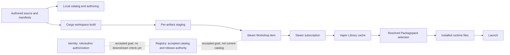
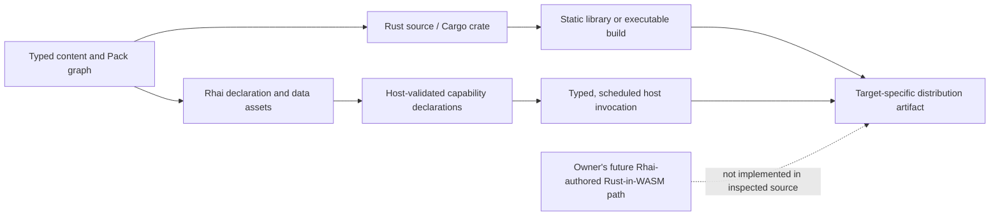
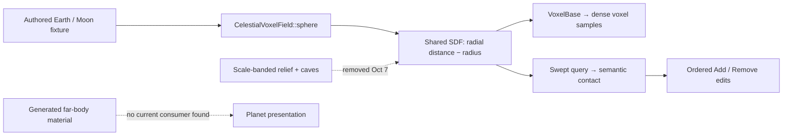

# Current-state semantic cross-reference — October 25 review, source state refreshed October 26, 2026

This is the latest-state-first companion to the [research index](loo-cast-vapor-research-index.md), [evidence atlas](vapor-ecosystem-evidence-atlas.md), and [semantic diff review](loo-cast-vapor-semantic-diff-review.md). It follows one present-day promise across every boundary that must cooperate to make it true, then points backward to the evidence explaining how the boundary formed. It is a current-source analysis, not a normative design document.

## Reading rules

- **Implemented** means visible in the inspected source. It does not imply that a complete workflow was run.
- **Owner direction** means a user decision or correction in the accessible conversation. It is intent evidence, not code behavior.
- **Documented** means a repo document or proposal says it should work that way. It may be stale or unimplemented.
- **Reported** means the owner saw or reported behavior; absent a preserved log/reproduction, it is not independently verified.
- **Open** marks a question the accessible record does not settle. Do not silently turn an interpretation into a contract.

GitHub default-branch heads and local checkouts were rechecked on October 26: the same 15 committed heads still match the October 25 record. Local dirty state remains separate and preserved (Loo-Cast Cargo.lock, Installer UI source, two untracked Vapor design documents, and nested-repository state in Vapor-Client). The source repositories are staggered at their latest observed commits. See [the checkout inventory and dirty-file record](vapor-ecosystem-evidence-atlas.md#current-source-inventory--refreshed-october-26-2026). Files under the project mirror's `sources/` were not available. I also inspected the app-accessible project conversations and selected older Codex threads surfaced by the app. That is a bounded history view, not a full account export or a complete five-year conversation archive; repo history and imported design records remain the main recoverable evidence before the accessible 2026 discussions. This cross-reference therefore aims at exhaustive reconciliation of accessible evidence, not a false claim of omniscience.

## The central contract under examination

The owner has clarified that the canonical ten content kinds are intentional and should not be changed without a strong case and explicit discussion. Packs are typed manifests that select/refer to content; they do not contain the implementation content. Content includes Engine, Game, mods, ExtensionMod, and Crate. A Packagepack is the root of a playable selection and is the one Pack expected to have a completed executable; the same selection should remain editable/forkable through its referenced source/content. The exact coupling of source closure, manifest identity, and released executable is not yet settled. The owner also distinguishes required dependencies from optional additions and wants packs to represent alternative, even mutually exclusive, content paths.

The current type vocabulary does contain the ten kinds: four Packs (`Packagepack`, `Enginepack`, `Gamepack`, `Modpack`) and six implementation kinds (`Engine`, `Game`, `EngineMod`, `GameMod`, `ExtensionMod`, `Crate`). `ContentKind::ALL` and manifest names are centralized in `vapor_content`; the authored manifest parser has one role slot per kind. See [`ContentKind`](</home/leslieghf/Vapor/Vapor-Client/Vapor/crates/vapor_content/src/content.rs#L30-L100>) and [`AuthoredContentManifest`](</home/leslieghf/Vapor/Vapor-Client/Vapor/crates/vapor_content/src/authored_manifest.rs#L12-L58>).

A Packagepack kind and the source project that realizes its runnable root are not the same schema. The Vapor book says “Packagepack is metadata, not a Rust crate,” but both observed flagship and example workspaces register a Packagepack path with a Cargo binary crate; the Wheel Salvage source directory contains both `Cargo.toml` and `src/main.rs` ([book statement](/home/leslieghf/Vapor/Vapor-Client/Vapor/docs/books/vapor/src/concepts/packagepacks.md#L1-L19), [example workspace membership](/home/leslieghf/Vapor/Vapor-Client/Vapor-Examples/Workspace.vapor.toml#L38-L39), [example executable crate](/home/leslieghf/Vapor/Vapor-Client/Vapor-Examples/content/hello-world-packagepack/Cargo.toml#L1-L17), [flagship executable crate](/home/leslieghf/Vapor/Loo-Cast/loo-cast-packagepack/Cargo.toml#L1-L14)). This can be coherent if “Pack is a manifest” describes its Vapor semantic kind while its registered project supplies the linker/executable. But the docs do not explain that distinction, and generic templates currently scaffold Packagepack as metadata-only. The mismatch is historically specific: Loo-Cast switched to a Packagepack executable on October 17 (`4551c53`), the book’s “metadata, not a Rust crate” claim was written on October 20 (`a194167`), and the runnable example added the same Cargo-root pattern on October 21 (`c157496`). The code and the concept are not yet joined by one explicit authoring/build contract.

The problem is not that the vocabulary is absent. It is that each layer currently models only part of what the owner means by those names.

The ten-kind matrix below separates the owner's now-explicit semantics from the checks the current resolver actually performs. The enum's doc comments are only short labels; where they appear broader than the current graph, the executable resolver is the present contract.

| Kind | Owner's intended role | Current enforceable shape and gap |
|---|---|---|
| **Packagepack** | Root of a playable selection; its completed release carries the one linked executable, while the referenced source remains forkable/editable. | Pack child allowlist permits the other nine kinds except Crate as a direct child. Resolver requires exactly one Engine and one Game anywhere in the flattened closure; it does not require a declared executable or ensure the release contains that binary. |
| **Enginepack** | Bundle an Engine and optional EngineMods; may express alternatives that need not all be compatible. | Child allowlist is Engine, EngineMod, Enginepack; flattened closure must contain exactly one Engine. No branch-selection or incompatibility path is represented by the current resolver. |
| **Gamepack** | Bundle a Game and optional GameMods, with the same ability to describe choices. | Child allowlist is Game, GameMod, Gamepack; flattened closure must contain exactly one Game. No selected branch is retained. |
| **Modpack** | Group additions for a particular existing experience; it is not inherently guaranteed that every member can coexist. | Child allowlist is EngineMod, GameMod, ExtensionMod, Modpack; resolver only requires at least one mod somewhere in the flattened closure. It does not model paths or compatibility alternatives. |
| **Engine** | Reusable engine-side API/mechanism; not synonymous with Rust or with a binary. | No Engine-specific direct dependency allowlist is applied by `dependency_kind_allowed`; starter generators disagree on binary versus library shape, while Loo-Cast's actual Engine is a library. |
| **Game** | Game-specific behavior/content built on Engine mechanisms; may also compose Crates. | Direct dependencies are restricted to Engine or Crate, and each Game must have exactly one direct Engine. That target rule exists, but does not settle what source belongs in Game versus Engine. |
| **EngineMod** | Engine-level extension; it must target an Engine. | Resolver requires exactly one direct Engine target. The generic scaffold emits `rlib` + `cdylib`, not the owner's stated static-linkable content contract. |
| **GameMod** | Game-level content/extension; it must target a Game. | Resolver requires exactly one direct Game target. The generic scaffold again emits both `rlib` and `cdylib`; static composition is not enforced. |
| **ExtensionMod** | Mod-of-a-mod, with its target typed generically as a mod. | Resolver requires exactly one direct dependency whose kind is any of EngineMod, GameMod or ExtensionMod. There is no compatibility/capability check beyond that broad kind. |
| **Crate** | Plain Vapor-managed Rust crate, statically linkable and usable without engine/game semantics. | Direct dependency kinds are restricted to Crate; Core reconciliation only handles a Crate root. Other content's Cargo graph does not yet consume Crate edges through the generic Packagepack realization. |

The fixed role-slot helpers are not unused: source authoring calls `dependency_choice_group_for_relationship` while validating selected children and requires exactly one member in each required Engine/Game role group ([source cardinality validation](</home/leslieghf/Vapor/Vapor-Client/Vapor/crates/vapor_client_provider/src/content/authoring.rs#L2189-L2235>)). The limit is narrower and more consequential: this is an authoring-path check, while the provider-neutral runtime candidate graph stores dependency edges, not a typed choice-group/selected-branch record. Runtime traversal includes each required edge and skips optional edges, then validates flattened kind counts and direct target counts. Thus fixed Packagepack role alternatives are checked during that source-authoring path, but the resolved graph still does not encode a general selected branch or mutually exclusive pack path ([fixed kind/relationship/choice vocabulary](</home/leslieghf/Vapor/Vapor-Client/Vapor/crates/vapor_content/src/content.rs#L30-L243>), [resolved graph and cardinality validation](</home/leslieghf/Vapor/Vapor-Client/Vapor/crates/vapor_content/src/resolution.rs#L110-L303>), [optional-edge and recursive resolution behavior](</home/leslieghf/Vapor/Vapor-Client/Vapor/crates/vapor_content/src/resolution.rs#L312-L463>)). The `vapor_core` adapter resolves only its local catalog: generic latest/exact routes return a graph, kind-specific resolution adds semantic validation, and Packagepack resolution projects the graph into `ResolvedComposition` ([local resolver adapter](</home/leslieghf/Vapor/Vapor-Client/Vapor/crates/vapor_core/src/resolution.rs#L15-L135>)). That adapter does not add branch selection or provider/source provenance.

The role-specific manifest contract is also enforced differently by different routes. The shared parser can represent all ten role sections in one struct. The IDE diagnoses another known role section in a filename-typed manifest; the source packager instead reads the section implied by the filename and copies that one role's fields without checking for other known sections. It then writes a deployed manifest from one typed artifact, and the deployed-artifact reader requires exactly one section. Therefore source authoring through the IDE rejects a multi-role file, while a direct package request can silently project just the expected section. The behavior is not “multi-kind Workshop items are supported”: the release reader rejects them. It is a validation seam between editor diagnostics and package-time projection. Additionally, these top-level authored structs do not opt into Serde's `deny_unknown_fields`, and the inspected TOML semantic path checks only known role sections; misspelled/unknown fields therefore lack an explicit typed diagnostic in this route. [Parser's ten optional roles and count](</home/leslieghf/Vapor/Vapor-Client/Vapor/crates/vapor_content/src/authored_manifest.rs#L11-L60>), [IDE multiple-role diagnostic](</home/leslieghf/Vapor/Vapor-Client/Vapor-GUI/crates/vapor_ide_ui/src/toml_semantics.rs#L60-L138>), [source packager selects only filename role](</home/leslieghf/Vapor/Vapor-Client/Vapor/crates/vapor_client_provider/src/content/packaging.rs#L132-L163>), [deployed reader requires exactly one role](</home/leslieghf/Vapor/Vapor-Client/Vapor/crates/vapor_client_provider/src/content/packaging.rs#L571-L611>).

### Authored dependency edges are richer than the provider-neutral resolver graph

The ten-kind schema supports two related but non-identical representations. Authored references carry a free-form relationship string, optionality, semver requirement, Workshop ID and explanatory reason; authored manifests also hold a separate conflict list. The provider-neutral resolver candidate narrows each dependency to `{ id, version, optional }` and keys it by a synthesized string such as `engine#0`; the resolved node retains that binding and version requirement, but not the original reason, Workshop provenance, conflict edges or explicit role slot as a typed value. The provider keeps the richer `ContentArtifact` alongside the candidate catalog, so those facts are not necessarily globally discarded, but graph resolution itself cannot validate or carry them as graph semantics. [Authored reference shape and role-edge generation](</home/leslieghf/Vapor/Vapor-Client/Vapor/crates/vapor_content/src/authored_manifest.rs#L68-L170>), [provider-facing rich references](</home/leslieghf/Vapor/Vapor-Client/Vapor/crates/vapor_client_provider/src/content/model.rs#L155-L258>), [candidate projection](</home/leslieghf/Vapor/Vapor-Client/Vapor/crates/vapor_client_provider/src/content/authoring.rs#L330-L371>), [resolver graph shape](</home/leslieghf/Vapor/Vapor-Client/Vapor/crates/vapor_content/src/catalog.rs#L1-L23>), [resolver output](</home/leslieghf/Vapor/Vapor-Client/Vapor/crates/vapor_content/src/resolution.rs#L1-L36>).

This matters against the owner's intended model because relationship type and target cardinality are part of the content contract, not just display labels. The shared vocabulary defines permitted kind pairs and fixed choice-group helpers. Source-authoring validation consumes those helpers for selected children and enforces required role slots; the provider-neutral resolver does not. It resolves every required edge, skips optional edges, and validates flattened/direct kind counts, but its resolved node stores dependency bindings as strings rather than a typed edge/choice model. Thus fixed Packagepack role alternatives are checked on that authoring path, while the generic resolved graph cannot express a user-selected branch, arbitrary mutually exclusive pack path, or conflict policy as first-class graph semantics. This complements the earlier Pack matrix finding; it is not a claim that all rich metadata is lost from the source catalog. No test or build was run in this audit.

The validation API has its own migration trace: September 5 `cce0630` wired the Core `validate_resolved_content_graph` wrapper into the first kind-specific and Packagepack paths; the October 18 `f9e8b13` extraction moved validation into `vapor_content`, and current callsites use `validate_content_graph` through local kind resolution, Packagepack projection and install planning. The old wrapper remains publicly exported but has no in-repository caller. This is an API residue from the extraction, not an unused validation system. See the [dated source-history comparison](loo-cast-vapor-history-timeline.md).

The same distinction applies to language and runtime: an artifact’s semantic role is not its implementation language. Rust libraries, Rhai declarations, host hooks and generated/runtime artifacts must eventually connect through explicit contracts, but the latest owner direction does not make Engine synonymous with Rust or Game synonymous with Rhai. The current content graph/build path and the separate scripting/editor paths are compared below.

The solid arrows describe source-backed handoffs, with important caveats in the table; dashed arrows are accepted ownership goals without current implementation. The missing contract is what makes the entire chain one verifiable release: stable content/version identity, source provenance, platform payload set, typed dependency/alternative graph, Workshop binding, Registry record, authorization decision, local acquired copy, resolved composition, and installed executable must all refer to the same release. Current code does not demonstrate one end-to-end record that binds all of them.

## Cross-reference by semantic boundary

| Boundary | Owner’s intended meaning | Current implementation evidence | Historical/current documentation evidence | Assessment |
|---|---|---|---|---|
| **Content-kind vocabulary** | Keep the ten kinds; each signals a distinct authoring, composition, or delivery role. | `ContentKind::ALL` has exactly ten kinds, with role-specific manifest filenames. | The current conversation fixes this vocabulary and describes each kind; older glossaries and plans use prior shorthand and must not override this clarification. | **Implemented vocabulary; incomplete semantics.** The enum is a strong shared anchor, but it does not itself enforce every meaning. |
| **Catalog identity and kind** | The same typed identity should carry content through source discovery, acquisition, Library, composition and install; UI roles may project from it without replacing its kind. | `ContentKind` is canonical in `vapor_content`, but `CatalogContent.kind` and protocol `CatalogEntry.kind` are strings. Service reparses them to derive four broad `CatalogItemRole` values; eight recognized kinds become `RuntimeContent`. Local catalog merges Cache and Installed only, while workspace source discovery is separate. | The owner requires one semantic core across Vapor products and distinguishes acquired content from source authoring without making them separate identities. | **Shared vocabulary, split projection.** Kind is not type-enforced across the Client boundary, and source/acquired observations do not meet in one catalog merge. This is evidence of an ownership seam, not proof the UI currently mislabels items. See [catalog boundary analysis](loo-cast-vapor-semantic-diff-review.md#october-25--the-ten-kind-vocabulary-loses-semantic-resolution-at-the-client-catalog-boundary). |
| **Pack meaning** | A Pack is a typed manifest selecting/referencing content. Only Packagepack carries the finished playable executable; Enginepack/Gamepack/Modpack express reusable selections or additions. | The authored and deployed structures expose the same payload fields (`binaries`, `libraries`, runtime payload, dependencies, conflicts) for all kinds. Generic staging copies the source tree and runtime outputs for any artifact. | October 18–20 architecture docs and generic templates describe Packagepack as metadata-only and generalize Cargo membership; later owner clarification says a playable Packagepack is the executable root. The Oct 24 untracked graph design records the later direction but remains a proposal. | **Conflated.** One artifact schema and staging function allow payload behavior that the owner says should be kind-sensitive. The universal tree-copy policy also publishes source files together with payload unless excluded. |
| **Dependency graph** | Required and optional references; packs can describe alternative and mutually exclusive branches; cardinality and mod-of-mod requirements matter. | `DependencySpec` is ID + version requirement + optional; the canonical kind model adds fixed role labels and narrow exclusive choice groups, which source-authoring validation enforces for its required groups. Runtime resolution still does not preserve branch choices. Candidate graph edges still carry no selected-branch or alternative-set record. Resolution omits optional edges and selects all required edges before requiring one effective Engine and Game; install planning separately detects some version duplication/conflicts. | Earlier “resolved composition” docs favor one flattened selected graph. October 22 owner clarification says pack alternatives can be incompatible. Current Studio creation cards still teach one compatible selection. | **Under-expressive.** Narrow typed role slots exist, but are fixed “exactly one” gates, not general selectable branches. Authored `conflicts` and install-time conflict checks exist, but are not equivalent to a branch/choice model. See [the detailed Pack analysis](loo-cast-vapor-semantic-diff-review.md#october-25--studio-teaches-one-compatible-selection-the-content-graph-cannot-express-pack-branches). |
| **Content identity and version** | Stable identity names the reusable content; exact version identifies an authored release. A pack is the root selection and must be traceable to its resolved constituents. | `ContentVersionId` and provider-neutral exact candidates exist; deployed manifests carry ID/version. Composition snapshots persist exact nodes, selected versions, dependency bindings and requirements. The exact graph model is stronger than a loose list. | October 15–19 Library/Auto-Install work separated subscription, cache, dependency ownership and composition. The October 24 proposal explores owner graphs. The old glossary’s state/recipe vocabulary is historical and cannot be imported as current authority wholesale. | **Partially joined.** Exact selected composition identity is persisted, but no common release record binds that graph to both its Packagepack source revision and all platform outputs. |
| **ID spelling and canonicalization** | One stable content identity should survive source discovery, Registry, Workshop, acquisition, selection and installation. Whether IDs have one global grammar or provider-specific aliases is not settled. | `VaporId::new` accepts any non-empty string without whitespace. Source-manifest discovery instead rejects explicit IDs and synthesizes IDs from a source-root prefix plus local names restricted to lowercase ASCII letters, digits, `-` and `_`. | The ID wrapper was introduced in the Sep 4 vertical-slice work; Oct 18 extracted it into shared `vapor_content` while adding the provider source-manifest parser. The generic wrapper's validation is not a normalization or canonical-form check. | **Two lexical contracts.** Source-generated IDs are narrower than IDs accepted at API/persistence boundaries. This is a confirmed grammar distinction, not proof of an exploit or an observed mis-resolution. A canonical grammar, provider alias rule, and rename/move stability policy remain open. See [the focused trace](loo-cast-vapor-semantic-diff-review.md#october-26--content-identity-has-two-lexical-contracts). |
| **Durable playable selection** | Packagepack is the playable selection; “composition” is informal shorthand. Persist the selected identity and settings while deriving current installation state from the host. | Client state v2 persists multiple Composition records, an active ID, exact resolved graphs and launch settings; load/save clears `installation` to `Unknown`. First-run import migrates legacy eframe profiles once, preserving root IDs without exact versions/graphs and retaining bad input as recovery data. | The October 18 extraction created a separate Composition model; the owner later clarified that Packagepack is itself the playable selection. | **Lifecycle is explicit; product identity remains split.** Runtime installation is correctly re-observed, but the current durable collection still models compositions as records around Packagepack roots. The design purpose of per-user records beyond selection/settings is unresolved. See [composition persistence review](loo-cast-vapor-semantic-diff-review.md#october-26--composition-state-persists-selection-and-resolution-not-installation-status). |
| **Source versus runtime artifact** | Source is available to edit/fork; a ready Packagepack has the runnable executable. Reusable Content is built as libraries and statically composed. Packs themselves carry references, not implementation. | `stage_deployed_artifact` copies the authored project tree plus declared binaries/libraries. The generic generator still maps types inconsistently; flagship Loo-Cast’s Engine is a library and Packagepack is a binary Cargo root. | The July 3 IDE mockup shows source tree + pack graph + inspector + build/package/publish. The latest user direction clarifies source/content vs Pack semantics. October 21 example work shows a hand-authored Cargo Packagepack binary, not a generic composer-generated build graph. | **Unbound release halves.** Current staging mixes source and runtime files in the Workshop directory, while the owner wants an explicit, easy player payload and a source path for editing. Exact storage/provenance split is open. |
| **Workshop as distribution** | Steam provides Workshop transport/discovery; Vapor supplies content types, dependency semantics, release identity and installation behavior. Type filtering should be accurate and attributable to Vapor’s semantic source. | Authored metadata has Steam app ID, PublishedFileId, title, description, tags and per-reference Workshop ID. Client search passes selected `ContentKind` and tags into Steam UGC; subscription/acquisition and SteamCMD publication are implemented. | October 22 Platform decision: Registry catalog; Identity authorizes; Steam transports and provides final Steamworks enforcement. | **Transport exists; canonical semantic authority does not.** The selector is implemented as a required Steam tag. Vapor's publish path emits the kind tag, but the live catalog, legacy/manual tags and the reported filter failure were not checked. Discovery does not query the selected Registry catalog; see [type-filter trace](loo-cast-vapor-semantic-diff-review.md#october-25--steam-kind-filtering-exists-as-a-tag-contract-not-a-catalog-query), [accepted boundary](loo-cast-vapor-semantic-diff-review.md#october-22--accepted-workshop-authority-boundary-implementation-still-topology-only), and [publishing path](loo-cast-vapor-semantic-diff-review.md#october-25--workshop-publishing-bypasses-the-accepted-registryidentity-boundary). |
| **Build, review and release provenance** | A creator reviews the exact target-ready payload before upload; a release should bind the Packagepack graph, source provenance and target artifacts, while respecting the ten kind-specific payload rules. | Service Workshop Stage builds the selected workspace before packaging. The review retains an in-memory fingerprint and publish rechecks it, but generic staging copies source plus declared outputs for every kind. Local receipts do not form a release record: package receipts omit the fingerprint, Workshop receipts omit source/build provenance and remote revision, and same-action/same-ID writes can collide within one second. | The July content monolith combined package and SteamCMD operations; the October service extraction introduced explicit Stage/Publish actions. Owner direction later made Packagepack executable-bearing and other Packs manifest-only; Registry-catalog/Identity-authorization was accepted but is not wired into this path. | **Review is stronger than provenance.** Local drift checks exist, but the fingerprint is non-cryptographic and not persisted as a complete release identity. No remote Steam read-back or end-to-end release record was found. See [the full trace](loo-cast-vapor-semantic-diff-review.md#october-26--workshop-review-protects-a-local-stage-but-receipts-do-not-identify-a-release). |
| **Subscription and acquisition** | Subscribe/download makes content available in Library; installing into a composition is a separate explicit lifecycle. Auto-Install can follow composition ownership; direct manual acquisition conveys different user intent. | Steam subscription snapshots, cache/import records, install plans, Packagepack owner data, and Auto-Install policy exist as distinct data. Successful subscribe reloads subscription state and then attempts acquisition; install materializes a resolved graph. Some batch partial-failure and multi-store transaction gaps remain source-confirmed. | October 15–19 history records these semantics emerging after an initially overloaded “Workshop item” concept. Owner clarified that Auto-Install should manage updates and removal; turning it off for a constituent implies manual ownership/subscription, while Packagepack remains the playable composition root. | **State distinctions exist, lifecycle is fragmented.** The model has most individual facts but does not yet make every transition atomic/reconcilable or consistently legible to the UI. See [subscription chronology](loo-cast-vapor-semantic-diff-review.md#october-15-19-steam-discovery-grows-into-a-separate-subscription-and-library-lifecycle). |
| **Registry and Identity** | Registry owns canonical content identity/type, Workshop bindings, discovery metadata and release/version/channel records. Identity authorizes people/roles. | Current Registry schema and routes serve ecosystem/provider/repository topology; no Workshop catalog, release record, write API or Identity-backed publish authorization was found. Its official repository list is a hardcoded startup seed: the September rename changes IDs and inserts new rows but does not delete the retired IDs, while provider reads return every stored repository. This can leave stale repository records on an upgraded persistent database; the fresh in-memory seed test does not cover it, and the live DB was not inspected. Identity implements Steam/GitHub-linked profiles, root/content-developer role administration and audit, but has no audience-introspection endpoint or downstream consumer. Those remote roles are separate from local Player/Composer/Developer tool-provisioning tiers. | The October 22 accepted design explicitly calls itself a target, not implemented authority; the owner selected “Registry catalog; Identity authorizes.” | **Accepted architecture, unimplemented authority.** Do not describe the Registry as a content catalog or a public publish gate. The Registry's schema marker is not a migration gate, and the source-topology seed is not an administrable catalogue. The Identity role guard also has a pre-transaction last-root count; concurrent revocation safety is not proven. See [Registry state review](loo-cast-vapor-semantic-diff-review.md#october-26-registry-repository-renames-can-leave-stale-provider-records) and [Identity review](loo-cast-vapor-semantic-diff-review.md#october-26--identity-manages-local-account-roles-ecosystem-authorization-is-not-integrated). |
| **Authoring and composition** | Player, Composer, Developer are nested capability levels. Composer uses Cargo compositionally, but authors no Rust source; Developer creates and builds source. Content creation should be a low-boilerplate path over the shared semantic model. | Studio’s Create flow scaffolds source templates and adds Cargo membership for code-bearing kinds; the four Pack templates are metadata-only. Its catalog is source-workspace based. The shared graph resolver/install planner works from provider candidates, but generic Create does not yet show the complete acquired-library → Pack authoring contract. | User approved the workflow-boundary design with Cargo-backed, Rust-source-free Composer. July IDE mockup, later Studio/IDE split, and prior scripting discussion imply a much broader authoring environment, but do not make today’s templates normative. | **Boundary intent is clearer than the product contract.** Current Create distinguishes manifest-only Packs from code-bearing content visually, but routes both through one Developer-tier action and source-workspace flow. The owner explicitly says they must be understood as different capability levels. See [the action/template mismatch](#content-authoring-operations-cross-the-playercomposerdeveloper-boundary-differently-from-pack-payloads). |
| **Player / Composer / Developer depth** | These are nested levels of work. Composer may edit Cargo composition/metadata and build from already acquired compiled content without authoring Rust; source authoring belongs to Developer. | `WorkflowTier` is explicitly product/navigation classification, not authorization or installation state. `VaporRole` is separate local setup state; all non-Player roles currently require the same DeveloperEnvironment. Action profiles list Rust, Rust Analyzer, Tracy and two external publisher requirements, but no Composer-specific Cargo-realization prerequisite/action. | User approved Player/Composer/Developer workflow separation and clarified Composer's Cargo-backed, Rust-source-free role. Current action profiles and local roles do not encode that exact boundary. | **Depth and capability are conflated.** Classification alone does not prove who may act or whether the needed tool is ready. See [role/action analysis](loo-cast-vapor-semantic-diff-review.md#october-25--role-tiers-collapse-to-one-developer-bundle-while-action-profiles-describe-only-three-capabilities). |

The same boundary leaks into the composition panel's dirty-editor guard. The shared service accepts an optional workspace for player Install/Update/Repair/Launch, but Studio blocks several of those actions whenever *any* authoring document or draft is dirty, even when the selected composition has no workspace association. The guard protects a source-backed build from reading stale files, but is broader than that actual dependency. Thus unsaved Developer work can block an unrelated Player install/update; this is source-confirmed UI policy, not a reproduced usability report. [Panel gate](</home/leslieghf/Vapor/Vapor-Client/Vapor-Studio/crates/vapor_studio_ui/src/pages/compositions_installation_panel.rs#L195-L246>), [lifecycle handlers](</home/leslieghf/Vapor/Vapor-Client/Vapor-Studio/crates/vapor_studio_ui/src/composition_lifecycle.rs#L96-L165>), [dirty-state scope](</home/leslieghf/Vapor/Vapor-Client/Vapor-Studio/crates/vapor_studio_ui/src/workspace_ops.rs#L383-L407>), [service workspace optionality](</home/leslieghf/Vapor/Vapor-Client/Vapor/crates/vapor_client_service/src/session/composition.rs#L534-L616>).

### Portal collision topology: real collider realization, narrow geometry contract

Portal apertures are not merely visual/query exclusions: enabled rectangular stencils are subtracted from the target cuboid and Avian receives convex hull pieces (or a compound collider), so ordinary contacts and casts use the aperture. The current implementation accepts only unit-scale cuboid hosts and rectangular cuts; CSG failure falls back to the original solid collider without an emitted diagnostic. Reconciliation handles removed stencil components but not removed clip-source components, leaving a conditional stale-clipped-collider case if the host remains after source removal. No local tests are defined in this module, and runtime traversal was not verified. See the [source and failure analysis](loo-cast-vapor-semantic-diff-review.md#october-26--portal-apertures-are-realized-by-rebuilding-the-authoritative-collider).

### Gravity ownership is canonical; sampling is once per outer frame

Avian's uniform gravity is zeroed and the Engine sums canonical radial-source gravity in `DVec3`; `field_scale` is a bounded numeric chart, not gravity authority. Sampling runs in `RunFixedMainLoop` before the fixed loop, while character motors consume the stored sample in `FixedUpdate`. During a catch-up frame, several physics ticks can therefore reuse one gravity/up sample. Game explicitly orders orbit propagation, gravity, navigation/flight and character-frame resolution before physics, so this is a coherent pre-physics snapshot; whether the snapshot cadence causes meaningful error or should move into fixed simulation is unmeasured. The character motor is also custom-integrated atop Avian `MoveAndSlide`, with separate stable locomotion and transient control frames. See the [schedule and ownership review](loo-cast-vapor-semantic-diff-review.md#october-26--gravity-is-canonical-but-its-runtime-sample-is-a-pre-fixed-loop-snapshot).
| **One shared Client service** | Launcher, Studio, IDE, Installer, CLI and future tools should be facades over one service/API and shared Rust implementation; the Entrypoint helps establish that service. | Typed Client actions, protocol and local service are real and power many workflows. In the CLI, ordinary root build/deploy/package/publish actions are routed through Workspace or Publishing actions; local deployment and Entrypoint launch are bootstrap/host calls. The embedded `vapor sdk` route still calls SDK Core directly and overlaps service operations. Installer retains direct Core/bootstrap paths and embedded tool copies; some CLI IDE/source operations remain local filesystem implementations; service startup ownership is split between Entrypoint and Installer. | User repeatedly corrected the design toward one local service/API with multiple frontends. Current source partly realizes it. | **Centralized core, leaky facades.** “One service exists” is true; “all effects flow through it” is not. This matters here because operation progress, role checks, content acquisition and publication can differ by frontend. See [Installer boundary](loo-cast-vapor-semantic-diff-review.md#october-25--installer-is-a-partial-service-facade-with-a-second-bootstrap-owner), [CLI IDE split](loo-cast-vapor-semantic-diff-review.md#october-25--two-public-ide-repairs-disagree-about-which-rustrover-files-are-canonical), [CLI service boundary](loo-cast-vapor-semantic-diff-review.md#october-25--cli-is-a-partial-service-facade-not-an-all-service-frontend), [CLI routing follow-up](loo-cast-vapor-semantic-diff-review.md#october-26-follow-up--root-operations-are-service-routed-bootstrap-and-sdk-paths-remain-distinct), and [launch/service lifecycle](loo-cast-vapor-semantic-diff-review.md#october-25--product-launch-images-converge-on-one-short-lived-local-client-service). |

There is also a deliberately smaller test boundary: `vapor-client-service simulate --scenario …` drives a child fixture service over typed stdio protocol frames, and the production local service rejects fixture mode. The scenario process test covers five checked-in scripts, but each script blocks for an accepted operation's terminal event before sending its next action. This proves useful request/response and fixture-isolation paths; it cannot model interleaved frontend actions, operation queue semantics, or streaming output/progress sequences. The process test has selected direct operation round trips, but its named tests do not include a simultaneous-client scenario. [Fixture runner](</home/leslieghf/Vapor/Vapor-Client/Vapor/crates/vapor_client_service/src/simulator.rs#L16-L112>), [scenario expectation schema](</home/leslieghf/Vapor/Vapor-Client/Vapor/crates/vapor_client_service/src/scenario.rs#L1-L34>), [checked-in scenario runner test](</home/leslieghf/Vapor/Vapor-Client/Vapor/crates/vapor_client_service/tests/process.rs#L840-L852>), [fixture-mode production guard](</home/leslieghf/Vapor/Vapor-Client/Vapor/crates/vapor_client_service/src/server.rs#L54-L59>). These are the limits of the scenario facility and inspected process-test names, not a claim that no lower-level concurrency test exists anywhere.
| **Generator and flagship alignment** | Generic templates must teach the same canonical model used by the flagship game and its Pack; one-off examples must not masquerade as generalized semantics. | The `basic-content` template, per-kind scaffolder, and Loo-Cast actual Cargo graph produce conflicting interpretations. Engine is variously an executable or library; Packagepack is variously metadata-only or binary root; Crate outputs vary between rlib/staticlib. | October 18–21 docs and template work expanded quickly; the flagship Packagepack and wheel example later demonstrate static composition manually. | **Inconsistent.** The flagship itself is evidence that current generic scaffolding does not yet faithfully encode the model. |

The Vapor book currently phrases Auto-Install as active version-update and cache-cleanup behavior, which is the owner's intended rule, but one half of the control is not implemented on the production request path. The service accepts `SetAutoInstall(enabled: true)` as a background Library operation, whose worker delegates to the application handler; that handler explicitly rejects every `SetAutoInstall` request as client-state-owned. Successful completion persists only the `enabled: false` branch, which first subscribes the item for manual retention. The unreferenced-item cleanup path exists, but users cannot turn policy on through the real service today. The book therefore reports intended behavior without labeling the enable/update half as unresolved; source review confirms the gap, but no UI action was executed ([book claim](</home/leslieghf/Vapor/Vapor-Client/Vapor/docs/books/vapor/src/concepts/packs-and-composition.md#L41-L53>), [service dispatch](</home/leslieghf/Vapor/Vapor-Client/Vapor/crates/vapor_client_service/src/session.rs#L1098-L1105>), [worker delegation and completion](</home/leslieghf/Vapor/Vapor-Client/Vapor/crates/vapor_client_service/src/session/library.rs#L118-L142>), [application rejection](</home/leslieghf/Vapor/Vapor-Client/Vapor/crates/vapor_client_application/src/content.rs#L190-L192>), [Auto-Install cleanup and ownership analysis](loo-cast-vapor-semantic-diff-review.md#october-25--auto-install-ownership-traversal-drops-exact-versions)).

Studio's Workshop frontend has a more complete interaction model than the transport authority beneath it: Browse uses Steam's 50-item pages plus local 10/20/50 row slicing and cross-page multi-selection; Subscriptions supports visible-selection bulk actions, but eagerly builds and draws every matching subscription row. The selected `ContentKind` is sent as a required Steam tag and then checked locally against returned item tags; Steam's total count is retained even if the local post-filter removes rows. This is a real Browse filter path, but it depends on externally mutable Workshop tags and is not the owner-approved Registry-backed semantic catalog. A separate confirmed gap exists in Subscriptions: the protocol retains each subscription's raw Steam tags, but the UI neither displays nor filters by them; its text predicate uses ID, title and Steam state only. So a user expecting one type filter across Browse and Subscriptions does not have that behavior, regardless of remote tag quality. Subscription rows are also eagerly rendered without a virtual-row policy. No live Workshop response was queried, so the reported failure in Browse remains unverified. [Studio search, paging and selection](</home/leslieghf/Vapor/Vapor-Client/Vapor-Studio/crates/vapor_studio_ui/src/pages/workshop_search_panel.rs#L18-L211>), [subscription search and row rendering](</home/leslieghf/Vapor/Vapor-Client/Vapor-Studio/crates/vapor_studio_ui/src/pages/workshop_subscriptions_panel.rs#L145-L282>), [subscription query fields](</home/leslieghf/Vapor/Vapor-Client/Vapor-Studio/crates/vapor_studio_ui/src/pages/workshop_subscriptions_panel.rs#L511-L533>), [tag-bearing protocol snapshot](</home/leslieghf/Vapor/Vapor-Client/Vapor/crates/vapor_client_protocol/src/state.rs#L379-L389>), [Steam tag query/post-filter](</home/leslieghf/Vapor/Vapor-Client/Vapor/crates/vapor_steam/src/lib.rs#L219-L319>). See [the Workshop UI/source cross-check](loo-cast-vapor-semantic-diff-review.md#october-25--steam-kind-filtering-exists-as-a-tag-contract-not-a-catalog-query).

The same “Vapor owns the pinned environment” expectation also reaches two distinct documentation pipelines. The Client exposes a shared-service Docs publish action and carefully validates endpoint shape, redirects and staged files, but `docs_publish.rs` detects `mdbook` through the ambient host PATH and silently changes output shape when it is absent: rendered books on one host, raw Markdown source trees on another. The byte cap is applied after full bundle construction in memory. Thus publishing has a service boundary, but not a deterministic renderer/toolchain or a pre-allocation resource bound. Separately, `BuildDocumentation` runs managed `cargo doc --workspace --no-deps` and installs Rustdoc locally; workspace discovery enables this for every Cargo project. Public `PublishDocumentation` does not run or bundle Rustdoc, while package and deployment paths can trigger this local compile as a side effect. So “publish documentation” means authored books/guides, while API documentation follows a different build/install lifecycle. Existing publisher tests cover transport policy and selected bundle rules, not generated-link integrity or reproducibility; no bundle or Rustdoc build was run during this audit. [Publish operation and renderer fallback](</home/leslieghf/Vapor/Vapor-Client/Vapor/crates/vapor_client_provider/src/docs_publish.rs#L1-L140>), [bundle generation and size check](</home/leslieghf/Vapor/Vapor-Client/Vapor/crates/vapor_client_provider/src/docs_publish.rs#L190-L374>), [local Rustdoc behavior and call paths](loo-cast-vapor-semantic-diff-review.md#october-26--installed-rustdoc-and-public-docs-are-separate-products), [file validation and tests](</home/leslieghf/Vapor/Vapor-Client/Vapor/crates/vapor_client_provider/src/docs_publish.rs#L376-L758>).

The remote Docs endpoint adds a separate release-integrity seam. It stages uploads, checks archive paths/types and resource limits, and requires its own configured bearer token, but promotion is implemented as two directory renames, not an atomic reader-visible swap. More importantly, concurrent authorized uploads have no shared lock around the fixed `.previous-current` path: the source does not guarantee publication ordering or preserve a reliable prior tree under overlap. The contract calls promotion atomic and the README says duplicate normalized paths are rejected, while source tracks only duplicate regular-file paths. These are source/document mismatches and concurrency risks, not a reproduced failure; no remote request was made. [Docs server upload routes and limits](</home/leslieghf/Vapor/Vapor-Platform-Server/Vapor-Docs-Server/src/main.rs#L20-L183>), [archive checks and promotion](</home/leslieghf/Vapor/Vapor-Platform-Server/Vapor-Docs-Server/src/main.rs#L235-L399>), [publication contract](</home/leslieghf/Vapor/Vapor-Platform-Server/docs/docs-publication-contract.md#L12-L38>).

### “Library” crosses several stores, while the durable records are keyed to one version per identity

The player-facing Library is a projection over several distinct authorities, not one cache directory. `ContentLayout` puts Steam's downloaded Workshop staging, Vapor's acquired cache, enabled installs, disabled installs and quarantine under the Steam app root; build/package outputs also sit under that root. The content index, selected Packagepack, per-artifact locks and receipts sit under `InstallationPaths.state_dir()/content`. Source projects live in a workspace and are discovered separately. The local content catalog reads the cache index and installed index, merges those records by content ID, and deliberately excludes source projects; it does not directly enumerate Steam's download staging directory. Subscription state is another Steam-facing surface. This means “subscribed,” “downloaded from Steam,” “acquired into the Library,” “installed,” “selected for Play,” and “available as source” are different facts and paths even when the UI visually presents the same content item. [App-root versus durable-state layout](</home/leslieghf/Vapor/Vapor-Client/Vapor/crates/vapor_client_provider/src/content.rs#L55-L95>), [Library catalog sources](</home/leslieghf/Vapor/Vapor-Client/Vapor/crates/vapor_client_application/src/catalog.rs#L6-L74>), [Workshop/source/cache acquisition path](</home/leslieghf/Vapor/Vapor-Client/Vapor/crates/vapor_client_provider/src/content.rs#L295-L388>).

There is also a version-cardinality mismatch underneath the user-facing model. Cache and installed records each store a version, but their durable maps are keyed by stable `artifact_id`, not `(id, version)`. Installation writes to `installed/<id>` and a single lock filename derived from that ID. Reacquiring or installing another version of the same identity replaces that identity's current slot. A persisted Composition graph, by contrast, records exact `id@version` nodes. So the composition record can retain an exact historical resolution while the app-wide source/cache/install store retains only one current artifact copy per identity. The source does not establish that two playable Packagepacks can independently preserve different source versions of a shared dependency. The intended Packagepack ownership model and exact-version persistence therefore exceed the current physical artifact-store cardinality; a test or runtime use case with two compositions requiring different versions was not run. [ID-keyed cache/install maps](</home/leslieghf/Vapor/Vapor-Client/Vapor/crates/vapor_client_provider/src/content/storage.rs#L20-L87>), [single ID install path and write](</home/leslieghf/Vapor/Vapor-Client/Vapor/crates/vapor_client_provider/src/content.rs#L2101-L2133>), [exact-version Composition graph](</home/leslieghf/Vapor/Vapor-Client/Vapor/crates/vapor_client_domain/src/composition.rs#L13-L75>).

The cleanup APIs preserve this separation: `uninstall` removes the installed/disabled copy and its installed-index entry, then clears the one global Packagepack selection if it points to that ID; it does not collect the Library cache or unsubscribe from Steam. Cache collection is a separate operation, explicitly guarded by caller-side “no composition depends on this” policy. This is useful machinery for safe lifecycle operations, but it means product-level “remove this from my Library” cannot be understood as one low-level action. Current Auto-Install is expected to reconcile some of these distinct states, yet it must do so against the identity-keyed store and per-composition owner graph. [Uninstall scope](</home/leslieghf/Vapor/Vapor-Client/Vapor/crates/vapor_client_provider/src/content.rs#L916-L958>), [separate cache collection](</home/leslieghf/Vapor/Vapor-Client/Vapor/crates/vapor_client_provider/src/content.rs#L1283-L1334>), [separate global selection](</home/leslieghf/Vapor/Vapor-Client/Vapor/crates/vapor_client_provider/src/content.rs#L960-L1035>).

This is not merely a confusing UI label. It is a data-ownership question: should a selected playable Packagepack own a versioned dependency closure that can coexist with other Packagepacks, or should the user choose one global installed version per content identity and accept composition invalidation/update when another root needs a different version? The current code implements the second storage shape while persisting enough exact graph data to suggest the first. The owner has not explicitly resolved this coexistence rule; keep it open rather than quietly treating the existing map key as the intended product contract.

### Workshop type filtering is a Steam-tag contract, while acquisition crosses several authorities

The UI/service request preserves a typed `ContentKind`, but the Steam adapter does not query a Vapor catalog. It requests all ready-to-use UGC items, converts the selected kind to its canonical string, submits that string and each additional filter as required Steam tags, then applies a local case-insensitive “all requested tags” predicate. The returned total count comes from Steam before that local pass. Vapor's publication VDF adds `artifact.kind()` as a tag, so newly published Vapor items have the expected type marker when the tag upload succeeds. Old or manually authored items are only filterable if their Steam tags match; no live item-tag audit or Steam query was run. This makes the filter a real but externally mutable convention, not an authoritative type lookup. It also explains why “the UI has a type filter” does not prove that every Workshop result is typed correctly. [Typed search request and dispatch](</home/leslieghf/Vapor/Vapor-Client/Vapor/crates/vapor_client_service/src/session/workshop.rs#L100-L135>), [Steam UGC query and tag predicate](</home/leslieghf/Vapor/Vapor-Client/Vapor/crates/vapor_steam/src/lib.rs#L219-L320>), [canonical kind spellings](</home/leslieghf/Vapor/Vapor-Client/Vapor/crates/vapor_content/src/content.rs#L87-L105>), [publisher tag emission](</home/leslieghf/Vapor/Vapor-Client/Vapor/crates/vapor_client_provider/src/content/workshop.rs#L689-L704>).

The shared service does own the acquisition workflow, but “subscribe,” “acquire,” “Auto-Install,” composition update, cache collection and unsubscribe remain different effects. A Subscribe worker changes Steam subscription first, reloads Steam's subscription list, and only then asks Vapor to download/acquire the selected item and required dependencies. The completion can report “subscription is active” while acquisition failed; when acquisition succeeds, the completion next seeds Packagepack dependency ownership, applies Auto-Install composition updates, persists them and collects now-unreferenced items. Unsubscribing a Packagepack clears its ownership, collects the root only if no installed composition uses it, then releases auto-installed dependencies with no remaining owner. This is much closer to the owner's intended Packagepack-owned lifecycle than a mere UI checkbox, but it spans Steam, app cache, durable local policies and composition state. Those effects cannot be one atomic transaction: the code has explicit partial-success messages and cleanup errors can occur after earlier effects. The current Workshop snapshot separately stores the last search, Steam subscriptions, last acquisition batch and staged publication reviews; it is a projection of those systems, not their common durable source of truth. [Subscribe/acquire worker sequence](</home/leslieghf/Vapor/Vapor-Client/Vapor/crates/vapor_client_service/src/session/workshop.rs#L1196-L1265>), [completion and ownership handling](</home/leslieghf/Vapor/Vapor-Client/Vapor/crates/vapor_client_service/src/session/workshop.rs#L675-L790>), [unreferenced Auto-Install cleanup](</home/leslieghf/Vapor/Vapor-Client/Vapor/crates/vapor_client_service/src/session.rs#L2017-L2119>), [separate Workshop snapshot projections](</home/leslieghf/Vapor/Vapor-Client/Vapor/crates/vapor_client_protocol/src/state.rs#L279-L365>).

One further consequence of that projection is client-visible: the latest successful acquisition is a session-wide snapshot revision without a requesting-client or operation identity. The service broadcasts snapshots to every connected client, and each Studio adapter interprets a new acquisition revision as its own completion and navigates to Library. Thus one Studio can change another Studio window's active page. This is not a Steam lifecycle effect; it is an event-correlation and view-ownership defect at the shared-service/frontend seam. The source path is confirmed, but it was not exercised with two running Studio clients. [Session projection](</home/leslieghf/Vapor/Vapor-Client/Vapor/crates/vapor_client_service/src/session.rs#L168-L183>), [broadcast fan-out](</home/leslieghf/Vapor/Vapor-Client/Vapor/crates/vapor_client_service/src/server.rs#L345-L349>), [per-client acquisition handling](</home/leslieghf/Vapor/Vapor-Client/Vapor-Studio/crates/vapor_studio_ui/src/workshop.rs#L178-L205>), [navigation side effect](</home/leslieghf/Vapor/Vapor-Client/Vapor-Studio/crates/vapor_studio_ui/src/workshop.rs#L297-L323>).

### The shared service has one serialized owner, but not yet one operation contract

`ClientSession` is the stateful center of the local Client service. It owns the active composition and selected content, catalog and workspace projections, durable state, operation registry, Workshop and publishing reviews, and event queues. The local service creates one session shared by up to eight connected clients; it serially dispatches requests and applies worker completions to that same session. Slow work is dispatched to named background threads and returns through typed completion messages. This is a real actor-like ownership boundary: frontends do not each own independent copies of the durable Client state. [Session aggregate and completion messages](</home/leslieghf/Vapor/Vapor-Client/Vapor/crates/vapor_client_service/src/session.rs#L162-L249>), [operation dispatch and worker lifecycle](</home/leslieghf/Vapor/Vapor-Client/Vapor/crates/vapor_client_service/src/session.rs#L1644-L1745>), [singleton service lifecycle](</home/leslieghf/Vapor/Vapor-Client/Vapor/crates/vapor_client_service/src/server.rs#L52-L75>).

The snapshot is not a cheap in-memory projection: every `ClientSession::snapshot()` rediscovers the installed app, reads persisted source selection, and walks the selected/default Superworkspace's direct repositories and declared submodules. The first authenticated connection also configures that Superworkspace synchronously before returning its first snapshot, while local Library refresh itself is sent to a worker. Each service request can construct a response snapshot and then a second broadcast snapshot. Since request dispatch and snapshot construction share the service loop, a large or slow Superworkspace can delay unrelated actions and event handling. This is a source-confirmed coupling, not a measured performance result; a correct fix needs an explicit cache invalidation/freshness contract. [Session initialization](</home/leslieghf/Vapor/Vapor-Client/Vapor/crates/vapor_client_service/src/session.rs#L609-L632>), [snapshot filesystem discovery](</home/leslieghf/Vapor/Vapor-Client/Vapor/crates/vapor_client_service/src/session/snapshot.rs#L367-L429>), [Superworkspace traversal](</home/leslieghf/Vapor/Vapor-Client/Vapor/crates/vapor_core/src/superworkspace.rs#L178-L285>), [request response plus snapshot broadcast](</home/leslieghf/Vapor/Vapor-Client/Vapor/crates/vapor_client_service/src/server.rs#L264-L350>).

That strength has a sharp consequence: workspace selection is shared mutable session state, not a document owned by each client. The IDE can display a client-local root while the service has a different active root, and workspace actions carry relative paths without a stable workspace identity. The atlas already records the resulting wrong-root hazard; it is not a hypothetical argument against a singleton service, but a missing identity/ownership rule within it. Multiple editor tabs can only be safe if the protocol says which workspace each action addresses or the product enforces one synchronized active workspace. [Workspace protocol actions and session root](</home/leslieghf/Vapor/Vapor-Client/Vapor/crates/vapor_client_service/src/session.rs#L953-L1055>), [detailed multi-client trace](vapor-ecosystem-evidence-atlas.md).

The operation machinery illustrates the same pattern. `OperationRegistry` reserves typed resource keys and detects conflicts, including workspace scan/edit and workspace/edit overlaps. But a reservation conflict returns `OperationInProgress` immediately with prose saying it can start later; the request is not retained in a queue. The owner explicitly asked for queueable user actions and only blocking actions that cannot safely be accepted. Current behavior therefore implements *conflict detection*, not the requested queue semantics. [Typed resources and conflict predicates](</home/leslieghf/Vapor/Vapor-Client/Vapor/crates/vapor_client_service/src/session/operation_registry.rs#L11-L43>), [reservation rejection](</home/leslieghf/Vapor/Vapor-Client/Vapor/crates/vapor_client_service/src/session/operation_registry.rs#L67-L106>), [service rejection message](</home/leslieghf/Vapor/Vapor-Client/Vapor/crates/vapor_client_service/src/session.rs#L1680-L1704>).

The conflict keys are typed, but the policy that chooses them is not. `BackgroundOperationSpec` stores free-form `domain` and `action` strings; `operation_resources` matches those labels to resource keys, while a separate string match decides which actions are cancellable. The action text is also copied into public operation summaries and Core operation requests. An unrecognized domain silently becomes `Exclusive(domain)`, which is conservative for concurrency but can hide a missing classification; an action typo can also change cancellation or conflict behavior without a type error. This is a concrete seam to investigate, not proof that every label is currently inconsistent. [String-backed specification](</home/leslieghf/Vapor/Vapor-Client/Vapor/crates/vapor_client_service/src/session.rs#L242-L249>), [resource classification](</home/leslieghf/Vapor/Vapor-Client/Vapor/crates/vapor_client_service/src/session.rs#L711-L760>), [separate cancellation classification and Core request](</home/leslieghf/Vapor/Vapor-Client/Vapor/crates/vapor_client_service/src/session.rs#L1650-L1710>).

There is a partial queue, but it lives in Studio rather than in this shared operation owner. Studio holds up to 64 deferred `ClientAction`s in an in-memory FIFO, resubmits the next one after an operation completes, and clears the queue on service disconnect. It discovers queueability by receiving `OperationInProgress` after sending the action. Therefore Studio can present “queued” for work that the service itself rejected, while Launcher, CLI or IDE clients do not inherit Studio's queue policy; a Studio disconnect can discard accepted-looking pending work. The protocol's `AvailableAction.queueable` field explicitly describes a frontend queue, yet its normal constructors set that flag false. This is not “no queue exists”; it is **frontend-local queue ownership masquerading as a common service behavior**. [Studio queue state and cap](</home/leslieghf/Vapor/Vapor-Client/Vapor-Studio/crates/vapor_studio_ui/src/operations.rs#L17-L75>), [resubmit after completion](</home/leslieghf/Vapor/Vapor-Client/Vapor-Studio/crates/vapor_studio_ui/src/operations.rs#L490-L528>), [disconnect clears pending actions](</home/leslieghf/Vapor/Vapor-Client/Vapor-Studio/crates/vapor_studio_ui/src/catalog.rs#L337-L350>), [protocol queueability contract](</home/leslieghf/Vapor/Vapor-Client/Vapor/crates/vapor_client_protocol/src/state.rs#L26-L68>).

The modules below `session.rs` do provide domain-specific orchestration and typed completion payloads; they are useful boundaries. They do not remove the central session's broad state ownership or the coordinator's cross-domain policy. The central source file is 4,936 lines, including a large inline test module; that size alone is not a defect, but it makes the coordinator a high-risk integration point where adding a feature can require changes across dispatch, reservation, worker execution, completion, snapshot projection, protocol and frontend state. No tests or runtime operations were run for this audit. The source proves the topology and current policy, not performance, race frequency, or what users experience on either OS.

This updates the earlier “one shared service” assessment: **one shared state owner is implemented; a coherent multi-workspace and service-owned queue contract is not.** Preserve the actor-like serialization and typed completion path as facts and current strengths, while investigating workspace identity, declarative operation policy, and actual queuing as one connected boundary. Do not treat a future queue as a UI-only feature: it changes operation admission, cancellation, persistence/recovery, progress ordering and how simultaneous frontends observe accepted work.

### Current build scaffolds do not yet implement the owner’s static Packagepack composition

The owner’s clarified distinction is: Packs describe selections; reusable Engine/Game/mod/Crate content supplies implementation; a Packagepack is the root that receives the final linked executable. The “basic content workspace” generator and the one-content authoring wizard both produce Packs without Cargo projects, which is consistent with Packs being manifests. But neither generator creates the target composer path from the selected Content libraries into a Packagepack-owned binary. The starter workspace’s Engine manifest declares a binary while also creating both `src/lib.rs` and `src/main.rs`; its Game declares `rlib` + `cdylib`; its Packagepack has only its manifest. The generic one-content scaffold instead maps Engine to a binary, Game and three mod kinds to `rlib` + `cdylib`, Crate to `rlib` + `staticlib`, and all four Packs to metadata only. The real Loo-Cast source graph differs again: its Engine declares a library, Game declares a library, and Packagepack declares a binary. These paths reveal generator drift from each other and from the active flagship shape, not merely a stale UI label. [Basic workspace generation](</home/leslieghf/Vapor/Vapor-Client/Vapor/crates/vapor_client_provider/src/source.rs#L92-L124>), [basic Engine and Game templates](</home/leslieghf/Vapor/Vapor-Client/Vapor/crates/vapor_client_provider/src/source.rs#L240-L327>), [metadata-only Packagepack template](</home/leslieghf/Vapor/Vapor-Client/Vapor/crates/vapor_client_provider/src/source.rs#L329-L357>), [generic output mapping](</home/leslieghf/Vapor/Vapor-Client/Vapor/crates/vapor_client_provider/src/source.rs#L395-L449>), [current Loo-Cast Engine manifest](</home/leslieghf/Vapor/Loo-Cast/spacetime-engine/Engine.vapor.toml>), [Game manifest](</home/leslieghf/Vapor/Loo-Cast/loo-cast-game/Game.vapor.toml>), [Packagepack manifest](</home/leslieghf/Vapor/Loo-Cast/loo-cast-packagepack/Packagepack.vapor.toml>).

The starter's local loop is also missing a build step, and its instructions misdescribe `content deploy`. The CLI's `content build` branch explicitly runs the managed Cargo workflow; `content deploy` instead sends `LibraryAction::Install` to the service ([separate command branches](</home/leslieghf/Vapor/Vapor-Client/Vapor-CLI/crates/vapor_cli/src/command/content_commands.rs#L134-L180>)). The application routes Install straight to `content::install_with_account_for_targets`; the provider then packages declared outputs from the existing `<app-root>/output/dev/<workspace>/.../debug` tree rather than invoking Cargo ([Install dispatch](</home/leslieghf/Vapor/Vapor-Client/Vapor/crates/vapor_client_application/src/content.rs#L101-L120>), [source-install packaging](</home/leslieghf/Vapor/Vapor-Client/Vapor/crates/vapor_client_provider/src/content.rs#L1877-L1895>), [expected build-output root](</home/leslieghf/Vapor/Vapor-Client/Vapor/crates/vapor_client_provider/src/content/packaging.rs#L442-L473>)). Cookbook says Packagepack deployment builds needed source projects; the generated README, SDK quick start, and Game recipe omit a preceding build, and the packaging error itself misleadingly advises “run `content build` ... or use `content deploy`” when outputs are absent ([Cookbook claim](</home/leslieghf/Vapor/Vapor-Client/Vapor/docs/books/cookbook/src/recipes/create-basic-packagepack.md#L16-L25>), [error text](</home/leslieghf/Vapor/Vapor-Client/Vapor/crates/vapor_client_provider/src/content/packaging.rs#L515-L525>)). So even after fixing the Packagepack executable design, a clean starter cannot reach its stated playable result through the documented sequence: content compilation is a separate operation that the guides currently skip. This is a code/docs contract verified by following source calls, not a reproduced failure.

The generated basic Packagepack still has no declared binary or runtime target ([template](</home/leslieghf/Vapor/Vapor-Client/Vapor/crates/vapor_client_provider/src/source.rs#L329-L355>)), yet its generated README, Cookbook and SDK quick start describe deployment as a playable composition ([generated instructions](</home/leslieghf/Vapor/Vapor-Client/Vapor/crates/vapor_client_provider/src/source.rs#L200-L218>), [Cookbook](</home/leslieghf/Vapor/Vapor-Client/Vapor/docs/books/cookbook/src/recipes/create-basic-packagepack.md#L1-L25>), [quick start](</home/leslieghf/Vapor/Vapor-Client/Vapor/docs/books/sdk/src/quick-start.md#L1-L33>)). The launch resolver requires a host-target runtime entry and binary name ([launch contract](</home/leslieghf/Vapor/Vapor-Client/Vapor/crates/vapor_client_provider/src/content/launch.rs#L532-L567>)). Thus there are two distinct missing steps: build the declared Engine/Game outputs, then create/link and declare the Packagepack executable. Source establishes that the unmodified scaffold cannot satisfy the documented launch path; no deployment or launch was run, so this is not a reproduced runtime failure.

There is a narrow Core Cargo realization API, so “no composer exists” would overstate the gap. `generate_local_cargo_realization` writes a generated Cargo app under `.vapor/build/<root>`, points it at the selected local Engine and Game packages, and exposes build/run functions. It currently rejects any resolved EngineMod, GameMod, or ExtensionMod; its generated manifest has only `engine` and `game` dependencies and no separate Crate edges. The API is publicly re-exported from `vapor_core`, but repository search found no caller beyond its own definitions and re-export. It is therefore an implemented, testable-in-principle Core slice—not an integrated Client-service/Studio/CLI route, nor a verified Packagepack source-and-release pipeline. [Cargo realization generation and build/run API](</home/leslieghf/Vapor/Vapor-Client/Vapor/crates/vapor_core/src/cargo.rs#L355-L433>), [Engine/Game-only graph and mod rejection](</home/leslieghf/Vapor/Vapor-Client/Vapor/crates/vapor_core/src/cargo.rs#L442-L520>), [public Core export](</home/leslieghf/Vapor/Vapor-Client/Vapor/crates/vapor_core/src/lib.rs#L38-L48>).

The separate content-packaging layer does not wire that realization into distribution. It copies the authored project tree into a deployed artifact, then stages whatever binaries or libraries that artifact declared. Its library resolver tries platform shared-library names before Rust `.rlib` names on Linux/macOS and before static archives on Windows GNU; the generic Game/mod scaffold emits `cdylib`, so this declaration/selection path favors dynamic libraries, not the intended static composition. The Crate scaffold emits a static library too, but that does not itself add Crate edges to the generated app. The checked-in Loo-Cast Cargo graph hand-wires the Engine crate into Game and the Packagepack executable, proving a working project-specific shape exists; the local October 24 content-graph design and plan remain untracked in the current Vapor worktree, with all five plan tasks unchecked. The design draft states Packagepack source and runtime as projections of the same authored package identity/release, while its Task 4 still lists exact source-closure and platform-artifact provenance as work to define. That formulation is more specific than the accessible owner record settles: the owner says packs are manifests and Packagepack is editable/forkable with a complete runnable artifact, but the source-to-release binding remains open in this audit. Treat the draft as a useful proposal, not a settled identity decision or completed implementation. [Generic artifact staging](</home/leslieghf/Vapor/Vapor-Client/Vapor/crates/vapor_client_provider/src/content/packaging.rs#L275-L345>), [library output preference](</home/leslieghf/Vapor/Vapor-Client/Vapor/crates/vapor_client_provider/src/content/packaging.rs#L424-L505>), [Loo-Cast Game Cargo dependency graph](</home/leslieghf/Vapor/Loo-Cast/loo-cast-game/Cargo.toml>), [Packagepack executable crate](</home/leslieghf/Vapor/Loo-Cast/loo-cast-packagepack/Cargo.toml>), [untracked Oct 24 design](</home/leslieghf/Vapor/Vapor-Client/Vapor/docs/superpowers/specs/2026-10-24-vapor-content-graph-design.md#L1-L50>), [untracked five-task implementation plan](</home/leslieghf/Vapor/Vapor-Client/Vapor/docs/superpowers/plans/2026-10-24-vapor-content-graph.md#L1-L58>), [unfinished generic source/runtime composition task](loo-cast-vapor-semantic-diff-review.md#october-18--f9e8b13-content-domain-local-composition-aggregate-and-starter-generators-arrive-together).

This is the concrete interpretation boundary behind “all things Vapor can own”: today Vapor owns identity, manifests, workspace registration, package staging and runtime-library discovery, while Cargo owns the actual hand-authored Loo-Cast linkage. Content scaffolds are starter files—not proof that any of the ten roles has its intended production build semantics. The local Oct 24 content-graph design is useful evidence of the current proposal, but its unchecked task list and untracked status mean it is neither implementation nor proof that every specific release-identity choice is settled. Static source cross-check only; no Cargo commands, generated workspaces, deployment or target build were run.

### Steam Entrypoint: installed-App host routing is separate from source discovery

The Steam EntryPoint derives the App root from its executable under `bin/`, independent of the working directory, and maps launch options to sibling product executables. No-argument Play goes through the Player-receipt gate, starts or ensures the Client service, then invokes `vapor launch selected`; chooser and Installer bypass the EntryPoint bootstrap so recovery/setup remains reachable without a ready service. Thus the Steam App directory should contain `App.vapor.toml`, not a source `Workspace.vapor.toml`; the latter belongs to a source Workspace. The EntryPoint itself uses neither marker to find its root, trusting the installed depot layout. [Steam route](</home/leslieghf/Vapor/Vapor-Client/Vapor-Steam-Entrypoint/crates/vapor_entrypoint/src/main.rs#L35-L123>), [app image/service selection](</home/leslieghf/Vapor/Vapor-Client/Vapor-Steam-Entrypoint/crates/vapor_entrypoint/src/main.rs#L359-L455>), [root inference](</home/leslieghf/Vapor/Vapor-Client/Vapor-Steam-Entrypoint/crates/vapor_entrypoint/src/entrypoint/app_root.rs#L1-L22>).

This is a useful host boundary, but it is not a uniform terminal or log subsystem. Linux uses Konsole, with a Pressure Vessel host-loader path; Windows constructs a `cmd /C` command line; other targets have no terminal adapter. Entrypoint and launched-composition output append to an App-local log with no visible rotation limit. Focused source tests cover route decisions, not the platform launchers. Reported cross-platform launch and console behavior therefore still needs actual Linux/Windows runs; source review alone cannot certify it. [Terminal adapters](</home/leslieghf/Vapor/Vapor-Client/Vapor-Steam-Entrypoint/crates/vapor_entrypoint/src/entrypoint/terminal.rs#L1-L205>), [append log](</home/leslieghf/Vapor/Vapor-Client/Vapor-Steam-Entrypoint/crates/vapor_entrypoint/src/entrypoint/log.rs#L1-L26>), [routing tests](</home/leslieghf/Vapor/Vapor-Client/Vapor-Steam-Entrypoint/crates/vapor_entrypoint/src/main.rs#L238-L357>).

## Scripting, Rust, capabilities, and the IDE: several generations, not one roadmap

This domain has a particularly dangerous documentation trap: old “Rhai is not implemented” roadmap text is stale, but newer capability glossaries can also sound much more implemented than they are. The right account distinguishes the legacy macro/bridge experiments, later declaration/capability design, the owner’s more recent meta-authoring model, and the current narrow product code.

The owner-intent and chronology reconstruction is already treated in depth in [the origin document’s scripting section](loo-cast-vapor-origin-and-intent.md#the-scripting-model-becomes-a-layered-runtime-not-a-rhai-api). This section adds the current source cross-check and corrects claims that could otherwise make that future design look implemented, or make present scripting look nonexistent.

| Evidence layer | What it actually says/shows | Relationship to the latest owner direction |
|---|---|---|
| **Legacy Loo-Cast Rhai implementation, as extracted in the quarantine/tech-glossary corpus** | Reflection macros collected Rust metadata into a deterministic runtime binding graph; the bridge catalog included Rust/Bevy-facing APIs. Contextual access providers opened and closed scoped access windows, with type-erased payloads and localized lifetime erasure. A separate `AccessCell` design made read/write/scoped value modes explicit. Generic-like dispatch was registry-backed; Rhai did not create arbitrary Rust monomorphizations at runtime. The corpus calls these high-signal legacy implementation evidence, not final doctrine. | This is the strongest evidence that the newer capability/handle ideas were informed by earlier working experiments rather than invented from zero. It provides precedent for typed registration and scoped access, but the inspected notes do not show recursive Rhai-defined API stages or the later “retain data, reacquire access” contract. It does **not** prove those legacy mechanisms are present in today’s Loo-Cast or Vapor Client, nor that their `unsafe`/panic-heavy forms should be revived unchanged. The old “thin bridge vs rich semantics” choice is superseded in direction by the owner’s explicit request to model short-lived, temporal access grants, while the final safe implementation remains open. |
| **Vapor planning-intake capability/Rhai corpus** | Rhai assets are typed declaration/data inputs; Rust owns host contracts, lifecycle/scheduling, native integration and runtime execution. Projected `ctx` graphs, typed callbacks, policy-mediated access and Rust materialization are described. These pages carry mixed statuses (`WIP-draft`, “lock candidate,” legacy/quarantine), and themselves enumerate unresolved callback identity, firing cardinality, declarations, profiles and access policy. | It captures a real intermediate design generation, but the owner later pushed past a declaration-only framing: Rhai should also author Rust for a controlled sandbox, and procedural evaluation may shape the capabilities/API graph available at a later stage. Do not flatten that conversation into “Rhai only declares data” or treat these WIP pages as fully approved current doctrine. |
| **August 30 “Hello World on Steroids” brief (conversation evidence)** | Proposes a minimal offline String Engine/Guess-the-Number ecosystem proof, with ordinary Rust/Cargo composition and Mods compiled before launch. Explicitly retires the previous Vapor-wide Capability Architecture: capability is only a USF runtime concern; no custom Rust compiler layer, capability supergraph, compilation strata or runtime capability framework for this proof. | This is a clear dated owner proposal, but its Codex thread contains only the initial prompt and failed at the usage limit before an answer or follow-up. It is not an implementation or a settled long-term doctrine. The owner later explicitly reopened a broader recursive Rhai/Rust/WASM architecture in the current project context; that is a genuine direction change, not a detail to merge into the August brief. See the [timeline entry](loo-cast-vapor-history-timeline.md). |

| **Owner’s later meta-authoring direction (conversation evidence)** | Rust supplies a statically compiled immutable core and bounded machinery. Rhai is the authoring language that can compose/influence later capability surfaces, with the capability graph itself crossing stages. The owner explicitly endorsed a shallow, wide recursive model where Rhai can define the syntax/API surface available to later Rhai evaluation. Handles are explicit data values encoding bounded access; a script retains data, not an active borrow, and reacquires fresh access in a permitted temporal/semantic window. Hooks/operations are a separate logic mechanism with typed input/output, phase/schedule, caller/cardinality and policy/identity concerns. A special scope can generate Rust compiled for a sandbox; dynamically loaded Layer 3 Rust is WASM, while Layer 2 additions happen before the binary and are not unloaded after launch. | This is the most recent and most specific intent evidence in the accessible record. It is an ambitious design direction, not evidence of implementation. Details still open are its encoding and validation, exact layer boundaries, limits that keep the recursive authoring hierarchy shallow/wide, how generated Rust is sandboxed/compiled/linked, and how callback fingerprints, state migration and capabilities compose. The direction of recursive API authoring itself is owner-endorsed; its executable contract is not yet specified. The user explicitly asked to keep the in-game scripting editor separate from Rust coding in the IDE for now. |
| **Current Loo-Cast in-game script workbench** | The workbench has bounded `rhai::Engine` resource limits, logging, a source workspace, syntax editing, compile/preview, saved/live/default copies, and separate draft/candidate/committed revisions. The only live host contract currently mapped by path is `debug/freecam_speed.rhai`; scratch documents compile but have no host contract. Rhai receives no Bevy `World` or filesystem authority. Every `.rhai` under repository `scripts/` is embedded as source text by the Engine crate's build script, then materialized as defaults and copied only when its live counterpart is missing. This is not Rhai-to-Rust code generation. The build cap is 1,024 files while runtime discovery caps at 256; today's two-file tree is below both. The common Commit/Revert Runtime controls also apply to compile-only scratch documents; there they manage only a per-document AST revision, not an executable runtime hook. | **Real but intentionally narrow.** It proves an in-game Rhai editor and safe-ish one-parameter runtime hook exist. It is not the old generalized reflected bridge/capability framework, and it is not the newer handle/hook graph or Rust→WASM authoring pipeline. “No scripting exists” is false; “the envisioned scripting system exists” is also false. The packaging/build seam and the script execution contract are separate; see [the focused current review](loo-cast-vapor-semantic-diff-review.md#october-25--the-in-game-rhai-workbench-executes-a-narrow-committed-hook). |
| **Current Vapor IDE Rhai integration** | `vapor_gui_core::rhai_semantics` builds a bounded syntax-only outline for Rhai declarations; the IDE language-server path uses it for semantic objects and structure diagnostics. Its own API comment says it does not evaluate scripts and Rust remains responsible for host capabilities/runtime behavior. Fourteen focused source tests cover outline shape, comments/strings, parser diagnostics, Unicode positions, limits and nested bindings; the in-game syntax highlighter has one focused source test. | This is editor intelligence, not an execution service, capability resolver, Rhai compiler pipeline, or Rust code generator. It is a concrete foothold for the future shared semantic editor, but current Rhai and Rust experiences are not yet one deeply integrated domain model. The tests are present in source; none were run for this documentation pass. |
| **Current roadmap/spec** | The old roadmap’s blanket statement that no Rhai parser or executor exists contradicts current code. Its “no capability implementation” statement needs qualification: no generalized owner-designed capability/handle/hook graph is evidenced, while one narrow host-bound live hook exists. The October 24 content-graph design explicitly excludes the full Rhai-to-Rust/WASM implementation from that content pass and says Engine/Game must not be encoded solely as Rust/Rhai language boundaries. | The roadmap needs correction rather than blind execution. The exclusion was a scope boundary for that pass, not a claim that the scripting problem is unimportant or permanently deferred. The content spec is aligned with the owner that Engine/Game are semantic responsibilities, not programming-language labels. |

### Rust workbench: semantic visibility exists; crate policy and authority do not

The current Rust workbench is more than file browsing: it projects Rust declarations and fields into selectable semantic objects, joins local syntax metadata to Rust Analyzer symbols, and attaches diagnostics to object ranges. It keeps source text authoritative and bounds parsing/index size. This is the right kind of substrate for the owner’s goal of navigating and editing meaningful Rust objects inside Vapor, but the existence of an object tree is not itself a Vapor-owned Rust model. The shared semantic record carries identity, kind and range; the Rust adapter still decides those meanings with Rust Analyzer plus local syntax heuristics. [Local Rust projection and bounds](</home/leslieghf/Vapor/Vapor-Client/Vapor-GUI/crates/vapor_ide_ui/src/rust_semantics.rs#L358-L483>), [buffer-first syntax outline](</home/leslieghf/Vapor/Vapor-Client/Vapor-GUI/crates/vapor_ide_ui/src/rust_semantics.rs#L498-L620>), [language-server symbol integration](</home/leslieghf/Vapor/Vapor-Client/Vapor-GUI/crates/vapor_ide_ui/src/language_server.rs#L1118-L1134>).

LSP has a similarly partial typed boundary: the shared protocol parses and bounds `publishDiagnostics` into a typed record, but leaves other JSON-RPC traffic generic for the IDE to interpret. A supplied diagnostic version is rejected only when an open-document record exists and differs; workspace containment is checked separately. This makes diagnostic ingestion safer and more structured than raw pass-through, without making Vapor's protocol model authoritative for symbols, requests, edits or freshness in all cases. [Protocol diagnostic subset and bounds](</home/leslieghf/Vapor/Vapor-Client/Vapor/crates/vapor_client_protocol/src/language_server.rs#L32-L139>), [generic LSP event variants](</home/leslieghf/Vapor/Vapor-Client/Vapor/crates/vapor_client_protocol/src/state.rs#L780-L790>), [IDE freshness gate](</home/leslieghf/Vapor/Vapor-Client/Vapor-GUI/crates/vapor_ide_ui/src/language_server.rs#L1319-L1368>).

Across Rust, Rhai, TOML and XML, the common `SemanticObject` is currently a transport/display tree, not a semantic authority: domains are strings, kinds mix language constructs with UI/config concepts, and qualified-name formatting has a Rust-vs-other branch. The revision-scoped index, object validation and resource bounds live in GUI core, while each format adapter still decides what a node means. That is a useful foundation for the requested semantic IDE, but it has not yet unified those domains or made identity durable across source edits. [Protocol object identity and node shape](</home/leslieghf/Vapor/Vapor-Client/Vapor/crates/vapor_client_protocol/src/semantic.rs#L5-L184>), [GUI-owned index and its revision/bounds policy](</home/leslieghf/Vapor/Vapor-Client/Vapor-GUI/crates/vapor_gui_core/src/semantic.rs#L1-L116>), [separate semantic rendering budget](</home/leslieghf/Vapor/Vapor-Client/Vapor-GUI/crates/vapor_ide_ui/src/semantic_view.rs#L8-L18>).

The “canonical module” vocabulary has moved into Client Domain and now has nine centrally named categories, each with generated module documentation. Yet this vocabulary is global to detected Cargo crates: IDE eligibility checks that the file lies under a discovered `Cargo.toml` crate’s `src`, and the service repeats that filesystem-level condition. Neither path checks a Vapor `Crate` manifest, another content kind, a crate role, or an opt-in policy. Thus the present implementation cannot distinguish a Vapor-managed gameplay/library crate from the IDE’s own Rust tooling crates or an ordinary Cargo project. Whether the rule should govern every Rust crate, only selected Vapor content classes, or a broader typed crate-role model remains a design decision; current eligibility must not be mistaken for the intended scope. [Nine-kind domain vocabulary](</home/leslieghf/Vapor/Vapor-Client/Vapor/crates/vapor_client_domain/src/canonical_rust.rs#L5-L61>), [IDE Cargo-root eligibility](</home/leslieghf/Vapor/Vapor-Client/Vapor-GUI/crates/vapor_ide_ui/src/workspace_navigation.rs#L168-L225>), [service-side crate-source check](</home/leslieghf/Vapor/Vapor-Client/Vapor/crates/vapor_client_application/src/workspace_files.rs#L312-L342>).

There is also a framework assumption inside the supposedly general rule set. The shared `systems.rs` starter says “Bevy systems and system sets”; the `Component`, `Resource` and `Event` templates emit Bevy derives; and the `System` template is only an empty public Rust function. The local classifier recognizes derive paths by their final identifier (`Component`, `Resource`, `Event`) and classifies functions by whether their file is named `systems.rs` or `run_conditions.rs`; it does not resolve the actual framework trait/type contract. This is useful scaffolding for the current Bevy-oriented IDE target, but it is not yet a framework-neutral organization model, and a template can be syntactically valid while lacking the dependency or semantics needed to compile in a given crate. No compile was run for these examples. [Bevy-specific starter text](</home/leslieghf/Vapor/Vapor-Client/Vapor/crates/vapor_client_domain/src/canonical_rust.rs#L50-L62>), [template bodies](</home/leslieghf/Vapor/Vapor-Client/Vapor-GUI/crates/vapor_ide_ui/src/rust_semantics.rs#L196-L229>), [syntax-only role inference](</home/leslieghf/Vapor/Vapor-Client/Vapor-GUI/crates/vapor_ide_ui/src/rust_semantics.rs#L365-L481>).

The defaults also expose more than the surrounding crate may intend: generated items are all `pub`, and generated child modules are registered with `pub mod`. The tool currently offers no semantic choice of visibility, dependency contract, owning content kind, or API exposure policy. This is not evidence that public visibility is always wrong; it is evidence that those are currently hard-coded authoring defaults rather than decisions expressed by a crate/content model. [Item insertion](</home/leslieghf/Vapor/Vapor-Client/Vapor-GUI/crates/vapor_ide_ui/src/rust_semantics.rs#L196-L278>), [parent module registration](</home/leslieghf/Vapor/Vapor-Client/Vapor/crates/vapor_client_application/src/workspace_files.rs#L363-L389>).

Finally, “belongs in `components.rs`” is presently a warning from the IDE, not an invariant. It checks the declaration’s immediate filename, while not validating module-tree policy, declaration visibility, exception declarations, or a content/crate-role contract. Module creation is the strongest authoritative operation: the Client service validates containment, a saved parent fingerprint and parseable Rust, adds one child module and rolls back the new file if updating the parent fails. It does not migrate existing source or enforce this category policy during check/build/CI. `New Rust item` is different again: it changes the open IDE buffer and needs an explicit Save. These three authority levels—IDE advice, typed service filesystem mutation, and local buffer editing—are all currently present under “canonical Rust,” which makes that label sound stronger and more uniform than the implementation is. [Warning-only placement rule](</home/leslieghf/Vapor/Vapor-Client/Vapor-GUI/crates/vapor_ide_ui/src/rust_semantics.rs#L280-L339>), [guarded service scaffolding](</home/leslieghf/Vapor/Vapor-Client/Vapor/crates/vapor_client_application/src/workspace_files.rs#L307-L413>), [buffer-only item creation](</home/leslieghf/Vapor/Vapor-Client/Vapor-GUI/crates/vapor_ide_ui/src/authoring.rs#L28-L70>).

The October 23 plan’s phrase “dogmatic defaults with explicit escape paths” is therefore not just a softer UI formulation: the source has implemented a small, useful convention adapter, but no reusable rule/policy contract that the service, managed build, CLI and IDE all consume. The owner’s later call for Vapor to own and enforce code organization reaches beyond that workbench slice. The gap is not a missing editor widget; it is missing semantic scope (which crates/content kinds), policy authority (who validates), and language/framework model (which rules are universal versus Bevy-specific). The plan’s own sequencing called for a semantic index, diagnostics and adapters; it did not specify those Rust governance decisions. [Implementation plan](</home/leslieghf/Vapor/Vapor-Client/Vapor-GUI/docs/superpowers/plans/2026-10-23-semantic-workbench.md#L5-L20>), [documented current IDE contract](</home/leslieghf/Vapor/Vapor-Client/Vapor-GUI/docs/ide.md#L100-L124>).

### Current evidence anchors

- The workbench module documents its ownership split and lack of direct Bevy/filesystem authority in [script_workbench/mod.rs](</home/leslieghf/Vapor/Loo-Cast/spacetime-engine/src/devtools/script_workbench/mod.rs#L1-L16>).
- [host.rs](</home/leslieghf/Vapor/Loo-Cast/spacetime-engine/src/devtools/script_workbench/host.rs#L126-L163>) applies operation/call/depth/collection limits and registers math/logging; `Engine::new()` still includes Rhai’s standard package, so this is bounded rather than a bespoke zero-native surface.
- [document.rs](</home/leslieghf/Vapor/Loo-Cast/spacetime-engine/src/devtools/script_workbench/document.rs#L22-L76>) names the sole live target, `debug.freecam.speed`, and distinguishes it from compile-only scratch scripts; [candidate and commit lifecycle](</home/leslieghf/Vapor/Loo-Cast/spacetime-engine/src/devtools/script_workbench/document.rs#L145-L208>) separates candidate validation from runtime authority.
- [workspace.rs](</home/leslieghf/Vapor/Loo-Cast/spacetime-engine/src/devtools/script_workbench/workspace.rs#L26-L80>) constructs the workbench from discovered Rhai files and defaults; the runtime path calls only the bound target when its explicit `live_enabled` flag is set ([workspace.rs](</home/leslieghf/Vapor/Loo-Cast/spacetime-engine/src/devtools/script_workbench/workspace.rs#L85-L101>)).
- The F2-hosted UI is divided into [workspace shell](</home/leslieghf/Vapor/Loo-Cast/spacetime-engine/src/devtools/script_workbench/ui/mod.rs>), [explorer](</home/leslieghf/Vapor/Loo-Cast/spacetime-engine/src/devtools/script_workbench/ui/explorer.rs>), and [editor](</home/leslieghf/Vapor/Loo-Cast/spacetime-engine/src/devtools/script_workbench/ui/editor.rs>) modules. Its five [console commands](</home/leslieghf/Vapor/Loo-Cast/spacetime-engine/src/devtools/script_workbench/commands.rs>) operate on the selected document without a role/capability field; the command list is not equivalent to a separately authorized script service.
- [Storage](</home/leslieghf/Vapor/Loo-Cast/spacetime-engine/src/devtools/script_workbench/storage.rs>) keeps embedded defaults apart from mutable live copies. Its root choice depends on paired environment variables, source-checkout discovery from CWD, then executable-relative fallback. Build-time embedding in [build.rs](</home/leslieghf/Vapor/Loo-Cast/spacetime-engine/build.rs>) allows 1,024 scripts while runtime discovery allows 256; this mismatch is dormant with the current two-file tree.
- The Rhai crate is configured with the `sync` feature in the [Engine manifest](</home/leslieghf/Vapor/Loo-Cast/spacetime-engine/Cargo.toml>); [workspace.rs](</home/leslieghf/Vapor/Loo-Cast/spacetime-engine/src/devtools/script_workbench/workspace.rs>) owns one workbench Engine. The freecam movement system is the sole observed consumer and clamps transformed speed before applying Rust-owned boost/time movement ([consumer](</home/leslieghf/Vapor/Loo-Cast/spacetime-engine/src/game/player/camera/freecam/movement.rs#L90-L112>)). This is a focused in-game workbench, separate from the Rust IDE and from the proposed generalized scripting/capability architecture. Runtime calls silently fall back to the input scalar on any Rhai error, without updating the workbench diagnostic; preview validation itself executes the bound function and can emit registered logs. Thus fail-soft behavior is present, but a committed/Live script can appear ineffective with no script-side failure signal. The source review records the exact distinction; no failing script was run.
- [rhai_semantics.rs](</home/leslieghf/Vapor/Vapor-Client/Vapor-GUI/crates/vapor_gui_core/src/rhai_semantics.rs#L24-L45>) explicitly provides syntax-only semantic objects. The IDE’s [language-server integration](</home/leslieghf/Vapor/Vapor-Client/Vapor-GUI/crates/vapor_ide_ui/src/language_server.rs#L1180-L1200>) consumes that parser for Rhai structure and diagnostics.
- Historical bridge claims above are grounded in the [reflection-macro notes](</home/leslieghf/Vapor/Vapor-Client/docs/planning-intake/source-corpus/tech_glossary/Rhai%20Reflection%20Macro%20Surface%20Notes.md#L1-L31>), [scoped bridge/access-provider notes](</home/leslieghf/Vapor/Vapor-Client/docs/planning-intake/source-corpus/tech_glossary/Rhai%20Bridge%20Domains%20and%20Access%20Provider%20Notes.md#L1-L51>), [AccessCell/value-semantics notes](</home/leslieghf/Vapor/Vapor-Client/docs/planning-intake/source-corpus/tech_glossary/Rhai%20Value%20Semantics%20and%20AccessCell%20Notes.md#L1-L47>), [dispatch notes](</home/leslieghf/Vapor/Vapor-Client/docs/planning-intake/source-corpus/tech_glossary/Rhai%20Generic%20Dispatch%20Policy%20Notes.md#L1-L51>), [Rhai Capability](</home/leslieghf/Vapor/Vapor-Client/docs/planning-intake/source-corpus/glossary/Rhai%20Capability.md#L1-L46>) and [Script Safety](</home/leslieghf/Vapor/Vapor-Client/docs/planning-intake/source-corpus/glossary/Script%20Safety.md#L1-L42>). These are source-corpus summaries pointing to legacy/quarantine work; the Loo-Cast-Legacy checkout itself is not in the available local repository set for this pass.
- The stale roadmap claim is at [capability/Rhai roadmap](</home/leslieghf/Vapor/Vapor-Client/Vapor/docs/roadmap/07-packs-capability-rhai-runtime/03-capability-rhai-runtime/README.md#L1-L18>); the Oct 24 scope boundary and language-neutral Engine/Game statement are at [content graph design](</home/leslieghf/Vapor/Vapor-Client/Vapor/docs/superpowers/specs/2026-10-24-vapor-content-graph-design.md#L9-L40>).

### Cross-domain implications

1. **Content kinds do not choose a language.** Engine, Game, EngineMod, GameMod and ExtensionMod describe reusable responsibility/relationship. The accepted content-graph spec explicitly rejects “Engine = Rust, Game = Rhai” as the taxonomy. Both Rust and Rhai may participate, subject to host/tooling contracts.
2. **Packs select and identify content; they do not own its implementation.** The Pack can reference a Rhai-authored declaration or a Rust-built library, but the eventual resolved graph must distinguish source, declarations, compiled constituent artifacts and Packagepack executable. The current IDE/workbench does not yet materialize that connection.
3. **“Rhai is safe” has at least three meanings.** Current workbench resource limits constrain execution cost; no-World/no-filesystem prevents two direct authority paths; neither proves a full capability sandbox, temporal handle validity, external-effect containment, or safe Rust/WASM compilation. Docs must name which property is evidenced.
4. **Hooks and handles cannot be collapsed into a single “capability API.”** Owner direction treats the handle graph as access-bearing input/data and hooks as scheduled behavior with typed invocation identity and policy. Legacy AccessCell providers combine projection and scoped borrowing in one bridge implementation; that is valuable evidence, but it may be too coupled to be the target organization.
5. **Language tooling is part of the runtime contract.** A future IDE should inspect declarations, signatures, capability paths, generated Rust diagnostics, Cargo realization and runtime hook traces through shared domain identities. Today the IDE’s Rhai parser and the in-game executor are separate bounded implementations, while Rust analyzer is a separate LSP path; they do not yet share a complete scripting semantic model.

The dashed line is an explicit aspiration, not an inferred implementation step. It highlights the architecture gap: the content graph can name artifacts and Rust can be built through Cargo, while current Rhai is split between one Loo-Cast live scalar hook and Vapor IDE syntax analysis. The connecting typed declaration/materialization/build pipeline is not present as one implemented contract.

### Confirmed versus unresolved

- **Confirmed current:** one Rhai workbench exists in Loo-Cast; its host has explicit execution/resource bounds and exposes one live freecam scalar hook plus compile-only scratch; Vapor IDE parses Rhai syntax for editor structure; source code generation/WASM layers are not evidenced in the current checked-out source.
- **Confirmed intent:** the owner wants one immutable Rust core, layered static composition, a dynamic WASM-capable outer layer, recursively self-extending Rhai API authoring, bounded temporal handles, typed scheduled hooks, and distinct Rust/Rhai IDE surfaces that can later integrate.
- **Not established:** whether every Rhai asset runs in a pooled worker or engine instance; exact API graph stage transitions and constrained authoring representation; Rust sandbox ABI and compiler protocol; unload/cleanup guarantees for dynamically registered ECS state; persisted-state migration; and whether the previous macro/AccessCell bridge is to be ported, redesigned, or used only as evidence.
- **Evidence limit:** the old Loo-Cast-Legacy repository is absent from the available local roots. Its implementation history is represented here through the later Vapor source-corpus technical notes, which label it as legacy/quarantine evidence. A literal line-by-line audit of those old source files remains unaudited until that repo is available.

## Gameplay horizon: the latest product ambition exceeds the current feature set

An app-accessible conversation dated October 6, 2026 records a direct shift in emphasis: gameplay should grow by making the architecture produce playable systems, not by expanding architecture for its own sake. The requested horizon names orbital travel, timewarp, an orbit map and maneuvers; a coherent goods lifecycle from item definitions and inventory through drops, conveyors, logistics and processing; snapped construction and factories whose distant simulation can be aggregated and later re-realized; material/environment/scale-driven interaction; fluids; atmosphere rendering; and multiple sensing regimes. This is owner-stated direction, not a committed roadmap or a claim that every item is equally near-term. Source: ChatGPT conversation “Big Picture Worker 3” (`6ac55611-70b4-83eb-884a-d9b66b24cd52`), user message dated 2026-10-06.

The current tree has real footholds—`game::orbit`, navigation, locomotion, inventory, item catalog/actions, thermal systems, world/voxel materialization, and a playground map—but the existence of those modules is not equivalent to the requested gameplay loop. In the inspected module tree there is no game-owned maneuver-node or timewarp subsystem, no factory/logistics or fluid simulation domain, and no general sensor-regime domain. Item and inventory are small slices rather than a semantic goods lifecycle; the reviewed worldgen path constructs authored fixture facts rather than an Earth/Moon/Mars data-backed terrain pipeline. This is a scope comparison from source inventory and existing feature reviews; it does not claim that no related primitive exists anywhere in dependencies.

The item path is a statically composed playground adapter, not an acquisition or ownership system. `ItemDefinition` is presentation metadata in an insertion-ordered catalog; each built-in item's Bevy plugin registers that metadata and owns its behavior. The local input adapter combines the selected hotbar `ItemId`, one of three conventional `ItemAction`s, the local actor and a shared aim ray into `UseItemRequest`; item plugins then turn that semantic request into domain-specific requests such as projectile fire or thermal energy ([catalog identity and metadata](</home/leslieghf/Vapor/Loo-Cast/spacetime-engine/src/game/item/catalog/mod.rs#L1-L67>), [action/request contract](</home/leslieghf/Vapor/Loo-Cast/spacetime-engine/src/game/item/action/mod.rs#L1-L91>), [playground item plugin list and starter hotbar](</home/leslieghf/Vapor/Loo-Cast/spacetime-engine/src/game/playground/items/mod.rs#L1-L45>), [local input adapter](</home/leslieghf/Vapor/Loo-Cast/spacetime-engine/src/game/playground/input.rs#L1-L203>), [one item-to-combat adapter](</home/leslieghf/Vapor/Loo-Cast/spacetime-engine/src/game/playground/items/projectile_gun/mod.rs#L1-L46>), [one item-to-thermal adapter](</home/leslieghf/Vapor/Loo-Cast/spacetime-engine/src/game/playground/items/heat_ray/mod.rs#L1-L83>)). Startup registers six built-in item plugins but places only Portal Gun, Projectile Gun and Voxel Hand into the nine-slot Hotbar; the remaining registered items are available through the paged in-game creative catalog. The Hotbar stores slot selection only. There are no item counts, stacks, drops, save/load, per-instance item state, runtime catalog unload, or Vapor-content discovery in this path. `UseItemRequest` documentation describes keyboard, AI, replay, networking and mods as compatible producers, but a repository-wide callsite search finds only the local Playground input adapter constructing the message. Thus those are extension possibilities stated by the API comment, not implemented adapters in this snapshot. This is a useful semantic action boundary for statically linked gameplay code, but “item” here means a compiled playground tool plus a catalog row—not yet a distributable/moddable goods contract.

The spacecraft is the clearest current playable integration loop, but it is a **single reference-ship fixture**, not a general vehicle lifecycle. In the celestial fixture the ship appears only after the player's detailed chart and collision are ready; the semantic ship, authority partition, and runtime manifestation are distinct, and the player semantic entity becomes a constituent while the ship manifestation receives local control ([spawn gate and graph](</home/leslieghf/Vapor/Loo-Cast/spacetime-engine/src/game/spacecraft/spawn.rs#L17-L103>), [manifestation contract](</home/leslieghf/Vapor/Loo-Cast/spacetime-engine/src/game/spacecraft/spawn.rs#L108-L200>)). Landing is a real hull shape cast against the active physics chart, gated by contact speed, flight regime, capability and walkable-normal policy; acceptance writes canonical position, stops motion, inhibits locomotion and disables propulsion. Takeoff reverses contact inhibition and applies an authored 5 m/s impulse ([landing detection and action](</home/leslieghf/Vapor/Loo-Cast/spacetime-engine/src/game/spacecraft/landing.rs#L26-L127>), [launch action](</home/leslieghf/Vapor/Loo-Cast/spacetime-engine/src/game/spacecraft/landing.rs#L129-L193>)). Boarding is limited to a landed ship within 12 physical metres; exit must first prove a walkable pose using the player's hull, then updates the player's semantic position, scale chart and constituency before requesting control back ([boarding](</home/leslieghf/Vapor/Loo-Cast/spacetime-engine/src/game/spacecraft/boarding/entry.rs#L72-L128>), [exit pose](</home/leslieghf/Vapor/Loo-Cast/spacetime-engine/src/game/spacecraft/boarding/pose.rs#L5-L44>), [disembark](</home/leslieghf/Vapor/Loo-Cast/spacetime-engine/src/game/spacecraft/boarding/exit.rs#L90-L165>)). Orbit values are derived telemetry from canonical relative position/velocity and the selected radial gravity source, not a separate orbit integrator for the ship ([telemetry calculation](</home/leslieghf/Vapor/Loo-Cast/spacetime-engine/src/game/spacecraft/orbit.rs#L42-L126>)).

Two limits matter to the product story. Startup guards against spawning another `SpacecraftManifestation`, and landing/disembark systems use a single controlled ship query; the checked path has no authored vehicle catalog, player-owned fleet, seat model or persistence lifecycle. Also, entry and exit mutate visibility, demand, collision and constituency before the queued local-control request is accepted. Their built-in preconditions currently mirror the resolver's checks, so this is not evidence of an ordinary failed transfer, but rejection produces no spacecraft rollback path; the action and control authorities are not one transaction. The existing control-handoff analysis separately shows that accepted control and destination-chart readiness are also distinct transactions. No runtime boarding/landing replay was performed.

A separate October 8 conversation asks for open-licensed, multi-resolution Earth/Moon/Mars surface data (color, elevation/normal-like detail, biome and persistent data). That request is a research/input need rather than a settled asset pipeline. The current authored Earth and Moon fixture uses spherical voxel fields; no such source-data acquisition or licensing pipeline is established. Source: ChatGPT conversation “Earth stuff” (`6ac80b40-4724-83ed-a8a9-ef8295feb665`), user message dated 2026-10-08, cross-checked against [current celestial fixture construction](</home/leslieghf/Vapor/Loo-Cast/spacetime-engine/src/game/world/fixture/scenery/celestial.rs#L38-L83>) and [worldgen review](loo-cast-vapor-semantic-diff-review.md#october-8--worldgens-typed-phenomenon-evaluator-is-replaced-by-construction-provenance).

This changes how the current snapshot should be explained: USF, multiscale world state and the engine/game split are valuable only insofar as they enable these player-facing systems. The gap is not merely “missing features”; it is that feature-level intent is much wider than the current playable/system contract. Avoid describing current architecture work as gameplay completion, and avoid treating this broad list as authorization to implement all domains in one undifferentiated pass.

### The terminal wheel is a credible small composition demo, not yet generated composition semantics

The current Terminal Engine/Game example implements the owner's intentionally small roguelike request as an actual game loop. It has eight wheel outcomes (weighted salvage/hazard plus cache and repair), a 36-tick animated spin at roughly 30 frames per second, deterministic seed injection for tests, increasing depth/hazard damage, hull reinforcement, extraction banking, and a GameMod that adds a ninth sector through the Game's registration set ([wheel and run state](/home/leslieghf/Vapor/Vapor-Client/Vapor-Examples/content/hello-world-game/src/lib.rs#L1-L236), [spin input, animation and rendering](/home/leslieghf/Vapor/Vapor-Client/Vapor-Examples/content/hello-world-game/src/lib.rs#L238-L363), [GameMod registration](/home/leslieghf/Vapor/Vapor-Client/Vapor-Examples/content/tiny-game-mod/src/lib.rs#L1-L30), [Engine terminal host and framebuffer](/home/leslieghf/Vapor/Vapor-Client/Vapor-Examples/content/terminal-engine/src/lib.rs#L1-L430)). This is materially more than a chat-script toy and a useful static-link/content-mod seam.

The demo's limits are also explicit in code: `banked_salvage` and `best_depth` live only in the in-process `Expedition` resource; they reset when the process exits. The shared terminal renderer stores only `char`, defaults to 80×24, and emits no color/style. The Packagepack entrypoint directly calls the selected Game and Mod install functions, so changing its authored Pack graph does not generate a different executable. The repository also has a complete six-project typed manifest graph and declares Steam IDs/public visibility, with Linux and Windows target triples at workspace level; the October 21 history records the change from a private graph to public declarations. That is strong evidence of the intended test composition, but the declarations do not verify live Workshop visibility, downloadable target artifacts, or Steam delivery. The owner requested an intentionally simple proof, not a large game, so these are boundaries to make visible—not a reason to inflate the example. See the [manifest/Cargo/Workshop comparison](loo-cast-vapor-semantic-diff-review.md#october-26--the-wheel-salvage-graph-proves-a-hand-wired-static-composition-not-generic-pack-realization). No build or runtime session was performed in this audit, and the embedded tests were not run.

The source-level implementation is deliberately split: Terminal Engine owns terminal setup, input translation, tick timing, ECS phases and framebuffer output; Game owns wheel state, progression and presentation; the two small Crates own IDs and wheel/loot data; and Game Mod contributes a registration system. The boundaries are visible in the [Engine API and runtime](</home/leslieghf/Vapor/Vapor-Client/Vapor-Examples/content/terminal-engine/src/lib.rs#L1-L547>), [Engine executable wrapper](</home/leslieghf/Vapor/Vapor-Client/Vapor-Examples/content/terminal-engine/src/main.rs#L1-L3>), [Game state and systems](</home/leslieghf/Vapor/Vapor-Client/Vapor-Examples/content/hello-world-game/src/lib.rs#L17-L363>), [shared identifier crate](</home/leslieghf/Vapor/Vapor-Client/Vapor-Examples/content/wheel-core/src/lib.rs#L1-L47>), [wheel rules crate](</home/leslieghf/Vapor/Vapor-Client/Vapor-Examples/content/wheel-rules/src/lib.rs#L1-L117>), [Mod registration plus focused assertion](</home/leslieghf/Vapor/Vapor-Client/Vapor-Examples/content/tiny-game-mod/src/lib.rs#L1-L33>), and the [Packagepack install closure and executable entrypoint](</home/leslieghf/Vapor/Vapor-Client/Vapor-Examples/content/hello-world-packagepack/src/lib.rs#L1-L25>, </home/leslieghf/Vapor/Vapor-Client/Vapor-Examples/content/hello-world-packagepack/src/main.rs#L1-L5>). This is a useful small semantic layering example, but the Engine exposes a plain-character renderer with no fixed-step simulation guarantee, and extension registration order is not declared. The tests encode expected behavior but were not run in this audit.

### Player input: semantic actions centralize sampling, but bindings are not a durable profile

The default hardware map is authored in Rust and translates physical keys/buttons into 42 semantic `PlayerAction` slots; the `PlayerInputFrame` sampler arbitrates gameplay focus, cursor capture and freecam before gameplay systems consume a bitset snapshot ([action vocabulary](</home/leslieghf/Vapor/Loo-Cast/spacetime-engine/src/game/player/input/action.rs#L1-L111>), [default map and target aliases](</home/leslieghf/Vapor/Loo-Cast/spacetime-engine/src/game/player/input/bindings/registry.rs#L1-L133>), [frame sampling](</home/leslieghf/Vapor/Loo-Cast/spacetime-engine/src/game/player/input/frame.rs#L1-L90>)). This is a useful shared execution seam: gameplay consumers can ask for semantic actions rather than re-reading hardware state. It does not cover every input dimension; mouse look and scroll are copied as raw accumulated deltas, so their contextual meanings remain in downstream camera, flight and UI code.

### Player camera: subject policy is deliberate, but camera ownership remains singleton-shaped

The camera implementation separates subject-authored policy from primary-view runtime state. `ViewCameraProfile` owns preferred/supported modes, orientation authority, eye offsets, near-plane distance and third-person boom tuning; `PlayerCamera` owns the active mode, orbit rotation and FOV. A subject transfer resets to the new profile's preferred mode, while remaining on the same subject preserves the player's selected mode ([profile/model](</home/leslieghf/Vapor/Loo-Cast/spacetime-engine/src/game/player/camera/model.rs>), [profile handoff and pose](</home/leslieghf/Vapor/Loo-Cast/spacetime-engine/src/game/player/camera/presentation/pose.rs>)). This is a real distinction between authored view defaults and player intent, not a general multi-camera registry: the systems still query a singleton primary camera separately from the local view target.

Third-person and Orbit share one boom path. It converts authored metres at the active scale boundary, sweeps a sphere through the scale-local collision query, clips before collision padding, and follows at most eight active portal crossings with a small metre-authored destination nudge. The resolved boom distance is written back as telemetry, while zoom input changes persistent intent only. FOV is authored horizontally and converted to Bevy's vertical FOV using the logical viewport aspect; the near plane is also scale converted. These are thoughtful numerical/presentation seams, though the portal hop cap and current single-view assumptions are implementation bounds, not demonstrated end-to-end guarantees ([boom resolution](</home/leslieghf/Vapor/Loo-Cast/spacetime-engine/src/game/player/camera/third_person/mod.rs>), [pose/FOV projection](</home/leslieghf/Vapor/Loo-Cast/spacetime-engine/src/game/player/camera/presentation/pose.rs>), [FOV policy](</home/leslieghf/Vapor/Loo-Cast/spacetime-engine/src/game/player/camera/presentation/fov.rs>)).

Debug freecam is modeled as a detached observer with separate controls for gameplay-input policy, USF projection policy and view-demand policy. It directly translates the primary camera using shared movement bindings and the PlayerController's look sensitivity, with no movement collision cast; this is a real noclip camera path but not a separate camera instance or canonical-motion owner ([movement](</home/leslieghf/Vapor/Loo-Cast/spacetime-engine/src/game/player/camera/freecam/movement.rs#L22-L109>), [observer bridge](</home/leslieghf/Vapor/Loo-Cast/spacetime-engine/src/game/player/camera/freecam/observer.rs#L20-L91>)). Its default 20 m/s speed and 8× boost provide one base-speed control but use linear metres/second, not a logarithmic range, and are not a durable user profile. Projection follows the observer by default while view demand is frozen, so canonical view position can advance without requesting new presentation geometry; live view demand is available as an explicit runtime policy. Thus the developer camera is useful and separated from gameplay physics, while high-speed world inspection, speed-range ergonomics, persistence and the overall camera-mode UX remain unverified or incomplete ([policies](</home/leslieghf/Vapor/Loo-Cast/spacetime-engine/src/game/player/camera/freecam/policy.rs>), [freecam module map](</home/leslieghf/Vapor/Loo-Cast/spacetime-engine/src/game/player/camera/freecam/mod.rs>)).

The `bind`/`unbind` commands mutate an in-memory Bevy resource. `unbindall` removes both user overrides and the compiled default map; the inspected command surface has no restore-defaults action, and the resource has no serialization/load path ([binding state](</home/leslieghf/Vapor/Loo-Cast/spacetime-engine/src/game/player/input/bindings/model.rs#L10-L111>), [console commands](</home/leslieghf/Vapor/Loo-Cast/spacetime-engine/src/game/console_commands/input_bindings.rs#L15-L117>), [resource initialization](</home/leslieghf/Vapor/Loo-Cast/spacetime-engine/src/game/player/mod.rs#L90-L101>)). Any unrecognized binding target is treated as a console command rather than rejected as an unknown action; this is a deliberate-looking dual-purpose bind mechanism, but it makes typographical mistakes defer to command dispatch. Contextual help remains only partly derived from this registry: an action label returns the first bound button, while scroll-modifier labels are separately hard-coded in the HUD review above. So the code has semantic sampling and runtime rebinding, but not yet the persistent, resettable, fully binding-aware control settings experience implied by an end-user configuration system. No input session or save/restart behavior was tested.

## Spatial scale and collision authority: scaffolding exists; coverage is not proven

The historical pressure is concrete: the owner reported high-speed travel and braking failures on an Earth-to-Moon approach, including a roughly 147 km/s surface-speed case with unusable collision. That report is evidence of observed behavior at the time, not a reproduction against the October 22 Loo-Cast head. The current source adds a semantic collision path, but it must be assessed as a bounded feature with a declared provider domain—not as proof that the original all-scale collision goal is solved.

### Floating-origin rebasing has a source response to the earlier stale-collider reproduction

The September 26 headless diagnostic pins a rebase fault to `e14e928`: child-local coordinates were reinterpreted as shifted canonical coordinates, and a static floor's Avian AABB remained in the old chart; an explicit refresh fixed the query in the counterfactual. September 29 `93b1a2a` added a dedicated backend rebase path. At current head, spatial sync preflights one scale-tagged `UsfChartDelta` across runtime transforms, physics positions and collider leaves, updates the canonical runtime origin, shifts non-parented runtime transforms, then emits `UsfOriginRebased`. A later ordered physics stage applies per-slice shifts directly to Avian `Position`, tight/enlarged AABBs and BVH proxies, bypasses ordinary motion change detection, and refits each affected tree once ([spatial rebase transaction](</home/leslieghf/Vapor/Loo-Cast/spacetime-engine/src/spatial/chart/rebase.rs#L18-L144>), [shared scale membership](</home/leslieghf/Vapor/Loo-Cast/spacetime-engine/src/spatial/chart/membership.rs#L1-L22>), [Avian adapter and ordering](</home/leslieghf/Vapor/Loo-Cast/spacetime-engine/src/physics/chart_rebase.rs#L26-L103>), [spatial system-set DAG](</home/leslieghf/Vapor/Loo-Cast/spacetime-engine/src/spatial/mod.rs#L150-L171>)). This is a precise structural fix for the two recorded stale-chart mechanisms. No current-head replay proves the fix, and the separate Earth surface-switch report and later Moon braking failure have not been shown to share this cause. Keep “mechanism corrected in source” separate from “collision works at speed across scales.” See the [historical reproduction and current comparison](loo-cast-vapor-semantic-diff-review.md#october-25--historical-rebase-runtime-evidence-versus-the-current-chart-boundary).

### The collision query is authoritative for a sphere, not for the terrain that was planned

The October 22 collision path is internally consistent with the **current** celestial field: `CelestialVoxelField::sphere` stores only radius and a coarsest detail scale ([field definition](</home/leslieghf/Vapor/Loo-Cast/spacetime-engine/src/voxel/celestial_field/mod.rs#L28-L61>)); its realization reports an exact `(radius, radius)` surface bound, computes `length(point) - radius`, and classifies only Rock or Void ([field realization](</home/leslieghf/Vapor/Loo-Cast/spacetime-engine/src/voxel/base/celestial/field.rs#L38-L57>), [sample and bounds](</home/leslieghf/Vapor/Loo-Cast/spacetime-engine/src/voxel/base/celestial/field.rs#L68-L77>), [radial distance](</home/leslieghf/Vapor/Loo-Cast/spacetime-engine/src/voxel/base/celestial/field.rs#L136-L171>)). Dense voxel materialization uses this same `CelestialFieldRealization` through `VoxelBase::CelestialBody` ([base dispatch](</home/leslieghf/Vapor/Loo-Cast/spacetime-engine/src/voxel/base/mod.rs#L21-L35>), [sampling](</home/leslieghf/Vapor/Loo-Cast/spacetime-engine/src/voxel/base/mod.rs#L87-L104>)); the semantic collision provider also samples `CelestialVoxelField::signed_distance_local_metres` and then folds in ordered Add/Remove edits ([collision distance](</home/leslieghf/Vapor/Loo-Cast/spacetime-engine/src/voxel/collision_query/resolve.rs#L8-L57>)). Thus the provider is not secretly colliding against a different dense terrain recipe: both current paths agree on a perfect sphere plus semantic edits.

That agreement is narrower than the game/world vocabulary implies. The fixture calls `CelestialVoxelField::sphere` for its authored Earth and Moon; there is no authored seed, rocky/lunar profile, displacement band, crater field or cave field in that construction ([fixture construction](</home/leslieghf/Vapor/Loo-Cast/spacetime-engine/src/game/world/fixture/scenery/celestial.rs#L38-L83>)). The fixture still derives a body-specific scale ceiling from radius and uses it to bound the available realization/collision/editing scales, so the scale has real residency/capability consequences; it does not alter the sampled shape. `CelestialFieldRealization` stores it as a numerical/cache chart, and each scale samples the same radial field ([scale-domain construction](</home/leslieghf/Vapor/Loo-Cast/spacetime-engine/src/game/world/fixture/scenery/celestial.rs#L50-L74>), [realization contract](</home/leslieghf/Vapor/Loo-Cast/spacetime-engine/src/voxel/base/celestial/mod.rs#L52-L76>)). The scenario description still advertises “procedural surfaces” and streamed voxel collision ([selection description](</home/leslieghf/Vapor/Loo-Cast/spacetime-engine/src/game/world/selection/mod.rs#L83-L97>)); at this head, “procedural” means voxelizing a radial sphere and applying authored edits, not procedural planetary relief. Existing comments in projection/spawn refer to caves, rocky terrain and noisy gradients, but those are stale/generalized algorithm comments relative to the active sphere-only sampler ([boundary fallback comment](</home/leslieghf/Vapor/Loo-Cast/spacetime-engine/src/voxel/celestial_field/boundary.rs#L93-L103>), [spawn comments](</home/leslieghf/Vapor/Loo-Cast/spacetime-engine/src/game/world/fixture/spawn.rs#L24-L35>)). This is a source-proven **semantic scope reduction plus documentation drift**, not evidence of what the user saw rendered at runtime.

The Earth arrival path is more developed than the spherical terrain suggests: it performs a bounded multi-ring safe-spawn search and derives clearance from the controlled body's hull, then writes canonical position and queues a separate coverage-gated spatial transition. But the current sphere makes its slope/roughness selection trivially smooth, and the initial semantic write occurs before the queued transition's coverage gate. Treat this as fixture bootstrap policy, not proof that collision is ready at the destination or that rough terrain is safely handled. The exact search/placement contract and its limits are recorded in the [fixture/worldgen cross-check](vapor-ecosystem-evidence-atlas.md#7a-worldgen-means-deterministic-construction-inputs-today-not-procedural-worlds).

The old and new field contracts both lack focused field tests in the inspected source: current `voxel/base/celestial` and `voxel/celestial_field` have no `#[test]`, and a parent-tree `git grep` at `69780e1^` found no tests in the field, Rocky morphology, cave, profile, or voxel-resolution implementation paths. Current voxel tests elsewhere target demand/role policy, not field shape, cave occupancy, bounds conservatism, or sweep agreement. This is a source-tree inventory only; it does not claim there were no manual experiments or external validation. The regression in available verification is therefore not “a passing terrain suite was deleted”; the evidence instead shows ambitious terrain semantics were introduced and removed without a nearby field-specific regression suite in either snapshot.

The remaining terrain-like presentation hint is also disconnected: `ProceduralPresentationAssetsPlugin` generates a 256×128 planet albedo and stores it on `ProceduralPresentationAssets`; a full-source consumer search finds no read of the `planet_surface` handle. Its `StandardMaterial` setup supplies only `base_color_texture`, not a displacement/height-driven geometry path. Therefore even that texture would color a proxy, not restore semantic relief or collision shape. This supplements the broader [authored-geometry/presentation audit](loo-cast-vapor-semantic-diff-review.md#october-25--authored-geometry-and-procedural-assets-reusable-pipeline-incomplete-lifecycle-and-recipe-authority); the search proves no source consumer at this head, not what a running image looked like.

The history shows this was a deliberate retreat from a substantial but reportedly unoptimized system. On October 7, [`69780e1`](https://github.com/GHF-Studios/Loo-Cast/commit/69780e125ca9149548a408e9a55447eb0e6bc451), titled “removed unoptimized af terrain shit,” deleted the semantic terrain bands, Rocky morphology, lunar/stellar profiles, cave SDFs, residual/noise integration, and much of the related GPU terrain path—2,701 removed lines across the 21-file change, not all terrain code. Before deletion, the model had seven scale-introduced Rocky displacement bands with metre-valued amplitudes, separate Lunar/Stellar macro profiles, and deterministic 3D rocky cave voids. The replacement collapses `CelestialVoxelField` construction to a radius/detail-floor sphere. The Oct 8 [`f19d73f`](https://github.com/GHF-Studios/Loo-Cast/commit/f19d73f93867b04e8119a2fdcc93bbc508e2d113) then removes the remaining presentation sampler/cave-support adapters while consolidating the canonical body sampler. This is not an overlooked partial hookup: the useful architectural thesis—one semantic field behind dense and future query representations—survives, while morphology itself was removed. The commit message supports the reason “unoptimized”; it does not establish which individual algorithms were measured or whether a replacement was completed elsewhere.

| Claim | Current evidence | Limit |
|---|---|---|
| Dense terrain and canonical query share field semantics | Both use `CelestialFieldRealization`; query additionally folds in semantic geometric edits. | Does not prove collision readiness, correct integration at 147 km/s, or agreement with generated presentation textures. |
| Terrain has relief/caves | No active relief or cave algorithm is in the fixture's `CelestialVoxelField` path; radial SDF is exact. | Visual rendering was not inspected, and the presentation assets may still texture a sphere. |
| Collision now handles the old report | It can sweep against sphere-plus-edits in semantic space. | No matching runtime reproduction was run; high-speed authority routing and failure paths remain separately unproven. |
| Deleted terrain was a failed direction | The commit explicitly labels it unoptimized and removes large code paths. | “Unoptimized” is not a benchmark, correctness report, or proof that all removed ideas were bad; the design may be worth rebuilding behind bounded, testable field contracts. |

| Boundary | Current source and intended relation | Assessment |
|---|---|---|
| **Scale and coordinates** | `SpatialScale` is an exponent-valued spatial chart coordinate; bounded local coordinates and canonical SI `UsfPosition` are distinct representations. The inspected `usf`/`spatial` source has no corresponding temporal-scale type or strict space-time scale coupling. | **Spatial foundation, not the proposed spacetime model.** The owner did say to prioritize spatial correctness before future temporal scaling; the absence of a temporal scale is therefore a present limit, not by itself a broken promise for this pass. See [`SpatialScale`](</home/leslieghf/Vapor/Loo-Cast/spacetime-engine/src/usf/mod.rs#L78-L104>). |
| **Motion authority** | The state policy promotes inertial flight to canonical kinematics for cruise, developer override, unrepresentable local `f32` steps, or a non-detailed collision policy / missing runtime Collider. It does not select by a universal “fast enough to tunnel” test. The `runtime_collision_ready` input is component presence, not proof that the destination's collision data is current or complete. | **Precision and collision coverage are related but not one readiness contract.** A step representable in `f32` can remain runtime-physics-owned even if speed crosses thin geometry; whether it actually tunnels depends on runtime colliders and query behavior. This is a source-level coverage risk, not a reproduced failure. See [motion policy](</home/leslieghf/Vapor/Loo-Cast/spacetime-engine/src/game/locomotion/runtime/state/policy.rs#L183-L214>) and the [deeper motion-authority review](loo-cast-vapor-semantic-diff-review.md#motion-authority-routing--canonical-sweeps-are-not-the-universal-fast-motion-path). |
| **Canonical collision transaction** | A fixed-step request describes canonical start, SI displacement, duration and body radius; providers publish `Clear`, `Contact` with safe fraction/normal, or `Unknown`. FixedUpdate orders reset → collect → providers → finalize around flight prepare/commit. Candidates are observations; the controlled flight commit owns the response. | **Good separation of query from response, narrow integration.** The public frame supports multiple requests/providers, but the flight implementation prepares one controlled subject and the current provider wiring is not a provider-complete ECS-wide transaction. It clips that path’s semantic motion; it does not define general force/impulse response for every entity. See [sweep contract](</home/leslieghf/Vapor/Loo-Cast/spacetime-engine/src/physics/collision_query/contract.rs#L9-L34>), [frame aggregation](</home/leslieghf/Vapor/Loo-Cast/spacetime-engine/src/physics/collision_query/frame.rs#L63-L129>), [schedule](</home/leslieghf/Vapor/Loo-Cast/spacetime-engine/src/physics/collision_query/runtime.rs#L47-L77>) and [flight sweep submission](</home/leslieghf/Vapor/Loo-Cast/spacetime-engine/src/game/locomotion/runtime/flight/mod.rs#L266-L291>). |
| **Voxel provider and terrain/contact meaning** | The wired canonical narrow phase samples the semantic celestial body field plus ordered Add/Remove edits in body-local SI coordinates, with a 256-step cap; it explicitly does not use dense chunks or their Avian colliders to decide whether this path is clear. Separately, the manifestation path builds collision-only Avian proxies from current derived materialization surfaces, merging members into aligned 4³ groups. Its registry publishes the exact member revisions represented by live aggregates; demanded rigid materializations with streaming state expose collision readiness only when that revision is registered, and defer physical presentation until then. A spatial chart transition reprojects aggregate transforms. | **Readiness is integrated at the materialization/presentation seam, not universal motion authority.** This is stronger coupling than “two unrelated representations”: the renderer waits on collision publication when the declared streamed demand requires it. But the canonical sweep still uses the semantic field/edit query, not the Avian mesh; the readiness registry proves revision membership, not geometric equivalence or full swept-volume coverage. The coverage gate is conditional on having a streaming component, while the collision aggregator requires one; the no-streaming case is a source-level edge worth further adjudication, not a reproduced defect. Candidate collection can return `Unknown` for incomplete or unrepresentable authority data; broad-phase and refinement limits can also make unrelated authorities/edits affect local motion. See [semantic voxel trace](</home/leslieghf/Vapor/Loo-Cast/spacetime-engine/src/voxel/collision_query/resolve.rs#L1-L20>), [aggregate build and revision publication](</home/leslieghf/Vapor/Loo-Cast/spacetime-engine/src/voxel/manifestation/collision/mod.rs#L142-L194>), [coverage gate](</home/leslieghf/Vapor/Loo-Cast/spacetime-engine/src/voxel/manifestation/coverage.rs#L246-L297>), and [PostUpdate ownership order](</home/leslieghf/Vapor/Loo-Cast/spacetime-engine/src/voxel/mod.rs#L230-L245>). |
| **Readiness and safety** | The code distinguishes `Unknown` from `Clear`, and the contact contract keeps provider observation separate from physical response. Yet collision demand, provider completeness, streamed materialization, local Collider presence, transition admission, and flight authority are still computed at separate seams. | **Conservative primitive, incomplete end-to-end guarantee.** The missing contract is one per-subject/per-sweep evidence result that says which collision authorities covered the full swept volume at the requested spatial error and what committed motion is safe. A readiness marker or empty candidate list alone is not that proof. See the [provider completeness audit](loo-cast-vapor-semantic-diff-review.md#additional-collision-query-audit--spatial-global-failure-and-edit-count-scaling) and [October 9 safety review](loo-cast-vapor-semantic-diff-review.md#october-9-controls-travel-handoff-camera-and-telemetry--focused-source-pass). |

Flight safety is more than a HUD warning but less than a braking controller. The fixed-step schedule evaluates it after navigation observes body-relative geometry and before Cruise requests are resolved. An Emergency state can cancel a spool or force Lattice Cruise to drop out; the later flight step zeros its throttle and directly caps velocity magnitude before collision resolution. It does not steer to oppose the measured closing vector, integrate emergency braking force, or use the sweep result to choose the capture. The profile's Rustdoc still says ship braking data will be supplied when the supervisor is added, although current runtime already supplies a scalar estimate. This stale comment and the connected-but-nonphysical capture path refine the earlier “observational supervisor” description; neither establishes that the reported Moon approach now collides safely. [Schedule and safety evaluator](</home/leslieghf/Vapor/Loo-Cast/spacetime-engine/src/game/mod.rs#L103-L125>), [outdated policy comment and model](</home/leslieghf/Vapor/Loo-Cast/spacetime-engine/src/game/flight/model/safety.rs#L5-L120>), [emergency dropout](</home/leslieghf/Vapor/Loo-Cast/spacetime-engine/src/game/navigation/runtime/travel.rs#L10-L53>), [velocity capture before collision resolution](</home/leslieghf/Vapor/Loo-Cast/spacetime-engine/src/game/locomotion/runtime/flight/mod.rs#L177-L237>). The capture is an explicit emergency-transition rule, not proof of conserved momentum, a safe contact speed under all conditions, or force-integrated braking.

The controlled-subject path does formalize a narrower “one motion owner” invariant: `MotionExecution` selects exactly one `Character`, `InertialFlight`, or `Disabled` kernel for the controlled subject ([kernel contract](</home/leslieghf/Vapor/Loo-Cast/spacetime-engine/src/game/locomotion/execution.rs#L5-L17>)). The fixed schedule realizes that choice, runs character simulation before flight preparation, then runs flight motion after collision-query finalization ([locomotion schedule](</home/leslieghf/Vapor/Loo-Cast/spacetime-engine/src/game/locomotion/mod.rs#L89-L116>), [Avian character schedule](</home/leslieghf/Vapor/Loo-Cast/spacetime-engine/src/physics/character/plugin.rs#L64-L97>)). Preparation returns for the Character/Disabled kernels; the flight resolver handles either the canonical sweep/commit or local `MoveAndSlide` path ([flight preparation and dispatch](</home/leslieghf/Vapor/Loo-Cast/spacetime-engine/src/game/locomotion/runtime/flight/mod.rs#L96-L160>), [resolved motion](</home/leslieghf/Vapor/Loo-Cast/spacetime-engine/src/game/locomotion/runtime/flight/mod.rs#L295-L401>)). This is a real per-controlled-subject executor selection, not an empty architectural promise.

It is also not one global semantic-position writer. `MotionKernel` chooses who integrates this controlled subject, while `UsfMotionAuthority` separately chooses whether canonical SI velocity or the Avian `LinearVelocity` projection is authoritative ([motion authority and cache contract](</home/leslieghf/Vapor/Loo-Cast/spacetime-engine/src/spatial/motion.rs#L1-L16>)). Locomotion resolution may zero or transfer velocity when policy changes, and its runtime realization inserts/removes `CharacterMotor`; these are handoff/state operations around the selected kernel, not additional continuous flight integrators ([state handoff](</home/leslieghf/Vapor/Loo-Cast/spacetime-engine/src/game/locomotion/runtime/state/systems.rs#L84-L109>), [motor realization](</home/leslieghf/Vapor/Loo-Cast/spacetime-engine/src/game/locomotion/runtime/state/systems.rs#L208-L213>)). Orbital ephemeris, admitted spatial rechart and event-scoped placement remain distinct semantic-position domains. The accurate conclusion is therefore **one selected controlled-locomotion kernel, but no universal semantic-position transaction or enforced disjointness across all motion domains**. This sharpens, rather than retracts, the conditional ownership conflict in the [writer-domain audit](loo-cast-vapor-semantic-diff-review.md#follow-up-audit--semantic-position-writer-domains); the overlap has not been reproduced.

The current narrow-phase source clarifies why “fail closed” can still feel like a fundamental flight failure. [`VoxelCollisionQuery::collect_candidates`](</home/leslieghf/Vapor/Loo-Cast/spacetime-engine/src/voxel/collision_query/mod.rs#L48-L120>) scans every celestial authority and each semantic edit; any failed relative projection or edit-bounds conversion sets one global `complete = false`. [`resolve`](</home/leslieghf/Vapor/Loo-Cast/spacetime-engine/src/voxel/collision_query/resolve.rs#L125-L171>) returns `Unknown { safe_fraction: 0 }` before resolving any candidate when that global bit is false. So a non-intersecting authority that is unrepresentable, or one unrelated malformed edit, can conservatively stop every queried sweep. This is a source-proven global fail-closed coupling, not a reproduced Moon failure. Separately, candidate collection is repeated in one provider system (`candidates` then `resolve`), the narrow trace caps at 256 samples and returns Unknown on exhaustion, and all non-paint edits are converted/evaluated for each candidate. These create workload and availability pressure with authority/edit counts; the scan was not profiled here. The in-scope collision-query and resolver files contain no `#[test]`; the four local flight policy tests do not test this provider path. See [resolver and bounded trace](</home/leslieghf/Vapor/Loo-Cast/spacetime-engine/src/voxel/collision_query/resolve.rs#L8-L122>) and [provider dispatch](</home/leslieghf/Vapor/Loo-Cast/spacetime-engine/src/voxel/collision_query/mod.rs#L258-L273>).

One more advertised preparation control is currently inert. `UsfCollisionQueryDemand` stores a two-second `lookahead_seconds` for the spacecraft, alongside hull radius and target error ([demand declaration and fixture value](</home/leslieghf/Vapor/Loo-Cast/spacetime-engine/src/physics/collision_query/contract.rs#L61-L104>), [spawn](</home/leslieghf/Vapor/Loo-Cast/spacetime-engine/src/game/spacecraft/spawn.rs#L145-L147>)), but a repository-wide call search finds no reader of `lookahead_seconds()`. Flight consumes the hull radius and target error only when it submits the current fixed-step sweep; it does not turn that horizon into future spatial/voxel demand ([submission](</home/leslieghf/Vapor/Loo-Cast/spacetime-engine/src/game/locomotion/runtime/flight/mod.rs#L266-L289>)). This is a dead field in the inspected source snapshot—not proof that no separate demand mechanism predicts motion, and not a runtime reproduction. It does mean the component’s apparent collision-preparation horizon is not itself wired to the residency pipeline.

This maps a recurring USF infection the owner suspected: “scale” can mean chart magnitude, authority selection, resolution/detail band, spatial demand, velocity regime, or time progression, while code often connects these through neighboring flags and schedules. The current change does begin to separate canonical semantic motion from local physics representation; it does not yet make cross-scale collision readiness an independently inspectable authority or prove the Moon-approach case. No build, test, or runtime experiment was performed in this documentation pass. The detailed review also identifies global failure propagation, repeated candidate collection, edit-count scaling, and writer-domain seams; see the [collision audit](loo-cast-vapor-semantic-diff-review.md#additional-collision-query-audit--spatial-global-failure-and-edit-count-scaling) and [semantic-position writer audit](loo-cast-vapor-semantic-diff-review.md#follow-up-audit--semantic-position-writer-domains).

### Canonical position arithmetic: hierarchical identity with a bounded float leaf

The position representation itself sharpens what “bounded `f32`/`f64` charts” means. [`UsfPosition`](</home/leslieghf/Vapor/Loo-Cast/spacetime-engine/src/usf/position/mod.rs#L34-L49>) stores one balanced digit per spatial exponent plus an `f32` leaf offset, normalized to `[-500, 500)` native units. The digits encode the broad coordinate without flattening it into a single world-sized float; they do not make the residual arbitrary precision. The leaf scale is per-position resolved precision across S-35…S+35, while S0 is a unit convention, not a privileged origin.

Construction is explicit: [`zero(leaf_scale)` and `from_scale_native_f64`](</home/leslieghf/Vapor/Loo-Cast/spacetime-engine/src/usf/position/construction.rs#L13-L43>) create a typed hierarchical value, while `Default` chooses S0 only as a compatibility convenience and its own comment warns against treating that as the world origin. The f64 constructor normalizes and refines in f64, then casts the final local residual to f32. Human-readable [`Display`/`format_stack`](</home/leslieghf/Vapor/Loo-Cast/spacetime-engine/src/usf/position/display.rs#L18-L93>) reconstruct decimal text from the digit stack plus the residual’s shortest round-tripping f32 decimal; it can expose the stack for diagnosis, but it is a presentation/debug representation, not an alternate identity or precision store. The decimal assembler’s carry/borrow normalization is implemented in [`decimal.rs`](</home/leslieghf/Vapor/Loo-Cast/spacetime-engine/src/usf/position/decimal.rs#L1-L35>).

| Operation | Verified source behavior | Consequence / limit |
|---|---|---|
| **Re-expression** | `reexpressed_at` refines by multiplying the `f32` residual by ten and normalizing into child digits; coarsening folds a child digit into the parent residual. The code comments describe this as preserving semantic position and call refinement exact. | This is a representation conversion, not chart authority. The path uses `f32` multiplication, division, and casts; source inspection alone does not establish bit-exact mathematical preservation for every residual. The “exact” wording needs numerical edge-case validation before being treated as a proven invariant. See [re-expression and scale projection](</home/leslieghf/Vapor/Loo-Cast/spacetime-engine/src/usf/position/arithmetic.rs#L8-L66>). |
| **Translation and carries** | Scale-native `f32` and `f64` translations are encoded into the existing hierarchy; explicit `translated_whole_native` keeps large integer-aligned offsets out of a single float. Carry normalization uses `f64` intermediates and checked integer arithmetic, repairing the half-open `f32` boundary after conversion. | This is a credible mechanism for avoiding one global float, but it still ends at a bounded `f32` residual at the chosen leaf. The `f64` input path does not mean the final residual itself is stored in `f64`. See [translations and carries](</home/leslieghf/Vapor/Loo-Cast/spacetime-engine/src/usf/position/arithmetic.rs#L72-L215>) and [normalization](</home/leslieghf/Vapor/Loo-Cast/spacetime-engine/src/usf/position/arithmetic.rs#L238-L326>). |
| **Relative projection** | Relative displacement is computed by subtracting and re-normalizing digit stacks, then directly accumulating at the requested scale. The API has bounded `f32` and `f64` forms; a separate integer-lattice path avoids flattening high-order digits. | The result is local-chart data with an explicit magnitude limit, not a new canonical position. It handles different leaf scales by refining to a common finer leaf. Root winding is discarded, so displacement follows the finite wrapped-world convention. See [relative projections](</home/leslieghf/Vapor/Loo-Cast/spacetime-engine/src/usf/position/relative.rs#L22-L150>) and [bounded scalar projection](</home/leslieghf/Vapor/Loo-Cast/spacetime-engine/src/usf/position/relative.rs#L153-L187>). |
| **Chart adapter** | `UsfChart` is only an origin and one `SpatialScale`; project/unproject delegate to the canonical relative/translation functions, without ECS or physics ownership. | This is clean numerical-chart algebra, but one chart is spatial only. It does not encode time scaling, collision coverage, realization readiness, authority selection, or safe transition admission. See [`UsfChart`](</home/leslieghf/Vapor/Loo-Cast/spacetime-engine/src/usf/chart.rs#L7-L49>). |
| **Flight commit** | Canonical flight integrates an SI displacement into `UsfPosition`, projects it into the existing frame chart, and on an out-of-bound result commits the canonical position while requesting a later chart reanchor. | This preserves semantic motion across a chart boundary; it is not itself collision validation. The safety of the accepted displacement depends on the separate sweep/authority path summarized above. See [canonical flight commit](</home/leslieghf/Vapor/Loo-Cast/spacetime-engine/src/game/locomotion/runtime/flight/commit.rs#L27-L70>). |

There is a meaningful tension between the intended “precision-preserving/exact refinement” comments and the actual `f32` residual arithmetic. This is a **verification question**, not a confirmed bug: no build, property test, boundary test, or runtime experiment was run here. The source itself contains no local test module in these three position files; this does not rule out coverage elsewhere, which remains to be searched. Similarly, top-scale carry is explicitly discarded, so the current mathematical world is finite and wraps at the root. That is a concrete current semantic choice, not an unbounded coordinate space. Any later space-time model, per-scale epsilon/padding, or cross-scale collision proof must state how it composes with that finite wrap and with the residual precision; none follows automatically from this representation.

### “Chunk” means two distinct address domains here

The code is unusually explicit that two chunk-like concepts are not interchangeable:

| Address | Current meaning | Owner / limitation |
|---|---|---|
| [`UsfChunkAddress`](</home/leslieghf/Vapor/Loo-Cast/spacetime-engine/src/usf/chunk_address.rs#L1-L68>) | One canonical 1000-native-unit-per-axis chunk at a `SpatialScale`, represented by its center and supporting containment, same-scale traversal and parent ancestry. | Pure sparse Scale Stack topology; its docs deny residency, realization, render or simulation ownership. It supports spatial residency and worldgen scope; it is not the voxel’s 10-unit dense cell. |
| [`VoxelMaterializationChunkAddress`](</home/leslieghf/Vapor/Loo-Cast/spacetime-engine/src/voxel/world/address/mod.rs#L78-L150>) | One canonical origin for a base materialization in a 10-native-unit-per-axis voxel lattice. It has no dense data/entity/mesh/collider merely by existing. `VoxelScaleRealization` resolves its world-relative integer key and reconstructs canonical addresses from that key. | This is voxel realization/cache identity, not a USF topology chunk or runtime coordinate. [`DenseVoxelMaterialization`](</home/leslieghf/Vapor/Loo-Cast/spacetime-engine/src/voxel/chunk/mod.rs#L12-L68>) stores 10³ owned samples plus one-sample padding on each face, so storage spans `[-1,10]³`; the logical address remains `[0,10)³`. See [world key/address conversion](</home/leslieghf/Vapor/Loo-Cast/spacetime-engine/src/voxel/world/mod.rs#L86-L125>). |

The world-relative key matters: USF’s 1000-unit digit chunks are coarser than the 10-unit voxel lattice, and their origin phase does not alone identify the finer cells. The world maps positions to integer lattice cells relative to its canonical origin, then back to semantic addresses. This is a designed separation of topology from manifestation. A remaining **type-boundary risk** is that `VoxelMaterializationChunkAddress::new` is public and accepts any `UsfPosition`; it does not itself prove 10-unit alignment or matching leaf scale. Internal observed construction goes through the world’s integer-key conversion, but `materialization_key` only checks leaf-scale compatibility and uses a `debug_assert` for round-trip equality. Therefore internal paths are aligned by construction, while an external caller can create a nominal “canonical materialization address” that violates the lattice invariant; no release-mode validation is established by this audit.

### Demand, residency and realization: bounded later work, no end-to-end planning bound

Current source distinguishes several meanings that earlier chunk systems often collapsed. This is a real architectural improvement, but it also moves correctness into the handoffs between those mechanisms.

The “scale-sliced ECS space” also has a concrete structural foothold: [`UsfScaleSlices`](</home/leslieghf/Vapor/Loo-Cast/spacetime-engine/src/spatial/slice/mod.rs#L1-L196>) spawns 71 scale-root marker entities; a live `UsfScaleLayer` records one entity’s active slice, and `UsfScaleSliceMemberOf` relates that entity beneath the corresponding root. This is ECS semantic membership, not Bevy transform parenting, so it does not move coordinates. It gives tools/hierarchy a real scale grouping, but by itself it does not create one simulation world per slice, isolate schedules/physics, or provide collision coverage. The current meaning of “slice” is thus a chart/partition tag plus discoverable ECS membership; further runtime isolation is not implied.

That partition tag is not mandatory at the collision boundary. [`UsfPhysicsSliceQuery::filter_for_slices`](</home/leslieghf/Vapor/Loo-Cast/spacetime-engine/src/physics/slice/mod.rs#L1-L97>) excludes colliders only when their direct or rigid-body-derived layer resolves and falls outside the requested mask; unresolved colliders remain query-visible. The pair hook similarly rejects a pair only when both layers resolve and differ ([pair hook](</home/leslieghf/Vapor/Loo-Cast/spacetime-engine/src/physics/topology/hooks/mod.rs#L1-L59>)). Two current spawn paths omit the layer: authored solid geometry and the generic Chunkloading Cube ([geometry spawn](</home/leslieghf/Vapor/Loo-Cast/spacetime-engine/src/geometry/runtime/spawning/mod.rs#L5-L92>), [cube spawn](</home/leslieghf/Vapor/Loo-Cast/spacetime-engine/src/game/playground/items/chunkloading_cube/mod.rs#L80-L150>)). Thus missing metadata currently acts like universal visibility, whether or not that was intended. An explicit global-collider policy would make this boundary legible; current code does not establish that either example causes an in-game cross-scale failure.

| Mechanism | What it owns now | What it does not establish |
|---|---|---|
| **Generic spatial demand** | `SpatialDemandSource` describes a bounded interest region and priority. Collection emits a canonical scope at the source’s current `UsfScaleLayer` (or chart-origin scale when absent). Metric extents are converted to native units at that scale. A pending relocation contributes a second destination scope, mapped through semantic ownership and prioritized by a fixed `+10,000` bias. | It does not choose representations, make data resident, guarantee a finite total work cost, or prove collision readiness. Its motion snapshot is a separate velocity hint map so changing velocity does not alter the scope graph. See [`SpatialDemandSource`](</home/leslieghf/Vapor/Loo-Cast/spacetime-engine/src/spatial/demand/mod.rs#L25-L112>) and [scope collection/relocation demand](</home/leslieghf/Vapor/Loo-Cast/spacetime-engine/src/spatial/demand/systems.rs#L21-L107>). |
| **Refinement demand** | `SpatialRefinementDemand` independently requests additional detail, optionally through a minimum scale and in native or metric extents. Capability planners consume it. | It is not another generic interest scope and does not, by itself, require every scale or representation. See [`SpatialRefinementDemand`](</home/leslieghf/Vapor/Loo-Cast/spacetime-engine/src/spatial/refinement/demand.rs#L7-L61>). |
| **USF context residency** | A sparse canonical set of `UsfChunkAddress` contexts, with direct-demand counts/priorities and a resident-child → ancestor closure. Its docs explicitly leave representation decisions to voxel, field, physics and render. The plan cache keys ranges by source entity, anchor and integer min/max, so motion within the same canonical footprint can avoid rebuilding the graph. | It does not mean voxel samples, collision surfaces, physics colliders or presentation exist. Ancestor presence is structural context only. See the [residency module contract](</home/leslieghf/Vapor/Loo-Cast/spacetime-engine/src/spatial/residency/mod.rs>), [`UsfContextResidency` and request buffer](</home/leslieghf/Vapor/Loo-Cast/spacetime-engine/src/spatial/residency/model.rs#L35-L112>) and [plan construction](</home/leslieghf/Vapor/Loo-Cast/spacetime-engine/src/spatial/residency/plan.rs#L10-L106>). |
| **Capability coverage** | A persistent snapshot of per-realization or producer-published authority/scale/bounds/role facts. It is rebuilt after capability publishers run, indexed by authority and scale, and keeps its revision until facts change or retire. Queries can ask for role coverage near a point or in one canonical context ([module and schedule](</home/leslieghf/Vapor/Loo-Cast/spacetime-engine/src/spatial/capability/mod.rs>), [fact model](</home/leslieghf/Vapor/Loo-Cast/spacetime-engine/src/spatial/capability/model.rs>), [snapshot/index](</home/leslieghf/Vapor/Loo-Cast/spacetime-engine/src/spatial/capability/snapshot.rs>), [reconciliation system](</home/leslieghf/Vapor/Loo-Cast/spacetime-engine/src/spatial/capability/systems.rs>)). | Coverage is the producer's bounded declaration, not proof that a swept path is collision-free or that every backend is fresh. The `COLLISION_QUERY` role is declared but currently has no producer/consumer; `COLLISION` remains the separate contact/response role ([role vocabulary](</home/leslieghf/Vapor/Loo-Cast/spacetime-engine/src/spatial/capability/roles.rs>)). |
| **Spatial refinement** | `SpatialRefinementDemand` asks a capability planner for a finer tip; `UsfRefinementPlan` expands that into a supported ancestor branch with per-step extent, residency halo and priority ([module contract](</home/leslieghf/Vapor/Loo-Cast/spacetime-engine/src/spatial/refinement/mod.rs>), [authored request](</home/leslieghf/Vapor/Loo-Cast/spacetime-engine/src/spatial/refinement/demand.rs>), [branch planner](</home/leslieghf/Vapor/Loo-Cast/spacetime-engine/src/spatial/refinement/plan.rs>)). | The plan does not choose a specific capability representation, materialize it, or establish readiness. Supported-scale masks and a finer requested tip shape a request branch; they are not evidence that the branch's parent/child data exists. |
| **Voxel realization intent** | Voxel’s planner combines spatial scopes, view demand, motion, the primary interaction target scale, voxel-specific refinement, celestial fields and standalone realizations. It requests USF residency for the resulting realization intents. A scale-domain role mask distinguishes realization, presentation, collision and editing; the local test checks that a coarse ancestor can present without gaining collision/edit authority. | An intent is not proof that the backing samples/surface/collider are ready. It is a request for a later streamed realization path. See [voxel intent aggregation](</home/leslieghf/Vapor/Loo-Cast/spacetime-engine/src/voxel/realization/intent.rs#L239-L316>) and [role distinction](</home/leslieghf/Vapor/Loo-Cast/spacetime-engine/src/voxel/realization/intent.rs#L320-L334>). |
| **Materialization residency and readiness** | A later voxel stage builds desired materialization plans, tracks hot/warm residency, prioritizes work, and gates migration candidates on current dense data plus required derived surfaces and registered runtime roles. | This is a subsystem-local readiness gate for a candidate migration. It is not a universal proof that every collision provider covered a whole high-speed sweep. On demand-plan error, this subsystem retires stale voxel residency and retries next frame; USF graph reconciliation instead logs and retains its previous graph. These are deliberately different recovery policies unless a higher transaction makes them coherent. See [voxel residency reconciliation](</home/leslieghf/Vapor/Loo-Cast/spacetime-engine/src/voxel/streaming/demand/systems.rs#L10-L81>) and [Update ordering](</home/leslieghf/Vapor/Loo-Cast/spacetime-engine/src/voxel/mod.rs#L163-L210>). |

The scheduled handoff is explicit: spatial scopes are collected first; the residency request buffer resets after that collection, then receives generic scopes and capability-derived voxel requests; USF residency reconciles after requests; voxel materialization residency runs after both realization-demand resolution and USF reconciliation. The ordering avoids clearing requests after capability planners add them. This is a code-level schedule fact, not a runtime proof that every requested region finishes before a transition deadline. See [USF request scheduling](</home/leslieghf/Vapor/Loo-Cast/spacetime-engine/src/spatial/residency/systems.rs#L8-L66>) and [voxel Update scheduling](</home/leslieghf/Vapor/Loo-Cast/spacetime-engine/src/voxel/mod.rs#L163-L210>).

One concrete resource-bound gap appears in the conversion from a continuous demand cuboid to context coordinates. [`address_range_intersecting_demand`](</home/leslieghf/Vapor/Loo-Cast/spacetime-engine/src/spatial/residency/range.rs#L7-L42>) checks that each min/max offset fits `i32`, but there is no checked total-cell volume or work budget before [`build_resident_contexts`](</home/leslieghf/Vapor/Loo-Cast/spacetime-engine/src/spatial/residency/plan.rs#L64-L103>) traverses the full 3-D range and closes all ancestors. Public `SpatialDemandSource` construction sanitizes negative/non-finite extents but accepts very large finite extents. Thus a demand that is representable in each coordinate may still request an impractically large number of contexts; this is a **source-derived exhaustion/performance risk, not a reproduced hang**, and normal authored demand sizes were not runtime-profiled here. The public [`first_missing_intersecting`](</home/leslieghf/Vapor/Loo-Cast/spacetime-engine/src/spatial/residency/model.rs#L118-L145>) has the same full-box scan shape when no missing context is found.

This structure matters to the owner’s per-scale epsilon, collision-hijacking, partial-force-application and “scale-sliced ECS space” ideas. None of the mechanisms above currently represents a cumulative epsilon/padding budget or a global collision authority. Generic demand asks what region matters; realization asks what representations a capability wants; residency records canonical context presence; role masks express subsystem permissions; collision query/readiness is another boundary. They are adjacent contracts, not synonyms. The existing split is useful evidence for a future integrated design, while the missing bounded-work contract and non-transactional failure policies are current findings to carry forward.

There is a cooperative frame pacer, so “no work budget” would be too broad. `ReconstructibleFrameBudget` admits synchronous work by class using an EWMA estimate and wall-clock frame allowance; it still always admits the first unit of each class and cannot interrupt a unit once started ([policy and admission](/home/leslieghf/Vapor/Loo-Cast/spacetime-engine/src/reconstructible.rs#L14-L153)). Voxel planning enters as one `Planning` unit per world, then `refresh_demand_plan` synchronously constructs and sorts a desired set. The planner computes an intended maximum set size from local cuboid estimates plus a predictive reserve based on sixteen times the per-frame throughput hint, capped at 65,536 ([planner budget and synchronous unit](/home/leslieghf/Vapor/Loo-Cast/spacetime-engine/src/voxel/streaming/demand/plan/mod.rs#L84-L120), [plan dispatch](/home/leslieghf/Vapor/Loo-Cast/spacetime-engine/src/voxel/streaming/demand/plan/tube.rs#L219-L296)).

That maximum does **not** bound enumeration for every demand shape. Moving non-view demand uses a sparse predicted centerline/frontier and stops when the maximum is reached ([predictive tube](/home/leslieghf/Vapor/Loo-Cast/spacetime-engine/src/voxel/streaming/demand/plan/tube.rs#L63-L204)). Stationary non-view demand iterates every leaf in its full 3D cuboid, and view-backed demand recursively traverses the region with view/surface culling; neither traversal receives the maximum. Region construction checks each axis extent fits `i32`, but has no total-volume/work limit ([region extents](/home/leslieghf/Vapor/Loo-Cast/spacetime-engine/src/voxel/region/mod.rs#L14-L70)). The merged vector is sorted and truncated only after those traversals finish ([full-region traversal](/home/leslieghf/Vapor/Loo-Cast/spacetime-engine/src/voxel/streaming/demand/plan/regions.rs#L19-L130), [dispatch and final truncation](/home/leslieghf/Vapor/Loo-Cast/spacetime-engine/src/voxel/streaming/demand/plan/tube.rs#L263-L310)). Therefore the nominal 65,536 cap bounds the returned desired set and predictive tube, but not the temporary map, traversal count or planning latency of broad stationary/view requests. As this synchronous unit is non-preemptible and the first planning unit is admitted, a sufficiently broad finite request can exceed the frame allowance before later generated work is throttled. This is a **source-derived missing practical work-bound risk, not a reproduced hang**; ordinary fixture sizes and runtime frequency were not measured.

View demand is also only a presentation input: `project_scale_presentations` hides a capability lacking the `PRESENTATION` role and projects visible contextual geometry from observer state; it does not grant collision or editing roles ([view-owned presentation policy](/home/leslieghf/Vapor/Loo-Cast/spacetime-engine/src/spatial/view/systems.rs#L97-L295)).

That desired set is not the number generated in one frame. The later batch scheduler limits each call by `load_budget_per_frame`, `max_batches`, and per-batch chunk limits; collision/edit/presentation-sensitive jobs are deliberately single-item batches ([generation batch admission](/home/leslieghf/Vapor/Loo-Cast/spacetime-engine/src/voxel/streaming/generation/batching/mod.rs#L29-L99)). The current design therefore has at least four separate quantities: demand enumeration work, returned desired-set/queue size, cooperative main-thread planning allowance, and asynchronous materialization throughput. This is better than unconditional whole-body demand, but there is still no universal planning-volume cap or subdivision point for one synchronous plan. The existing motion-aware predictive tube, view/surface culling, and critical-work ordering are strengths; this pass does not establish their runtime responsiveness under large scopes or adversarial scope counts.

One role label currently overstates the implemented connection: [`UsfScaleRoleMask::COLLISION_QUERY`](</home/leslieghf/Vapor/Loo-Cast/spacetime-engine/src/spatial/capability/roles.rs#L1-L25>) is documented, but a repository-wide Rust-source search finds no producer or consumer of that bit. Canonical flight submits sweeps through [`UsfCollisionQueryDemand`](</home/leslieghf/Vapor/Loo-Cast/spacetime-engine/src/game/locomotion/runtime/flight/mod.rs#L266-L291>); the voxel provider resolves them directly against semantic fields and edits ([candidate collection](</home/leslieghf/Vapor/Loo-Cast/spacetime-engine/src/voxel/collision_query/mod.rs#L37-L122>), [bounded field trace](</home/leslieghf/Vapor/Loo-Cast/spacetime-engine/src/voxel/collision_query/resolve.rs#L1-L170>)). By contrast, transition admission asks for `COLLISION` role coverage, which means local backend contact/response capability, not non-authoritative query/refinement support ([coverage collection](</home/leslieghf/Vapor/Loo-Cast/spacetime-engine/src/spatial/transition/admission.rs#L202-L287>)). Thus the role vocabulary anticipates a distinct query-capability publication contract that the observed direct sweep path bypasses. This is a dead/unused semantic slot, not proof that collision querying itself is absent.

Local tests in this pipeline are narrow: the inspected modules contain a transition-destination demand test, a voxel scale-role test, and a surface-shell region predicate test ([scope collection test](</home/leslieghf/Vapor/Loo-Cast/spacetime-engine/src/spatial/demand/systems.rs#L122-L179>), [role test](</home/leslieghf/Vapor/Loo-Cast/spacetime-engine/src/voxel/realization/intent.rs#L311-L334>), [region test](</home/leslieghf/Vapor/Loo-Cast/spacetime-engine/src/voxel/streaming/demand/plan/regions.rs#L132-L168>)). The inspected residency range/planner modules have no local tests for maximum-volume admission, overflow/retry policy, planning-cost bounds or request-plan equivalence, and no one focused test in these modules joins demand → residency → realization → streamed readiness → transition admission. This describes direct local test placement, not total repository test coverage; none of the cited tests was run.

The history supplies a sharper test-coverage finding. The initial USF commit [`f13b31c4` (2026-09-27)](https://github.com/GHF-Studios/Loo-Cast/commit/f13b31c45f447589d98fcfd5784aaed232323a65) added a local 23-test `usf/tests.rs` suite alongside the first chart/USF model. It covered the 71-scale bounds, positive/negative balanced carry, bounded and long-carry relative projection, root wrap and borrow, re-expression round trips, large f32 normalization, coarse translation preserving fine digits, mixed leaf precision, authored f64 input, and decimal formatting. The suite was deleted in [`e987230f` (2026-10-05)](https://github.com/GHF-Studios/Loo-Cast/commit/e987230f240378353fe7afe1f5508649e318252b) during broad restructuring; the current `spacetime-engine/src/usf` tree has no equivalent test module or those named assertions. A similarly timed terrain/chart consolidation at [`dc69de6c`](https://github.com/GHF-Studios/Loo-Cast/commit/dc69de6ccaf297201b600df7f013436f8735a83e) independently deletes the same test file, but shares the parent before `e987230f` and is **not an ancestor of current `main`**; it is a parallel branch proposal, not an additional step in the current lineage. The old re-expression checks used tolerances (including `<1e-4` relative error), not a proof of bit-exact preservation, while one f64-authored case explicitly distinguished its result from an f32-quantized source. Later current-main commits split the model into [`arithmetic.rs`](</home/leslieghf/Vapor/Loo-Cast/spacetime-engine/src/usf/position/arithmetic.rs#L8-L34>), [`construction.rs`](</home/leslieghf/Vapor/Loo-Cast/spacetime-engine/src/usf/position/construction.rs#L28-L93>), [`relative.rs`](</home/leslieghf/Vapor/Loo-Cast/spacetime-engine/src/usf/position/relative.rs#L153-L187>) and display helpers, but that structural extraction does not restore the deleted verification contract. This establishes **loss of direct local regression coverage**, not that no external test anywhere exercises USF.

The current arithmetic is also a sequence of design corrections, not one uninterrupted design. The first mainline implementation landed in `f13b31c4` as a large `usf/mod.rs` plus pure `UsfChart`; `48f6002c` (Sep 29) added the integer-lattice relative projection now used for fine voxel materialization keys; Oct 5–6 (`d51f2bcc`, `ab65b8e2`) extracted the position model into construction, arithmetic, relative and display modules; `0e488433` removed the `from_scale0_local` compatibility spelling in favor of the unit-named `from_metres_local`; and `430e2974` (Oct 7) introduced precomputed scale conversion factors and changed repeated relative-projection division/powers into multiplication by those factors. The rename reinforces that S0 is a metre adapter, not the canonical center. The split and arithmetic optimization are present in current source, but do not remedy the lost tests or establish numerical error bounds across all 71 scales.

### Spatial transition transaction: readiness, collision veto and commit are separate gates

`UsfSpatialTransitions` keeps one-shot relocations, continuous interaction requirements and motion reanchors as distinct intents. The latest pending relocation is visible to demand planning before commit; after destination capability coverage is ready, the applier writes canonical position, re-charts subject projections under an explicit velocity policy, reanchors runtime coordinates and publishes an applied event for consumers such as voxel collision aggregates. A requested interaction scale is visible to demand while the committed chart remains unchanged. The physics overlap guard is narrower: it checks continuous **coarsening** handoffs, not every coverage-gated relocation and not finer contact transfer. Therefore a caller's coverage requirement proves declared capability presence, not a universal safe-arrival policy. Motion reanchor also takes precedence over continuous interaction demand and cancels that handoff for the frame; repeated reanchors could defer a requested scale change, although no runtime evidence shows this occurs. The engine transition path chooses the first spatial anchor; Game separately enforces/audits a single local focus, while floating-origin rebase refuses ambiguous multiple anchors. This is currently a single-focus integration, not a multi-observer transition API. The only focused test found at this seam checks destination demand from a pending relocation; no joined admission→commit→backend-refresh test was found or run. See [the full transaction review](loo-cast-vapor-semantic-diff-review.md#october-26--spatial-transitions-are-canonical-transactions-with-backend-specific-admission), [module wiring](</home/leslieghf/Vapor/Loo-Cast/spacetime-engine/src/spatial/transition/mod.rs>), [intent and demand](</home/leslieghf/Vapor/Loo-Cast/spacetime-engine/src/spatial/transition/intent.rs#L34-L225>), [admission](</home/leslieghf/Vapor/Loo-Cast/spacetime-engine/src/spatial/transition/admission.rs#L77-L231>), [application](</home/leslieghf/Vapor/Loo-Cast/spacetime-engine/src/spatial/transition/apply.rs#L53-L201>), and [physics guard](</home/leslieghf/Vapor/Loo-Cast/spacetime-engine/src/physics/interaction_handoff.rs#L25-L106>).

The full-range velocity adapter adds a confirmed extreme-scale failure seam: `SpatialScale` spans 70 exponent steps, but apply computes the `f32` conversion factor unconditionally. S+35→S−35 overflows and drops a consumed one-shot relocation after setting its handoff target; S−35→S+35 underflows to zero and can erase canonical velocity in the LinearVelocity-only fallback. This calculation is unnecessary for several explicit velocity policies and for entities with canonical motion. It is a source-derived failure, not a reproduced gameplay report. Positive-infinite coverage radius is also retained by request construction, then rejected by the bounded projection API, leaving the request unsatisfiable. See the [source-level transition follow-up](loo-cast-vapor-semantic-diff-review.md#follow-up--extreme-rechart-velocity-conversion-can-consume-a-relocation-without-applying-it).

### ECS identity and manifestation ownership: layers exist; some remain descriptive

The current ECS graph separates semantic identity, authority partitions, logical realizations, presentation projections/views, and constituency. Its ownership query is widely used, but it only traverses realization → partition → semantic links; it does not validate that the terminal entity carries `UsfEntity`. Constituency currently has direct player/spacecraft uses rather than a recursive traversal, and the view reverse index has no reader. The upstream-to-downstream linked-spawn policy covers partition/realization lifetime, while view and constituency lifetime remain consumer-owned. September’s direct graph-lifecycle tests were removed October 5 without replacement in the current ECS module. The opt-in ECS visualization does traverse marked semantic entities through partitions and realizations, but only draws simple transform anchors/links and does not diagnose missing or malformed relationships. These are source/history facts, not proof of malformed runtime state; details and citations are in the [USF identity graph review](loo-cast-vapor-semantic-diff-review.md#october-25--usf-identity-graph-and-diagnostics-semantics-split-persistence-and-observability-still-separate).

## Engine facilities and Game composition: plugin ownership is split from schedule ownership

The current module map gives a clear intended direction: `SpacetimeEnginePlugin` installs reusable facilities and the root says reusable Engine domains should not depend on `game` except through explicit adapters ([Engine root and plugin list](</home/leslieghf/Vapor/Loo-Cast/spacetime-engine/src/lib.rs#L34-L110>)). The live wiring is less clean. The Engine plugin does not install Portal or Thermal; `LooCastGamePlugin` installs both alongside player, locomotion, scenario and playground facilities ([Game composition root](</home/leslieghf/Vapor/Loo-Cast/spacetime-engine/src/game/mod.rs#L190-L213>)). Yet Game also owns their placement in its top-level Update schedule: Portal topology is grouped with game simulation topology, its views/presentation with game presentation, and Thermal's input/evolution/output phases with game phenomena ([Game schedule mapping](</home/leslieghf/Vapor/Loo-Cast/spacetime-engine/src/game/mod.rs#L127-L187>)). That may be a deliberate composition seam, but it makes the advertised reusable modules dependent on the Loo-Cast composition for their full ordering contract.

Portal's internals cross several reusable domains: it takes `CharacterMovementSet` and `UsfSpatialSet` as ordering anchors, inserts split work around character motion, Avian fixed/post-update and solver substeps, then invalidates/rebuilds local caches around USF rebases ([Portal plugin schedule](</home/leslieghf/Vapor/Loo-Cast/spacetime-engine/src/portal/mod.rs#L43-L179>)). Its rigid split keeps one USF semantic owner while a reserved peer represents the complementary collider half. Solver velocity deltas are inverse-mapped into the authority at multiple Avian stages; post-physics crossing maps the authority and swaps portal endpoints. The peer is still a concrete pairwise adapter, not general 1:N portal authority. The kinematic-character contact bridge is narrower still: it maps only normal-impulse magnitude through a fixed effective-mass and speed cap. These are implementation contracts, not measured contact outcomes ([rigid peer coupling review](loo-cast-vapor-semantic-diff-review.md#october-25--portal-subsystem-gameplay-feature-collision-protocol-and-scale-adapter)).

There is also a direct inverse dependency: Engine-owned physics collision-query configuration orders its reset and collection sets against `crate::game::locomotion::LocomotionSet::Prepare` ([collision-query schedule](</home/leslieghf/Vapor/Loo-Cast/spacetime-engine/src/physics/collision_query/runtime.rs#L47-L78>)). This is not merely Game choosing where to install an Engine plugin; a Physics module imports a Game-owned set. It violates the root's stated direction unless treated as an explicit adapter, but no adapter boundary is visible in that module. Together, the composition has a two-way source dependency: Game composes Engine facilities, while one Engine facility names Game's schedule contract. That is a concrete, low-level example of why moving code by directory or renaming the thin `loo-cast-game` crate will not by itself create semantic Engine/Game ownership.

Thermal provides a useful counterexample and a second integration seam. `ThermalCorePlugin` owns reusable state and ordered spatial-input/evolution/output phases; `ThermalPresentationPlugin` is separable ([Thermal plugins](</home/leslieghf/Vapor/Loo-Cast/spacetime-engine/src/thermal/mod.rs#L1-L76>)). Game schedules those phases and separately owns `game::health::thermal_injury`, which translates aggregate thermal state into game damage. The prior cross-check establishes the compatibility bridge between aggregate and field energy, and its limits ([thermal analysis](vapor-ecosystem-evidence-atlas.md#6a-thermal-and-combustion-a-coherent-slice-with-a-two-level-state-model)). The useful lesson is not “Thermal is already Engine-perfect”: plugin code is reusable and the consequence adapter is properly game-side, but install-time responsibility, schedule responsibility and semantic dependency direction are three different boundaries today.

**Assessment:** the Engine/Game split is neither absent nor complete. Some domains have good reusable/plugin seams and Game-owned policy adapters; cross-domain schedule contracts are partly composed by Game, while Physics still imports Game directly. This finding is source-confirmed and not runtime-validated. It should be carried into the broader code/Crate audit as an ownership graph, not settled by a mechanical module move.

### The Game-named source subtree contains several different ownership levels

At the Cargo boundary there are three members, but the code sizes are extremely asymmetric: `spacetime-engine` owns 20,226 lines under `src/game`; `loo-cast-game` is a 17-line identity/install adapter; and `loo-cast-packagepack` owns the 5-line executable. `EngineApp` is currently a type alias for Bevy `App`; `spacetime_engine::run` installs the Engine host, invokes a supplied Game installer, then runs the app. The thin outer seam therefore works, but it does not make the Engine crate’s internal Game tree a separate compiled Game implementation ([workspace and public entrypoints](</home/leslieghf/Vapor/Loo-Cast/Cargo.toml>), [Engine host](</home/leslieghf/Vapor/Loo-Cast/spacetime-engine/src/lib.rs#L41-L117>), [Game adapter](</home/leslieghf/Vapor/Loo-Cast/loo-cast-game/src/lib.rs>), [Packagepack entry](</home/leslieghf/Vapor/Loo-Cast/loo-cast-packagepack/src/main.rs>)).

The [`spacetime-engine/src/game/mod.rs` module map](</home/leslieghf/Vapor/Loo-Cast/spacetime-engine/src/game/mod.rs#L1-L49>) itself advertises at least three different source-owner classes. The counts below come from the [October 26 source register](latest-source-file-coverage.md); the labels are the module root's own descriptions, not a completed code-move recommendation.

| Module-level label in the source map | Modules | Files / physical lines | What the label establishes—and what it does not |
|---|---|---:|---|
| Local player, scenario, playground and Loo-Cast adapters | `player`, `playground`, `world`, `console_commands`, `devtools` | 90 / 11,338 | The map names player presentation, scenario bootstrap, commands and Developer adapters. `playground` is described as a reusable test playground, so even this group is not “move every file unchanged.” |
| Explicitly generic or cross-game mechanisms | `health`, `inventory`, `item`, `locomotion`, `navigation`, `orbit` | 42 / 5,450 | The map explicitly calls most of these generic; orbital mechanics is described as shared. These labels support an extraction audit, not proof that every policy/data type is already game-independent. |
| Feature/integration areas whose ownership is mixed or underspecified by the map | `control`, `flight`, `spacecraft`, `surface`, `combat`, the module root | 26 / 3,438 | The map describes a reference spacecraft, telemetry and cross-domain flight/control, but does not settle which policy belongs to Engine, Game, or authored content. |

Together the table accounts for all 158 files and 20,226 physical lines in that subtree. It changes the question from “move Game out of Engine” to “separate reusable mechanism, Loo-Cast policy/content, authoring adapters and schedule composition without losing a coherent owner.” The module names and comments are a useful author intent signal; they are not a stable public boundary, and the separate Game artifact currently delegates installation back into this subtree. The engine-side reverse import of a Game schedule set and Game-side scheduling of Engine-owned Portal/Thermal internals mean the extraction unit is a dependency/schedule graph, not the directory tree alone.

The repository history shows how the artifact seam formed without resolving source ownership. The July 7 workspace bootstrap [`afe1d77`](https://github.com/GHF-Studios/Loo-Cast/commit/afe1d770cee8217f4100c7d4e8cd779677de2673) creates Engine, Game and Packagepack roots, but Engine is still a binary and the Game/Packagepack Rust files are one-line placeholders. The July 17 [`fc58aa7`](https://github.com/GHF-Studios/Loo-Cast/commit/fc58aa7452588309abc4d7b6a1e83a8da73e5228) resets first-party manifests/content to placeholders. On September 19, [`4abb207`](https://github.com/GHF-Studios/Loo-Cast/commit/4abb207c524bbe1f373e85f85023d1b3cca26fa8) gives Engine a host/library API and the Game a real install function; the Game source explicitly says implementation remains temporarily under `spacetime_engine::game` while the boundary is proved. October 17 [`4551c53`](https://github.com/GHF-Studios/Loo-Cast/commit/4551c534bf5ad9debd2fc51364de93f7ad995e1b) removes the standalone Engine binary and moves the executable into Packagepack, completing the outer static Cargo composition for Loo-Cast. That executable proof still does not make the Vapor graph generate Cargo edges or reassign the 158-file source tree; the explicit “temporary housing” caveat is removed from the Game adapter without the modules moving. The 2023 Engine-first legacy narrative explains why the source tree may have accumulated this way, but it does not establish that the present placement remains the intended end state; see [the older causal history](loo-cast-vapor-origin-and-intent.md#februarydecember-2023-build-the-engine-chair-while-sitting-on-it).

## Authored geometry: strong data-to-runtime path, incomplete content and editor lifecycle

`.spacemap` already provides a real structured authoring slice: RON schema, validation and a 20,000-generated-object cap feed an internal IR and runtime meshes, colliders, lights and generic markers. The only checked-in map and its gameplay adapter remain inside the Engine crate ([map asset](</home/leslieghf/Vapor/Loo-Cast/spacetime-engine/assets/maps/physics_campus.spacemap>), [playground adapter](</home/leslieghf/Vapor/Loo-Cast/spacetime-engine/src/game/playground/map/mod.rs>)), while the nominal Game crate is a thin installer; the playground adapter interprets spawn/portal markers with one-shot local flags, so hot reload rebuilds geometry but does not refresh already-applied gameplay state. Removed assets or despawned map-source entities also lack a complete generated-entity teardown path. The format has no explicit schema version or current IDE editor; its README describes editor tooling as future work. See the [source and history audit](loo-cast-vapor-semantic-diff-review.md#october-25--authored-geometry-and-procedural-assets-reusable-pipeline-incomplete-lifecycle-and-recipe-authority).

## Player, Composer, Developer: one intended ladder, several current authorities

The owner’s product model is a progressive ladder, with player workflows as the default, Composer as a Cargo-backed composition role that edits selections/manifests but not constituent Rust source, and Developer authoring source/build machinery. First-party/ecosystem development is a stronger developer context, not a reason to conflate all creators. The current code already has useful separate primitives for progressive workflow, installed tools, and operation requirements, but it does not yet make them one coherent capability model.

| Current mechanism | Source-backed semantics | Cross-check against owner intent |
|---|---|---|
| **`WorkflowTier`** | Three ordered values—Player, Composer, Developer—and its docs explicitly say this classifies product work, not authorization or installed tools. `ActionProfile` adds local capabilities and external-authority requirements to each action. Current local capabilities are only managed Rust, Rust Analyzer and Tracy; external authority requirements name Workshop and root publishers. | **Good separation primitive.** It preserves the intended three broad levels, but action classification needs to reflect Composer’s real Cargo-backed composition tasks. |
| **Installed `VaporRole`** | Four persisted values—Player, Composer, Content Developer, Ecosystem Developer. Every non-Player role currently crosses the same `requires_developer_environment` predicate and promotion/maintenance path. Demotion is explicitly non-destructive. | **Over-bundled and differently shaped.** The extra ecosystem-developer rung may be useful as a sublevel, but the local tool-installation ladder is not the same three-level conceptual model. Composer receives the same complete developer environment as source developers, despite the user wanting a useful middle role and a more graduated separation. |
| **Per-action requirement profile** | Most composition launch/install/select actions are Player-tier; loading/saving authored composition is Composer-tier; `PackageContent` and `ValidateContent` are Developer-tier and require Rust. Other authoring actions default to Developer. Publishing actions carry publisher authorities separately from Rust. | **Composer’s intended work is underrepresented.** The source does not show a Composer-tier action that edits the Cargo composition graph and builds/links already acquired libraries into a Packagepack. The one crucial compositional operation is therefore not yet modeled at the tier boundary. This is stronger evidence than the installed role name alone. |
| **Remote authorization** | Publisher authority is an action requirement separate from the local role; Registry/Identity remains the accepted remote catalog/authorization target, not the current local role file. | **Correct conceptual separation; incomplete end-to-end gate.** A local “Ecosystem Developer” installation is not proof of publisher authorization, and publisher authorization should not be inferred from the local tool bundle. |

The key cross-cutting defect is not simply that roles have four names while the owner speaks of three levels. It is that **navigation depth, local tool readiness, action eligibility, and remote permission are separately modeled but their composition is incomplete**. A role can be persisted while an action prerequisite is absent; a workflow tier can classify an action but does not itself authorize it; an external publish requirement is a different gate again. For the fuller source trace, see [role tiers and action profiles](loo-cast-vapor-semantic-diff-review.md#october-25--role-tiers-collapse-to-one-developer-bundle-while-action-profiles-describe-only-three-capabilities), [Installer role/readiness boundary](loo-cast-vapor-semantic-diff-review.md#october-25--installer-role-and-setup-state-do-not-share-one-authority), and [the approved workflow-boundaries design](vapor-workflow-boundaries-design.md).

The navigation model also shows that the intended ladder is not yet reflected as a player journey. It labels Play and Find Content as Player areas and frames one amber Creator Tools group, but all four creator sections—Create, Compose, Projects, Share—are rendered for every role; `NavigationArea` only selects style. The Home page also always exposes Create, My projects and Project tools. This meets the earlier request for a visible creator boundary, but not the clarified progressive Player → Composer → Developer model or a distinct Composer/Developer boundary. This is a discoverability gap, not an authorization claim; no UI was run. [Group definitions](</home/leslieghf/Vapor/Vapor-Client/Vapor-Studio/crates/vapor_studio_ui/src/navigation.rs#L20-L54>), [styling without role filtering](</home/leslieghf/Vapor/Vapor-Client/Vapor-Studio/crates/vapor_studio_ui/src/app_shell.rs#L202-L226>), [Home creator entry points](</home/leslieghf/Vapor/Vapor-Client/Vapor-Studio/crates/vapor_studio_ui/src/pages/home.rs#L104-L149>).

One concrete platform defect sharpens this mismatch: the shared developer-environment readiness test includes Tracy's `csvexport` analyzer, but its managed installer explicitly supports only Linux x86_64 GNU. Promotion reconciles this tool for every non-Player role, so Windows promotion fails before the role becomes ready even when the core Rust toolchain and Tracy Profiler are available. The owner-reported Windows promotion failure is consistent with this path; source was inspected, but Windows behavior was not reproduced. See [Tracy role gate](loo-cast-vapor-semantic-diff-review.md#tracy-analysis-support-is-a-hard-windows-gate-for-every-non-player-role). This is a concrete target-capability modeling bug: an optional profiling feature is currently a mandatory role prerequisite.

The visible “Projects” workspace is a second, more concrete role leak: within the same Creator group it exposes source-project discovery, opening the authored project manifest, dependency editing, build/preview/package staging, Workshop metadata, runtime output editing, and project unregistration. That is a useful integrated tool surface, but it combines Composer-facing graph composition with Developer-facing source/build/publishing operations. The project panel itself is explicitly scoped to folders and says it can change dependencies and prepare projects for sharing; package build and manifest editing are direct actions, not hidden behind a separate Developer mode. The operation profile classifies `PackageContent` as Developer, but the navigation does not reflect that distinction, and the workspace panel can still present those controls to every role. This is a product-surface boundary gap, not evidence that unauthorized callers can bypass service checks. The current user model explicitly allows Composer to use Cargo composition without writing constituent Rust; a future structure should retain Cargo-manifest composition while separating source edits and release tooling. [Projects and Build workspace tabs](</home/leslieghf/Vapor/Vapor-Client/Vapor-Studio/crates/vapor_studio_ui/src/pages/workspace.rs#L65-L101>), [source-project action surface](</home/leslieghf/Vapor/Vapor-Client/Vapor-Studio/crates/vapor_studio_ui/src/pages/workspace_content_panel.rs#L125-L145>), [manifest, composition and build actions](</home/leslieghf/Vapor/Vapor-Client/Vapor-Studio/crates/vapor_studio_ui/src/pages/workspace_content_panel.rs#L215-L293>), [advanced project actions](</home/leslieghf/Vapor/Vapor-Client/Vapor-Studio/crates/vapor_studio_ui/src/pages/workspace_content_panel.rs#L295-L351>), [current group membership](</home/leslieghf/Vapor/Vapor-Client/Vapor-Studio/crates/vapor_studio_ui/src/navigation.rs#L27-L54>).

The setup transaction exposes a more concrete form of that mismatch: Composer promotion currently installs cross-target Windows tooling and Tracy analysis as mandatory parts of the same bundle, although the Composer build action asks only for managed Rust and tool actions independently request Analyzer or Tracy. Aggregate `is_ready()` means one unsupported optional component can prevent role promotion; Core maintenance uses the same aggregate as its health predicate and calls the same full reconciliation during broad repair. This is a source-confirmed policy mismatch; no current cross-platform promotion or repair was run. It is distinct from whether demotion should remove tools, which current policy explicitly says it must not. See [the focused role setup review](loo-cast-vapor-semantic-diff-review.md#october-25--role-setup-is-one-all-tools-transaction-not-a-progressive-capability-plan).

Current anchors: [`WorkflowTier` and `ActionProfile`](</home/leslieghf/Vapor/Vapor-Client/Vapor/crates/vapor_client_domain/src/workflow.rs#L3-L50>), [installed role and shared environment predicate](</home/leslieghf/Vapor/Vapor-Client/Vapor/crates/vapor_core/src/role.rs#L21-L41>), [non-destructive demotion](</home/leslieghf/Vapor/Vapor-Client/Vapor/crates/vapor_core/src/role.rs#L197-L221>), and [operation-to-tier/prerequisite mapping](</home/leslieghf/Vapor/Vapor-Client/Vapor/crates/vapor_client_domain/src/actions.rs#L425-L499>). The tests in these files assert selected static tier/role rules, but they were not run here and do not prove the full UI → service → tool-readiness → Identity authorization path.

### Content-authoring operations cross the Player/Composer/Developer boundary differently from Pack payloads

The content-authoring path supplies a more precise example of the gap. `CreateContent` accepts any canonical `ContentKind`, resolves required/optional dependencies, creates a `content/<name>` project, and generates a Vapor manifest. For the four Pack kinds, the template is intentionally metadata-only: it creates no Cargo package or Rust placeholder and does not add a Cargo workspace member. That matches the owner’s “packs are manifests” boundary. Yet `CreateContent` has no Composer-specific profile: the catch-all `AuthoringAction` mapping classifies it as Developer, just like Fork, CreateWorkspace, and metadata edits. The service’s enforcement path checks local tool capabilities and returns early when the profile requests none; it does not enforce `workflow_tier` as a role/authorization gate. Therefore the present type says pack creation is Developer work while its actual Pack template is Rust-free, and that tier label alone does not protect or grant the operation. This is not a case for relabeling all authoring actions: Rust-bearing content creation and Pack-manifest composition are distinct operations currently bundled under one `CreateContent` request. [Authoring action classification](</home/leslieghf/Vapor/Vapor-Client/Vapor/crates/vapor_client_domain/src/actions.rs#L448-L467>), [capability-only service gate](</home/leslieghf/Vapor/Vapor-Client/Vapor/crates/vapor_client_service/src/session.rs#L767-L787>), [accepted content creation operation](</home/leslieghf/Vapor/Vapor-Client/Vapor/crates/vapor_client_service/src/session/authoring.rs#L330-L375>), [Pack kinds omit Cargo workspace membership](</home/leslieghf/Vapor/Vapor-Client/Vapor/crates/vapor_client_provider/src/source.rs#L397-L450>), [generated metadata-only Pack projects](</home/leslieghf/Vapor/Vapor-Client/Vapor/crates/vapor_client_provider/src/content/authoring.rs#L405-L450>).

Studio’s Create screen does teach part of the distinction: it groups Packagepack and the other packs separately from Engine/Game/mods and Crate, and explains that Pack templates create no code project. But all ten kinds are still offered as one “Create a project” workflow in the Creator area, and choosing any of them submits the same `CreateContent` action. Its dependency choices come from the current source workspace’s registered `source_projects`, not the acquired local Library catalog. That means this flow is source-authoring oriented; it is not yet the Composer workflow the owner described, where already acquired compiled constituents are selected and combined into manifests/Cargo composition. It does not cordon Composer’s Rust-free Pack composition off from Developer’s code-project authoring or give them distinct prerequisites/operation language. This looks like a real mismatch between a thoughtful template distinction and the higher-level product boundaries, not proof the UI has no semantic awareness. [Studio template groups and Pack/code descriptions](</home/leslieghf/Vapor/Vapor-Client/Vapor-Studio/crates/vapor_studio_ui/src/pages/create.rs#L617-L724>), [single action sent for all selected kinds](</home/leslieghf/Vapor/Vapor-Client/Vapor-Studio/crates/vapor_studio_ui/src/content_creation.rs#L46-L105>), [Create dependency choices are drawn from source projects](</home/leslieghf/Vapor/Vapor-Client/Vapor-Studio/crates/vapor_studio_ui/src/pages/create.rs#L136-L152>), [Studio source list projects WorkspaceContent.source_projects](</home/leslieghf/Vapor/Vapor-Client/Vapor-Studio/crates/vapor_studio_ui/src/catalog.rs#L463-L471>), [WorkspaceContent discovers authored workspace projects](</home/leslieghf/Vapor/Vapor-Client/Vapor/crates/vapor_client_service/src/session/catalog.rs#L306-L348>), [application resolves source artifacts from the chosen workspace](</home/leslieghf/Vapor/Vapor-Client/Vapor/crates/vapor_client_application/src/workspace.rs#L152-L169>), [provider's content discovery iterates registered workspace projects](</home/leslieghf/Vapor/Vapor-Client/Vapor/crates/vapor_client_provider/src/content/authoring.rs#L239-L268>).

The provider does supply guarded domain editing beneath these screens. It exposes graph, Workshop-policy and runtime-output projections over the same exact manifest snapshot; saves reject stale snapshots, validate the requested fields, edit with `toml_edit`, serialize writes with a per-manifest lock/backup path, and reopen the artifact before success ([snapshot types](</home/leslieghf/Vapor/Vapor-Client/Vapor/crates/vapor_client_provider/src/content/model.rs#L209-L260>), [graph save](</home/leslieghf/Vapor/Vapor-Client/Vapor/crates/vapor_client_provider/src/content/authoring.rs#L1309-L1440>), [runtime save](</home/leslieghf/Vapor/Vapor-Client/Vapor/crates/vapor_client_provider/src/content/authoring.rs#L1485-L1519>), [Workshop save](</home/leslieghf/Vapor/Vapor-Client/Vapor/crates/vapor_client_provider/src/content/authoring.rs#L1631-L1715>)). This is meaningful structured authoring, but concurrency is whole-manifest: an edit from one projection invalidates another open projection instead of merging fields. That makes the Studio editor's single-draft behavior a separate UI problem layered above provider-level stale-write protection.

The existing-project authoring surface has a smaller but concrete draft-loss defect. Workshop upload metadata and runtime-output declarations are separate editable drafts, but `AuthoringState` gives them one shared dirty flag. Loading either editor unconditionally clears the other draft; the corresponding async “loaded” handler clears it again and resets the shared dirty flag. The project list exposes both load actions without checking that flag, so switching from an unsaved draft can silently discard it, including when the next load later fails. The October 17 commit [`67c89d1`](https://github.com/GHF-Studios/Vapor-Studio/commit/67c89d15e2ba3d945e88eec8a295c6319e05d15d) explicitly introduced the one-editor-at-a-time policy because both editors write the same role manifest, but the implementation did not add a discard prompt or independent draft ownership. This is source-confirmed behavior; no UI reproduction was performed. [Shared draft state and editor switching](/home/leslieghf/Vapor/Vapor-Client/Vapor-Studio/crates/vapor_studio_ui/src/source_authoring.rs#L23-L30), [unconditional clears before loading](/home/leslieghf/Vapor/Vapor-Client/Vapor-Studio/crates/vapor_studio_ui/src/source_authoring.rs#L380-L420), [load-result handlers reset dirty state](/home/leslieghf/Vapor/Vapor-Client/Vapor-Studio/crates/vapor_studio_ui/src/authoring_results.rs#L276-L318), [both project actions are exposed](/home/leslieghf/Vapor/Vapor-Client/Vapor-Studio/crates/vapor_studio_ui/src/pages/workspace_content_panel.rs#L391-L396).

### Launcher: a player-facing projection with partial shared-service semantics

The current Launcher is deliberately narrower than Studio: its primary `Play` page lists playable compositions and maps each installation state to one main action (Play, Install, Check setup, Update, or Repair); `Library` filters out source-project roles; Workshop hides `Crate`; and adding a Workshop Packagepack to Play is gated by the service-projected `PlayableComposition` role and `CreateComposition` action. These are real player/creator boundaries, not merely labels. A persistent active-composition selection already exists in durable service state, and the Launcher exposes it through an explicit per-row “Select” action. The owner has already directed that this persistent selection replace the duplicate special `default` concept. Current code has the persistent active selection and explicit row-level Select action, but still seeds/recognizes a composition with ID `default` and derives its Packagepack root from the installed app. This is an implementation lag against an explicit product decision, not an open design question; the UI itself does not own the selection invariant. [Launcher composition action mapping and creation gate](</home/leslieghf/Vapor/Vapor-Client/Vapor-GUI/crates/vapor_launcher_ui/src/lib.rs#L19-L67>), [Play page](</home/leslieghf/Vapor/Vapor-Client/Vapor-GUI/crates/vapor_launcher_ui/src/lib.rs#L570-L689>), [persistent selection and legacy default Packagepack seed](</home/leslieghf/Vapor/Vapor-Client/Vapor/crates/vapor_client_service/src/session.rs#L549-L619>), [default composition record](</home/leslieghf/Vapor/Vapor-Client/Vapor/crates/vapor_client_domain/src/composition.rs#L323-L349>), [Library role filter and status projection](</home/leslieghf/Vapor/Vapor-Client/Vapor-GUI/crates/vapor_launcher_ui/src/lib.rs#L690-L855>), [Workshop row type and player-facing projection](</home/leslieghf/Vapor/Vapor-Client/Vapor-GUI/crates/vapor_launcher_ui/src/lib.rs#L90-L183>).

Workshop discovery and subscription management share Steam item identity in one page, but remain distinct projections: discovery merges the latest search page with account subscriptions and local catalog entries by `PublishedFileId`; Subscriptions starts from Steam-account state and filters it using tags or local content kind. Search asks the service for a typed kind, while the Launcher labels rows from local manifest kind when available, otherwise from a Steam tag. The subscriptions type filter is entirely local over that projection. Thus a missing/mis-cased/unmaintained tag can make remote discovery filtering and subscription filtering disagree with the authoritative manifest kind; the tests cover canonical tags and local-kind precedence, not untagged/legacy Workshop items or live Steam metadata. `Crate` is omitted from the player-facing type choices and filtered from discovery rows, but a Steam page’s total count still comes from the unfiltered result count. [Search request and deferred-search UI](</home/leslieghf/Vapor/Vapor-Client/Vapor-GUI/crates/vapor_launcher_ui/src/lib.rs#L891-L966>), [discover paging and selection](</home/leslieghf/Vapor/Vapor-Client/Vapor-GUI/crates/vapor_launcher_ui/src/lib.rs#L985-L1138>), [subscription type filtering and paging](</home/leslieghf/Vapor/Vapor-Client/Vapor-GUI/crates/vapor_launcher_ui/src/lib.rs#L1287-L1464>), [row kind resolution](</home/leslieghf/Vapor/Vapor-Client/Vapor-GUI/crates/vapor_launcher_ui/src/lib.rs#L1510-L1534>), [Steam type query contract](</home/leslieghf/Vapor/Vapor-Client/Vapor/crates/vapor_client_service/src/session/workshop.rs#L100-L135>).

The visible paging controls have two scales. Steam search requests are fixed at 50 results per remote page; a persisted 10/20/50 setting only pages that returned set inside the Launcher. Its “total” is Steam’s raw total, and the local page count is computed from fetched items before the `Crate` player-facing filter. So the control changes the number of rows presented, not the requested Steam page size or the set of results Steam reports. This is a useful local readability control, but it is not yet the user-configurable remote paging contract the owner described. [Fixed service page size](</home/leslieghf/Vapor/Vapor-Client/Vapor-GUI/crates/vapor_launcher_ui/src/lib.rs#L23-L24>), [page-size choices and result count](</home/leslieghf/Vapor/Vapor-Client/Vapor-GUI/crates/vapor_launcher_ui/src/lib.rs#L1003-L1077>).

The operation affordance is inconsistent with the accepted shared operation model. Several Workshop controls use `snapshot.active_operation.is_some()` as one global `busy` bit, which disables search, pagination, acquire and batch subscribe/unsubscribe even when the new request could use an independent resource. Discovery stores only one deferred search boolean, then submits the newest query after *any* operation ends; other blocked user actions are not retained. Separately, the Launcher treats a service action marked `queueable` as enabled, but does not maintain a request queue or retry a rejected reservation. That can produce an enabled-looking action followed by a service rejection. The service has conflict-aware reservations, while Studio alone currently retries a bounded FIFO; therefore the Launcher’s local “wait for idle” behavior neither implements the service-owned queue requested by the owner nor preserves the Studio FIFO semantics. [Global `busy` gate and one pending search](</home/leslieghf/Vapor/Vapor-Client/Vapor-GUI/crates/vapor_launcher_ui/src/lib.rs#L891-L966>), [batch operations gated by global busy](</home/leslieghf/Vapor/Vapor-Client/Vapor-GUI/crates/vapor_launcher_ui/src/lib.rs#L1090-L1138>), [action enabled for `queueable`](</home/leslieghf/Vapor/Vapor-Client/Vapor-GUI/crates/vapor_launcher_ui/src/lib.rs#L545-L558>), [service-side conflict rejection](</home/leslieghf/Vapor/Vapor-Client/Vapor/crates/vapor_client_service/src/session.rs#L711-L765>), [cross-frontend queue analysis](</home/leslieghf/Vapor/Vapor-Client/Vapor/docs/roadmap/08-workshop-registry-trust-install-ledger/README.md#L1>).

The page itself is a single product surface with Play, Library and Workshop, a separate resizable console viewport, one latest-operation card, and a status footer. The console is rendered as its own window, but the main window’s activity view keeps only `latest_operation`; it is a status projection rather than a persistent operation history. This is enough to expose basic progress and full output on demand, but the current screen model does not yet provide one coherent player navigation/selection graph or an operation queue/history view. No visual inspection or runtime walkthrough was performed for this source pass. [Launcher top-level pages and latest activity](</home/leslieghf/Vapor/Vapor-Client/Vapor-GUI/crates/vapor_launcher_ui/src/lib.rs#L1873-L1969>), [detached console window](</home/leslieghf/Vapor/Vapor-Client/Vapor-GUI/crates/vapor_launcher_ui/src/lib.rs#L1981-L2008>).

### Studio's Share page combines community publishing and first-party release controls

The **Share** section extends the audience mismatch into publishing. `pages/publish.rs` places two separate release paths side by side: creator-authored Workshop content and the Vapor root app/depot release. The first is built from the open source workspace, checked against the staged review, and confirmed as `PUBLISH <content> TO <account>`; the second exposes the fixed root App/Depot, Steamworks account, release description, optional beta-branch change, SteamCMD/package-path details, and a distinct root-upload confirmation ([two tabs and Workshop review](</home/leslieghf/Vapor/Vapor-Client/Vapor-Studio/crates/vapor_studio_ui/src/pages/publish.rs#L16-L48>), [Workshop gates and warning](</home/leslieghf/Vapor/Vapor-Client/Vapor-Studio/crates/vapor_studio_ui/src/pages/publish.rs#L76-L162>), [Workshop confirmation](</home/leslieghf/Vapor/Vapor-Client/Vapor-Studio/crates/vapor_studio_ui/src/pages/publish.rs#L166-L245>), [root-app controls](</home/leslieghf/Vapor/Vapor-Client/Vapor-Studio/crates/vapor_studio_ui/src/pages/publish.rs#L248-L399>)). Both submit typed Client actions, but their execution and trust contracts differ. The root actions are classified `Developer` with `RootPublisher`; the current shared capability validator checks local tool prerequisites and explicitly leaves external authority to the concrete handler. That root handler checks the staged review and exact confirmation, then delegates SteamPipe work to `vapor_sdk_core`; Steamworks credentials remain the actual account gate in this route ([action profile](</home/leslieghf/Vapor/Vapor-Client/Vapor/crates/vapor_client_domain/src/actions.rs#L482-L490>), [service validation boundary](</home/leslieghf/Vapor/Vapor-Client/Vapor/crates/vapor_client_service/src/session.rs#L768-L787>), [root handler](</home/leslieghf/Vapor/Vapor-Client/Vapor/crates/vapor_client_service/src/session/publishing.rs#L6-L145>)). The page is in the broadly visible Share/Creator area, while workflow tier is not a role/authorization gate. This is a **confirmed product-boundary mismatch**, not evidence that a player can publish without Steamworks permission: routine community sharing and first-party Vapor release operations are presented together without an audience boundary or explanation. No GUI session or publish action was run.

## Loo-Cast’s in-game “Creative Menu” is not the Vapor Creator workflow

The Loo-Cast Playground installs a gameplay-side creative inventory overlay. It pages the `ItemCatalog` in fixed groups of 45, renders a 590-pixel panel with fixed 58-pixel slots, and uses a temporary cursor item to move catalog entries into the hotbar ([UI composition](</home/leslieghf/Vapor/Loo-Cast/spacetime-engine/src/game/playground/ui/creative_menu/mod.rs#L1-L93>), [fixed layout](</home/leslieghf/Vapor/Loo-Cast/spacetime-engine/src/game/playground/ui/creative_menu/layout/mod.rs#L5-L74>), [paging and catalog selection](</home/leslieghf/Vapor/Loo-Cast/spacetime-engine/src/game/playground/ui/creative_menu/catalog/mod.rs#L5-L76>), [hotbar/cursor interactions](</home/leslieghf/Vapor/Loo-Cast/spacetime-engine/src/game/playground/ui/creative_menu/hotbar/mod.rs#L1-L55>)). Closing the menu discards a held cursor item and resumes gameplay; while it is open, contextual help shows only the binding to close it ([toggle lifecycle](</home/leslieghf/Vapor/Loo-Cast/spacetime-engine/src/game/playground/input.rs#L51-L88>), [menu help branch](</home/leslieghf/Vapor/Loo-Cast/spacetime-engine/src/game/playground/ui/hud/context_actions.rs#L37-L67>)). This is a developer/playground inventory affordance, not a Vapor content catalog or Packagepack Composer. “Creative” here means in-game item access and hotbar editing; it is not the Composer role. The code itself is coherent as a small fixed inventory, but the terminology and UI must not be used as evidence that the player-to-creator content workflow exists. Layout and help observations are source-derived; no runtime screenshot or interaction was checked.

## Developer-ready omits part of the cross-target tool set

`DeveloperEnvironmentStatus::is_ready` requires the pinned Rust installation, Rust Analyzer, the Windows GNU Rust target and llvm-mingw linker, Tracy Profiler, and Tracy analysis. It does not include Zig or the app-local Linux cross-linker wrapper. The provider's separate `CrossToolchainStatus::inspect` checks Zig, llvm-mingw tools, the Windows runtime DLL, and the Linux wrapper, but a whole-crate source search found no production callsite for `inspect`; the actual Cargo build asks `configure_linker_env` for a foreign target only at build time ([Developer readiness fields and conjunction](/home/leslieghf/Vapor/Vapor-Client/Vapor/crates/vapor_core/src/developer_environment.rs#L13-L31), [provider cross-toolchain inventory](/home/leslieghf/Vapor/Vapor-Client/Vapor/crates/vapor_client_provider/src/cross_toolchain.rs#L11-L68), [target-specific linker configuration](/home/leslieghf/Vapor/Vapor-Client/Vapor/crates/vapor_client_provider/src/cross_toolchain.rs#L70-L93), [build-time requirement](/home/leslieghf/Vapor/Vapor-Client/Vapor/crates/vapor_client_provider/src/workspace_build.rs#L453-L469)).

That creates a source-confirmed difference between “Developer setup ready” and “all supported release targets can be built.” On a Windows host, a Linux GNU build needs the bundled Zig linker and wrapper; the Developer role status has no field or prerequisite for them. The standalone setup script does install Zig and the wrapper, but it is a separate operation and reports its own status. The current source therefore has target-specific build checks without a unified, role-owned readiness/reconciliation model for every supported host-target pair. No Windows or cross-target build was run, so this is a code-path conclusion, not a reproduced user failure.

## Standalone setup scripts and Core still provision the same paths differently

The bundled `resources/vapor/tools/production/app_setup/setup_development.rs` entrypoint calls its own setup implementation. That implementation shares the same app-local Rust, Zig and `tools/llvm-mingw` roots as the Core-managed Developer environment, and duplicates the Rust pin, target, LLVM version, URLs, checksums and tool-marker schema as constants ([standalone tool constants](/home/leslieghf/Vapor/Vapor-Client/resources/vapor/tools/_shared/vapor_tools.rs#L10-L41), [script entrypoints](/home/leslieghf/Vapor/Vapor-Client/resources/vapor/tools/_shared/vapor_tools/entrypoints.rs#L47-L64), [standalone installer flow](/home/leslieghf/Vapor/Vapor-Client/resources/vapor/tools/_shared/vapor_tools/app_setup.rs#L29-L49)). This is a reasonable fallback shape for an app whose main service may be broken, but it means emergency setup is not just a frontend over Core's existing developer-environment machinery.

The safety contracts differ materially. Standalone `install_llvm_mingw` calls `reset_dir` on the live tool path before it downloads, verifies, or extracts the replacement; `reset_dir` recursively removes the current tree. By contrast, Core downloads to a temporary file, checksum-verifies, stages extraction, validates tools and marker, then promotes while preserving the prior bundle and restoring it on promotion failure ([destructive reset semantics](/home/leslieghf/Vapor/Vapor-Client/resources/vapor/tools/_shared/vapor_tools/filesystem.rs#L1-L21), [standalone install order](/home/leslieghf/Vapor/Vapor-Client/resources/vapor/tools/_shared/vapor_tools/app_setup.rs#L199-L225), [Core staged-install contrast](/home/leslieghf/Vapor/Vapor-Client/Vapor/crates/vapor_core/src/cross_target_toolchain.rs#L59-L145)). A failed standalone download can therefore leave the app without the previous working linker; the Core path is designed not to. This is source-derived, not reproduced.

The fallback also calls `setup_player` first, which writes the Player-ready receipt before Rust, cross-target tools and the development receipt complete. Core's role promotion has a related sequencing concern recorded above. Since users rely on first launch and Steam entrypoints to express setup completion, both paths must agree on receipt meaning and repair semantics. Preserve the emergency script path if it remains useful, but its duplicated paths, version constants, status and destructive replacement logic need to be treated as a second first-class installer implementation until it is redirected or made to consume one shared contract. The repository history supports a two-generation reading: parent commit [`b42b57b` (July 28, 2026)](https://github.com/GHF-Studios/Vapor-Client/commit/b42b57b) introduced the standalone app-root workflow control surface with 970 lines across setup and entrypoint files; child commit [`a10ca0e` (October 21, 2026)](https://github.com/GHF-Studios/Vapor/commit/a10ca0e) later added Core's distinct 473-line cross-target toolchain implementation, and [`92ab2b9`](https://github.com/GHF-Studios/Vapor/commit/92ab2b9) refined that path. The later work did not edit the parent fallback. This is evidence of additive evolution across repository ownership boundaries; it does not establish that either implementation was intended to retire the other. [Player receipt before Developer setup](/home/leslieghf/Vapor/Vapor-Client/resources/vapor/tools/_shared/vapor_tools/app_setup.rs#L1-L49), [receipt writer](/home/leslieghf/Vapor/Vapor-Client/resources/vapor/tools/_shared/vapor_tools/filesystem.rs#L49-L57).

## Cross-target build tools do not prove a playable release exists

Current Core pins an `llvm-mingw` bundle version and verifies the archive checksum before extracting it to the Vapor installation. It requires the target linker/archiver tools, `libunwind.dll`, and a matching UCRT/target marker; replacement stages a new bundle and preserves/restores the old one if promotion fails. The install code selects a Linux or Windows archive only when the host is x86-64; other hosts return `UnsupportedHost`. Thus “unsupported host” is a host capability error, while `x86_64-pc-windows-gnullvm` is the build target. [Pinned host archives and host gate](</home/leslieghf/Vapor/Vapor-Client/Vapor/crates/vapor_core/src/cross_target_toolchain.rs#L11-L58>), [verified install and staged replacement](</home/leslieghf/Vapor/Vapor-Client/Vapor/crates/vapor_core/src/cross_target_toolchain.rs#L59-L145>), [bundle contract and recoverable promotion](</home/leslieghf/Vapor/Vapor-Client/Vapor/crates/vapor_core/src/cross_target_toolchain.rs#L167-L229>).

The Developer environment installs the Rust target and linker together, but its `is_ready` is an all-or-nothing conjunction of Rust, Rust Analyzer, Windows GNU target/linker, Tracy Profiler and Tracy analysis. This means the platform prerequisites are represented and provisioned by Vapor, yet a Windows GNU build can be blocked by unrelated Tracy analysis readiness, and a successful tool install still says nothing about whether a particular Packagepack has a release executable for that target. That last distinction matches the old player-facing “no ready-to-run build” reports: native compilation capability belongs to the authoring environment; the released Packagepack artifact set is a separate distribution obligation. Current source supports Windows as a cross-target host, but no Windows setup or build was run during this audit. [Readiness conjunction and reconciliation order](</home/leslieghf/Vapor/Vapor-Client/Vapor/crates/vapor_core/src/developer_environment.rs#L13-L31>), [managed stages](</home/leslieghf/Vapor/Vapor-Client/Vapor/crates/vapor_core/src/developer_environment.rs#L123-L177>).

## The console has shared records and widgets, but not one end-to-end event contract

The latest implementation is a real consolidation step. `vapor_console_core` defines severity/source/target/fields, filtering, ANSI cleanup, bounded history, prompt history, structured compiler/LSP diagnostics, and Rhai lexical categories without depending on a UI or transport. `vapor_gui_core` builds one dark, filterable panel used by Launcher, Studio and IDE; its console rows use egui's visible-row renderer over fixed-height records rather than constructing every row. Each panel still owns its own history and prompt state, so the shared widget does not create one shared log store. The semantic core also contains the Rhai lexer, which is reused by the GUI editor and Loo-Cast script editor but sits beside console records and history under the same crate name. [Host-neutral core and record/filter/history contracts](</home/leslieghf/Vapor/Vapor-Client/Vapor/crates/vapor_console_core/src/lib.rs#L1-L20>), [bounded history](</home/leslieghf/Vapor/Vapor-Client/Vapor/crates/vapor_console_core/src/lib.rs#L308-L377>), [Rhai lexer](</home/leslieghf/Vapor/Vapor-Client/Vapor/crates/vapor_console_core/src/lib.rs#L428-L533>), [shared GUI panel state](</home/leslieghf/Vapor/Vapor-Client/Vapor-GUI/crates/vapor_gui_core/src/console.rs#L35-L120>), [visible-row rendering](</home/leslieghf/Vapor/Vapor-Client/Vapor-GUI/crates/vapor_gui_core/src/console.rs#L305-L380>).

The core contract is also narrower than “shared console” can imply. ConsoleRecord has plain-text message plus record-level severity styling, not rich text spans; process ANSI is stripped and carriage-return redraws are turned into additional lines before display. ConsoleHistory bounds row count, while byte ceilings live in separate provider/service/protocol layers; it does not own persistence, transport or a cross-frontend transcript. Typed diagnostic context is converted into string fields by the GUI adapter for console filtering. These are source-level limits, not measured memory or visual defects. See the [core-versus-design trace](loo-cast-vapor-semantic-diff-review.md#october-25--the-shared-console-core-is-semantic-data-not-a-shared-console-runtime).

The transport boundary is still plural. Managed Client operations emit `OperationOutputEvent` with operation, origin, composition, process, stream, diagnostic, raw payload and text; the GUI converts each event into one or more `ConsoleRecord`s, preserving searchable fields and structured diagnostics. The game runtime's telemetry is a separate bounded localhost TCP producer/broker/consumer protocol for logs, metrics, snapshots and lifecycle events; it re-exports the same record and Rhai-language types through `vapor_telemetry`. The in-game F2 console adds its own command/trace origin and output/error/clear kinds around a shared semantic record, then executes commands through the game-owned dispatcher. Studio similarly parses Vapor console commands and submits typed service actions. These are sensible host-specific execution boundaries, but they show that shared data types have not become one canonical event/command protocol. The game also depends on the whole `vapor_telemetry` crate to reuse shared console/editor types, coupling its console/editor reuse to the telemetry transport package. [Operation output contract](</home/leslieghf/Vapor/Vapor-Client/Vapor/crates/vapor_client_protocol/src/state.rs#L551-L585>), [operation-to-console adapter](</home/leslieghf/Vapor/Vapor-Client/Vapor-GUI/crates/vapor_gui_core/src/console.rs#L444-L535>), [telemetry event protocol and re-exports](</home/leslieghf/Vapor/Vapor-Client/Vapor/crates/vapor_telemetry/src/lib.rs#L20-L73>), [game console record adapter](</home/leslieghf/Vapor/Loo-Cast/spacetime-engine/src/console/transport/record.rs#L8-L55>), [game-side shared crate dependency](</home/leslieghf/Vapor/Loo-Cast/spacetime-engine/Cargo.toml#L50>), [Studio command-to-service adapter](</home/leslieghf/Vapor/Vapor-Client/Vapor-Studio/crates/vapor_studio_ui/src/operation_center.rs#L176-L219>).

One concrete capacity asymmetry sits below those protocol differences. Loo-Cast caps its pending console **record count** at 4,096, but the cross-thread command `VecDeque` has no count or byte bound; each frame drains the entire queue and invokes every handler synchronously against `&mut World`. The stdin reader accepts complete lines without a length limit, and parsing copies the raw command and token strings. Therefore the record cap does not bound command ingress, command bytes, synchronous work per update, or retained bytes per record. This is a source-level risk, not a measured lag or memory failure, and it should be tracked separately from the frontend's 512-row scrollback cap. [Transport bounds](</home/leslieghf/Vapor/Loo-Cast/spacetime-engine/src/console/transport/queue.rs#L11-L50>), [all-at-once dispatch](</home/leslieghf/Vapor/Loo-Cast/spacetime-engine/src/console/mod.rs#L109-L154>), [stdin ingress](</home/leslieghf/Vapor/Loo-Cast/spacetime-engine/src/console/transport/terminal.rs#L16-L35>), [command allocation](</home/leslieghf/Vapor/Loo-Cast/spacetime-engine/src/console/command/parse.rs#L5-L25>).

The remaining game-side details reinforce this boundary. The F2 overlay keeps at most 512 records, but its prompt renderer iterates the full retained deque and constructs a selectable layout for every row on each draw; unlike Vapor GUI's fixed-height `show_rows`, it has no visible-row virtualization. Its panel size is a percentage/clamped rectangle positioned by `egui::Area::fixed_pos`, not a resizable Window or shared dock primitive. These are source-confirmed implementation differences; the 512-row ceiling bounds the work, and no frame profile or visual test establishes their practical severity. The prompt supports cursor-aware completion, common-prefix insertion, unique-match spacing, quoted/escaped token scanning, and up/down history; preview displays at most eight candidates. History storage is delegated to `vapor_telemetry::PromptHistory`, so the game code does not set that capacity locally. [F2 drawing and geometry](</home/leslieghf/Vapor/Loo-Cast/spacetime-engine/src/console/overlay/render.rs>), [row construction and prompt](</home/leslieghf/Vapor/Loo-Cast/spacetime-engine/src/console/overlay/prompt.rs>), [prompt state](</home/leslieghf/Vapor/Loo-Cast/spacetime-engine/src/console/overlay/state.rs>), [bounded visible history](</home/leslieghf/Vapor/Loo-Cast/spacetime-engine/src/console/overlay/mod.rs>), [completion scan](</home/leslieghf/Vapor/Loo-Cast/spacetime-engine/src/console/completion/scan.rs>), [candidate resolution](</home/leslieghf/Vapor/Loo-Cast/spacetime-engine/src/console/completion/candidate.rs>), [completion edit](</home/leslieghf/Vapor/Loo-Cast/spacetime-engine/src/console/completion/edit.rs>), [completion module boundary](</home/leslieghf/Vapor/Loo-Cast/spacetime-engine/src/console/completion/mod.rs>).

Command metadata carries name, aliases, usage and summary, plus argument-completion descriptors; there is no declared role, capability scope, risk class, scheduling policy or cancellation contract. Registry insertion uses startup assertions for empty/duplicate paths and aliases, and longest-prefix matching supports nested commands. Built-in `help` enumerates the entire registry, with no Player/Composer/Developer filtering at this layer. A handler is a function pointer taking `&mut World`, so metadata does not constrain what it can observe or mutate; concrete handlers remain responsible for safe behavior. This is a broad host capability paired with per-handler discipline, not proof that a player can invoke any given command: input focus and game-state checks may constrain execution elsewhere. [Command descriptors and invocation/result contract](</home/leslieghf/Vapor/Loo-Cast/spacetime-engine/src/console/command/contract.rs>), [registry and resolution](</home/leslieghf/Vapor/Loo-Cast/spacetime-engine/src/console/command/registry.rs>), [built-ins](</home/leslieghf/Vapor/Loo-Cast/spacetime-engine/src/console/command/builtin.rs>), [command module surface](</home/leslieghf/Vapor/Loo-Cast/spacetime-engine/src/console/command/mod.rs>).

Runtime variables are a second metadata-backed path rather than ordinary commands. Their contract labels values as bool/enum/f32/optional-f32/usize, includes authority and domain metadata, and delegates get/set/reset to callbacks over `&mut World`. The registry normalizes/indexes paths and rejects duplicates; range metadata is rendered but numeric bounds are not enforced centrally, so each setter owns parsing and validation. The authority enum blocks generic mutation for `SemanticOperation` and directs it to causal ingress (#17), while `EngineConfigOverride` and `LocalDeveloperControl` remain directly mutable; there is no user-role check in this adapter. This is an intentional authority distinction, but not yet a unified typed semantic-action path. [Runtime-variable contract](</home/leslieghf/Vapor/Loo-Cast/spacetime-engine/src/console/runtime_variables/contract.rs>), [path registry](</home/leslieghf/Vapor/Loo-Cast/spacetime-engine/src/console/runtime_variables/registry.rs>), [get/set/list commands](</home/leslieghf/Vapor/Loo-Cast/spacetime-engine/src/console/runtime_variables/commands.rs>), [runtime-variable module](</home/leslieghf/Vapor/Loo-Cast/spacetime-engine/src/console/runtime_variables/mod.rs>).

Finally, the game's `ConsoleRecord` wrapper adds local `origin`, `kind` and optional command source around the shared telemetry record; tracing copies event fields into strings and excludes Bevy's Tracy frame marker. Native terminal output prints command/error/output records but leaves tracing to Bevy's formatter, and does not capture arbitrary process stdout/stderr. `ConsoleTransport` recovers poisoned mutexes and bounds pending records by count, but the command queue remains uncapped. These are local adapters, not evidence that output from a launched composition, Vapor service operations, F2 and terminal share retention or provenance. [Record conversion](</home/leslieghf/Vapor/Loo-Cast/spacetime-engine/src/console/transport/record.rs>), [tracing capture](</home/leslieghf/Vapor/Loo-Cast/spacetime-engine/src/console/transport/tracing.rs>), [transport module exports](</home/leslieghf/Vapor/Loo-Cast/spacetime-engine/src/console/transport/mod.rs>), [native terminal adapter](</home/leslieghf/Vapor/Loo-Cast/spacetime-engine/src/console/transport/terminal.rs>), [dispatcher and plugin wiring](</home/leslieghf/Vapor/Loo-Cast/spacetime-engine/src/console/mod.rs>).

So the shared-console ambition is **partly realized at the record, diagnostic, Rhai-lexing and egui-panel layers**. It is not yet a single source-tagged, filterable stream that naturally spans Vapor tools, managed child processes and the running game; clients currently adapt between distinct protocols, and the game's console remains its own execution/presentation layer. The existing split is not automatically wrong: a game command must run against game authority, while a Vapor command must run through the Client service. The open design question is how much of their event schema, filtering, history and rendering should be common without merging those distinct authorities. Source inspection only; no GUI was rendered or runtime telemetry session exercised here. This finding connects to the older [console evolution review](loo-cast-vapor-semantic-diff-review.md#october-22--a-shared-vapor-console-model-reaches-studio-and-ide-but-not-the-game-f2-console) and [current game-versus-tool console trace](loo-cast-vapor-semantic-diff-review.md#latest-state-console-trace--game-command-runtime-versus-vapor-operation-console).

The game-side travel controls illustrate the same need for semantic command contracts. `debugfly` is implemented: it enters characteristic traversal, requests Manual travel assistance, and the solver uses the shared `TravelPace` to set collision-free flight speed. But the control is split between a `speed` command, Shift+wheel octave changes, plain-wheel throttle changes, and the debugfly-only plain-wheel pace mode. More seriously, `speed` directly accepts any finite nonnegative `f32`, bypassing the TravelPace logarithmic limits that only wheel-step changes enforce; the character movement multiplication can consequently overflow for a sufficiently large accepted value. This is a source-derived input-boundary defect, not a reproduced crash. The command descriptor also has no role/scope field, and the debugfly handler checks flight capability rather than Player/Composer/Developer authority. This does not establish who can open F2 at runtime, but the command contract itself cannot express the requested tier boundary. [Travel command handlers](</home/leslieghf/Vapor/Loo-Cast/spacetime-engine/src/game/console_commands/travel.rs#L89-L123>), [noclip-style mode](</home/leslieghf/Vapor/Loo-Cast/spacetime-engine/src/game/console_commands/travel.rs#L325-L363>), [bounded wheel pace](</home/leslieghf/Vapor/Loo-Cast/spacetime-engine/src/game/navigation/travel/motion.rs#L10-L42>), [wheel and flight-intent routing](</home/leslieghf/Vapor/Loo-Cast/spacetime-engine/src/game/player/controls/movement/mod.rs#L5-L33>), [command descriptor scope](</home/leslieghf/Vapor/Loo-Cast/spacetime-engine/src/console/command/contract.rs#L7-L13>).

Tracy analysis is another visible tool path, but it has different resource semantics from managed compiler output. The service does run trace analysis as a background operation; Core captures the entire `tracy-csvexport` output in memory, retains all matching per-zone durations, and applies the requested top-row limit only after aggregation/sorting. It does not send incremental exporter output or analysis progress to the shared console. This is a large-capture scaling risk inferred from source, not a measured failure. It also sits beside a platform asymmetry: the current all-roles readiness bundle requires `tracy-csvexport`, while its installer only supports Linux x86_64 GNU. See the [Tracy boundary analysis](loo-cast-vapor-semantic-diff-review.md#tracy-analysis-support-is-a-hard-windows-gate-for-every-non-player-role) and [whole-capture analysis path](loo-cast-vapor-semantic-diff-review.md#tracy-report-analysis-is-whole-capture-work-behind-a-generic-operation).

## Game console commands are split into observation, control, and config adapters

The game command catalog composes several domain modules into the generic F2 registry, plus a separate developer lab configuration path. The source grouping looks deliberate, but the resulting command model still exposes one common handler signature and metadata shape ([game command registrations and transition cleanup](</home/leslieghf/Vapor/Loo-Cast/spacetime-engine/src/game/console_commands/mod.rs>), [observation module](</home/leslieghf/Vapor/Loo-Cast/spacetime-engine/src/game/console_commands/observation/mod.rs>)). This means “console command” spans read-only inspection, stateful diagnostics, gameplay controls and engine settings without those categories appearing in `ConsoleCommandSpec`.

The observation group is not wholly read-only. `where` and `locate` project controlled/current state and indexed authored landmarks; `voxelstream` returns worker telemetry. `navtrace` can list, clear, enable or disable a bounded recorder. `presentation` prints camera, coverage and interaction diagnostics but also sets the global `UsfPresentationDomainProbe`, so a command named for inspection changes which presentation pass is shown. [Position and landmark commands](</home/leslieghf/Vapor/Loo-Cast/spacetime-engine/src/game/console_commands/observation/position.rs>), [presentation command](</home/leslieghf/Vapor/Loo-Cast/spacetime-engine/src/game/console_commands/observation/presentation.rs>), [runtime diagnostics](</home/leslieghf/Vapor/Loo-Cast/spacetime-engine/src/game/console_commands/observation/runtime.rs>). No test or runtime capture was performed to judge whether that side effect is useful or confusing.

`teleport` is comparatively well routed through the simulation: it resolves one unique fixture landmark or finite scale-relative f64 coordinates into canonical `UsfPosition`, sends a `ControlledRelocationRequest`, and lets navigation own coverage gating. Its success message says a transition was requested, not completed. For a named landmark it adjusts PlayerAim before the request has been applied, which means aim is an eager side effect while relocation remains asynchronous. This code does not directly write Transform, but neither is the command an atomic “move and orient on successful handoff.” [Teleport request adapter](</home/leslieghf/Vapor/Loo-Cast/spacetime-engine/src/game/console_commands/teleport.rs>).

`bind` and `unbind` mutate a transient Bevy Resource. Completion offers a fixed vocabulary of player actions/commands, but `bind_button` accepts any nonempty target string and stores unknown targets as console commands; errors surface only when a submitted command cannot resolve. The input dispatcher submits those bindings through the same full console queue only when gameplay owns focus and cursor capture is active, and emits matching `-action` commands on release for `+action` bindings. The source explicitly says bindings inherit the invoked command's authority. Because the command contract has no authorization field, that inheritance currently means “same unrestricted dispatcher,” not a separately enforced role gate. [Binding commands](</home/leslieghf/Vapor/Loo-Cast/spacetime-engine/src/game/console_commands/input_bindings.rs>), [input binding state and validation](</home/leslieghf/Vapor/Loo-Cast/spacetime-engine/src/game/player/input/bindings/model.rs>), [binding dispatch and release behavior](</home/leslieghf/Vapor/Loo-Cast/spacetime-engine/src/game/player/input/bindings/dispatch.rs>), [target vocabulary](</home/leslieghf/Vapor/Loo-Cast/spacetime-engine/src/game/player/input/bindings/registry.rs>). The observed state object is initialized from compiled defaults and has no serialization in the inspected model; persistence across game runs is not evidenced here.

Runtime-variable groups show why the string-backed generic adapter exists: they attach domain labels and typed parsing to existing owners rather than duplicate simulation state. Character settings update the controlled subject's `CharacterMovementConfig`; freecam settings update its dedicated camera policy and use the `freecam` lab preset; `debug.locomotion.regime` inserts/removes a capability-checked override; voxel budgets write `EngineConfigOverrides` and reset by clearing only that override ([character settings](</home/leslieghf/Vapor/Loo-Cast/spacetime-engine/src/game/console_commands/runtime_variables/character.rs>), [freecam settings and command](</home/leslieghf/Vapor/Loo-Cast/spacetime-engine/src/game/console_commands/runtime_variables/freecam.rs>), [locomotion regime override](</home/leslieghf/Vapor/Loo-Cast/spacetime-engine/src/game/console_commands/runtime_variables/lab.rs>), [voxel config bindings](</home/leslieghf/Vapor/Loo-Cast/spacetime-engine/src/game/console_commands/runtime_variables/voxel.rs>), [shared parsers and registration](</home/leslieghf/Vapor/Loo-Cast/spacetime-engine/src/game/console_commands/runtime_variables/mod.rs>)). The setters parse finite f32 or unsigned values and impose lower bounds, but most numeric fields have no upper bound; the generic `Range` metadata is descriptive, while enforcement lives in each setter. The adapter has no Player/Composer/Developer authorization and no scheduling budget. Current source therefore supports a useful division by domain owner, alongside inconsistent command category/scope metadata and a broad synchronous execution surface.

## The IDE understands parts of Rust structure; source authoring still has two competing doors

The in-game Hierarchy tab actually presents multiple graph types: Bevy transform parenting, a separate editor-only group relationship, and USF semantic/authority/realization links surfaced from Structure. The group relation correctly avoids Transform and simulation ownership, matching the owner’s explicit semantic-grouping requirement. However, group insertion permits nesting deeper than the renderer can display (64-link check versus depth-32 stop), so sufficiently deep groups can become inaccessible in the tree; the sole local test covers cycles, not this limit. `DeveloperFocus` stores concrete and semantic entity IDs, but pruning only checks entity liveness and does not refresh a still-live realization whose semantic ownership changes. The dock layout and tab set are fixed in a transient resource; tabs cannot close or detach, and the inspected shell has no persisted layout. These are limits of the embedded game editor, distinct from the separate Vapor IDE’s workspace tree and source semantics. [Group and semantic Structure code](</home/leslieghf/Vapor/Loo-Cast/spacetime-engine/src/devtools/editor/hierarchy/mod.rs>), [focus lifetime](</home/leslieghf/Vapor/Loo-Cast/spacetime-engine/src/devtools/focus/mod.rs>), [Structure frame and selection](</home/leslieghf/Vapor/Loo-Cast/spacetime-engine/src/devtools/structure/mod.rs>), [docked tabs](</home/leslieghf/Vapor/Loo-Cast/spacetime-engine/src/devtools/editor/shell/tabs/mod.rs>).

The current owner direction is unusually specific: ordinary folders should list before files; files inside a Rust crate should be strictly alphabetical; `mod.rs` should display as its module identity and gain only as much path as needed for uniqueness; recognized source kinds should get semantic tools rather than making every file a blank text document; and even declarations inside a Rust source file should become navigable semantic objects. This is not a generic “add IDE polish” request. It proposes Vapor owning a structural vocabulary for source code alongside its existing content vocabulary. The owner also explicitly asked to treat the existing in-game Rhai editor and future Rust/code-generation tooling as related but distinct authoring domains. [Owner direction in this conversation](loo-cast-vapor-research-index.md#revised-research-objective--explain-the-latest-state-then-its-ancestry) is broader than the IDE’s present implementation and should not be retroactively described as a settled source schema.

Several pieces are real today. The IDE derives Cargo source roots from discovered `Cargo.toml` paths and source-file location; within those roots its tree selects strict lexical ordering, while other paths select directories-first. Rust labels strip the `.rs` suffix, turn `mod.rs` into its containing module path, and search for the shortest suffix unique among candidate files. The shared tree abstraction can render both orderings, and the IDE has tests for representative ordering and label collisions. This makes two of the owner’s explicit display rules implemented in the IDE—not a mere mockup. [Cargo-root detection and ordering policy](</home/leslieghf/Vapor/Vapor-Client/Vapor-GUI/crates/vapor_ide_ui/src/workspace_navigation.rs#L204-L251>), [short Rust labels and `mod.rs`](</home/leslieghf/Vapor/Vapor-Client/Vapor-GUI/crates/vapor_ide_ui/src/workspace_navigation.rs#L105-L145>), [suffix disambiguation](</home/leslieghf/Vapor/Vapor-Client/Vapor-GUI/crates/vapor_ide_ui/src/workspace_navigation.rs#L253-L287>), [shared keyed tree and selectable order](</home/leslieghf/Vapor/Vapor-Client/Vapor-GUI/crates/vapor_gui_core/src/workspace_tree.rs#L15-L105>), [IDE ordering/label cases](</home/leslieghf/Vapor/Vapor-Client/Vapor-GUI/crates/vapor_ide_ui/src/tests.rs#L1270-L1300>).

That behavior is neither universal nor yet one workspace presentation contract. Studio builds the same `WorkspaceFileTree`, then iterates its `BTreeMap` directly; directories and files consequently appear in one alphabetical order instead of directories-first. The IDE chooses order using Cargo-root heuristics, not a Vapor `Crate` manifest or an explicit source-kind registry. A Cargo crate anywhere in a workspace is therefore treated as the Rust-special case, while the user’s stronger phrase “for Rust crates” has not yet been tied to authoritative Vapor ownership. The implementation matches the visual convention for discovered Cargo crates, but it does not yet enforce the semantic rule across products. [Studio tree rendering](</home/leslieghf/Vapor/Vapor-Client/Vapor-Studio/crates/vapor_studio_ui/src/pages/workspace_files_panel.rs#L414-L458>), [IDE-specific ordering choice](</home/leslieghf/Vapor/Vapor-Client/Vapor-GUI/crates/vapor_ide_ui/src/workspace_navigation.rs#L239-L251>), [Cargo source-root inference](</home/leslieghf/Vapor/Vapor-Client/Vapor-GUI/crates/vapor_ide_ui/src/workspace_navigation.rs#L204-L236>).

Rust “semantic objects” are also a narrower current projection than the owner’s future-facing wording. Before Rust Analyzer responds, `syn` parses the open buffer into a bounded local outline; it recognizes selected items such as structs, fields, enum variants, traits, impl blocks, inline modules, functions, aliases and constants, and later LSP symbols can replace that projection. This gives addressable editor navigation inside a file. It is not a canonical Vapor object identity, complete Rust semantic model, macro-expanded view, or guarantee that every syntax item is represented. Invalid/incomplete syntax returns an empty local projection; unsupported syntax forms can be skipped. The earlier IDE audit documents those exact limits and the LSP distinction; no need to inflate “objects in one file” into a fully implemented source ontology. [Local outline parser and bounded projection](</home/leslieghf/Vapor/Vapor-Client/Vapor-GUI/crates/vapor_ide_ui/src/rust_semantics.rs#L498-L525>), [recognized top-level constructs](</home/leslieghf/Vapor/Vapor-Client/Vapor-GUI/crates/vapor_ide_ui/src/rust_semantics.rs#L560-L750>), [historical/current IDE limits](loo-cast-vapor-semantic-diff-review.md#october-23--lsp-edits-gain-explicit-safety-rails-the-ide-grows-into-a-separate-subsystem).

The sharper ownership seam is file creation. The IDE exposes **New empty file**, **New Vapor content**, **New Rust item**, and **New canonical Rust module**. The module path is genuinely convention-aware: it requires a Rust file in a Cargo crate’s `src`, chooses from nine canonical categories, parses the parent, checks its fingerprint, creates the child and registers it, and removes the child if the parent update fails. But the same IDE still has the generic empty-file path, and Studio’s editor also accepts an arbitrary workspace-relative filename. The service safely rejects invalid/outside paths and existing files, but it does not decide that `.rs` files must be created through the canonical module flow. Thus the specialized path is an authoring affordance, not an enforced source-layout invariant; users can bypass it through the generic path. The module category list itself is hard-coded Rust vocabulary, not generated from the source file’s semantic contents. [IDE actions and UI gates](</home/leslieghf/Vapor/Vapor-Client/Vapor-GUI/crates/vapor_ide_ui/src/authoring.rs#L70-L165>), [canonical category vocabulary](</home/leslieghf/Vapor/Vapor-Client/Vapor/crates/vapor_client_domain/src/canonical_rust.rs#L1-L58>), [generic and canonical service actions](</home/leslieghf/Vapor/Vapor-Client/Vapor/crates/vapor_client_domain/src/actions.rs#L125-L145>), [service request validation](</home/leslieghf/Vapor/Vapor-Client/Vapor/crates/vapor_client_service/src/session/workspace.rs#L94-L140>), [guarded generic creation and canonical module transaction](</home/leslieghf/Vapor/Vapor-Client/Vapor/crates/vapor_client_application/src/workspace_files.rs#L232-L305>), [Rust-parent and rollback behavior](</home/leslieghf/Vapor/Vapor-Client/Vapor/crates/vapor_client_application/src/workspace_files.rs#L307-L412>), [Studio generic create path](</home/leslieghf/Vapor/Vapor-Client/Vapor-Studio/crates/vapor_studio_ui/src/workspace_editor.rs#L527-L551>).

The two editors do share a substantive safety floor: file enumeration skips common generated/VCS directories and caps at 10,000 files; open/save is UTF-8 text with a 4 MiB bound; saves compare a content fingerprint and use a lock/temp/backup replacement path. IDE Rust Analyzer edits have their own reviewed-buffer constraints. They are deliberately narrow: an edit must target an already open, local file inside the active workspace; one proposal is capped at 64 files and 4 MiB; revisions are checked before preview and again before apply; acceptance changes buffers only, with explicit per-file saves. LSP file operations such as create/delete/rename are rejected. Consequently, multi-file refactors may require every touched document to be open, and Rust Analyzer cannot use this path to move or create modules. This is a meaningful safety boundary and a concrete capability ceiling, not full workspace-edit support. [Workspace edit validation and preview/apply](</home/leslieghf/Vapor/Vapor-Client/Vapor-GUI/crates/vapor_ide_ui/src/language_server.rs#L700-L955>), [file-operation rejection and version checks](</home/leslieghf/Vapor/Vapor-Client/Vapor-GUI/crates/vapor_ide_ui/src/language_server.rs#L736-L828>). That supports “Vapor owns file operations” more strongly than a GUI-only editor claim. But the workspace-file API is still a generic filesystem API: its list contains files, not typed semantic files; open/save do not enforce manifest/source kind; and workspace discovery is rooted at the one opened path rather than a Rust/Vapor-aware virtual project graph. Studio additionally holds drafts for up to 16 documents and persists them as UI state. This is useful recovery machinery, not source ownership or structured editor support. [Enumeration exclusions and cap](</home/leslieghf/Vapor/Vapor-Client/Vapor/crates/vapor_client_application/src/workspace_files.rs#L23-L69>), [bounded open/read](</home/leslieghf/Vapor/Vapor-Client/Vapor/crates/vapor_client_application/src/workspace_files.rs#L71-L92>), [fingerprinted save](</home/leslieghf/Vapor/Vapor-Client/Vapor/crates/vapor_client_application/src/workspace_files.rs#L100-L156>), [Studio document and recovery state](</home/leslieghf/Vapor/Vapor-Client/Vapor-Studio/crates/vapor_studio_ui/src/workspace_editor.rs#L15-L33>), [Studio draft restoration bound](</home/leslieghf/Vapor/Vapor-Client/Vapor-Studio/crates/vapor_studio_ui/src/workspace_editor.rs#L230-L287>).

The integration conclusion is therefore mixed, not binary: **the IDE already has useful semantic navigation and a narrowly transactional Rust scaffold; Studio and IDE share guarded text-file machinery; but source structure is not yet one Vapor-enforced model shared across products.** Generic file access, Cargo-heuristic tree policy, syntax-outline projection, language-server semantics and Vapor content authoring are adjacent systems with partial handoffs. A future internal “semantic object” feature should state which authority names an object (path, Rust Analyzer symbol, syntax projection, or Vapor content ID), which operations can mutate it, and how those names survive file moves/builds. The codegen/Rhai “special authoring scope” remains a design direction from the conversation, not present behavior. This complements the [source-authoring review](loo-cast-vapor-semantic-diff-review.md#october-23--lsp-edits-gain-explicit-safety-rails-the-ide-grows-into-a-separate-subsystem), [Vapor content authoring trace](loo-cast-vapor-semantic-diff-review.md#october-25--studios-composer-edits-authored-source-graphs-not-the-broader-acquired-content-graph), and [current Pack/content graph boundary](#cross-reference-by-semantic-boundary). Static inspection only; no editor GUI, file operation, formatter, build or test was run.

### Rust Analyzer is a real IDE feature, but its process and semantic contracts split at the frontend

The current IDE starts Vapor's pinned Rust Analyzer through the local Client service, bound to the canonical workspace already selected in that Client session. The service stores one managed language-server process per connected client ID, stops it on disconnect or replacement, launches it with the workspace's managed toolchain, drains stderr, suppresses a Windows console, and bounds LSP message size and the outgoing queue ([service dispatch and workspace equality](</home/leslieghf/Vapor/Vapor-Client/Vapor/crates/vapor_client_service/src/server.rs#L545-L584>), [bounded process transport](</home/leslieghf/Vapor/Vapor-Client/Vapor/crates/vapor_client_service/src/server/language_server.rs#L15-L16>), [toolchain-backed startup and worker lifecycle](</home/leslieghf/Vapor/Vapor-Client/Vapor/crates/vapor_client_service/src/server/language_server.rs#L67-L179>)). The IDE owns the LSP initialize handshake, Rust Analyzer options and requests; those options explicitly disable check-on-save, Cargo build scripts and proc macros ([initialize](</home/leslieghf/Vapor/Vapor-Client/Vapor-GUI/crates/vapor_ide_ui/src/language_server.rs#L179-L199>), [managed Rust Analyzer options](</home/leslieghf/Vapor/Vapor-Client/Vapor-GUI/crates/vapor_ide_ui/src/lsp_text.rs#L59-L67>)). The editor exposes hover, completion, definition, references and formatting, while version-aware edits are previewed and applied to open buffers ([editor actions](</home/leslieghf/Vapor/Vapor-Client/Vapor-GUI/crates/vapor_ide_ui/src/editor_view.rs#L185-L250>), [stale-version checks](</home/leslieghf/Vapor/Vapor-Client/Vapor-GUI/crates/vapor_ide_ui/src/language_server.rs#L84-L123>), [workspace edit validation and apply](</home/leslieghf/Vapor/Vapor-Client/Vapor-GUI/crates/vapor_ide_ui/src/language_server.rs#L700-L955>)).

The boundary is nevertheless frontend-shaped. Vapor's protocol converts `publishDiagnostics` into a typed record but forwards other LSP traffic as generic JSON messages; the IDE interprets request IDs, positions, document versions, semantic links and edit previews itself ([service event adaptation](</home/leslieghf/Vapor/Vapor-Client/Vapor/crates/vapor_client_service/src/server.rs#L540-L543>), [protocol diagnostic and generic-message variants](</home/leslieghf/Vapor/Vapor-Client/Vapor/crates/vapor_client_protocol/src/language_server.rs#L32-L139>), [IDE-side protocol state](</home/leslieghf/Vapor/Vapor-Client/Vapor-GUI/crates/vapor_ide_ui/src/language_server.rs#L36-L123>)). This is a functioning service-owned process boundary, not yet a frontend-neutral semantic/LSP API. The one-process-per-client map also means multiple connected IDE clients can each start an analyzer for a workspace; duplicate analysis is a source-derived possibility, not a measured load problem. No runtime, multi-client, build-on-open, or Windows process behavior was exercised here. `lsp_text.rs` holds substantive protocol conversion and safe text-edit helpers, while `editor_view.rs` owns visible request controls; those files are newly included in exact-path tracking, not certified as exhaustively reviewed.

The in-game editor already contains a separate semantic-inspection model that is a useful architectural reference for that work. Its runtime shell keeps raw Bevy Inspector ECS inspection distinct from semantic Structure navigation, domain-aware Inspector sections and contextual Gizmos ([editor module contract and shell](</home/leslieghf/Vapor/Loo-Cast/spacetime-engine/src/devtools/editor/mod.rs>), [docked runtime editor](</home/leslieghf/Vapor/Loo-Cast/spacetime-engine/src/devtools/editor/shell/mod.rs>), [semantic inspector](</home/leslieghf/Vapor/Loo-Cast/spacetime-engine/src/devtools/editor/inspector/mod.rs>)). `Inspect` and its visitor interfaces describe typed, UI-agnostic field metadata; a separate registry enables only explicitly registered Rust types; `inspect_ui` chooses widgets and emits edit/action requests, while the owning domain validates and commits them ([inspection contract](</home/leslieghf/Vapor/Loo-Cast/spacetime-engine/src/devtools/inspect/traits/mod.rs>), [type registry](</home/leslieghf/Vapor/Loo-Cast/spacetime-engine/src/devtools/inspect/registry/mod.rs>), [reusable widget registry](</home/leslieghf/Vapor/Loo-Cast/spacetime-engine/src/devtools/inspect_ui/registry/mod.rs>), [request-emitting sections](</home/leslieghf/Vapor/Loo-Cast/spacetime-engine/src/devtools/inspect_ui/sections/mod.rs>)). This is stronger than reflection-only presentation and supports extensible, domain-owned editors. It is not yet the proposed Vapor IDE's shared semantic-object runtime: the types, registries, state and ECS requests live inside Loo-Cast, and no cross-process contract connects them to Rust Analyzer, Vapor manifests or Rhai documents.

### Editor hierarchy and gizmo separate organization, observation, and mutation authority

Hierarchy grouping is another useful boundary example: `EditorGroupOf` is explicitly editor-only and has no Transform-parenting, simulation-ownership or spawn-lifetime semantics. The editor's generic Transform gizmo also keeps visibility separate from permission: direct mutation is opt-in, refuses parented transforms without a parent-aware adapter, and commits typed inspection edits or viewport drags into the current Bevy `Transform` ([editor-only grouping](</home/leslieghf/Vapor/Loo-Cast/spacetime-engine/src/devtools/editor/hierarchy/mod.rs>), [gizmo edit authority and request path](</home/leslieghf/Vapor/Loo-Cast/spacetime-engine/src/devtools/editor/inspector/mod.rs>), [gizmo edit/drag model](</home/leslieghf/Vapor/Loo-Cast/spacetime-engine/src/devtools/gizmo/model.rs>), [geometry shared by picking and drawing](</home/leslieghf/Vapor/Loo-Cast/spacetime-engine/src/devtools/gizmo/geometry/mod.rs>), [inspection path](</home/leslieghf/Vapor/Loo-Cast/spacetime-engine/src/devtools/gizmo/inspection/mod.rs>), [pointer/drag interaction](</home/leslieghf/Vapor/Loo-Cast/spacetime-engine/src/devtools/gizmo/interaction/mod.rs>), [World Draw presentation](</home/leslieghf/Vapor/Loo-Cast/spacetime-engine/src/devtools/gizmo/presentation/mod.rs>), [plugin wiring and widget](</home/leslieghf/Vapor/Loo-Cast/spacetime-engine/src/devtools/gizmo/mod.rs>), [transform-space widget](</home/leslieghf/Vapor/Loo-Cast/spacetime-engine/src/devtools/gizmo/widget.rs>)). This is a concrete existing pattern for separating organization, observation and mutation authority; it should inform future editor integration without implying the in-game editor is already a reusable Vapor product.

### Portal topology exposes a command seam over a fixed pair, with incomplete rejection feedback

The portal domain presents a public `PortalCommand` mutation protocol, but its runtime target is exactly the two persistent entities in `PortalPair`; public components and transforms still permit direct writes around that protocol ([domain surface](</home/leslieghf/Vapor/Loo-Cast/spacetime-engine/src/portal/domain/mod.rs>), [commands](</home/leslieghf/Vapor/Loo-Cast/spacetime-engine/src/portal/domain/command/mod.rs>), [pair representation](</home/leslieghf/Vapor/Loo-Cast/spacetime-engine/src/portal/domain/portal/mod.rs>), [directed face vocabulary](</home/leslieghf/Vapor/Loo-Cast/spacetime-engine/src/portal/domain/face/mod.rs>)). The handler validates unit scale and host support, rejects coplanar aperture overlap, but silently drains pre-start commands and ignores invalid placements without a result or reason ([command application](</home/leslieghf/Vapor/Loo-Cast/spacetime-engine/src/portal/simulation/control/mod.rs>), [placement policy](</home/leslieghf/Vapor/Loo-Cast/spacetime-engine/src/portal/simulation/placement/mod.rs>), [simulation module map](</home/leslieghf/Vapor/Loo-Cast/spacetime-engine/src/portal/simulation/mod.rs>)). Conventional traversal detects crossings in local aperture coordinates and rigidly maps position/rotation/optional velocity; if one segment crosses multiple portals, it accepts the first matching ECS query result rather than the earliest crossing fraction ([crossing](</home/leslieghf/Vapor/Loo-Cast/spacetime-engine/src/portal/topology/crossing/mod.rs>), [mapping](</home/leslieghf/Vapor/Loo-Cast/spacetime-engine/src/portal/topology/mapping/mod.rs>), [topology module map](</home/leslieghf/Vapor/Loo-Cast/spacetime-engine/src/portal/topology/mod.rs>), [fallback traversal](</home/leslieghf/Vapor/Loo-Cast/spacetime-engine/src/portal/simulation/traversal/mod.rs>)). This is a fixed-pair gameplay facility with a useful requested-mutation seam, not yet a general endpoint graph or strongly enforced domain command boundary. The debug visualizer and rebase/transition cache adapters are integrated separately: the former is registered from Game devtools, and the latter follows USF representation changes in the Portal plugin ([visualizer](</home/leslieghf/Vapor/Loo-Cast/spacetime-engine/src/portal/devtools/mod.rs>), [Game registration](</home/leslieghf/Vapor/Loo-Cast/spacetime-engine/src/game/devtools/mod.rs>), [portal event adapters](</home/leslieghf/Vapor/Loo-Cast/spacetime-engine/src/portal/systems.rs>), [portal plugin/schedule](</home/leslieghf/Vapor/Loo-Cast/spacetime-engine/src/portal/mod.rs>)). No runtime case was tested.

### The local July IDE mockup is strong visual evidence, weak behavioral authority

The referenced desktop mockup source is present outside the repositories at [`Vapor SDK IDE Mockup Source Code`](</home/leslieghf/Desktop/Vapor SDK IDE Mockup Source Code/README.md>); its README points to a Figma design. It is a React/Vite static application, not a Tauri shell or working IDE. Its main component fixes the canvas at 1920×1080, hard-codes the 262/292-pixel side panels and 220-pixel bottom panel, and embeds its workspace tree, TOML token stream, graph nodes, Problems, Build, Steam and Toolchain rows in the component ([mockup layout and state](</home/leslieghf/Desktop/Vapor SDK IDE Mockup Source Code/src/app/App.tsx#L348-L367>), [toolbar](</home/leslieghf/Desktop/Vapor SDK IDE Mockup Source Code/src/app/App.tsx#L372-L469>), [static example content](</home/leslieghf/Desktop/Vapor SDK IDE Mockup Source Code/src/app/App.tsx#L87-L117>), [bottom tool panels](</home/leslieghf/Desktop/Vapor SDK IDE Mockup Source Code/src/app/App.tsx#L984-L1133>)). Only tree expansion and tab/selection state are wired; the top toolbar's Check/Build/Run/Package/Publish buttons have no callbacks. It demonstrates an intended information architecture and visual language—IDE menus, persistent project tree, editor tabs, an artifact graph, contextual inspector, Problems and switchable operational panels—not working product behavior.

Its displayed artifact vocabulary is also explicitly stale relative to later owner direction: it models `[workspace.metadata.vapor.packagepack]`, `[[workspace.metadata.vapor.mod]]`, `Vapor.toml`, and one generic `Mod`, while the current fixed vocabulary has ten role-specific manifests and distinguishes EngineMod, GameMod and ExtensionMod. The owner separately cautioned that the mockup is semantically shallow and praised its visual result. It should therefore guide layout and visual hierarchy, while current owner decisions and current typed contracts govern semantics. The Figma page itself was not opened in this audit; only the local code bundle, its README and the already supplied screenshot were examined. No dependency install or mockup run was performed.

### Shared egui foundation exists, but the product-wide toolkit remains uneven

The `vapor_gui_core` crate gives all GUI products a common eframe host and explicit dark theme, and it now exports a small set of useful primitives: code editor, filterable console, console marks, panel, workspace tree, and Rhai/Rust semantic helpers. This is already a real cross-product foundation, not merely a proposal. Its adoption is uneven, though: Launcher uses the shared Panel and Activity marks; IDE uses the shared editor and workspace tree. The common console surface is used by Launcher and IDE, while Studio does not use `ConsolePanelState` or the Panel directly in its inspected UI code. Shared modules are not yet proof of a consistent layout system, shared persistent panel sizing, app-wide iconography, or a previewable component catalog.

The console uses a bounded local history of 4,000 entries and egui `show_rows`, so it only creates row widgets for visible records. This directly addresses eager row rendering, while leaving the separately documented split between operation records, game telemetry and command/trace protocols intact. The editor delegates tokenization to `egui_code_editor` and supplies syntax coloring for selected extensions; Rust Analyzer is a distinct LSP feature, so highlighting and semantic understanding remain separate layers. `icons::console_mark` is a custom severity mark, not a semantic asset icon system. The generic Panel is a compact titled frame, not a full layout composition API.

The host’s `GuiMode` router selects Chooser, Installer, IDE, Launcher/Play or Studio product implementations in one `vapor_gui` entry point. This gives products separate implementations inside a common host, but should not be described as independent GUI executables without checking their actual build/Steam entrypoint topology. A search of the checked-out GUI workspace found no dedicated preview/gallery target; that is an observed workspace gap, not an assertion about external tools. The owner’s proposed shared egui toolkit, reusable layout/virtualization abstractions and fast UI preview workflow therefore has initial infrastructure to extend, but still needs deliberate component adoption, common layout rules and a review surface. [Host and exported modules](</home/leslieghf/Vapor/Vapor-Client/Vapor-GUI/crates/vapor_gui_core/src/lib.rs#L1-L77>), [history cap and filter state](</home/leslieghf/Vapor/Vapor-Client/Vapor-GUI/crates/vapor_gui_core/src/console.rs#L25-L112>), [visible-row rendering](</home/leslieghf/Vapor/Vapor-Client/Vapor-GUI/crates/vapor_gui_core/src/console.rs#L311-L370>), [editor implementation](</home/leslieghf/Vapor/Vapor-Client/Vapor-GUI/crates/vapor_gui_core/src/code_editor.rs#L1-L150>), [panel](</home/leslieghf/Vapor/Vapor-Client/Vapor-GUI/crates/vapor_gui_core/src/panel.rs#L1-L55>), [workspace tree](</home/leslieghf/Vapor/Vapor-Client/Vapor-GUI/crates/vapor_gui_core/src/workspace_tree.rs#L1-L100>), [icon primitives](</home/leslieghf/Vapor/Vapor-Client/Vapor-GUI/crates/vapor_gui_core/src/icons.rs#L1-L100>), [Launcher panel adoption](</home/leslieghf/Vapor/Vapor-Client/Vapor-GUI/crates/vapor_launcher_ui/src/lib.rs#L649-L660>), [IDE editor adoption](</home/leslieghf/Vapor/Vapor-Client/Vapor-GUI/crates/vapor_ide_ui/src/editor_view.rs#L241-L255>), [product routing](</home/leslieghf/Vapor/Vapor-Client/Vapor-GUI/crates/vapor_gui/src/lib.rs#L45-L58>).

## Source roots and installed App roots are distinct; workspace selection is split

The markers define different objects. `App.vapor.toml` with `[root]` identifies an installed runtime App; Core explicitly discovers that installation from `VAPOR_HOME` or an executable under the App's `bin/`, with no fallback that treats a source Workspace as an installation ([installation discovery](</home/leslieghf/Vapor/Vapor-Client/Vapor/crates/vapor_core/src/installation.rs#L47-L110>)). `Workspace.vapor.toml` is the recognition point for source-bearing Workspaces, which contain Projects ([workspace model](</home/leslieghf/Vapor/Vapor-Client/Vapor/crates/vapor_core/src/workspace.rs#L1-L18>)). `Superworkspace.vapor.toml` describes a local checkout container, not another source or Git identity; its traversal follows declared submodules rather than recursively scanning arbitrary paths ([superworkspace model](</home/leslieghf/Vapor/Vapor-Client/Vapor/crates/vapor_core/src/superworkspace.rs#L1-L22>)). These distinctions match the owner's repeated correction that a Steam depot needs its App manifest, not a source Workspace manifest.

The current source-selection model has **two persisted active-workspace authorities**. Core stores `superworkspace`, `active`, and `known` source paths in Installation state `sources.toml`; one-shot Core operations resolve explicit context first, then the most-specific known root containing the process working directory, then the remembered active source ([Core context resolver and state](</home/leslieghf/Vapor/Vapor-Client/Vapor/crates/vapor_core/src/source.rs#L25-L79>), [precedence](</home/leslieghf/Vapor/Vapor-Client/Vapor/crates/vapor_core/src/source.rs#L119-L139>), [selection](</home/leslieghf/Vapor/Vapor-Client/Vapor/crates/vapor_core/src/source.rs#L252-L272>)). Separately, the Client service persists `authoring_workspace_root` in its durable UI/session state and restores that as `bootstrap.workspace_root`; a Workspace Open request accepts any canonical directory and saves it, without checking `Workspace.vapor.toml` at that action boundary ([service restore and stale-App clearing](</home/leslieghf/Vapor/Vapor-Client/Vapor/crates/vapor_client_service/src/session.rs#L588-L607>), [Workspace Open persistence](</home/leslieghf/Vapor/Vapor-Client/Vapor/crates/vapor_client_service/src/session.rs#L953-L1002>)). The Core source API and service workspace API are therefore related but not one selection contract. The CLI adds another precedence rule: `VAPOR_WORKSPACE` overrides Core’s remembered active source; otherwise it requests that Core value from the service. It does not use the service’s `authoring_workspace_root` as its selected shell source ([CLI precedence](</home/leslieghf/Vapor/Vapor-Client/Vapor-CLI/crates/vapor_cli/src/command/source_commands.rs#L397-L418>)). Core one-shot tools instead use explicit path → known-root CWD → Core active; the public explicit branch returns the supplied path without validating it in the resolver. Separately, the provider exports `EnvironmentPaths::discover`, whose documented resolution is `VAPOR_WORKSPACE` → app-local `source-workspace` file → process CWD, and whose marker search considers `App-Source`, `Workspace`, and `Registry`; its source validator accepts `[root]` App-Source and `[workspace]` roots but rejects Registry as a source. The interactive CLI then also accepts only Root/Workspace entities. No production call to `EnvironmentPaths::discover()` was found in this checkout. Current provider operations usually receive an explicit root and build `EnvironmentPaths` from that path ([provider discovery policy and marker vocabulary](</home/leslieghf/Vapor/Vapor-Client/Vapor/crates/vapor_client_provider/src/discovery.rs#L46-L64>), [legacy configured-source order](</home/leslieghf/Vapor/Vapor-Client/Vapor/crates/vapor_client_provider/src/discovery.rs#L130-L145>), [source marker search](</home/leslieghf/Vapor/Vapor-Client/Vapor/crates/vapor_client_provider/src/discovery.rs#L438-L464>), [provider root validation](</home/leslieghf/Vapor/Vapor-Client/Vapor/crates/vapor_client_provider/src/discovery.rs#L497-L509>), [CLI entity gate](</home/leslieghf/Vapor/Vapor-Client/Vapor-CLI/crates/vapor_cli/src/state.rs#L123-L148>)). These are three active selection policies plus a dormant discovery API, not one centralized discovery rule. The startup repair clears the service’s stale App-as-authoring selection only when `App.vapor.toml` exists and `Workspace.vapor.toml` does not; it does not reconcile Core’s `sources.toml` active path ([predicate](</home/leslieghf/Vapor/Vapor-Client/Vapor/crates/vapor_client_service/src/session.rs#L2211-L2213>)).

Validation also differs by action. `remember_source` requires a valid `VaporWorkspace`; `open_source` canonicalizes a directory and checks only that it does not overlap the Installation before persisting it as active ([remember](</home/leslieghf/Vapor/Vapor-Client/Vapor/crates/vapor_core/src/source.rs#L141-L178>), [open](</home/leslieghf/Vapor/Vapor-Client/Vapor/crates/vapor_core/src/source.rs#L180-L217>)). The service's Source Open action delegates to this Core API, while Workspace Open follows the separate durable-state path. Thus a direct protocol caller can persist an invalid directory through `open_source` even though the adjacent registration operation rejects it; later operations may then fail when they actually load Workspace content. The CLI's `source open` currently prevalidates with `EnvironmentPaths` before sending the action, so this is a service/API contract gap, not evidence that every frontend exposes it. This is a confirmed source-level inconsistency, not a reproduced UI failure. Source-workspace creation calls the service Core `open_source`, which makes that missing validation relevant to a normal path too ([create-and-open route](</home/leslieghf/Vapor/Vapor-Client/Vapor/crates/vapor_client_service/src/session/authoring.rs#L567-L607>)).

Registered-source presentation introduces another projection: it unions known roots with repositories discovered from the configured Superworkspace, falling back to the active service workspace or active Core source, while `active` still comes only from Core `sources.toml` ([registered-source result](</home/leslieghf/Vapor/Vapor-Client/Vapor/crates/vapor_client_service/src/session/authoring.rs#L743-L769>)). That list is useful discovery, but it is not the same as the service's authoring workspace selection. The user-facing concepts “open source,” “open workspace,” “active source,” “current workspace,” “superworkspace,” and “installed App” can consequently diverge across Core CLI context, service state, and IDE bootstrap. The latest code has explicit marker types and sensible CWD scoping, but does not yet establish one authoritative, cross-frontend selection lifecycle. No Windows runtime path or service/CLI round-trip was exercised for this finding.

## Engine runtime config: typed precedence is real, but the root is voxel-only

`EngineConfigPlugin` composes compiled defaults, an optional RON file, and typed in-memory overrides. Installed launches pass `VAPOR_ENGINE_ROOT` from the selected Engine content root; the Engine then reads `assets/config/engine.ron` there, avoiding dependence on Steam's Packagepack working directory. Source-run fallback deliberately searches the current directory's `assets/config/engine.ron`, then `spacetime-engine/assets/config/engine.ron`; `SPACETIME_ENGINE_CONFIG` overrides either route. The file reload interval is 0.5 seconds. Invalid file edits preserve the prior file layer, and invalid effective overrides preserve the previous effective resource ([loader/path selection](</home/leslieghf/Vapor/Loo-Cast/spacetime-engine/src/config/source.rs#L34-L180>), [Engine-root handoff](</home/leslieghf/Vapor/Vapor-Client/Vapor/crates/vapor_client_provider/src/content/launch.rs#L302-L320>)). The public config surface is explicitly narrower than its “Engine” name can suggest: `EngineConfig` contains only voxel policy, and `resolved()` performs clone → override → validate; `config/mod.rs` re-exports the effective root, its override resource, the plugin and voxel types ([public module surface](</home/leslieghf/Vapor/Loo-Cast/spacetime-engine/src/config/mod.rs>), [root model](</home/leslieghf/Vapor/Loo-Cast/spacetime-engine/src/config/model.rs>)).

The `EngineConfig` root currently owns only voxel streaming and manifestation policy; portal settings and other domains are not in this centralized model. Seven typed voxel override fields exist, while five are registered as console runtime variables. The generation grouping divisor and physics interaction radius are configurable by RON/programmatic override but have no console binding in the inspected registration ([voxel policy and validation](</home/leslieghf/Vapor/Loo-Cast/spacetime-engine/src/config/voxel.rs#L5-L177>), [console bindings](</home/leslieghf/Vapor/Loo-Cast/spacetime-engine/src/game/console_commands/runtime_variables/voxel.rs#L13-L106>)). `serde(default)` is present without `deny_unknown_fields`, so unknown or misspelled keys can be ignored and leave defaults in place; this is an inference from the deserialization contract, not a tested malformed file. The three current tests cover path precedence/fallback only; layer precedence, RON validation and live-reload behavior have not been verified in this audit ([path tests](</home/leslieghf/Vapor/Loo-Cast/spacetime-engine/src/config/source.rs#L181-L219>)). This is narrower than the pre-October 5 suite, whose successive snapshots tested valid defaults, partial RON inheritance, invalid policy rejection, and runtime override precedence before `e987230` removed the config test module; the test-history fact does not establish that those old tests passed or that current policy is identical. Thus the config loader is a functioning domain-owned mechanism, not yet an engine-wide settings authority or a fully validated authoring contract. This distinction also keeps the user's CWD guidance precise: source configuration has an explicit CWD fallback, while deployed launches are expected to use the Engine root passed by Vapor.

## What looks like “one release” but is not yet one contract

The user-facing concept of “a Workshop item” currently crosses several identities:

1. Steam `PublishedFileId` and Steam subscription state.
2. Vapor stable content ID and semantic version in an authored/deployed manifest.
3. One or more runtime target payloads (`bin/` and `lib/`).
4. A local Library/cache observation.
5. A resolved Packagepack graph with exact selected versions.
6. A local installation record and actual files.
7. A Registry record and publisher authorization, which are accepted design goals but absent from the current service implementation.

The current code can relate some of these: manifests may carry a Workshop ID; acquired items are checked against expected Vapor identity; install plans retain exact identity and platform availability; Packagepack ownership drives some dependency lifecycle. It does not establish a canonical, signed or otherwise authoritative release object that binds source revision, declared graph, per-target binaries/libraries, Workshop item/version, and Registry publication status together. Without that binding, “same item on Linux and Windows,” “update the composition,” “recover the source,” and “uninstall every owned item” are separate best-effort workflows rather than consequences of one release identity.

This does **not** prove Steam uploads were wrong, content cannot be launched, or source is missing. Those would require runtime/remote evidence. It means the inspected current architecture does not make their mutual consistency a single invariant.

The actual package path is more source-inclusive than the phrase “prebuilt artifact” suggests. `content package` copies the entire authored content root into the staged package, excluding only `.git`, `target`, and `output`, then adds the declared target binaries/libraries and writes a deployed manifest ([staging](</home/leslieghf/Vapor/Vapor-Client/Vapor/crates/vapor_client_provider/src/content/packaging.rs#L275-L303>), [exclusions](</home/leslieghf/Vapor/Vapor-Client/Vapor/crates/vapor_client_provider/src/content.rs#L2451-L2453>)). Workshop publication calls that same package operation and uploads its resulting directory ([publish staging](</home/leslieghf/Vapor/Vapor-Client/Vapor/crates/vapor_client_provider/src/content/workshop.rs#L534-L565>)). So current Workshop releases combine the authored source tree with target runtime payloads; they are not binary-only artifacts with a separate source-provider link. This gives a source-copy/fork route, but does not bind the source to a Git commit or prove that the binaries were reproducibly built from those copied files. The owner raised GitHub-backed source/release separation as an avenue, not a settled choice, so this is an unresolved distribution contract rather than a confirmed violation.

There is also a second graph to keep distinct. Vapor manifests express the Pack's typed dependency selection, while the actual executable links through Cargo dependencies authored in the Packagepack crate. In the Wheel Salvage example, the manifest names Terminal Engine, Hello World Game, and Tiny Game Mod; its `Cargo.toml` separately links the Game, Engine, and Mod crates ([Packagepack manifest](</home/leslieghf/Vapor/Vapor-Client/Vapor-Examples/content/hello-world-packagepack/Packagepack.vapor.toml#L3-L21>), [Cargo linker graph](</home/leslieghf/Vapor/Vapor-Client/Vapor-Examples/content/hello-world-packagepack/Cargo.toml#L1-L17>)). Loo-Cast has the same direct Cargo shape: its Packagepack binary depends on `spacetime-engine` and `loo-cast-game` ([Cargo graph](</home/leslieghf/Vapor/Loo-Cast/loo-cast-packagepack/Cargo.toml#L1-L14>)). These samples align the two graphs manually; the inspected Pack resolver validates and projects a manifest graph, while packaging stages build outputs already produced for each artifact. Current evidence does not show a general Composer turning an arbitrary resolved Pack graph into the corresponding Cargo/link graph.

At runtime the Launcher/Studio-facing Play action is service-owned: it becomes an asynchronous typed Client operation, application code checks or obtains the installed composition, and the provider verifies the typed installed dependency closure before resolving the host-target Packagepack executable. This is genuine shared-service integration, but the final executable is only checked for declared target entry and file presence; the inspected path does not prove it was linked from the verified graph or copied source revision. The service fixture tests cover action availability/conflict behavior, while provider launch resolution has no focused test and process integration does not exercise a real Packagepack launch. See the [full service-to-binary trace and verification scope](vapor-ecosystem-evidence-atlas.md#7c-play-is-service-routed-but-the-executablecontent-binding-remains-a-separate-contract). This is the current source-level gap between a real Play path and a provable release-to-executable identity; it is not evidence that existing published binaries are mismatched.

There is a second, independent Play contract: after restart, the persisted selection's installation state is reset to `Unknown`, but the service still exposes Launch when a Packagepack root exists. Launch may then download root-seeded Workshop items and install or repair the graph before starting the executable, while the operation is classified as `Running`; those acquisition/install helpers do not receive the operation context for staged progress. This may be a deliberate convenience, but it blurs Play with install/update and makes the lifecycle less explicit than the user's described install-before-play journey. The first-launch **Vapor toolchain/role setup** gate is a separate concern and must not be mistaken for content installation. See the [source-pinned Play phase analysis](loo-cast-vapor-semantic-diff-review.md#october-26--play-can-acquireinstallrepair-before-launching-while-reporting-running) and [full route](vapor-ecosystem-evidence-atlas.md#7c-play-is-service-routed-but-the-executablecontent-binding-remains-a-separate-contract).

## Contradictions that should be kept distinct

- **Conflict versus alternative:** `conflicts` can reject incompatible items at install/launch, but a conflict edge is not a selectable branch, cardinality rule, or pack path. Do not claim “conflicts exist” settles pack alternatives.
- **Packagepack versus composition:** owner direction treats Packagepack as the root and composition as an inofficial synonym for the playable selection; the code still persists a separate `CompositionDocument` with resolved graph and selection data. This may be a useful runtime projection, but must not become a second competing player concept. See the [Composer and resolved-graph boundary](loo-cast-vapor-semantic-diff-review.md#october-25--studios-composer-edits-authored-source-graphs-not-the-broader-acquired-content-graph).
- **Library versus library:** owner direction uses “Library” for acquired/local installable content and reserves `Crate` for a Rust crate. Code uses `Library` also as a source-tree projection in some services and as an app-owned cache/install presentation in player surfaces. The product/UI boundary must make this one semantic library of acquired artifacts, not a source-workspace browser.
- **Steam metadata versus Vapor type:** a local type filter or Workshop tag is not canonical type enforcement. Search-side filtering cannot replace Registry-owned content metadata and validation.
- **Source project versus distribution folder:** copying source trees and compiled artifacts into one staged directory is not evidence that the Workshop user gets only the player payload or that a Composer can recover the exact build inputs.
- **Compiled constituent versus executable:** Engine/Game/mod/Crate libraries are not individually playable; Packagepack is the linking root. “Download all content” and “launch composition” must not be treated as equivalent operations.
- **Code ownership versus artifact label:** `Loo-Cast-Game` is a real Cargo artifact, but its implementation delegates into `spacetime_engine::game`; package boundaries alone do not prove ownership has moved. See [Engine/Game source ownership](loo-cast-vapor-semantic-diff-review.md#october-25--the-game-artifact-boundary-is-real-the-source-ownership-boundary-is-not).

### The current Vapor book is not yet aligned to the latest Packagepack model

The three current concept chapters agree on the ten-kind vocabulary and correctly
distinguish the authored `Crate` kind from the product's local-content Library.
Beyond that shared vocabulary, they present a more settled split than the owner
has approved. `packagepacks.md` says the Packagepack and the player's durable
Composition record are different objects, while `packs-and-composition.md`
defines Composition as the durable launchable object and describes the
Packagepack as only its graph root. The latest owner direction instead uses
“composition” as an informal synonym for the playable Packagepack selection;
it does not endorse a second player-facing content identity. Current service
code does persist a separate `CompositionDocument`, so the docs' claim is
implemented in part, but it is an implementation/design divergence rather than
proof that the owner's semantic distinction has changed. See [Packagepack
chapter](</home/leslieghf/Vapor/Vapor-Client/Vapor/docs/books/vapor/src/concepts/packagepacks.md#L3-L19>),
[Packs and Composition chapter](</home/leslieghf/Vapor/Vapor-Client/Vapor/docs/books/vapor/src/concepts/packs-and-composition.md#L3-L39>),
and the [separate Composition persistence](</home/leslieghf/Vapor/Vapor-Client/Vapor/crates/vapor_client_domain/src/composition.rs#L323-L349>).

The same chapters describe an Engine choice and a Game choice as if the
current resolver's fixed cardinalities fully express the intended selection
semantics. Source currently requires exactly one Engine and one Game across the
resolved Packagepack graph, exactly one Engine for an Enginepack, exactly one
Game for a Gamepack, and a nonempty set of mods for a Modpack. Authored edges
carry one free-form relationship string and one `optional` flag; optional edges
are excluded from automatic resolution. This is a concrete, narrower model
than the owner's description of packs as manifests that may expose alternative
or mutually exclusive content paths, with requiredness and cardinality needing
first-class treatment. The docs should not be read as evidence that these
alternative-path semantics are already represented. See the [kind table and
book claims](</home/leslieghf/Vapor/Vapor-Client/Vapor/docs/books/vapor/src/concepts/content-types.md#L9-L26>),
[resolver cardinalities](</home/leslieghf/Vapor/Vapor-Client/Vapor/crates/vapor_content/src/resolution.rs#L200-L247>),
[typed-target cardinalities](</home/leslieghf/Vapor/Vapor-Client/Vapor/crates/vapor_content/src/resolution.rs#L249-L303>),
and [authored edge fields](</home/leslieghf/Vapor/Vapor-Client/Vapor/crates/vapor_content/src/authored_manifest.rs#L198-L217>).

Finally, the book calls Packagepack “metadata, not a Rust crate,” but the
observed Loo-Cast and Hello World Packagepack projects are Cargo binary roots.
The distinction may be sound—Pack is the semantic manifest while a project
realizes its executable—but the chapter currently collapses that distinction
instead of documenting the build contract. The executable, source closure,
published payload, and editable/forkable source remain separate unresolved
parts of that contract; see the earlier [Packagepack realization finding](#the-premium-contentcomposition-model-durable-thesis-changed-vocabulary-unfinished-realization).

The identity split also propagates into authoring and player guidance. The
current [`authoring-content` chapter](</home/leslieghf/Vapor/Vapor-Client/Vapor/docs/books/vapor/src/authoring-content.md#L10-L24>)
repeats that the Packagepack is metadata-only; [`installing-and-launching`](</home/leslieghf/Vapor/Vapor-Client/Vapor/docs/books/vapor/src/installing-and-launching.md#L1-L18>)
teaches Composition as the player's separate selectable object, and its Shell
example still says `launch default` ([lines 39–47](</home/leslieghf/Vapor/Vapor-Client/Vapor/docs/books/vapor/src/installing-and-launching.md#L39-L47>)).
Those are published user instructions, not merely internal vocabulary. They
conflict with the owner's decision that the persistent active selection
replaces the duplicate `default` concept and that “composition” is only an
informal synonym for the Packagepack selection. The current service's retained
`default` record is documented above as implementation lag, not as a renewed
product decision. The authoring chapter also promises a source-free staged
runtime artifact; current staging first recursively copies the content project
and excludes only `.git`, `target`, and `output`, then adds the declared runtime
outputs. Cargo manifests/source files therefore remain in the staged package
for projects that contain them. The source directly shows a mixed payload, not
a player-only delivery. See [staging sequence](</home/leslieghf/Vapor/Vapor-Client/Vapor/crates/vapor_client_provider/src/content/packaging.rs#L275-L294>),
[copy exclusions](</home/leslieghf/Vapor/Vapor-Client/Vapor/crates/vapor_client_provider/src/content.rs#L2422-L2453>),
and the [staging behavior review](loo-cast-vapor-semantic-diff-review.md#october-25--authored-content-and-runtime-artifacts-are-co-staged-pack-edges-do-not-generate-cargo-links).

The dedicated [Launcher book's Quick Start](</home/leslieghf/Vapor/Vapor-Client/Vapor/docs/books/launcher/src/quick-start.md#L1-L60>)
and [Lock And Launch chapter](</home/leslieghf/Vapor/Vapor-Client/Vapor/docs/books/launcher/src/workflows/lock-and-launch.md#L1-L30>)
repeat the separate Composition model and publish both `launch default` and
`launch selected`, treating them as distinct player-facing choices. The latter
is the persistent selection direction; the former is the legacy duplicate the
owner asked Vapor to remove. The same mismatch therefore crosses the product
boundary into the intended standalone Launcher, not only the current Studio or
Shell documentation.

This is book-wide, not isolated to those three concept pages. [`What Vapor Is`](</home/leslieghf/Vapor/Vapor-Client/Vapor/docs/books/vapor/src/what-vapor-is.md#L1-L50>)
and [`Rationale`](</home/leslieghf/Vapor/Vapor-Client/Vapor/docs/books/vapor/src/rationale.md#L1-L22>)
repeat the distinct Composition as a core identity; [`What Vapor Is Not`](</home/leslieghf/Vapor/Vapor-Client/Vapor/docs/books/vapor/src/what-vapor-is-not.md#L1-L22>)
states “A composition is not a Packagepack”; and [`Limits`](</home/leslieghf/Vapor/Vapor-Client/Vapor/docs/books/vapor/src/limits.md#L1-L22>)
frames a binary-only Workshop artifact as the forkability boundary. These pages
turn one October documentation choice into Vapor's public-facing mental model.
They should be corrected together once the durable selection model is reconciled,
rather than patched one page at a time to sound compatible. At present, the
owner direction is clear while exact internal storage and release/source
packaging remain implementation/design work.

The SDK's procedural authoring path exposes the unresolved bridge between the
two graphs. It correctly distinguishes Vapor content IDs from Cargo package
identities, but leaves authors to keep the Pack graph and Cargo linker graph
manually aligned; the documented workflow does not generate or verify that
correspondence. It also calls Packagepack metadata-only while the observed
Loo-Cast and Hello World Packagepacks are Cargo executable roots. These claims
can coexist only if the docs explicitly name the manifest/project/build/release
boundary. As written, authors cannot tell which part is metadata, what gets
compiled, or how the resolved content graph becomes the linked executable. The
quick start correctly limits `--host-only` deploy to local smoke validation
and warns that this does not prove cross-platform release readiness, but that
caveat does not close the graph-to-linker gap. See [SDK content authoring](</home/leslieghf/Vapor/Vapor-Client/Vapor/docs/books/sdk/src/workflows/content-authoring.md#L1-L30>),
[SDK Pack workflow](</home/leslieghf/Vapor/Vapor-Client/Vapor/docs/books/sdk/src/workflows/packs-and-packagepacks.md#L1-L26>),
[SDK quick start](</home/leslieghf/Vapor/Vapor-Client/Vapor/docs/books/sdk/src/quick-start.md#L1-L34>),
and the [example's separate Pack and Cargo graphs](</home/leslieghf/Vapor/Vapor-Client/Vapor-Examples/content/hello-world-packagepack/Packagepack.vapor.toml#L1-L21>).

That same SDK authoring chapter also introduces a generic **Mod** as a
first-class authoring category. The current closed ten-kind model instead has
EngineMod, GameMod and ExtensionMod as distinct kinds; there is no generic
Mod kind. This is more than imprecise shorthand in a reference that tells new
authors which templates to create: it obscures the engine/game/extension
distinction and makes the fixed content vocabulary look broader or flatter
than it is. The July outline used “mods” generically, but the October rewrite
retained that wording in normative role descriptions instead of enumerating
the actual kinds. See [the SDK role descriptions](</home/leslieghf/Vapor/Vapor-Client/Vapor/docs/books/sdk/src/workflows/content-authoring.md#L7-L18>),
[the canonical content-kind enum](</home/leslieghf/Vapor/Vapor-Client/Vapor/crates/vapor_content/src/content.rs#L30-L54>),
and [the Vapor book's ten-kind list](</home/leslieghf/Vapor/Vapor-Client/Vapor/docs/books/vapor/src/concepts/content-types.md#L9-L26>).
The Cookbook's “Create a Local Mod” recipe repeats that broad category for a
concrete authoring task ([recipe](</home/leslieghf/Vapor/Vapor-Client/Vapor/docs/books/cookbook/src/recipes/create-local-mod.md#L1-L29>)); the inconsistency is therefore shared by both SDK learning paths, not confined to one chapter.

The book's front door also teaches the split: the [README's shortest useful model](</home/leslieghf/Vapor/Vapor-Client/Vapor/docs/books/vapor/src/README.md#L8-L33>)
lists Composition as distinct from Packagepack and Installation, and the
[glossary](</home/leslieghf/Vapor/Vapor-Client/Vapor/docs/books/vapor/src/glossary.md#L1-L20>)
defines it as a separate user object before ending with a raw instruction to
link the canonical glossary after migration. So the discrepancy is reinforced
at the book's entry point, not just deep in a technical chapter.

The role chapter is also thinner than the type system's intended semantics:
[`engines-games-mods.md`](</home/leslieghf/Vapor/Vapor-Client/Vapor/docs/books/vapor/src/concepts/engines-games-mods.md#L1-L29>)
defines ExtensionMod only as an extension “neither an engine nor game
replacement.” The owner describes it as a Mod-of-Mod whose required target can
be any Mod, allowing extension of either the mod's engine-side mechanisms or
its game-side content. Current validation enforces exactly one target of a Mod
kind, but does not make this distinction visible in the author's relationship
model; the book's short label therefore hides a meaningful authoring concept.

The book also still contains authoring prompts in published chapter bodies:
[`steam-and-github.md`](</home/leslieghf/Vapor/Vapor-Client/Vapor/docs/books/vapor/src/concepts/steam-and-github.md#L39>)
ends with an instruction to explain Registry authority, and [`rationale.md`](</home/leslieghf/Vapor/Vapor-Client/Vapor/docs/books/vapor/src/rationale.md#L44>)
ends with an instruction to explain the split. The first is especially
revealing because the owner has already chosen the intended hierarchy—Registry
owns the catalog, Identity authorizes—and this page does not describe it. In
current source, Registry instead serves an ecosystem/source-repository index;
the Client lifecycle shown here has no complete Registry-authorized Workshop
release record. These are unfinished user-visible chapters plus an
unimplemented authority bridge, not merely a lack of technical detail.
Compare the [accepted authority direction and current chain](#the-central-contract-under-examination)
with the [Registry and Identity implementation findings](vapor-ecosystem-evidence-atlas.md#8-registry-identity-and-platform-server).
The October documentation gate blocks blank pages and three exact stub
phrases; it does not detect these natural-language prompts or judge semantic
truth/completeness ([gate source](</home/leslieghf/Vapor/Vapor-Client/Vapor/crates/vapor_client_provider/src/docs_publish.rs#L229-L288>)).

### The book map names three product roles but offers only one direct product guide

The public book set has seven entries: Vapor concepts, SDK, Launcher,
Distribution, Internals, Cookbook, and Index. The navigation explicitly
recognizes the approved player Launcher, creator Studio, and code-authoring
IDE as separate experiences over one Client service, but only the Launcher
has a book named and routed as a product workflow. Creator authoring is sent
to the broad SDK book, while the IDE has no user-facing book entry; Installer
and first-launch role/toolchain setup are absent from the book list and chooser.
The Vapor Book and Launcher README mention Studio and IDE at the concept level,
and the Index admits some surfaces are bundled today, so this is not evidence
that the product boundaries are undocumented. It is an information-architecture
gap: a new creator, code author, or player who must complete Installer setup
has no corresponding product guide as the obvious starting point. That likely
forces readers to assemble workflows across the Vapor, SDK, distribution,
Internals and command-reference books; the amount of actual duplication or
reader confusion has not been measured. See the [book inventory and role note](</home/leslieghf/Vapor/Vapor-Client/Vapor/docs/books/README.md#L3-L21>),
[task-based book chooser](</home/leslieghf/Vapor/Vapor-Client/Vapor/docs/books/index/src/which-book.md#L3-L20>),
[book navigation](</home/leslieghf/Vapor/Vapor-Client/Vapor/docs/books/index/src/SUMMARY.md#L1-L14>),
and [status/scope](</home/leslieghf/Vapor/Vapor-Client/Vapor/docs/books/index/src/status-and-scope.md#L11-L18>).

The published `/docs/` root does not render that authored Index Book as its
navigation system. `docs_publish` discovers `book.toml` files, builds mdBooks
and reads their title/description, but then writes its own minimal HTML shell
with three flat sections: Books, Shell guides, and Client. Books are sorted by
their directory path, so the `index` book is not privileged as the root route.
Every recursively
found Shell Markdown page is reduced to its first H1 and placed into one flat
list; book descriptions are shown, while the authored task chooser and its
reader paths are not used to structure the root page. The Index Book is itself
one of the listed books. This directly explains the mismatch between an
authored task-based navigation model and a generated inventory/TOC surface;
the publisher has dynamic book discovery, but not semantically organized
cross-product navigation. There is also build-environment drift: `mdbook` is
launched as a bare process name, and the inspected repository contains no
managed version/acquisition declaration for it. The shared `background_command`
only constructs `Command::new` and applies quiet process settings; it does not
resolve an app-managed mdBook. Publication therefore relies on the host's PATH.
When the command is unavailable, the publisher copies raw book sources and
links each book to `src/SUMMARY.md` instead of rendered HTML. The same docs
source can consequently yield different outputs across publisher hosts; no
deployed page was visually inspected in this audit. Current tests cover
metadata parsing, link escaping, book enumeration and placeholder rejection,
not whether the root layout communicates reader tasks or whether both output
branches are usable. See [book discovery and renderer fallback](</home/leslieghf/Vapor/Vapor-Client/Vapor/crates/vapor_client_provider/src/docs_publish.rs#L290-L356>),
[flat Shell-guide discovery](</home/leslieghf/Vapor/Vapor-Client/Vapor/crates/vapor_client_provider/src/docs_publish.rs#L359-L408>),
[generated root markup](</home/leslieghf/Vapor/Vapor-Client/Vapor/crates/vapor_client_provider/src/docs_publish.rs#L463-L491>),
and [publisher tests](</home/leslieghf/Vapor/Vapor-Client/Vapor/crates/vapor_client_provider/src/docs_publish.rs#L534-L677>).
The generic process helper is documented as a Windows-console policy, not a
toolchain resolver ([helper contract](</home/leslieghf/Vapor/Vapor-Client/Vapor/crates/vapor_core/src/managed_process.rs#L15-L25>)).
The internal book maps are structurally more complete than the root suggests:
a read-only check of all seven `SUMMARY.md` files found 105 content pages, no
missing listed targets, and no unlisted Markdown pages. That verifies page
coverage inside each book, not anchors, cross-book links, rendering, or reader
comprehension; the confirmed weakness is the cross-book `/docs/` entrypoint.

## The Premium Content/Composition model: durable thesis, changed vocabulary, unfinished realization

The [Premium Content And Composition Model](</home/leslieghf/Vapor/Vapor-Client/Premium%20Docs/Architecture/Vapor%20Content%20And%20Composition%20Model.md#L1-L6>) is a valuable design snapshot. It names one semantic dependency graph as normative and separates that graph from Cargo realization and runtime extension APIs. The owner’s latest clarifications reinforce much of this: Packs are typed manifests in the same content system; implementation belongs to Content; Crate is reusable Rust code; and a Packagepack is the playable root. It should neither be discarded as stale nor copied wholesale as current law.

Its historical authority matters: the parent corpus says each concept has one normative owner and that Architecture owns the stable semantic model ([documentation rule](</home/leslieghf/Vapor/Vapor-Client/Premium%20Docs/README.md#L10-L14>), [Architecture scope](</home/leslieghf/Vapor/Vapor-Client/Premium%20Docs/README.md#L33-L43>)). So stale terms and claims here are more serious than an abandoned scratch note. They need explicit supersession or careful reconciliation; the newest owner clarification is the current design evidence, but it has not yet been folded back into that normative document. No per-section decision date/status presently tells a reader which assertions were later changed.

| Premium model statement | Latest owner direction | Current source cross-check | Status |
|---|---|---|---|
| **One requirement graph; packs, mods and composition are semantic views, not unrelated graphs.** | Still compatible with the owner’s insistence on one shared semantic core. Pack alternatives should live inside this model, not become a second disconnected product graph. | `vapor_content` has one provider-neutral graph and one resolver. Its candidate shape contains required/optional dependency edges, but no branch or alternative object. | **Durable principle; incomplete expressive model.** The old text's “one graph” does not imply the current flat resolver is sufficient. |
| **`Library` is a support dependency, distinct from behavioral constituency.** | The user explicitly renames the content kind to `Crate`, a plain Rust crate/static-library content type; “Library” remains the player-facing local content collection. | The ten-kind source enum now includes `Crate`; candidate kinds and static-link outputs exist. `ResolvedComposition` exposes all nodes plus effective Engine/Game identities but no separate derived constituency/support-dependency projection. | **Vocabulary superseded; distinction still useful.** Do not revive `Library` as an eleventh content kind. Whether/where support-vs-constituent classification is needed remains open. |
| **A stable local binding/name is authored separately from canonical ID.** | User agrees role/cardinality/requirements matter, but has not re-approved this exact binding contract. | `AuthoredReference` has `relationship`, target ID, optionality and version, but no explicit binding. The provider derives resolver bindings as `relationship#index` from list order. Composition snapshots persist those generated strings. Reordering same-relationship edges can therefore rename a binding without changing the target IDs. | **Designed but not preserved as-authored.** Stable bindings in the older doc and positional generated bindings in current code are not the same thing. Compatibility/migration consequences have not been executed. |
| **Every edge means `requires`; relationship kinds refine it into Runtime Foundation or Extension Target.** | User distinguishes mandatory dependency, optional/voluntary inclusion, pack-path alternatives, cardinality and mod targets; ExtensionMod must target a Mod generically. | Current `relationship` is a string (`engine`, `game`, `dependency`, etc.) and `optional` a Boolean; current validator counts target *kinds* (one Engine for EngineMod, one Game for GameMod, one Mod for ExtensionMod). | **Partly retained, but underspecified.** The current schema cannot encode the richer required-vs-optional choice semantics the owner described, and authoring does not enforce all target cardinalities at the same boundary as resolution. |
| **Constituency derives from reachable closure, kind and target chain; no registry-wide auto-inclusion.** | This matches the owner’s idea that a mod becomes relevant through explicit inclusion and its position in the Engine/Game/mod chain. | Resolver closure is reachability-based and does not auto-include registry candidates. However, the current `ResolvedComposition` selects exactly one Engine and Game from the graph and retains nodes; it does not compute a separate Engine-side/Game-side constituency projection or demonstrate downstream use of one. | **No-auto-inclusion principle retained; derived views not demonstrated.** The present result is a graph plus two root-kind picks, not the full semantic classification promised by the document. |
| **Packagepack is the complete composition root; Vapor App Composition is the resolved projection, not a second authored finished object.** | User calls “composition” an informal synonym for Packagepack/playable selection, not a separate content kind. | `vapor_content::ResolvedComposition` has Packagepack root, nodes, effective Engine and Game. Persistence uses a separate `CompositionDocument`, durable active selection and resolution state. | **Conceptually reconcilable, product model still duplicated.** The resolved projection can remain an internal view, but the second durable/player-facing identity and special `default` naming need explicit treatment. See the [Composer/resolution trace](loo-cast-vapor-semantic-diff-review.md#october-25--studios-composer-edits-authored-source-graphs-not-the-broader-acquired-content-graph). |
| **Packs participate in the same graph and Packagepack derives exactly one effective Engine/Game.** | Packagepack is the full playable root; Enginepack/Gamepack/Modpack are useful reusable manifests and may represent mutually incompatible paths. | Current resolver traverses every required edge, omits every optional edge, checks exactly one Engine/Game for a root Packagepack, and validates only the root pack's shape. It cannot select one branch from several simultaneously required paths; nested pack paths do not each receive their own cardinality validation. | **Packagepack cardinality retained; alternatives not realized.** “One graph” must not be misread as “all references are compatible and included together.” |
| **Vapor understands semantic targets but must not impose one universal mod ABI. Cargo is separate from graph meaning.** | Owner wants a mix: Rust supplies machinery/API and builds statically; Rhai composes behavior; different content kinds have deliberate implementation roles. | Current resolver is Cargo-neutral; existing build and package operations separately compile workspace targets. No generic Pack graph-to-Cargo static composition operation currently connects those two sides. | **Strong boundary principle; end-to-end bridge missing.** This aligns with Composer using Cargo compositionally without authoring source, but implementation and authorization details remain open. |

This cross-check materially changes how the old document should be read: its **single graph**, **reachable inclusion**, **Packagepack root**, and **Cargo-separate semantics** remain useful design anchors. Its `Library` kind is explicitly superseded by `Crate`; its stable-authored-binding and constituency promises are not represented as stated; and its graph does not include the owner’s later pack-path alternatives. The document is not wholly current and not wholly obsolete.

Key current-source paths: [`AuthoredReference` fields](</home/leslieghf/Vapor/Vapor-Client/Vapor/crates/vapor_content/src/authored_manifest.rs#L204-L217>), [index-derived graph bindings](</home/leslieghf/Vapor/Vapor-Client/Vapor/crates/vapor_client_provider/src/content/authoring.rs#L326-L350>), [required-edge traversal and optional-edge omission](</home/leslieghf/Vapor/Vapor-Client/Vapor/crates/vapor_content/src/resolution.rs#L435-L463>), [Packagepack graph result](</home/leslieghf/Vapor/Vapor-Client/Vapor/crates/vapor_content/src/resolution.rs#L64-L81>), [root Pack cardinality](</home/leslieghf/Vapor/Vapor-Client/Vapor/crates/vapor_content/src/resolution.rs#L200-L247>), and [mod-target cardinality](</home/leslieghf/Vapor/Vapor-Client/Vapor/crates/vapor_content/src/resolution.rs#L249-L300>). See also the [Studio/authoring versus resolver mismatch](loo-cast-vapor-semantic-diff-review.md#october-25--studio-teaches-one-compatible-selection-the-content-graph-cannot-express-pack-branches).

The separate [Vapor ecosystem architecture plan draft](vapor-ecosystem-architecture-plan-draft.md) is closer to the latest owner definition: it keeps the ten kinds, says Packs carry manifests rather than constituent code, makes Packagepack the playable root, names the source/build/distribution distinction, and proposes alternatives/cardinality/typed relations. It is a plan artifact, not current source or proof that every detailed edge policy was approved. In particular, its proposed exact release-to-source binding and its recommended multi-axis edge schema should remain proposals until checked against the owner's words and the implementation boundary; do not cite its specificity as evidence that those contracts exist.

## The earlier scattered glossary corpus records an actual concept transition

The `docs/planning-intake/source-corpus/glossary/` entries are individually marked `WIP-draft` and “owner-answer-informed”; they preserve the pressures and partial answers that fed the later architecture docs. They are valuable history, but not the newest authority. Comparing a few central entries with the present owner direction shows which ideas survived and which were later narrowed:

| Earlier glossary pressure | Present owner correction | Current code/status |
|---|---|---|
| [Packagepack glossary](</home/leslieghf/Vapor/Vapor-Client/docs/planning-intake/source-corpus/glossary/Packagepack.md>) already says Packagepack is the complete player/modpack-author launch composition and distinguishes it from Steam/source/build/distributable artifacts. It fixes exactly one Enginepack and one Gamepack, permits physical grouping/aggregation of downloaded content, and says Workshop items may reference dependencies. | The root/composition identity and qualified artifact vocabulary survive. The user later says Packs are manifest-only: code/content is never inside a Pack. Constituents remain separate typed Content; Packagepack is the playable root with executable and access to referenced source for editing/forking. The exact release/source binding still needs precise provenance semantics. | Current `stage_deployed_artifact` copies source trees for all kinds. It therefore has not implemented the later manifest-only Pack boundary or the source-vs-player payload split. |
| [Enginepack](</home/leslieghf/Vapor/Vapor-Client/docs/planning-intake/source-corpus/glossary/Enginepack.md>) fixes one Engine fixture plus a `core_engine`/`core_mod` pair; [Gamepack](</home/leslieghf/Vapor/Vapor-Client/docs/planning-intake/source-corpus/glossary/Gamepack.md>) fixes Game as a `base_mod` crate. | Current user semantics use Engine/Game as reusable Content. Enginepack/Gamepack bundle typed selections of that base plus optional additions; a Game may depend on an Enginepack. The `core_engine`, `core_mod`, and `base_mod` names are not part of the current ten-kind definition. | Search of current product source found no enforcement/use of those reserved names; they remain in historical WIP and roadmap questions. Do not present them as current required crate names. |
| [Modpack](</home/leslieghf/Vapor/Vapor-Client/docs/planning-intake/source-corpus/glossary/Modpack.md>) emphasizes nested packs, target attachment categories, dependency/conflict checks and fingerprints. It says nested boundaries remain visible even when a graph resolves them. | The user still wants one shared semantic graph but allows a pack to present incompatible paths; the single fixed `Modpack` kind is not to be split into new kinds. Target context, cardinality and mutually exclusive branches must be expressed within the fixed vocabulary. | Current resolver flattens all required edges into a selected closure, skips optional edges, validates only the root Pack cardinality, and lacks authored branch selection. The old nested pack notes are a useful unresolved design input, not proof that nested semantics exist today. |
| [Extension Mod](</home/leslieghf/Vapor/Vapor-Client/docs/planning-intake/source-corpus/glossary/Extension%20Mod.md>) already names “mod of mod,” explicit target metadata, normal dependencies and conflicts, and no implied defaults. | This substantially matches the current owner definition: ExtensionMod targets a Mod generically; an EngineMod/GameMod is the layer-specific reusable/gameplay counterpart. The user's vocabulary remains exactly ten kinds. | Current resolver does require an ExtensionMod to target one Mod kind, but source authoring does not enforce all target cardinalities before save; broader target path/compatibility semantics remain thin. |
| [Vapor Ecosystem](</home/leslieghf/Vapor/Vapor-Client/docs/planning-intake/source-corpus/glossary/Vapor%20Ecosystem.md>) calls Vapor Steam-exclusive and capability/Rhai-first, with an open-source tooling possibility and WIP product boundary. | Current owner direction deeply integrates Steam and puts Registry above Workshop/transport, but has also made Rust, Rhai, Cargo, service APIs, identity, source hosting and future IDE/tooling part of the system. No current conversation decision says all future distribution must be Steam-exclusive. | Current Client has Steam UGC/SteamCMD plus Registry/Identity service boundaries, but Registry content authority is not implemented. Whether Steam is a permanent ecosystem constraint or the first provider remains open; do not infer either from the old WIP page or generic provider abstractions alone. |

The glossary corpus is thus neither a plan to resurrect verbatim nor disposable noise. It preserves motivating questions (nested packs, fingerprints, explicit source/artifact distinctions, progressive authoring, Rhai/capabilities) and several provisional structural choices that later changed (`Library`, `base_mod`, mandatory Enginepack+Gamepack, physical aggregation inside packs). Those changes should be identified as dated supersessions in the eventual documentation rather than rewritten to look as if one timeless design existed.

## How today formed: selected backtrace, not a substitute for the timeline

- **Legacy 2022–2025:** item/mod identity, reusable engine capability, world/scale modeling, scripting and runtime ownership recur, but no one-to-one implementation lineage is established. See [origin and intent](loo-cast-vapor-origin-and-intent.md).
- **June–July 2026:** Vapor gives the ecosystem explicit typed identity, source workspaces and distribution ambitions. Early Q&A and prompt backups contain proposals, questions, and partially answered batches; they are not all settled rules.
- **September 2026:** focused glossaries and roadmaps try to separate normative model, experience, migration and reference. Some terms later become stale; the timeline records these as historical state rather than silently rewriting their meaning.
- **October 15–19:** Steam discovery, subscription, acquisition, Library, Packagepack ownership and Auto-Install are added in stages. Their separation improves, but multiple durable facts and non-transactional handoffs accumulate.
- **October 18–21:** content creation, Cargo-backed builds and Packagepack executable work advance; generic scaffolding and documentation broaden faster than their semantic model is reconciled with the flagship.
- **October 22:** owner explains the ten-kind semantics and chooses Registry catalog / Identity authorization. Platform Server documents that as target architecture; service code remains topology-only.
- **October 24–25:** untracked graph proposals attempt to make alternatives and cardinality explicit. Studio still teaches a narrower fixed compatible path. Current code and docs therefore contain several generations simultaneously.

For the full commit and document evidence, see the [history timeline](loo-cast-vapor-history-timeline.md), [semantic diff review](loo-cast-vapor-semantic-diff-review.md), and [owner-model crosswalk in the atlas](vapor-ecosystem-evidence-atlas.md#owner-model-to-compare-against).

## CLI: many domain operations use the service, but the shell still owns adjacent workflows

The CLI is already a real facade for a substantial part of the shared Client surface. Installed-composition launch, Workshop acquisition, composition-root changes, workspace build/check/test/format/validate, documentation build and publication dispatch typed `ClientAction`s through `Client::connect_or_start`; the operation event is rendered into the shared console records ([CLI command routing](</home/leslieghf/Vapor/Vapor-Client/Vapor-CLI/crates/vapor_cli/src/command.rs#L58-L121>), [workspace-tool and docs dispatch](</home/leslieghf/Vapor/Vapor-Client/Vapor-CLI/crates/vapor_cli/src/command.rs#L227-L265>), [docs routes](</home/leslieghf/Vapor/Vapor-Client/Vapor-CLI/crates/vapor_cli/src/command.rs#L425-L463>), [service client connection and launch](</home/leslieghf/Vapor/Vapor-Client/Vapor-CLI/crates/vapor_cli/src/command/client_commands.rs#L62-L90>), [shared service bootstrap](</home/leslieghf/Vapor/Vapor-Client/Vapor-CLI/crates/vapor_cli/src/command/client_commands.rs#L133-L176>)). This is stronger than a CLI that independently implements every workflow.

The boundary is still mixed. The shell owns parsing, REPL/session state and local diagnostics; direct `client deploy local` invokes Core deployment without a service action; `client launch` starts the Entrypoint process; IDE repair, Git-provider linking, source-path validation/session caching, documentation path/open helpers and the separate `vapor sdk` command have local execution paths ([direct Client commands](</home/leslieghf/Vapor/Vapor-Client/Vapor-CLI/crates/vapor_cli/src/command/client_commands.rs#L18-L59>), [local IDE and provider commands](</home/leslieghf/Vapor/Vapor-Client/Vapor-CLI/crates/vapor_cli/src/command.rs#L144-L225>), [SDK dispatch](</home/leslieghf/Vapor/Vapor-Client/Vapor-CLI/crates/vapor_cli/src/command.rs#L113-L121>), [CLI dependency boundary](</home/leslieghf/Vapor/Vapor-Client/Vapor-CLI/crates/vapor_cli/Cargo.toml#L8-L18>)). Source state is a deliberate hybrid: `source open/close/add/remove` mutations and source-list queries go through `ClientAction::Authoring`, but `ShellState` also stores the validated root, current directory, nearest-content context and a Cargo metadata index for interactive navigation and local command validation ([authoring actions](</home/leslieghf/Vapor/Vapor-Client/Vapor-CLI/crates/vapor_cli/src/command/source_commands.rs#L236-L269>), [source registry actions](</home/leslieghf/Vapor/Vapor-Client/Vapor-CLI/crates/vapor_cli/src/command/source_commands.rs#L307-L368>), [derived shell context](</home/leslieghf/Vapor/Vapor-Client/Vapor-CLI/crates/vapor_cli/src/state.rs#L82-L157>)). The source does not show a second durable registry in the CLI; this is a service-owned selection plus a frontend cache/projection. That distinction matters when assessing reload behavior and which frontend owns selection persistence. The nested `vapor sdk` route is a second, explicitly separate in-process command implementation, not just a spelling alias: its dispatcher calls `vapor_sdk_core` directly for workspace Cargo operations and deploy, root package/publish, Steam status/login and toolchain status/install; unmatched grammar entries return a visible `status: not_implemented` ([SDK adapter](</home/leslieghf/Vapor/Vapor-Client/Vapor-CLI/crates/vapor_sdk_cli/src/lib.rs#L1-L12>), [implemented dispatch and fallback](</home/leslieghf/Vapor/Vapor-Client/Vapor-CLI/crates/vapor_sdk_cli/src/output/mod.rs#L23-L74>), [honest stub output](</home/leslieghf/Vapor/Vapor-Client/Vapor-CLI/crates/vapor_sdk_cli/src/output/stub.rs#L1-L19>), [direct managed-Cargo API](</home/leslieghf/Vapor/Vapor-Client/Vapor/crates/vapor_sdk_core/src/workspace/mod.rs#L49-L81>)). Thus `vapor build/check/fmt/test` enters the Client service, while `vapor sdk workspace build/check/fmt/test` invokes SDK Core from the CLI process. That is a concrete duplicated workflow/API surface and a service-boundary exception for root release operations; whether SDK remains an explicit low-level recovery/developer surface or is migrated behind service actions is not settled by the implementation. Some of these are appropriately frontend or host-adapter responsibilities; their existence alone is not a defect. The confirmed gap is that the product has no single, explicit boundary document/API contract separating terminal presentation and host integration from domain decisions and durable state. The same command tree mixes service actions, direct Core calls, filesystem mutations and a second SDK grammar. Consequently “the CLI uses the Client service” is true for major product workflows but false as a complete ownership statement. This mirrors the Installer’s partial-facade problem, with a different set of bypasses.

The service transition is visible in the commit sequence rather than one atomic conversion: current-workspace launch, docs build, docs publication and cleanup were routed through the service on October 20; composition commands followed October 21; shared console rendering and request-scoped operation IDs followed October 22 ([launch route](https://github.com/GHF-Studios/Vapor-CLI/commit/f83ba52), [docs build](https://github.com/GHF-Studios/Vapor-CLI/commit/3e89f02), [docs publish](https://github.com/GHF-Studios/Vapor-CLI/commit/c1c7d94), [cleanup](https://github.com/GHF-Studios/Vapor-CLI/commit/d9207aa), [composition commands](https://github.com/GHF-Studios/Vapor-CLI/commit/061eb7a), [console events](https://github.com/GHF-Studios/Vapor-CLI/commit/42fe658)). The remaining local paths may be intentional, unfinished migration, or a supported escape hatch; the sources inspected here do not establish which. No CLI command, service, filesystem, build, or runtime operation was executed during this review.

## The embedded SDK command keeps a second workspace engine

The historical SDK capability set was absorbed into the shared `Vapor` repository on October 14 (`0e5789b`), but not all of its workflows became Client-service actions. The current `vapor sdk` command is embedded in the main CLI and calls `vapor_sdk_core` directly. Its workspace `status/sync/check/fmt/build/test/deploy` path uses `Workspace.vapor.toml` as its own identity/discovery contract; it walks upward from the invocation directory unless `--workspace` is supplied, then derives `{organization}/{name}` from that manifest ([SDK dispatcher](</home/leslieghf/Vapor/Vapor-Client/Vapor-CLI/crates/vapor_sdk_cli/src/lib.rs#L1-L12>), [direct command dispatch](</home/leslieghf/Vapor/Vapor-Client/Vapor-CLI/crates/vapor_sdk_cli/src/output/mod.rs#L23-L74>), [SDK workspace discovery](</home/leslieghf/Vapor/Vapor-Client/Vapor/crates/vapor_sdk_core/src/workspace/identity.rs#L20-L84>)). This is separate from the main `vapor build/check/fmt/test` actions, which use the Client service and its active workspace selection. Both invoke the pinned managed toolchain, but the SDK path owns its own target-root policy and produces no Client operation event; it is not merely an alternate spelling of the same request.

`workspace sync` also remains an older project generator. It reads the workspace's declared project paths, finds each project's role manifest, and writes the generated Cargo workspace/package manifests and seeded `src/lib.rs` files ([project graph read](</home/leslieghf/Vapor/Vapor-Client/Vapor/crates/vapor_sdk_core/src/workspace/manage.rs#L100-L174>), [generated writes](</home/leslieghf/Vapor/Vapor-Client/Vapor/crates/vapor_sdk_core/src/workspace/manage.rs#L54-L98>)). The project path is joined to the workspace root both while reading the content and while generating files; this route does not normalize, reject parent components, or verify canonical containment. Absolute and `..` paths can therefore resolve outside the workspace when an author runs this explicit sync command. This is a source-confirmed conditional write-boundary risk, not a reproduced exploit; the SDK CLI guard prompts for operations classified as destructive, but sync is not classified for confirmation ([CLI safety policy](</home/leslieghf/Vapor/Vapor-Client/Vapor-CLI/crates/vapor_sdk_cli/src/safety.rs#L150-L209>)). The newer Client workspace provider has a distinct lexical relative-path/parent-component guard (not canonical symlink containment), so this is a divergence between two authoring engines, not evidence that the service path shares the same weakness ([Client workspace path validation](</home/leslieghf/Vapor/Vapor-Client/Vapor/crates/vapor_client_provider/src/workspace.rs#L540-L653>)).

This is distinct from the documented `source sync` command. In the Shell, `source sync` is explicitly a status hook for future source-provider synchronization and does not run Git; SDK `workspace sync` generates Cargo manifests and Rust seed files. The two docs are not contradicting each other, but their shared word “sync” obscures separate domains and owners ([Shell command contract](</home/leslieghf/Vapor/Vapor-Client/Vapor-CLI/crates/vapor_cli/docs/commands.md#L308-L313>), [SDK command reference](</home/leslieghf/Vapor/Vapor-Client/Vapor/docs/books/sdk/src/reference-command.md#L25-L33>), [SDK limits](</home/leslieghf/Vapor/Vapor-Client/Vapor/docs/books/sdk/src/limits.md#L1-L15>)).

This is not grounds to call `vapor_sdk_core` unused. The shared service itself calls its root-package publication API for first-party release, while the legacy SDK CLI exposes a direct route to the same function ([service publication route](</home/leslieghf/Vapor/Vapor-Client/Vapor/crates/vapor_client_service/src/session/publishing.rs#L40-L120>), [SDK direct publication route](</home/leslieghf/Vapor/Vapor-Client/Vapor-CLI/crates/vapor_sdk_cli/src/output/mod.rs#L55-L60>)). The important division is operation ownership: shared algorithms may be reused by the service, but direct CLI execution still bypasses service scheduling, operation attribution and event reporting. October 14 consolidated source code; October 19's CLI service migration centralized the primary command grammar but left the `sdk` route in place. This is partial convergence with a surviving alternate workspace/build interface, not a clean deletion or complete service migration.

The separate `vapor sdk` toolchain route also advertises `repair` but currently dispatches it to the generic unimplemented stub. Its install operation refuses an existing toolchain root; status checks only that root plus Cargo and rustc presence and labels the result unverified. Shared Developer setup separately provisions the Windows GNU-LLVM target/linker, so the SDK command is not equivalent to role-based Developer setup. This is source evidence, not a Windows runtime diagnosis. See the [SDK toolchain trace](loo-cast-vapor-semantic-diff-review.md#october-26--sdk-toolchain-repair-is-advertised-but-unimplemented).

## One pinned Rust environment, three Cargo target-root policies

Vapor has a shared compiler-command environment: `RustToolchainCommandEnvironment` pins `VAPOR_HOME`, Cargo/Rustup homes, `RUSTUP_TOOLCHAIN`, `RUSTC` and `RUSTDOC`, and removes ambient compiler wrappers. Both the service provider's `ApplicationCargo` and SDK `VaporCargo` use it; Core's managed toolchain command also centralizes these variables. The deliberate remaining ownership seam is target output: that helper explicitly leaves discovery and cache ownership to its caller ([shared environment contract](</home/leslieghf/Vapor/Vapor-Client/Vapor/crates/vapor_core/src/toolchain.rs#L38-L82>), [provider Cargo construction](</home/leslieghf/Vapor/Vapor-Client/Vapor/crates/vapor_client_provider/src/managed_cargo.rs#L20-L77>), [SDK Cargo construction](</home/leslieghf/Vapor/Vapor-Client/Vapor/crates/vapor_sdk_core/src/workspace/cargo.rs#L22-L75>)).

The current target roots are observably different:

- Service-backed workspace build/check/test/fmt chooses `<installation-root>/output/{dev|release}/<Cargo-project-name>` ([provider target selection](</home/leslieghf/Vapor/Vapor-Client/Vapor/crates/vapor_client_provider/src/workspace_build.rs#L443-L457>)).
- `vapor sdk workspace ...` chooses `<user-data-root>/output/dev/<normalized-workspace-identity>` ([SDK target construction](</home/leslieghf/Vapor/Vapor-Client/Vapor/crates/vapor_sdk_core/src/workspace/cargo.rs#L22-L30>)).
- Core `vapor run` and its development operations choose `<user-data-root>/development/<Cargo-project-name>/target` ([Core development target function](</home/leslieghf/Vapor/Vapor-Client/Vapor/crates/vapor_core/src/development.rs#L421-L427>), [Core development command](</home/leslieghf/Vapor/Vapor-Client/Vapor/crates/vapor_core/src/development.rs#L429-L469>)).

Cleanup does not span this graph today. Service `workspace clean` confirms the source root and removes only `<installation-root>/output/dev/<project>`, intentionally preserving release output and app data; Core `DevelopmentOperation::Clean` independently deletes `<user-data-root>/development/<project>/target`, and the SDK workspace command enum has no Clean action ([service clean contract](</home/leslieghf/Vapor/Vapor-Client/Vapor/crates/vapor_client_provider/src/workspace_build.rs#L230-L295>), [service dispatch](</home/leslieghf/Vapor/Vapor-Client/Vapor/crates/vapor_client_service/src/session/workspace.rs#L830-L847>), [Core clean branch](</home/leslieghf/Vapor/Vapor-Client/Vapor/crates/vapor_core/src/development.rs#L429-L447>), [SDK workspace command set](</home/leslieghf/Vapor/Vapor-Client/Vapor/crates/vapor_sdk_core/src/workspace/mod.rs#L16-L33>)). The service cache removal validates project names and unlinks a symlink rather than recursively following it, an important existing safety property. These roots differ by product entrypoint, base lifecycle, profile partitioning and sometimes project identity. The same project can therefore build into more than one tree without Cargo sharing the incremental cache. This is a direct architecture explanation for why cache accounting/cleanup must understand product purpose and ownership. It is **not** evidence that these directories contain duplicated gigabytes on this machine, nor that all three flows are regularly used; no filesystem size audit was run as part of this source review. The positive foundation is that compiler version and process environment are already largely unified; the remaining gap is central build-output policy and a tool to report/clean each owned profile safely.

Application-release staging adds a separate, expensive matrix on top of those roots. It runs fmt/check/test/Clippy/docs/release-build for each binary-bearing Cargo project and runtime target; host tests execute while non-host targets use `--no-run`. `fmt` is target-independent but repeats per target, and progress advances only after each child Cargo command completes. It then promotes the declared binaries/libraries into installation `bin/<target>` one file at a time. This operation is a local validate/build/promote stage; Steam publishing is a separate later task. The per-file rename protects each destination, but not the multi-file release as one transaction. These details are source evidence for workload shape and failure semantics, not timing or cross-platform runtime evidence. [Release matrix and progress](</home/leslieghf/Vapor/Vapor-Client/Vapor/crates/vapor_client_provider/src/release.rs#L80-L133>), [step arguments/output profiles](</home/leslieghf/Vapor/Vapor-Client/Vapor/crates/vapor_client_provider/src/release.rs#L143-L239>), [file promotion](</home/leslieghf/Vapor/Vapor-Client/Vapor/crates/vapor_client_provider/src/release.rs#L281-L368>), [service staging task](</home/leslieghf/Vapor/Vapor-Client/Vapor/crates/vapor_client_service/src/session/publishing.rs#L226-L315>).

Runtime artifact promotion has a similar split. The full application-release path and workspace/package path both publish target-specific binaries and libraries into the same installation `bin/<target>` namespace, but each owns its own file-promotion loop. The release-matrix writer can restore a previous destination after a failed staged rename; the workspace/package writer removes the old file first, so the same failure can leave it missing. The older writer also removes retired binary names, a behavior any shared promotion contract must preserve deliberately. This duplication grew across two October 20 commits and is a source-derived failure-mode difference, not a reproduced deployment failure. See the [runtime promotion review](loo-cast-vapor-semantic-diff-review.md#october-26--runtime-promotion-has-parallel-writers-with-different-replacement-guarantees).

## Managed-tool provisioning is one shared adapter plus a Tracy-only path

Compiler process environment is shared across the main Cargo routes, but external-tool lifecycle is not yet a general service. `ManagedToolRequest` and the GitHub asset helper currently serve Tracy alone. Their digest check is valuable, while its release-metadata trust, unbounded in-memory download, remove-before-rename replacement and Tracy source-build path differ from the stronger pinned-checksum/size-bounded linker provisioner. Tracy CSV export is Linux-only and is required by developer readiness on every host, so Windows promotion depends on a published compatible artifact. The same managed-process helper now suppresses background console windows, but that only standardizes spawning, not acquisition or recovery. These findings make the Windows role/setup failures structurally plausible; they do not prove which release assets were present on the user's machine ([managed-tool identity and downloader](</home/leslieghf/Vapor/Vapor-Client/Vapor/crates/vapor_core/src/managed_tool.rs#L20-L246>), [Tracy artifact availability](</home/leslieghf/Vapor/Vapor-Client/Vapor/crates/vapor_core/src/tracy.rs#L150-L167>), [developer readiness](</home/leslieghf/Vapor/Vapor-Client/Vapor/crates/vapor_core/src/developer_environment.rs#L23-L31>)). See the [detailed managed-tool review](loo-cast-vapor-semantic-diff-review.md#october-25--managed-tool-infrastructure-is-a-tracy-shaped-adapter-not-yet-a-lifecycle-manager).

## Questions that remain owner decisions

These are not blockers to describing current behavior; they are boundaries the evidence cannot settle:

1. **Release identity:** Is an executable Packagepack release bound to exact source revisions of its referenced content, or does it bind only to published compiled constituents while each source project has an independent release identity? Both can satisfy editable source + downloadable executable; they create different reproducibility and update rules.
2. **Workshop granularity:** Is each Workshop item one typed Vapor content identity/version, or can a single item carry several independently versioned identities? Current deployed-artifact reading requires exactly one role section, so multi-kind deployed items are rejected. The remaining question is the intended binding between one Steam item and one Vapor identity/version, including source/artifact revisions; the parser's ability to hold several role sections is not evidence that multi-kind items are supported.
3. **Distribution split:** Should source live in GitHub/provider releases while Steam contains only executable/prebuilt modules, or should Steam retain source too? Current staging copies the source tree; the conversation identifies the question but does not settle the transport split.
4. **Pack alternatives:** What exact syntax/cardinality expresses mutually exclusive branches, optional additions, requirements, and nested packs? The owner says the existing design needs this; no accepted schema in the current source fulfills it.
5. **Composer build authority:** Which exact Cargo actions Composer may perform (manifest membership, lockfile changes, build invocation, code generation) and which require Developer role? Owner says Composer is Cargo-backed but must not author Rust source; the entire command/authorization contract remains open.
6. **Registry trust model:** What evidence Registry accepts for source, artifact digests, target coverage and publisher rights, and whether Registry signs/attests the release. The ownership split is accepted, but protocol and cryptographic provenance are not evidenced.
7. **Terrain authority after the October retreat:** Should the sphere-only field remain the prototype baseline, or should the current semantic field contract be rebuilt around deterministic relief/caves (or another authored terrain model)? The owner’s earlier goal and the deleted September/October implementation do not specify which parts to restore, how generated recipes/seed identity are authored, or what collision/readiness budget they must satisfy. This is not settled by the fact that one shared sphere field currently feeds dense voxels and swept collision.
8. **Version coexistence across Packagepacks:** May two installed/playable Packagepacks retain different exact versions of the same content identity at the same time, or is there deliberately one global current version whose update can invalidate another Packagepack's reproducible source graph? Current Composition state can represent the first while the cache/install store can only hold one version per ID; the user-facing dependency ownership and Auto-Install direction is composition-scoped, but the conflict policy is not explicit.

Do not ask the owner these questions merely to continue the audit. Record them, investigate existing docs and implementation, and present them together only when a concrete design decision is actually required.

## Scope and verification ledger

- This document treats the latest accessible implementation snapshot as its subject and cross-checks current product boundaries—including content/release/acquisition, scripting, spatial authority, service/workspace ownership and player/composer/developer workflows—against accessible owner decisions, local proposals, source, prior documentation, reports and history. The historical timeline is the causal evidence spine, not the primary organization of this current-state audit. It does not claim every file or every past conversational intention is semantically reviewed.
- The source references are local checkout evidence; no source files were modified and no build/test/runtime/Steam/VPS action was performed for this document.
- Existing unit/process tests and their scope are inventoried in the semantic review. No claim here that those tests were run.
- A code line mentioning a field demonstrates representation, not successful end-to-end behavior. A test in source demonstrates intended coverage, not execution in this pass.

## Studio diagnostics and Tracy session boundary

Studio embeds `vapor_devtools::DevtoolsApp`, routes Client telemetry into it, and sends its typed profiler actions back through the service. The panel says Steam launch options do not create a telemetry session and that a profiled current-workspace launch is required; Open Tracy asks the host to open the profiler but does not start a game capture. Its log history is bounded at 1,200 and filterable, yet this panel still draws every matching record in its own fixed-height console rather than reusing the shared visible-row widget. Source supports a likely explanation for “no active run” and confirms the separate console path, but does not reproduce the reported UI message or establish the rendered result. [Studio telemetry adapter and Diagnostics page](</home/leslieghf/Vapor/Vapor-Client/Vapor-Studio/crates/vapor_studio_ui/src/catalog.rs#L350-L376>), [Devtools session guidance](</home/leslieghf/Vapor/Vapor-Client/Vapor/crates/vapor_devtools/src/app.rs#L112-L146>), [bounded history and console rendering](</home/leslieghf/Vapor/Vapor-Client/Vapor/crates/vapor_devtools/src/model.rs#L8-L10>), [Open Tracy service action](</home/leslieghf/Vapor/Vapor-Client/Vapor/crates/vapor_client_service/src/session.rs#L1499-L1514>).

The game's diagnostics are data producers, not the UI or profiler session. With `VAPOR_TELEMETRY_ADDR` available, the engine publishes source-tagged frame/system/physics metrics four times per second and world/component-memory values every five seconds. The Client service reconnects to the active development-session broker, forwards events to subscribed clients, and intentionally drops events when its bounded queue is full. The Studio's live cards consume the engine's source-prefixed metric keys. Thus the integration path is present, but depends on the active development-session lifecycle and is lossy by design; it does not establish that Steam runs appear in Studio or that Tracy is capturing. Component-memory values estimate inline component storage and omit heap allocations. [Engine publisher and cadence](</home/leslieghf/Vapor/Loo-Cast/spacetime-engine/src/diagnostics/mod.rs#L33-L88>), [service session bridge](</home/leslieghf/Vapor/Vapor-Client/Vapor/crates/vapor_client_service/src/development_telemetry.rs#L26-L89>), [metrics UI](</home/leslieghf/Vapor/Vapor-Client/Vapor/crates/vapor_devtools/src/app.rs#L216-L236>), [detailed diagnostic lineage](loo-cast-vapor-semantic-diff-review.md#october-26--engine-diagnostics-publish-typed-snapshots-through-an-optional-lossy-telemetry-bridge).
### Authored Workspace projections lose dependency detail before the service boundary

The provider source model keeps typed content kind and structured dependency policy, but the application projection stringifies kind and reduces each dependency to `relationship · id`; the Client protocol repeats that reduced form as `WorkspaceSourceProject`. The distinct on-device catalog does retain structured dependency fields such as version, optionality, Workshop ID and reason. Thus these two snapshots are not interchangeable: Workspace discovery can identify authored projects and show a label, but cannot stand in for the catalog/resolver's complete edge semantics. The user's clarified target remains: Packs are typed selection manifests, while reusable content and its build/runtime artifacts are separate; Packagepack is the playable-selection root and may carry its final executable. The current code has not yet converged those two representations into a single typed graph. [Provider model and application projection](</home/leslieghf/Vapor/Vapor-Client/Vapor/crates/vapor_client_application/src/workspace.rs#L10-L21>), [flattening and protocol snapshot](</home/leslieghf/Vapor/Vapor-Client/Vapor/crates/vapor_client_application/src/workspace.rs#L158-L185>), [catalog dependency details](</home/leslieghf/Vapor/Vapor-Client/Vapor/crates/vapor_client_domain/src/catalog.rs#L66-L79>), [wire DTO distinction](</home/leslieghf/Vapor/Vapor-Client/Vapor/crates/vapor_client_protocol/src/state.rs#L411-L423>).

### Flight safety is layered across travel policy, directional supervision, and collision response

The fixed schedule connects navigation observation, a clearance-based Cruise envelope, directional contact-risk evaluation, Cruise dropout, and canonical sweep resolution, but each layer has a different owner and contract. `UsfTravelBoundary` refines the boundary used for travel speed policy; it is not collision. `FlightSafetyState` predicts closing risk and interaction readiness; it does not resolve contact. The canonical motion owner clips a contact sweep and treats unknown resolution as zero-safe movement. Manual flight applies RCS damping only when translational thrust is inactive, while Cruise computes an assisted target velocity. Existing unit tests cover pieces of these policies, but no checked-in test joins the Moon-approach path that Leslie reported. Source proves meaningful machinery, not that the old user-visible failure is fixed. [Ordered schedule](</home/leslieghf/Vapor/Loo-Cast/spacetime-engine/src/game/mod.rs#L103-L125>), [speed envelope](</home/leslieghf/Vapor/Loo-Cast/spacetime-engine/src/game/navigation/policy.rs#L21-L159>), [safety supervisor](</home/leslieghf/Vapor/Loo-Cast/spacetime-engine/src/game/flight/model/safety.rs#L72-L135>), [manual versus Cruise movement](</home/leslieghf/Vapor/Loo-Cast/spacetime-engine/src/game/locomotion/runtime/flight/policy.rs#L90-L129>), [collision sweep result](</home/leslieghf/Vapor/Loo-Cast/spacetime-engine/src/game/locomotion/runtime/flight/mod.rs#L293-L360>).

The ownership chain has additional typed layers: [FlightCapabilities and policy requests](</home/leslieghf/Vapor/Loo-Cast/spacetime-engine/src/game/flight/model/control.rs>) are distinct from [controller intent, persistent throttle and actuator state](</home/leslieghf/Vapor/Loo-Cast/spacetime-engine/src/game/locomotion/flight.rs>) and from [locomotion regime eligibility/inhibition](</home/leslieghf/Vapor/Loo-Cast/spacetime-engine/src/game/locomotion/capability.rs>). [FlightMode and landed/contact state](</home/leslieghf/Vapor/Loo-Cast/spacetime-engine/src/game/flight/model/mode.rs>) are pilot-facing context, separate from the [resolved regime/request and transition snapshot](</home/leslieghf/Vapor/Loo-Cast/spacetime-engine/src/game/locomotion/state.rs>); [FlightTelemetry](</home/leslieghf/Vapor/Loo-Cast/spacetime-engine/src/game/flight/model/telemetry.rs>) is a presentation snapshot, not motion authority. This means “flight mode,” “locomotion regime,” “kernel,” “collision backend,” and “canonical/runtime authority” are not synonyms. The vocabulary encodes a real separation, but its stacked names increase the burden on diagnostics and UI to show which dimension changed.

The resolver's [policy module](</home/leslieghf/Vapor/Loo-Cast/spacetime-engine/src/game/locomotion/runtime/state/policy.rs>) chooses one motion/collision contract; the [state module](</home/leslieghf/Vapor/Loo-Cast/spacetime-engine/src/game/locomotion/runtime/state/mod.rs>) groups that resolver with its Bevy adapter, and the [runtime adapter](</home/leslieghf/Vapor/Loo-Cast/spacetime-engine/src/game/locomotion/runtime/mod.rs>) exports the scheduled systems. It promotes flight to canonical SI motion for Cruise, collision proxy/missing collider, developer bypass, or an unrepresentable f32 step. On a handoff, the [state system](</home/leslieghf/Vapor/Loo-Cast/spacetime-engine/src/game/locomotion/runtime/state/systems.rs>) converts velocity between canonical SI state and Avian's native chart cache; collision readiness is inferred from Collider component presence, while the sync system defers representation changes. This leaves an important seam between “a collider component exists” and “the required collision data is ready and covers the sweep.” The [flight commit](</home/leslieghf/Vapor/Loo-Cast/spacetime-engine/src/game/locomotion/runtime/flight/commit.rs>) then uses different collision implementations in runtime-local versus canonical motion. Persistent signed throttle is not cleared merely by releasing input, and the manual integrator suppresses RCS damping while any translational thrust is active; this is a concrete interaction worth diagnosing against the reported braking behavior, not proof of its cause. No Moon-approach replay was performed.

Travel assistance, approach refinement, relocation, body selection and view-scale planning are separate state paths. `TravelAssistanceRequest` is the stable pilot/script/developer ingress; its `TravelAssistanceState` owns charge/spool, cooldown, emergency capture and transition reason, while `NavigationCapabilities` gates whether Cruise can be requested ([travel exports](</home/leslieghf/Vapor/Loo-Cast/spacetime-engine/src/game/navigation/travel/mod.rs>), [assistance state](</home/leslieghf/Vapor/Loo-Cast/spacetime-engine/src/game/navigation/travel/assistance.rs>), [subject profile](</home/leslieghf/Vapor/Loo-Cast/spacetime-engine/src/game/navigation/travel/profile.rs>)). The spacecraft constructor currently reuses the character travel profile unchanged. Two public `ApproachTravelProfile` settings (`refinement_rate_decades_per_second`, `interaction_handoff_coverage_radius_native`) have no current source consumer; the planner instead derives target scale directly from clearance, resolution divisor and refinement minimum. This is a source-confirmed inert configuration surface, not proof of a user-visible fault.

`ApproachRefinementState` records pre-realized capability demand; the [approach adapter](</home/leslieghf/Vapor/Loo-Cast/spacetime-engine/src/game/navigation/runtime/approach.rs>) asks spatial refinement to prepare a target and rebases after a requested transition. It does not choose the interaction Scale. `ControlledRelocationRequest` uses a different explicit transaction path: it can specify destination/view/scale/velocity and request local realization+collision coverage around a refinable hard-body, but that condition is destination coverage, not a swept route proof ([relocation planner](</home/leslieghf/Vapor/Loo-Cast/spacetime-engine/src/game/navigation/relocation.rs>)). `PrimaryBodyContext` stores body geometry/identity, while gravity remains in the physics domain ([body snapshot](</home/leslieghf/Vapor/Loo-Cast/spacetime-engine/src/game/navigation/travel/body.rs>)). The `NavigationAudit.healthy` flag means finite characteristic/view values and initialized structured presentation—not safe collision readiness; `NavigationAudit` and its [diagnostic observer](</home/leslieghf/Vapor/Loo-Cast/spacetime-engine/src/game/navigation/runtime/audit.rs>), [presentation profile/state](</home/leslieghf/Vapor/Loo-Cast/spacetime-engine/src/game/navigation/presentation.rs>), [runtime module](</home/leslieghf/Vapor/Loo-Cast/spacetime-engine/src/game/navigation/runtime/mod.rs>) and [view-scale adapter](</home/leslieghf/Vapor/Loo-Cast/spacetime-engine/src/game/navigation/runtime/presentation.rs>) are diagnostic/presentation owners, not travel control. This narrows “navigation ready” to multiple independently owned facts rather than one end-to-end boolean.

Navigation also owns a bounded, local diagnostic recorder: up to 160 in-memory samples at 0.5-second intervals or on selected scale/view/regime/kernel changes. It records one local-control subject's canonical position, primary-body clearance, current/requested interaction scales, refinement target, view scale, and nearby realization/presentation/collision coverage. The `navtrace` command can inspect, clear, enable, or disable that history. Expensive canonical projection and coverage checks are gated behind recording triggers. This gives the flight stack a real diagnostic aid, but it is ephemeral and game-local: it neither serializes/export samples nor correlates them with Vapor service events, and its primary-body coverage summary is not route-wide collision proof. [Recorder contract and sampling](</home/leslieghf/Vapor/Loo-Cast/spacetime-engine/src/game/navigation/devtools.rs#L94-L110>), [sampling and coverage facts](</home/leslieghf/Vapor/Loo-Cast/spacetime-engine/src/game/navigation/devtools.rs#L230-L327>), [plugin registration](</home/leslieghf/Vapor/Loo-Cast/spacetime-engine/src/game/navigation/mod.rs#L25-L100>), [command](</home/leslieghf/Vapor/Loo-Cast/spacetime-engine/src/game/console_commands/observation/runtime.rs#L5-L50>), [cadence optimization](https://github.com/GHF-Studios/Loo-Cast/commit/8bea1d67b4b0084c2ccd424199a484d561ecfdb2).

`SurfaceContext` is the bridge from body geometry to that flight/HUD telemetry, not a general surface-query service. It enumerates every entity with `CelestialVoxelField`, computes a signed radial altitude, and chooses the candidate with the smallest absolute **center** altitude; only afterward does it subtract the subject hull's oriented support radius to report clearance. So its selected body is not necessarily the one with the least hull-to-surface clearance when bodies have different radii or the subject hull is large. Candidate selection has no visibility/frustum or maximum-distance gate, and at scales where the body's `VoxelScaleDomain` does not realize the subject slice it falls back to nominal radius instead of sampling the detailed surface. `collision_ready` then asks the coverage snapshot whether that body's `COLLISION` role is near the subject within a support-radius probe; it does not ask whether the swept approach path is clear. These are source-confirmed limits of the current geometric telemetry, not a reproduced wrong-body selection or landing failure. [Candidate selection and hull adjustment](</home/leslieghf/Vapor/Loo-Cast/spacetime-engine/src/game/surface.rs#L102-L205>), [surface readiness probe](</home/leslieghf/Vapor/Loo-Cast/spacetime-engine/src/game/surface.rs#L207-L252>).

Voxel streaming has a separate, more operationally developed worker boundary. Its bounded admission leases count work from queue admission until compute exits; tickets govern result visibility independently. Stale task retirement drops a ticket and prevents publication, while already queued/running CPU work continues and releases its slot only when the closure exits. Generation and surface derivation each rank their own work before the shared executor applies a weighted three-lane service wheel and capped critical bursts. Thus the code has real backpressure and stale-result suppression, but cancellation is non-preemptive and ranking is not one end-to-end deadline order. Tracy exposes lane pressure and average duration, not per-job queue age or publication delay. No evidence here demonstrates a starvation or latency failure; measuring those would require a workload trace. [Worker admission/ticket contracts](</home/leslieghf/Vapor/Loo-Cast/spacetime-engine/src/voxel/worker/admission.rs>), [queue policy](</home/leslieghf/Vapor/Loo-Cast/spacetime-engine/src/voxel/worker/queue.rs>), [generation and derivation lifecycles](</home/leslieghf/Vapor/Loo-Cast/spacetime-engine/src/voxel/streaming/generation/mod.rs>), [profiling](</home/leslieghf/Vapor/Loo-Cast/spacetime-engine/src/voxel/worker/profiling.rs>).

## Combat/Health: useful request boundary, unresolved Engine-versus-Game ownership

Combat turns projectile contacts into generic damage requests; Health owns applying them and emitting death. However, both implementations still reside under `spacetime-engine/src/game`, installed through the Engine's `LooCastGamePlugin` facade. This is internal modularity, not yet the cross-artifact Engine/Game split. The thermal-injury-to-Damage adapter is unconditionally installed by `HealthPlugin` despite being described as a test-game adapter. Projectile collision checks only the post-step endpoint, so fast projectiles can tunnel through thin colliders in principle; this has not been reproduced. No inline tests were found in these modules. See the [source review](loo-cast-vapor-semantic-diff-review.md#october-26--combat-and-health-look-generic-but-remain-in-the-engine-crates-game-tree) and [chronology](loo-cast-vapor-history-timeline.md#september-10october-6-2026--combat-and-health-gain-modules-without-crossing-the-enginegame-package-boundary).

## Game content is an install shim; reusable-looking domains remain Engine/Game entangled

The `loo-cast-game` artifact is a small plugin-registration library. It installs `spacetime_engine::game::LooCastGamePlugin` and developer adapters; the packagepack executable constructs the Engine app and passes that install function. Most gameplay code still lives in `spacetime-engine/src/game`. The claimed generic domains also import aggregate sets declared in that Game module, creating an upward schedule dependency. So the current structure has three distinct truths: Game and Packagepack are separate Vapor/Cargo artifacts; Packagepack owns the executable; Game gameplay implementation still compiles from Engine source. The July 7 scaffold explicitly called this temporary, but current source shows no physical migration. This sharpens the earlier Engine/Game boundary finding: the future split is not just “move 158 files,” because current reusable APIs rely on a Game-owned schedule and the Game facade has little implementation of its own. See the [detailed composition review](loo-cast-vapor-semantic-diff-review.md#october-26--the-game-crate-is-still-an-install-shim-over-gameplay-housed-in-the-engine), [initial transitional intent](loo-cast-vapor-history-timeline.md#july-7--october-17-2026--a-game-content-crate-is-created-but-implementation-stays-inside-the-engine), and the previous [Engine/Game source-boundary assessment](loo-cast-vapor-semantic-diff-review.md#october-25--the-enginegame-split-is-a-package-label-boundary-not-yet-a-source-or-dependency-boundary).

## Reference spacecraft and worlds are compiled Loo-Cast scenario policy

Player is a local-human controller/body/view specialization; Spacecraft is a hard-coded reference-game entity assembled from generic control/USF pieces. Its implementation still depends directly on `PlayerInputFrame` and `GameScenario`, spawns a single named craft, waits for fixture readiness, then transfers the Player's semantic control through the shared transaction. `GameScenario` itself is a Rust enum; the startup UI chooses Playground or Celestial Fixture while the gameplay plugin set remains installed for either. The celestial fixture composes Earth/Moon facts and arrival policy, but is not dynamically resolved Vapor content in this snapshot. This demonstrates the useful split between reusable runtime mechanisms and game-owned content policy, while showing that source organization currently keeps both together. Whether scenarios should become first-class authored content is undecided. See [player/ship/scenario review](loo-cast-vapor-semantic-diff-review.md#october-26--player-spacecraft-and-scenario-bootstrap-are-game-policy-composed-from-engine-primitives) and [chronology](loo-cast-vapor-history-timeline.md#september-22--october-9-2026--reference-spacecraft-and-authored-worlds-grow-inside-the-game-facade).

## Worldgen is a stable-construction API; current celestial terrain is only a sphere

The worldgen layer has seed/key/revision-derived sampling and exact/procedural construction constraints, but the Earth/Moon fixture currently resolves radii with exact constraints, making its construction seed-independent. More importantly, current `CelestialVoxelField` stores a radius and samples a sphere with ROCK/VOID. It contains no terrain relief, caves or authored surface algorithm. This truth is downsampled/realized through the sophisticated voxel streaming, collision and mesh machinery; presentation complexity must not be mistaken for rich terrain content. On October 7, `69780e1` removed 2,701 lines, including profiles, bands, caves and GPU density code, explicitly citing performance, and replaced the previous field builder with `sphere`. This is confirmed removal, not proof the removed version was correct or efficient. It directly explains why terrain authoring is presently unavailable: the current API cannot express the prior terrain behavior, and no content-facing recipe interface is inspected. See the [current and historical field review](loo-cast-vapor-semantic-diff-review.md#october-26--world-generation-currently-means-stable-construction-facts-celestial-terrain-is-a-sphere), [October 7 timeline](loo-cast-vapor-history-timeline.md#october-7-2026--performance-pruning-removes-authored-planetary-relief-and-caves), and [commit diff](https://github.com/GHF-Studios/Loo-Cast/commit/69780e125ca9149548a408e9a55447eb0e6bc451).

## Voxel edits survive cache rebuilding, but are not durable authored saves

The in-game Voxel Hand raycasts only currently active dense materializations at the selected interaction Scale Slice; its built-in actions remove or add spherical brushes, with material selected by modifier keys. For a shared celestial body it converts the world-space brush to body/frame-local SI data, appends one `VoxelFrameEdit` to the semantic entity's `VoxelSemanticAuthority`, then updates resident realizations whose domain declares editing support. A standalone realization without that shared authority instead records an inline `VoxelEdit` in its own `VoxelModificationLayer` ([tool and authority routing](</home/leslieghf/Vapor/Loo-Cast/spacetime-engine/src/game/playground/items/voxel_hand/mod.rs>), [semantic edit log](</home/leslieghf/Vapor/Loo-Cast/spacetime-engine/src/voxel/authority.rs>), [standalone world log and materialization recipe](</home/leslieghf/Vapor/Loo-Cast/spacetime-engine/src/voxel/world/mod.rs>)). The two are different storage paths for different ownership contexts, not one general save format.

Dense samples, surfaces, and colliders are disposable projections of `base + edits`. Generation captures a per-chunk recipe and catches up edits appended while a worker runs. `VoxelScaleDomain` separately declares which slices can realize/collide/edit; current celestial fixtures mark a contiguous supported range as capable, while only the selected physical interaction slice receives the active Editing role. An editable slice replays the same semantic brush log into its own materialization; a slice outside that mask does not. This separates capability, active authority, and cache representation, but it does not define a durable terrain-authoring contract ([domain policy](</home/leslieghf/Vapor/Loo-Cast/spacetime-engine/src/voxel/realization/domain.rs>), [recipe snapshot](</home/leslieghf/Vapor/Loo-Cast/spacetime-engine/src/voxel/world/recipe/mod.rs>), [worker catch-up](</home/leslieghf/Vapor/Loo-Cast/spacetime-engine/src/voxel/streaming/generation/mod.rs>), [fixture mask](</home/leslieghf/Vapor/Loo-Cast/spacetime-engine/src/game/world/fixture/scenery/celestial.rs>)).

“Persistent” in current comments means semantic edits remain authoritative when scale-local dense caches are discarded and regenerated. The inspected edit/authority types are not serialized, and no save/load or package-authored edit path was found in Loo-Cast. Thus the current feature is an in-memory gameplay tool, not saved world editing or a content-authoring API. Its current primitive set is one sphere brush and Add/Remove/Paint; it has no undo/redo or authored terrain recipe surface. This is source/repository-search evidence, not proof that no external host could serialize ECS state. See the [focused review and historical comparison](loo-cast-vapor-semantic-diff-review.md#october-26--voxel-edit-authority-is-cache-durable-but-not-a-saved-world-format).

## Platform Server operations: deploy is broader than its recovery boundary

The current deployment command builds and restarts five services, including Registry; its local health check now covers all five. However, the hourly state exporter and explicit restore script still stop only Docs, Identity and Diagnostics. Registry owns a SQLite database under the same state root. Its HTTP routes are GET-only, and schema/seed writes occur during startup, so ordinary steady-state HTTP writes are not established; however, it uses WAL mode and both its database copy and process lifecycle remain outside the quiescing lists. A concurrent startup can overlap the recursive copy, and restore replaces the database path without restarting the existing Registry pool, so reachability health can pass while that process still serves the pre-restore database. SQLite's WAL/backup contracts make the live-copy risk plausible but not reproduced. The scripts also lack a strict canonical-root guard before recursive state-root replacement. These are source-level recovery risks, not evidence of data loss or a live VPS failure. The checked-in first-install bootstrap remains only a tail fragment beginning with `install_dir` calls, despite README instructions presenting it as the bootstrap entrypoint. Separately, per-service Vapor manifests pin Rust, while CI selects moving `stable` and the server scripts invoke host `cargo`; the common toolchain owner is not enforced across these workflows. The docs uploader's checked-in SSH flow reads the token on the server, stages the bundle temporarily, and uses an interactive sudo step; the owner reported a successful one-off upload on October 21, but this source audit did not inspect the live server or verify the currently served tree. [Deploy and bootstrap scripts](</home/leslieghf/Vapor/Vapor-Platform-Server/deploy/scripts/deploy.sh>), [bootstrap fragment](</home/leslieghf/Vapor/Vapor-Platform-Server/deploy/scripts/bootstrap-ubuntu.sh>), [export](</home/leslieghf/Vapor/Vapor-Platform-Server/deploy/scripts/export-state.sh>), [restore](</home/leslieghf/Vapor/Vapor-Platform-Server/deploy/scripts/restore-state.sh>), [Registry routes and initialization](</home/leslieghf/Vapor/Vapor-Platform-Server/Vapor-Registry-Server/src/main.rs#L18-L61>), [Registry WAL setup](</home/leslieghf/Vapor/Vapor-Platform-Server/Vapor-Registry-Server/src/db.rs#L1-L29>), [SQLite WAL contract](https://www.sqlite.org/wal.html#the_wal_file), [toolchain wrappers](</home/leslieghf/Vapor/Vapor-Platform-Server/deploy/scripts/build.sh>), [SSH docs publication](</home/leslieghf/Vapor/Vapor-Platform-Server/deploy/scripts/upload-docs-via-ssh.sh>).

The shared deploy/state lock is not acquired consistently. The systemd auto-deploy unit wraps `deploy.sh` in `flock`, and export/restore acquire the same lock internally; however, the deployment README instructs direct `sudo deploy/scripts/deploy.sh`, and the script itself has no internal lock. That manual entrypoint can overlap a timer/export/restore operation ([systemd wrapper](</home/leslieghf/Vapor/Vapor-Platform-Server/deploy/systemd/vapor-deploy.service#L6-L9>), [manual command](</home/leslieghf/Vapor/Vapor-Platform-Server/deploy/README.md#L21-L33>), [auto-deploy setup](</home/leslieghf/Vapor/Vapor-Platform-Server/deploy/scripts/install-auto-deploy.sh#L8-L21>), [export lock](</home/leslieghf/Vapor/Vapor-Platform-Server/deploy/scripts/export-state.sh#L49-L54>), [restore lock](</home/leslieghf/Vapor/Vapor-Platform-Server/deploy/scripts/restore-state.sh#L67-L79>)).

The recovery contract still lists only `docs/`, `identity/` and `diagnostics/`, even though export copies the entire state root and Registry's SQLite database is there. It therefore fails to say Registry is in the archive while also failing to stop Registry for snapshot or restore. The same document calls the bundle whole-system recovery, which overstates its present service coverage ([contract](</home/leslieghf/Vapor/Vapor-Platform-Server/docs/operations-evidence-and-recovery-contract.md#L8-L43>), [validator](</home/leslieghf/Vapor/Vapor-Platform-Server/deploy/scripts/state-bundle-validate.py#L49-L79>), [five-service health check](</home/leslieghf/Vapor/Vapor-Platform-Server/deploy/scripts/health-check.sh#L5-L32>), [Registry unit](</home/leslieghf/Vapor/Vapor-Platform-Server/deploy/systemd/vapor-registry.service#L1-L23>), [state export unit](</home/leslieghf/Vapor/Vapor-Platform-Server/deploy/systemd/vapor-state-export.service#L1-L9>)). Active Registry database writes during copy and a Registry process remaining attached to an old SQLite file after root replacement are plausible consequences, not reproduced outcomes. The health probe proves reachability only, not that Registry reopened the restored database.

`secrets_included = false` is scoped operationally to keeping `/etc/vapor-server` out of the archive. The archived Identity database also contains profiles/roles/audit records and stores the GitHub device-flow `device_code` in plaintext while a flow is active; it stores browser session token hashes, not session bearer tokens ([Identity tables](</home/leslieghf/Vapor/Vapor-Platform-Server/Vapor-Identity-Server/src/db.rs#L98-L126>), [device-code persistence and polling](</home/leslieghf/Vapor/Vapor-Platform-Server/Vapor-Identity-Server/src/auth_attempts.rs#L185-L244>)). Polling rejects the device code past its own expiry and successful authorization clears it, but expiry alone does not clear that DB field. The row remains until the outer auth attempt is consumed or expires; pruning happens when another auth attempt is created ([pruning call and predicate](</home/leslieghf/Vapor/Vapor-Platform-Server/Vapor-Identity-Server/src/auth_attempts.rs#L70-L115>), [clear on success](</home/leslieghf/Vapor/Vapor-Platform-Server/Vapor-Identity-Server/src/auth_attempts.rs#L267-L283>)). The archive is root-only and retained up to 48 bundles, so this finding concerns data classification and persistence in backups, not a demonstrated usable credential leak ([archive mode and retention](</home/leslieghf/Vapor/Vapor-Platform-Server/deploy/scripts/export-state.sh#L100-L115>)).

This detail joins the pre-existing source-level `state/`-file validator flaw and missing canonical-root guard; no archive or restore was executed. For the historical gap, the July exporter/restore predates Registry, but September deployment added Registry without updating recovery membership. The new [focused recovery review](loo-cast-vapor-semantic-diff-review.md#october-26--platform-server-deployment-backup-and-restore-disagree-on-registry-ownership) and [timeline](loo-cast-vapor-history-timeline.md#july-23--october-22-2026--server-recovery-grows-around-three-databases-then-deployment-adds-a-fifth-service) separate that chronology from the current-state source findings.

### Deployment/recovery ownership map at Platform Server `a98770a`

The issue is compositional: deployment authority, service-unit authority, state-root authority, backup format, timer, restore procedure, and documentation use separate lists. Five services reached deployment and health checking while state membership and operator descriptions stayed at three. The table records files read in this pass; exact-path coverage does not mean every branch was exercised.

| File | Current responsibility and evidence | Relevant history / intent |
|---|---|---|
| `deploy/scripts/lib.sh` | Shared path defaults, optional `platform.env` loading, root check, token generation, config-file and directory helpers. This is a shell convention, not a typed deployment model. | Introduced with July 23 deploy automation (`4872c51`). Later scripts source it; no common declarative service inventory was found. |
| `deploy/scripts/bootstrap-ubuntu.sh` | Current file starts at `install_dir` calls, does not source `lib.sh`, and has no shebang, package/user installation, or deploy call. Direct invocation lacks an interpreter header; if interpreted by a shell, its first command has no definition and exits before setup. `deploy.sh` never calls it. README and `install-caddy.sh` still describe it as first-run bootstrap. This outcome is source-derived; it was not executed. | Began as a full bootstrap in `4872c51`; September 7 (`e9e4ba3`) removes its 50-line preamble/host provisioning and final status output while adding Registry directory/config lines. The change leaves only the former helper-call tail, with no replacement entrypoint. |
| `deploy/scripts/deploy.sh` | Clones if absent; otherwise fetches, checks out and hard-resets the configured branch, updates recursive submodules, ensures Registry/docs directories/config, configures Identity's public origin, builds five services with ambient `cargo`, installs units/proxy/timers, restarts five services, then checks health. It does not acquire the shared lock itself. | July 23 added deployment automation; September 7 added Registry to setup/build/restart; October 20 (`01ee1b7`) repaired missing Docs config during deploy. This remains branch deployment, not artifact promotion. |
| `deploy/scripts/export-state.sh` | Takes the lock, stops only Docs/Identity/Diagnostics, copies all of `VAPOR_STATE_ROOT`, restarts those services, archives the copy, chmods it `0600`, and prunes default-root bundles to 48. Registry is copied while running; Homepage is copied too, though its current write behavior was not established here. A custom output path is separate from the default retention directory. | Added with restore on July 23 (`1088d56`), periodic export/retention on July 24 (`3ec87f6`). Registry never entered its list after September 7. |
| `deploy/scripts/restore-state.sh` | Validates before service changes, takes the same lock, temporarily stops the active deploy timer, stops deploy and only the same three stateful services, moves current state aside, copies restored contents, normalizes ownership/modes, restarts previously active services/timer, then health-checks. Registry is neither stopped nor restarted; Homepage state is replaced without an established quiescence contract. There is no failure rollback from the moved-aside tree. | Initial restore was July 23; July 25 (`a2a9592`) added pre-extraction validation/tests. Registry membership was not added to its lifecycle list later. |
| `deploy/scripts/state-bundle-validate.py` and `deploy/tests/test_state_bundle_validation.py` | Validator rejects traversal, links, unsupported members, duplicates, missing manifest, bad schema, and secret-inclusive manifests; tests cover archive shapes. The previously documented `state/` member-kind hole remains: a regular file can satisfy the name check then fail later after replacement begins. No tests were run in this pass. | Validation was added July 25 (`a2a9592`) in response to the destructive restore boundary; defense-in-depth does not make restore transactional. |
| `deploy/scripts/install-systemd.sh` | Installs and enables five application units. | Registry was appended September 7 (`e9e4ba3`). |
| `deploy/scripts/health-check.sh` | Checks all five service health/status routes and requires the state-export timer enabled and active. It does not verify restored database contents were reopened or are semantically usable. | Expanded alongside Registry on September 7; timer assertions arrived with automatic export. |
| `deploy/scripts/install-auto-deploy.sh` / `deploy/systemd/vapor-deploy.timer` / `vapor-deploy.service` | Installs a five-minute timer; the unit invokes `deploy.sh` under `flock`. The timer uses `OnBootSec` and `OnUnitActiveSec` plus `Persistent=true`; [systemd documents `Persistent` as effective only with `OnCalendar`](https://freedesktop.org/software/systemd/man/latest/systemd.timer.html), so this flag does not provide missed-calendar-run catch-up. The timer still has a post-boot and recurring monotonic schedule. This serializes the scheduled entrypoint only. | Timer added July 23 (`6996ba9`). The documented manual command bypasses the wrapper, so it can overlap export/restore. |
| `deploy/scripts/install-state-backup.sh` / `deploy/systemd/vapor-state-export.timer` / `vapor-state-export.service` | Installs an hourly root one-shot export timer with jitter. Like the deploy timer, it sets `Persistent=true` despite using only `OnBootSec` and `OnUnitActiveSec`; under the [systemd timer contract](https://freedesktop.org/software/systemd/man/latest/systemd.timer.html), this does not record/catch up missed calendar events. The unit supplies `platform.env`; exporter takes its own lock. | Added July 24 (`3ec87f6`); scheduling is separate from semantic service membership. |
| `deploy/systemd/vapor-{homepage,docs,identity,diagnostics,registry}.service` | Five separate unprivileged services with independent environment files and writable state directories. Registry explicitly owns `registry.sqlite3` under the shared root; Homepage receives a writable state path, though actual writes were not established here. | The first four were present in the July 23 service shape; Registry arrived September 7. This is evidence that recovery membership should not stay coupled to July's three-service list. |
| `deploy/scripts/install-caddy.sh`, `deploy/caddy/Caddyfile.template` | Renders directly into `/etc/caddy/Caddyfile`, formats that destination in place, and only then validates it. A rendering/format/validation failure can therefore leave an invalid on-disk config and removes the prior on-disk version before acceptance. It enables Caddy but does not restart it; `deploy.sh` owns restart. This is a conditional rollback hazard, not evidence that the running Caddy process immediately changes or that a failure occurred. | Initial installer arrived with deploy automation (`4872c51`); the pre-DNS block came in `75a3b2b` and changed from route serving to canonical HTTPS redirect in `b17c531`. |
| `deploy/systemd/README.md`, `deploy/README.md`, `docs/operations-evidence-and-recovery-contract.md` | Docs remain inconsistent: systemd README lists four app units; deployment README says four units; recovery contract enumerates Docs/Identity/Diagnostics, while install/deploy/health include five and exporter archives the whole state root. The manual deployment command also advertises an unlocked invocation. | These descriptions predate Registry and were not reconciled during the September expansion. The recovery contract came with validator hardening but remains narrower than current topology. |
| `.github/workflows/ci.yml`, `.github/workflows/deploy.yml`, `deploy/scripts/build.sh`, `deploy/scripts/test.sh` | All five service manifests record Rust `1.97.0`, but CI selects moving `stable`; build/test/deploy invoke host `cargo` directly. `build.sh`, `test.sh`, and `deploy.sh` independently repeat the five-service inventory. CI's shell check is `bash -n` plus Python unit tests and Cargo tests; it does not execute bootstrap, deploy, Caddy installation, or recovery scripts. CI and VPS-deploy triggers are separate; deployment can skip when SSH secrets are unset and public smoke is optional. This does not share Vapor Client's managed-toolchain contract. | Root deploy was introduced July 23; CI and workflow behavior evolved separately. Service-level pinned toolchain metadata does not pin these ambient invocations, and the executable bootstrap regression passes syntax-only checking. |

The repository instruction states that whole-system export/import is an invariant, while the current procedure is a state-root copy with incomplete process quiescence. This is a direct intent/implementation mismatch. Repair cannot be reduced to adding Registry to one array: service inventory, writable-state policy, lock acquisition, archive scope, secret classification, and recovery docs need one source of truth. That is an architectural inference from the split lists and units, not a repair plan approved by the owner. No VPS or archive was inspected in this pass.

### Platform Server operator access and HTTP ingress map

Current auth and operations are divided between Identity's root dashboard, server-local admin tokens, SSH, sudoers, systemd, Caddy and GitHub Actions. The code has useful least-privilege mechanisms, but operator instructions and active routing contain date drift.

| File | Current responsibility / consequence | History / intent |
|---|---|---|
| `deploy/scripts/harden-vps.sh` | Writes SSH settings, validates `sshd`, reloads SSH, then opens OpenSSH/HTTP/HTTPS in UFW and denies other inbound traffic. Root key login remains allowed; password and interactive auth are disabled. This is a real host mutation, not a harmless “check” command. | July 23 operations-script pass (`75a3b2b`); not run during audit. |
| `deploy/scripts/install-github-actions-deploy-user.sh` | Installs one public key by overwriting `authorized_keys`, and grants that account two passwordless `systemctl` commands via sudoers. Re-running with a different key replaces the previous key. Its SSH account has a shell, but no other sudo command is granted by this file. | Added with the deploy-trigger workflow on July 23 (`a26f3b7`). |
| `.github/workflows/deploy.yml` and `docs/github-deployment.md` | Push/dispatch asks the VPS to start a root-owned deploy service; optional missing SSH secrets mark the deployment trigger as skipped rather than failing the workflow. Public smoke is also optional. The docs record branch protection as not configured. | Workflow-trigger shape added July 23; current docs distinguish CI trigger from VPS-owned build/deploy. This is not a docs-publication pipeline. |
| `deploy/scripts/configure-identity-auth.sh` | Updates Identity env settings one key at a time using temporary-file replacement, root/group ownership and mode `0640`; prompts/files are available for secrets, but literal secret flags also exist. It writes values as unquoted `KEY=value` shell text; the current whitespace/newline checks are not shell escaping, so accepted metacharacters can change later `source` behavior. Validation is interleaved with writes, so a later invalid option leaves earlier values committed. Deployment forcibly resets public origin and Secure cookie settings to canonical HTTPS. | Provider setup began July 23–24 (`2feb0f9`, `cfa73ff`); deploy-time canonicalization was added later. The runbook's temporary HTTP-by-IP instructions can be overwritten by the next deploy. The metacharacter consequence is conditional on operator-provided values, not evidence of a remote input path; the identified source path is the optional `smoke-identity-auth.sh --bootstrap-first-root` branch. |
| `grant-identity-role.sh`, `revoke-identity-role.sh`, `list-identity-audit.sh` | Default to loopback and read the Identity admin token from the server env file. Their `--base` accepts either HTTP or HTTPS, and sends the token in an Authorization header; remote plaintext use is therefore possible though not the documented default. Role helpers target linked SteamID64 + GitHub login; server policy remains authoritative. | Grant flow July 24 (`87e8851`), identity pairing (`6926fad`), revoke (`274a6de`); audit helper followed the admin audit route. |
| `deploy/caddy/Caddyfile.template` / `deploy/scripts/install-caddy.sh` | Domain site imports the route map. When `VAPOR_HTTP_FALLBACK_HOST` is set, the current fallback block redirects `http://<host>` to `https://VAPOR_DOMAIN`; it no longer serves the routes directly. Installer validates and enables Caddy but only `deploy.sh` performs the later restart. | July 23 `75a3b2b` added a true pre-DNS route import. September 14 `b17c531` replaced it with a canonical HTTPS redirect and renamed the status message. |
| `deploy/scripts/public-http-check.sh`, `deploy/scripts/http-contract-checks.sh`, `.github/workflows/deploy.yml`, `deploy/README.md` | The manual helper passes only Homepage, Docs, Identity and Diagnostics bases to the shared unauthenticated contract checks; it omits Registry even though deploy and local health-check cover five services. The GitHub public smoke does probe Registry, but only when its optional public-base setting enables that job path. Separately, the manual check expects direct HTTP 200/401 responses; README calls the fallback HTTP-only smoke access. With the current redirect, those direct checks do not test the services and the strict helper fails on redirect status. The generic GitHub smoke does not follow redirects; its final expected-401 checks also reject a redirect, so it should fail rather than certify this path. No request was run. | The manual public helper was added for the earlier four-service topology (`75a3b2b`) and was not extended with Registry in September. The operator language also predates the September redirect change. Source confirms current routing/check definitions, not live Caddy configuration or public availability. |
| `deploy/scripts/smoke-diagnostics.sh`, `Vapor-Diagnostics-Server/src/main.rs`, Diagnostics README/contract | The operator smoke uploads a synthetic redaction report and retrieves it, then removes only local temporary files. The service exposes upload/list/download/export but no report deletion route. Its aggregate quota rejects new uploads rather than expiring or deleting old reports; the smoke-created report therefore remains in server state until an operator removes it. This is a persistent data mutation despite the script's “smoke” role; it is not invoked by CI or deploy. | `ecf1b4e` simplified the smoke from dual legacy/v2 uploads to the current `/reports` route without adding cleanup. The service docs describe retention as a policy direction, while the README promises enforcement and the implementation currently provides only a hard storage ceiling. No smoke was run and no server state was inspected. |
| `docs/identity-auth-runbook.md` | Still instructs temporary HTTP-by-IP browser origin and Secure=false, but canonical deploy resets these settings and the Caddy fallback redirects to the canonical HTTPS host. Taken together, the checked-in runbook cannot be followed unchanged on a deployment without working domain DNS/TLS. | Runbook reflects the earlier pre-DNS route behavior; it is not current deployment-state evidence. |

The Caddy transition is a concrete regression in the pre-DNS operating contract: a route-serving fallback became a redirect to the domain whose DNS was, by definition, not ready. The source change is dated; whether the live VPS still has this config is unverified. Separately, GitHub Actions is a trigger authority, while root deployment remains the server's authority; the repository's deployment user is narrowly sudo-scoped, but a successful trigger still runs the current branch's root-owned deployment code. These are intended boundaries with different trust consequences, not proof that GitHub Actions directly receives VPS service secrets.

## Studio composition creation is split across service mutations

From selected Library content, Studio commits a blank new composition first, making it active, and then separately assigns its Packagepack/workspace root. If the second request fails, the new empty active composition remains. The shared service already has a validated atomic `CreateFromContent`, but its payload omits the workspace association that Studio must preserve; the mismatch traces to Studio's October 19 two-step helper and the October 21 backend action addition. The aligned contract is one service mutation carrying exact Packagepack identity plus optional workspace binding, with the existing service-side availability/conflict checks. This is a source-derived partial-success risk, not a reported/reproduced incident. [Studio sequence](</home/leslieghf/Vapor/Vapor-Client/Vapor-Studio/crates/vapor_studio_ui/src/compositions.rs#L180-L207>), [action payload](</home/leslieghf/Vapor/Vapor-Client/Vapor/crates/vapor_client_domain/src/composition.rs#L236-L264>), [service validation](</home/leslieghf/Vapor/Vapor-Client/Vapor/crates/vapor_client_service/src/session/composition.rs#L311-L360>), [October 19 UI change](https://github.com/GHF-Studios/Vapor-Studio/commit/950127675595812a0c47380a423a72c14e33c4f1), [October 21 service action](https://github.com/GHF-Studios/Vapor/commit/8765f621c4adab75a705e6eaec49954f2013687f).

## Studio command palette duplicates availability policy

The palette's “Play” command only navigates to Home despite describing itself as launching the current composition. It also filters workspace commands with its own broad `operation.running` and dirty-state checks instead of using the service-projected action state/reason/queueability carried in snapshots. A service-backed action catalog would give this surface the same eligibility and explanation rules as the rest of the Client. This is a confirmed label/policy divergence in source, not a reproduced failed action. [Palette labels and predicates](</home/leslieghf/Vapor/Vapor-Client/Vapor-Studio/crates/vapor_studio_ui/src/command_palette.rs#L42-L47>), [manual gating](</home/leslieghf/Vapor/Vapor-Client/Vapor-Studio/crates/vapor_studio_ui/src/command_palette.rs#L186-L209>), [service availability contract](</home/leslieghf/Vapor/Vapor-Client/Vapor/crates/vapor_client_protocol/src/state.rs#L27-L47>), [historical integration trace](loo-cast-vapor-semantic-diff-review.md#october-26--studios-command-palette-is-a-second-manually-gated-action-surface).

## Release review is a mutating preparation operation

The operation named `stage_application_release` builds Rustdoc and synchronizes app-owned assets into the installed app before assembling the review payload. It is therefore not a read-only preview: failure later in staging can leave the app root changed, and asset replacement deletes the prior tree before copying its replacement. Local deploy and package assembly share that asset sync path. This is source-derived transactional risk; no interruption or copy failure was induced. [Release stage sequence](</home/leslieghf/Vapor/Vapor-Client/Vapor/crates/vapor_client_application/src/publishing.rs#L411-L439>), [asset synchronization](</home/leslieghf/Vapor/Vapor-Client/Vapor/crates/vapor_client_provider/src/app_root.rs#L20-L97>), [documentation generation/install](</home/leslieghf/Vapor/Vapor-Client/Vapor/crates/vapor_client_provider/src/documentation.rs#L14-L80>).

## Browse combines source-project adoption with acquired-content discovery

Studio's local Browse pane presents registered/acquired Catalog content and unregistered source-project candidates together under “On this device.” It labels candidates as projects not yet added and says their files stay in place, but the count, filters, list and detail context still combine two distinct authorities. Browse also sends local search changes to the Client service while filtering its own copies; it does not apply the service's returned `catalog_search` projection. Several empty-state clear buttons reset only the UI query, unlike the top-level Clear filters control, which also sends the empty query. The visible filter remains local, but shared service query state can stay stale. This is a source-proven ownership/UI inconsistency, not a reproduced incorrect result. [Browse layout and filter](</home/leslieghf/Vapor/Vapor-Client/Vapor-Studio/crates/vapor_studio_ui/src/pages/discover.rs#L90-L175>), [mixed source/content pane](</home/leslieghf/Vapor/Vapor-Client/Vapor-Studio/crates/vapor_studio_ui/src/pages/discover.rs#L290-L322>), [service search snapshot](</home/leslieghf/Vapor/Vapor-Client/Vapor/crates/vapor_client_service/src/catalog.rs#L10-L53>), [UI snapshot application](</home/leslieghf/Vapor/Vapor-Client/Vapor-Studio/crates/vapor_studio_ui/src/catalog.rs#L379-L445>).

### Input, camera, and HUD are integrated adapters with fixed product assumptions

The physical input path is a fixed keyboard/mouse vocabulary sampled once per rendered frame after cursor and focus arbitration. `PlayerInputBindings` is an in-memory Resource initialized from compiled defaults; it has no serialization/persistence in this model. A physical bind can map to several semantic actions (`+jump` -> Jump/Ascend/TakeOff; `+speed` -> Sprint/Boost/FastModifier), and each semantic action can have multiple buttons, while displayed labels choose only the first one. Arbitrary nonempty target strings become console-command bindings rather than validated semantic actions. See [input API](</home/leslieghf/Vapor/Loo-Cast/spacetime-engine/src/game/player/input/mod.rs>), [action enum](</home/leslieghf/Vapor/Loo-Cast/spacetime-engine/src/game/player/input/action.rs>), [bindable buttons](</home/leslieghf/Vapor/Loo-Cast/spacetime-engine/src/game/player/input/button.rs>), [sampled frame](</home/leslieghf/Vapor/Loo-Cast/spacetime-engine/src/game/player/input/frame.rs>), [binding facade](</home/leslieghf/Vapor/Loo-Cast/spacetime-engine/src/game/player/input/bindings/mod.rs>), [binding state](</home/leslieghf/Vapor/Loo-Cast/spacetime-engine/src/game/player/input/bindings/model.rs>) and [default/semantic registry](</home/leslieghf/Vapor/Loo-Cast/spacetime-engine/src/game/player/input/bindings/registry.rs>).

The camera is a genuine three-mode target-owned model with character/ship-specific orientation policy, persistent zoom intent separate from collision-resolved distance, and an independently projected USF camera. Mode choice is currently one F5 cycle; third-person collision and portal handling are not themselves alternate cameras. The [camera root](</home/leslieghf/Vapor/Loo-Cast/spacetime-engine/src/game/player/camera/mod.rs>) reexports a [mode/profile model](</home/leslieghf/Vapor/Loo-Cast/spacetime-engine/src/game/player/camera/model.rs>), while [mode input](</home/leslieghf/Vapor/Loo-Cast/spacetime-engine/src/game/player/camera/input.rs>) mutates only that selected mode/zoom intent. [Third-person collision/portal traversal](</home/leslieghf/Vapor/Loo-Cast/spacetime-engine/src/game/player/camera/third_person/mod.rs>) uses a sphere cast and eight-hop bound. In [presentation](</home/leslieghf/Vapor/Loo-Cast/spacetime-engine/src/game/player/camera/presentation/mod.rs>), [FOV](</home/leslieghf/Vapor/Loo-Cast/spacetime-engine/src/game/player/camera/presentation/fov.rs>) uses viewport aspect and Scale-Slice near clipping, [pose resolution](</home/leslieghf/Vapor/Loo-Cast/spacetime-engine/src/game/player/camera/presentation/pose.rs>) consumes target profile + player aim, [projection](</home/leslieghf/Vapor/Loo-Cast/spacetime-engine/src/game/player/camera/presentation/projection.rs>) mirrors the local camera into a bounded USF view anchor, and [self-visibility policy](</home/leslieghf/Vapor/Loo-Cast/spacetime-engine/src/game/player/camera/presentation/visibility.rs>) uses RenderLayers. The [freecam shell](</home/leslieghf/Vapor/Loo-Cast/spacetime-engine/src/game/player/camera/freecam/mod.rs>) separates control/observer integration from its [control and projection policies](</home/leslieghf/Vapor/Loo-Cast/spacetime-engine/src/game/player/camera/freecam/policy.rs>); its default view-demand policy is Frozen, so movement can leave presentation demand anchored.

The game-specific [control facade](</home/leslieghf/Vapor/Loo-Cast/spacetime-engine/src/game/player/controls/mod.rs>) keeps device adaptation outside locomotion. [Mode controls](</home/leslieghf/Vapor/Loo-Cast/spacetime-engine/src/game/player/controls/modes/mod.rs>) issue typed flight/navigation requests; [view controls](</home/leslieghf/Vapor/Loo-Cast/spacetime-engine/src/game/player/controls/view/mod.rs>) route pointer and wheel context. In inertial flight, ordinary look does not rotate the ship; the semantic angular-rate actions do. That is an intentional separation, but it increases dependence on clear, binding-aware help.

The [HUD contract](</home/leslieghf/Vapor/Loo-Cast/spacetime-engine/src/game/player/hud/mod.rs>) formats a typed telemetry snapshot, but its [metric/alert strings](</home/leslieghf/Vapor/Loo-Cast/spacetime-engine/src/game/player/hud/format.rs>) and [screen geometry](</home/leslieghf/Vapor/Loo-Cast/spacetime-engine/src/game/player/hud/layout.rs>) remain separate code. The two text wings are fixed at 260 px each, offset 125 px from center, with a Unicode marker; [HUD projection](</home/leslieghf/Vapor/Loo-Cast/spacetime-engine/src/game/player/hud/systems.rs>) refreshes metrics at 20 Hz and marker/alerts each frame. A narrow-viewport fit, font/glyph support or readable rendered result is not source-verifiable. The display's `SURF READY` is a nearby coverage fact, not an arrival guarantee. The architecture is reasonably layered, but product behavior still depends on consistent input-help projection and visual QA across viewports.

### Studio Library role filter excludes Crates, but the visibility policy is unclear

The Studio Library filter currently displays only `RuntimeContent` entries with a Cache or Installed location; it excludes Packagepacks and Crates, while Compositions shows playable roots separately. Packagepack separation is documented. Crate visibility remains ambiguous: the book calls Crate static Rust library source and defines the product Library broadly as locally available content, but the current Studio Library excludes the `CreatorCrate` role. This could be deliberate Developer-tier disclosure or could hide a selectable Composer dependency; the checked-in model pages do not settle it. [Library UI](</home/leslieghf/Vapor/Vapor-Client/Vapor-Studio/crates/vapor_studio_ui/src/pages/library.rs#L9-L16>), [role filter](</home/leslieghf/Vapor/Vapor-Client/Vapor-Studio/crates/vapor_studio_ui/src/catalog.rs#L733-L790>), [content-type semantics](</home/leslieghf/Vapor/Vapor-Client/Vapor/docs/books/vapor/src/concepts/content-types.md#L1-L36>).

### Character movement has three frame owners with different update cadences

`CharacterLocomotionFrame` supplies stable up for gravity and movement projection; `CharacterControlFrame` supplies the view-relative basis and can settle from portal-induced orientation; `Transform.rotation` is physical pose and is re-aligned only while grounded. Local yaw is applied after the control basis, movement direction is projected onto locomotion-up, fresh movement input is eased during a settle, and jump presses are suppressed below the 0.5 input-scale threshold. Existing velocity is not damped by that factor. The control settle advances in render `PreUpdate`; gravity/body frame sync happens in the once-per-frame pre-fixed stage; movement intent is sampled before fixed simulation, so catch-up ticks reuse that frame's snapshot. This is a deliberate separation with a cadence seam, not proof of correct camera feel or fixed-tick temporal behavior. Portal crossings begin the settle; vehicle/fixture pose transactions can snap it. No runtime or frame-rate test was run. [Frame state and policy](</home/leslieghf/Vapor/Loo-Cast/spacetime-engine/src/physics/character/frame/mod.rs>), [schedule](</home/leslieghf/Vapor/Loo-Cast/spacetime-engine/src/physics/character/plugin.rs#L61-L87>), [frame sync](</home/leslieghf/Vapor/Loo-Cast/spacetime-engine/src/physics/character/frame/systems.rs>), [movement consumer](</home/leslieghf/Vapor/Loo-Cast/spacetime-engine/src/game/player/controls/movement/mod.rs#L119-L193>). See the [semantic review](loo-cast-vapor-semantic-diff-review.md#october-26--character-orientation-is-split-into-gravity-body-and-control-frames) and [history](loo-cast-vapor-history-timeline.md#september-12-2026--portal-orientation-settling-introduces-a-third-character-frame).

## USF view demand and presentation are observer-owned, with partial multi-view support

The view subsystem is a separate observer/presentation path, not a synonym for physical authority. `UsfViewAnchor` identifies the semantic universe position; `UsfViewRenderAnchor` identifies the render-space origin; a third-person boom or camera-eye offset must not move the semantic observer. `UsfViewObservationOverride` is a global, single override that changes presentation observation only: it does not grant interaction, collision, editing, refinement, or spatial-demand authority ([anchor and override](</home/leslieghf/Vapor/Loo-Cast/spacetime-engine/src/spatial/view/anchor.rs>), [view context](</home/leslieghf/Vapor/Loo-Cast/spacetime-engine/src/spatial/view/context.rs>)).

`UsfViewContext` holds canonical anchor, local runtime/render anchors, SI velocity, eye offset, discrete scale and continuous zoom. Projection subtracts the physical eye offset before scale conversion, so changing zoom alone should not invent parallax. Presentation components separately represent semantic anchored geometry and already-positioned local child geometry; projection changes their render transforms, visibility and render layers, not logical/physics transforms ([presentation contracts](</home/leslieghf/Vapor/Loo-Cast/spacetime-engine/src/spatial/view/presentation.rs>), [projection systems](</home/leslieghf/Vapor/Loo-Cast/spacetime-engine/src/spatial/view/systems.rs>)). Direct projection is bounded to 16,384 view units. The fallback far-field path requires a semantic owner and explicit conservative bound, and applies one uniform similarity ratio per phenomenon; a failed or unsupported representation is hidden rather than assigned an implicit global fallback. Capability terrain takes the physical local path only when presentation, interaction and view scales match; otherwise contextual presentation remains observer-owned and role-gated.

`UsfViewDemandSnapshot` is explicitly separate from generic spatial demand, residency and physical interaction. It captures active camera frusta and screen density, ignores renderer near/far clipping as a semantic-residency rule, and supports Live, Frozen and Disabled capture policies. Snapshot capture queries all active `UsfViewRenderAnchor` cameras, sorts by entity identity and stores multiple entries; voxel realization consumes every view entry. Its revision advances for observer/frustum changes but not velocity-only changes (which still replace the motion snapshot) ([demand model](</home/leslieghf/Vapor/Loo-Cast/spacetime-engine/src/spatial/view/demand/model.rs>), [capture/policy](</home/leslieghf/Vapor/Loo-Cast/spacetime-engine/src/spatial/view/demand/capture.rs>), [voxel intent consumer](</home/leslieghf/Vapor/Loo-Cast/spacetime-engine/src/voxel/realization/intent.rs>)).

The public demand module wires capture after Bevy updates frusta; its policy is a single global resource. The root view module separately exports `UsfPresentationDomainProbe`, a developer-only Physical/Context/All output filter. It is presentation diagnostics only and cannot change residency, physics, capability coverage or interaction authority ([view root and wiring](</home/leslieghf/Vapor/Loo-Cast/spacetime-engine/src/spatial/view/mod.rs>), [demand module](</home/leslieghf/Vapor/Loo-Cast/spacetime-engine/src/spatial/view/demand/mod.rs>), [presentation probe](</home/leslieghf/Vapor/Loo-Cast/spacetime-engine/src/spatial/view/probe.rs>), [projection systems](</home/leslieghf/Vapor/Loo-Cast/spacetime-engine/src/spatial/view/systems.rs>)). This keeps a useful debug control from acquiring accidental simulation semantics, while reinforcing that view policy and probe scope are global rather than owned per camera.

View velocity is captured into each observer demand and participates in snapshot replacement, but it currently does not reach predictive voxel planning. View-generated intents are keyed by the camera entity; the plan key retrieves motion from `SpatialDemandMotionSnapshot`, which only indexes entities carrying `SpatialDemandSource`, and the spawned projection camera carries no such source component. Current frustum/position demand still updates; only the leading motion prediction for view-owned demand is missing ([view intent](</home/leslieghf/Vapor/Loo-Cast/spacetime-engine/src/voxel/realization/intent.rs#L10-L91>), [motion collection](</home/leslieghf/Vapor/Loo-Cast/spacetime-engine/src/spatial/demand/systems.rs#L21-L57>), [planner lookup](</home/leslieghf/Vapor/Loo-Cast/spacetime-engine/src/voxel/streaming/demand/plan/mod.rs#L365-L399>), [camera spawn](</home/leslieghf/Vapor/Loo-Cast/spacetime-engine/src/game/player/spawn/mod.rs#L260-L286>)). This is a source-level dataflow gap, not a reproduced visual defect.

That is not yet a complete multi-view renderer. `sync_view_context`, `project_local_scale_presentations` and `project_scale_presentations` use Bevy `Single`; synchronization rejects multiple semantic anchors; the observation override and demand policy are global resources. Consequently capture and downstream demand can represent multiple views, but the central presentation context/projection path remains one-primary-view. The code comments explicitly describe independent portal/spectator/split-screen contexts as future possibilities, not implemented support. This is a real, specific seam between demand cardinality and presentation cardinality.

The freecam path is similarly bounded: it moves a local camera transform and can override observer presentation; by default its demand policy is Frozen, so view-driven residency stays at the last captured point while the camera moves. If switched Live, the override sync currently publishes zero semantic observer velocity. This is a source-derived limitation, not a reproduced streaming defect. The subsystem has focused distant-projection tests in source, but this audit did not run them or exercise a multi-camera runtime; projection quality, visibility continuity, and streaming readiness therefore remain unverified. See the [focused source review](loo-cast-vapor-semantic-diff-review.md#october-26--usf-view-demand-and-presentation-are-separate-from-camera-and-physics-authority) and [history](loo-cast-vapor-history-timeline.md#october-6--8-2026--usf-view-context-and-observer-demand-become-explicit).

## Portal rendering is a fixed pair's recursive view tree, not a general multi-view portal service

The current Engine portal renderer creates one configured pair at startup. Each endpoint combines a `Portal`, activation/support state, a collision stencil and its configured rigid `Transform`; setup creates the three-sided frame and recursively generated directed aperture surfaces. The shader samples the derived camera texture by viewport position, making each surface an aperture mask rather than a UV-mapped monitor ([setup](</home/leslieghf/Vapor/Loo-Cast/spacetime-engine/src/portal/rendering/scene/setup/mod.rs>), [frame geometry](</home/leslieghf/Vapor/Loo-Cast/spacetime-engine/src/portal/rendering/scene/frame/mod.rs>), [directed surfaces](</home/leslieghf/Vapor/Loo-Cast/spacetime-engine/src/portal/rendering/scene/surface/mod.rs>), [material](</home/leslieghf/Vapor/Loo-Cast/spacetime-engine/src/portal/rendering/material/mod.rs>), [shader](</home/leslieghf/Vapor/Loo-Cast/spacetime-engine/src/portal/rendering/shader/portal.wgsl>)). Camera recursion is built in advance as a directed-face tree. Deeper cameras render at lower camera order; each child context hides the exit face just traversed. With the default two-sided, depth-2 config, the source tree creates 16 derived camera/image targets (4 first-level, 12 second-level); targets exist even while the pair is inactive, when cameras are dormant and the endpoints hidden. Activation requires both endpoints. Render targets resize against the primary game viewport, including embedded viewport changes, and materials are touched after image resize to rebuild their bind groups ([tree/path](</home/leslieghf/Vapor/Loo-Cast/spacetime-engine/src/portal/rendering/recursion/tree/mod.rs>), [camera mapping](</home/leslieghf/Vapor/Loo-Cast/spacetime-engine/src/portal/rendering/recursion/camera/mod.rs>), [target lifecycle](</home/leslieghf/Vapor/Loo-Cast/spacetime-engine/src/portal/rendering/recursion/targets/mod.rs>), [visibility/lights](</home/leslieghf/Vapor/Loo-Cast/spacetime-engine/src/portal/rendering/visibility/mod.rs>)). This works from one `PortalView` and one `PrimaryGameView`; it does not provide independent recursive trees per observer.

The split body visual has an important shared-geometry contract: both manifestations use the same convex partition points as the portal physics split, while omitting the visual cut cap that the collider needs. But the `Update` system currently rebuilds and replaces a convex `Mesh` on every visit for active authority visuals and even for the ordinary unsplit full-box visual path; there is no transform/state change gate before asset replacement ([visual sync](</home/leslieghf/Vapor/Loo-Cast/spacetime-engine/src/portal/rendering/split/mod.rs>), [mesh construction](</home/leslieghf/Vapor/Loo-Cast/spacetime-engine/src/portal/rendering/split/mesh/mod.rs>)). This is a source-confirmed repeated rebuild, with likely CPU/asset churn; the actual frame-time cost was not measured.

A stronger correctness issue is the supported recursion range. `PortalConfig::validate` accepts `visual_recursion_depth <= 4`, but the tree encodes a child render-layer ID as `node * 4 + face_index` and calls `RenderLayers::layer(child)`. At depth 3, that child ID reaches 64; at depth 4 it grows further. The pinned Bevy 0.19.1 `RenderLayers::layer` constructor asserts that its layer index fits its one inline `u64` (0–63), and documents `with()`/`from_layers()` as the arbitrary-index alternatives ([portal depth contract](</home/leslieghf/Vapor/Loo-Cast/spacetime-engine/src/portal/domain/config.rs>), [tree IDs](</home/leslieghf/Vapor/Loo-Cast/spacetime-engine/src/portal/rendering/recursion/tree/mod.rs>), [Bevy constructor source](</home/leslieghf/.cargo/registry/src/index.crates.io-1949cf8c6b5b557f/bevy_camera-0.19.1/src/visibility/render_layers.rs>)). Therefore config depths 3–4 pass portal validation but reach an out-of-range constructor during startup tree creation. This is a source-proven invariant mismatch; this audit did not run the panic. Depth 2, the configured default, stays below that layer ceiling. The setting is called a maximum, not merely a future placeholder, so the wider accepted range is a real contract defect.

See the [portal subsystem review](loo-cast-vapor-semantic-diff-review.md#october-26--recursive-portal-rendering-has-a-depth-bound-mismatch-and-per-frame-mesh-churn) and [portal chronology](loo-cast-vapor-history-timeline.md#september-11--october-6-2026--recursive-portal-rendering-grows-from-a-camera-effect-into-a-bounded-view-tree).

## Identity operator scripts expose two workflow mismatches

The Platform Server's auth smoke script cannot resume a Device Flow after `--no-wait`: it creates an auth attempt and GitHub device code, prints the user code, then exits; its message says to rerun without the flag, but that rerun creates a different attempt and code. The runbook's use of `--no-wait` is still valid as a readiness-only check that the endpoint accepts a flow, but the script's resume instruction is false ([smoke flow](</home/leslieghf/Vapor/Vapor-Platform-Server/deploy/scripts/smoke-identity-auth.sh#L221-L250>), [runbook](</home/leslieghf/Vapor/Vapor-Platform-Server/docs/identity-auth-runbook.md#L128-L148>), [server attempt binding](</home/leslieghf/Vapor/Vapor-Platform-Server/Vapor-Identity-Server/src/session_handlers.rs#L258-L287>)).

The auth configuration script also applies options one at a time: each value is validated immediately before its write. A later invalid option can therefore exit after earlier options have already replaced values in `identity.env`; the caller gets failure without an all-or-nothing result. Each individual replacement is staged through a temporary file, but the *set* of requested options is not validated and committed transactionally ([validation and replacement](</home/leslieghf/Vapor/Vapor-Platform-Server/deploy/scripts/configure-identity-auth.sh#L108-L156>), [ordered mutations](</home/leslieghf/Vapor/Vapor-Platform-Server/deploy/scripts/configure-identity-auth.sh#L268-L315>)). These are confirmed operator-workflow defects in source, not evidence of a live VPS failure; no auth smoke or server mutation was run.
## October 26 — Developer Lab composes local runtime variables without owning them

The Lab’s `DeveloperPresetState` records active preset names and baseline strings; `DeveloperPresetRegistry` currently contains only the built-in `freecam` preset ([state and definition](</home/leslieghf/Vapor/Loo-Cast/spacetime-engine/src/game/devtools/lab/model.rs>), [registration and commands](</home/leslieghf/Vapor/Loo-Cast/spacetime-engine/src/game/devtools/lab/commands.rs>)). Application and removal rebuild the effective values through the generic typed `RuntimeVariableBinding` adapters ([transaction](</home/leslieghf/Vapor/Loo-Cast/spacetime-engine/src/game/devtools/lab/transaction.rs>)); the Lab module itself says it is not a second cvar authority ([module contract](</home/leslieghf/Vapor/Loo-Cast/spacetime-engine/src/game/devtools/lab/mod.rs>)).

That layering is useful, but “active” is an overlay-stack record, not an exclusive lease: generic freecam runtime-variable setters remain available while the preset is active, so direct edits may temporarily disagree with the stored preset state until another stack rebuild. The command-level `debug freecam` toggle does route through the preset stack; the direct runtime-variable controls do not ([freecam bindings and adapter](</home/leslieghf/Vapor/Loo-Cast/spacetime-engine/src/game/console_commands/runtime_variables/freecam.rs#L118-L158>)). Baselines are ephemeral process state. The setter loop and rollback attempt are not proven atomic for adapters that can fail during rollback, though the current four static freecam values have matching bindings and valid declared choices. Current source has no Lab tests; initial narrow tests were deleted in `e987230`. The October 2 initial monolith (`05f5a55`) was split on October 6 (`ab65b8e`) into command/model/transaction modules; the split clarifies code placement but does not broaden actual registration beyond the freecam preset. No test or runtime execution was done.
## October 26 — World Draw is a frame-scoped geometry bus, not a retained or validated visualization model

The developer schedule clears one shared `WorldDrawFrame`, then runs producer and renderer sets in order. Domain-facing producers submit `WorldDrawBatch` values; ordinary primitives go to world/overlay gizmos, while scalar fields use a mesh/entity cache keyed by static `DrawId` ([frame API](</home/leslieghf/Vapor/Loo-Cast/spacetime-engine/src/devtools/draw/frame/mod.rs>), [renderer](</home/leslieghf/Vapor/Loo-Cast/spacetime-engine/src/devtools/draw/render/mod.rs>), [primitive renderer](</home/leslieghf/Vapor/Loo-Cast/spacetime-engine/src/devtools/draw/render/primitives/mod.rs>), [set order and clear point](</home/leslieghf/Vapor/Loo-Cast/spacetime-engine/src/devtools/mod.rs#L69-L107>)). Thermal and transform-gizmo systems contribute through this interface rather than constructing their own visualization renderer ([thermal producer](</home/leslieghf/Vapor/Loo-Cast/spacetime-engine/src/thermal/world_draw/mod.rs>), [transform-gizmo producer](</home/leslieghf/Vapor/Loo-Cast/spacetime-engine/src/devtools/gizmo/presentation/mod.rs>)). The top-level API explicitly exports data descriptions and wiring ([module surface](</home/leslieghf/Vapor/Loo-Cast/spacetime-engine/src/devtools/draw/mod.rs>)); scalar colors have one reusable range/ramp implementation ([color mapping](</home/leslieghf/Vapor/Loo-Cast/spacetime-engine/src/devtools/draw/color/mod.rs>)).

This is a useful reusable mechanism, with a few limits hidden by its fixed built-in producers: field IDs must be unique for the frame or `submit` panics; the shared frame lock is blocking and poisoned-lock recovery is not provided; primitive submissions have no identity/deduplication; cached scalar meshes are rebuilt whenever their ID is present and hidden, rather than reclaimed, when absent. The thermal coupling field is fixed-size at 28×28, so the source currently rebuilds 1,458 triangles on each collected frame while enabled; no frame cost was measured. Public custom ramps/descriptors have no full validation boundary, though the current fixed producer inputs are known. The historical September 13 spatial-only policy is preserved: text and labels remain inspection/UI responsibilities, not World Draw payloads. This same separation and extension gap is captured in the [focused implementation review](loo-cast-vapor-semantic-diff-review.md#october-26--world-draw-is-a-reusable-spatial-snapshot-api-with-a-cached-mesh-path-that-rebuilds-every-collected-frame).

### Collision stencil fitting is a cuboid adapter, not general support-surface geometry

Portal placement's “nearby surface fit” uses `CollisionClipSource::Cuboid` and assumes unit-scale hosts. The reusable fitter requires a near-axis-aligned face, moves the aperture onto the face plane, quantizes roll to a quarter-turn, then clamps/snaps it inside tangent bounds; the strict support predicate performs no correction. Portal supplies 0.025m plane tolerance, 1.50m allowed correction, and 0.50m edge snap. Its `CollisionClipSource` has no other current shape, and the focused geometric test file that existed at initial introduction was later removed ([source shape](</home/leslieghf/Vapor/Loo-Cast/spacetime-engine/src/physics/collision_topology/source.rs>), [fitter API](</home/leslieghf/Vapor/Loo-Cast/spacetime-engine/src/physics/collision_topology/stencil_fit/mod.rs>), [axis math](</home/leslieghf/Vapor/Loo-Cast/spacetime-engine/src/physics/collision_topology/stencil_fit/axes.rs>), [placement](</home/leslieghf/Vapor/Loo-Cast/spacetime-engine/src/physics/collision_topology/stencil_fit/placement.rs>), [strict predicate](</home/leslieghf/Vapor/Loo-Cast/spacetime-engine/src/physics/collision_topology/stencil_fit/support.rs>), [portal consumer](</home/leslieghf/Vapor/Loo-Cast/spacetime-engine/src/portal/simulation/placement/mod.rs>)). Thus this supports authored cuboid surfaces, not arbitrary terrain/mesh support. The generic public API relies on callers for positive finite extents and transforms; portal's own configuration validates its aperture size. History records the original four focused tests and their later deletion in the [focused review](loo-cast-vapor-semantic-diff-review.md#october-26--stencil-fitting-is-cuboid-specific-and-currently-has-no-retained-focused-tests).

### Collision topology replaces collider realization rather than adding portal-only filters

`CollisionStencil` is declarative component state; a system-local index sorts effective stencils and rebuilds only dirty clip hosts. It reconstructs the actual Avian collider by subtracting rectangular prisms from the immutable cuboid source, so ordinary character casts and physics contacts see the same topology. Non-unit host scale or a failed CSG result restores the original solid collider, preserving collision while potentially leaving a blocked aperture. Only stencil/source/Transform changes dirty the host; independently replacing `Collider` is not detected. The code reads `Transform` while stencil docs call their coordinates world-space, so parented clip hosts need an explicit transform-space contract ([state/index/fingerprint](</home/leslieghf/Vapor/Loo-Cast/spacetime-engine/src/physics/collision_topology/state.rs>), [rebuild owner](</home/leslieghf/Vapor/Loo-Cast/spacetime-engine/src/physics/collision_topology/systems.rs>), [source](</home/leslieghf/Vapor/Loo-Cast/spacetime-engine/src/physics/collision_topology/source.rs>), [CSG](</home/leslieghf/Vapor/Loo-Cast/spacetime-engine/src/physics/collision_topology/csg/mod.rs>)). This is a general engine-level collision realization seam in current source, but it is presently cuboid-only and fallback observability/test coverage are not established. The history starts at the September 12 portal collision-topology overhaul and is detailed in the [focused source review](loo-cast-vapor-semantic-diff-review.md#october-26--collision-topology-derives-real-avian-colliders-from-authored-stencil-state).

### Input focus centralizes blocking, but claims remain manually balanced strings

The game has one shared `InputFocus` resource for pointer/gameplay blocking and a separate wrapping resume epoch. Producers explicitly set or clear static-string owner claims; readers see only a boolean aggregate, with no priority or owner diagnostics. This is broadly reused by console, editor/gizmo, menus and player cursor handling, so it replaces bespoke per-widget input suppression, but missing release paths or duplicate owner strings can alias/stick claims. The cursor adapter separately observes resume-epoch changes as persistent capture intent and keeps that request blocked until modal claims clear ([focus resource](</home/leslieghf/Vapor/Loo-Cast/spacetime-engine/src/input_focus/mod.rs>), [cursor adapter](</home/leslieghf/Vapor/Loo-Cast/spacetime-engine/src/game/player/cursor/mod.rs>), [gizmo integration](</home/leslieghf/Vapor/Loo-Cast/spacetime-engine/src/devtools/gizmo/mod.rs>), [console integration](</home/leslieghf/Vapor/Loo-Cast/spacetime-engine/src/console/mod.rs>)). `InputFocusSet::Resolve` is just a scheduling boundary, not a resolver/arbiter implementation; producers and consumers must place their systems around it. The resource is a good simple shared mechanism, but currently exposes neither scoped lifetime nor “who owns the block” to diagnostics.

### View coordinate contract is shared, but primary presentation state is singular

The `view` module centralizes Bevy logical-viewport containment/conversion, target-to-world rays, a primary-view marker, an `Immersive`/`Embedded` presentation resource, and the USF render-layer constant ([contract module](</home/leslieghf/Vapor/Loo-Cast/spacetime-engine/src/view/mod.rs>)). The editor shell still owns egui-to-window viewport assignment; cursor and gizmo paths consume the helper, so these callers no longer need bespoke window-offset math. This is a useful coordinate seam, not a multi-view host: presentation mode is one global resource and most consumers select one `PrimaryGameView`. The USF demand snapshot can collect multiple observers, but that separate subsystem does not make this gameplay/editor view API multi-view. `ViewRay::new` normalizes its direction, although public fields allow constructing a ray without that check. Historical evolution and limits are in the [focused review](loo-cast-vapor-semantic-diff-review.md#october-26--view-helpers-centralize-viewport-coordinates-while-the-product-state-remains-one-global-primary-view).
### Character motor input and contact state have deliberately different encapsulation

`CharacterMovementIntent` carries world-space wish direction, analog magnitude, speed multiplier, held jump, and a latched jump press; it has no player, camera, or device identity. The setters clamp scalar inputs, but fields are public, so adapters can bypass those helpers. The fixed controller refreshes contact, resolves jump/ground-or-air acceleration and split gravity, chooses a collision-constrained step route, updates transform/velocity, finalizes contact transitions, then consumes the one-shot jump request. A grounded jump clears support before route selection and takes the airborne branch in that same tick. `CharacterGroundState` has stronger ownership: its private contact and transition fields make contact presence the sole groundedness source, with explicit clear/invalidate operations for discontinuity and topology changes ([intent API](</home/leslieghf/Vapor/Loo-Cast/spacetime-engine/src/physics/character/input.rs>), [contact state](</home/leslieghf/Vapor/Loo-Cast/spacetime-engine/src/physics/character/state.rs>), [fixed orchestration](</home/leslieghf/Vapor/Loo-Cast/spacetime-engine/src/physics/character/controller/mod.rs>), [velocity integration](</home/leslieghf/Vapor/Loo-Cast/spacetime-engine/src/physics/character/controller/movement/mod.rs>)). This is a narrow, readable solver boundary, but input validity remains convention-based. Source only; no simulation or motor tests were run. See [focused semantic review](loo-cast-vapor-semantic-diff-review.md#october-26--character-motor-separates-device-intent-contact-truth-and-fixed-tick-integration) and [history](loo-cast-vapor-history-timeline.md#september-12--october-6-2026--character-movement-intent-and-contact-state-gain-explicit-ownership).
### Character math and tuning are SI-labelled but only partially chart-verified

`CharacterMovementConfig::source_2013` is a named reference profile, not byte-for-byte Source defaults: its own docs state stronger ground friction and a higher jump for this game's portal-heavy feel. The current default is that profile. Dimensional hull/eye/crouch constants are expressed in metres; per-character tuning is a reflected mutable component. Resolution converts speeds, stop speed, jump speed, step height, snap distance, air cap, and gravity into the active spatial chart, but leaves acceleration, friction, surface-friction, and walkability coefficients as authored values. That may be intentional game-feel policy, but the inspected test history does not establish scale-equivalent movement response across the whole solver. The public config also has no validation boundary for negative/non-finite values; the gravity response is clamped nonnegative during resolution, but the other values are passed through or converted ([dimensions/profile and resolution](</home/leslieghf/Vapor/Loo-Cast/spacetime-engine/src/physics/character/config.rs>), [movement equations](</home/leslieghf/Vapor/Loo-Cast/spacetime-engine/src/physics/character/math.rs>)). Historical math tests covered acceleration overshoot, friction reversal, air-cap parallel gain, and axis rejection; config tests covered the Earth gravity response plus speed/jump conversion in another chart. Both test modules were removed on October 5 and are absent from current source. Their old assertions are useful evidence of intended invariants, not current passing evidence. No tests, builds, or movement simulations were run. See the [focused review](loo-cast-vapor-semantic-diff-review.md#october-26--character-movement-math-is-quake-derived-with-chart-conversion-only-for-selected-quantities) and [history](loo-cast-vapor-history-timeline.md#september-12--october-5-2026--character-movement-profile-is-explicit-but-its-focused-tests-are-removed).
### Character grounding reconciles collision changes before input and after movement

The motor's support path is more than a downward floor check. Each fixed tick first asks Avian to depenetrate the current collider pose; when moved, it removes only velocity directed into the depenetration normal, preserving tangential and outward velocity. It then probes every support hit and selects the nearest walkable surface, breaking near-equal distance ties by the stronger up-facing normal so a zero-distance side wall does not mask a valid floor. After movement, a character that moved from ground may snap by the larger of step height or ground-snap distance; a jump suppresses that snap. Accepted support removes velocity along locomotion-up. This is a concrete order-sensitive collision policy, and it relies on the supplied up vector and tuning values being valid; those assumptions are established by adapters/configuration rather than checked inside the grounding functions ([ground probing, depenetration, and final support](</home/leslieghf/Vapor/Loo-Cast/spacetime-engine/src/physics/character/controller/grounding/mod.rs>), [fixed-tick call order](</home/leslieghf/Vapor/Loo-Cast/spacetime-engine/src/physics/character/controller/mod.rs>)). The source history shows the code extracted from the original controller and later split into named grounding/stepping/movement/pushing responsibilities; this makes the policy easier to locate, while correctness still depends on the caller's phase sequence. No collision simulation or step/ledge test was run. See [focused review](loo-cast-vapor-semantic-diff-review.md#october-26--character-motor-separates-device-intent-contact-truth-and-fixed-tick-integration).
### Character step selection and dynamic-body pushes are heuristic adapters

The controller always computes direct `MoveAndSlide`; only grounded planar movement with a positive step height evaluates a raised route. That route casts upward, slides from the achieved raise, requires a walkable support hit within step height plus ground snap, then removes vertical displacement/velocity. It wins only when planar progress is strictly greater than direct sliding. This is a compact tie-break policy, but the source does not expose a named tolerance for meaningful progress beyond a fixed squared-distance epsilon, and its result depends on Avian query/collision semantics; no edge, stair, low-ceiling, or high-speed scenario was executed ([step route](</home/leslieghf/Vapor/Loo-Cast/spacetime-engine/src/physics/character/controller/stepping/mod.rs>)).

Dynamic-body interaction is deliberately approximate rather than a unified two-body motor. Before kinematic movement, a cast along the character's requested displacement may emit one outgoing push, using a hard-coded 80 kg effective character mass and 0.35 impulse scale. The post-physics receiver adds collision normal impulses back as velocity change using the same effective mass, sums per character, then caps the aggregate delta at 12 m/s; the outgoing applier ignores non-dynamic and `SpatialSplitPeer` bodies. These constants and the one-hit outgoing path form a clear adapter policy, but they are not material/mass-aware character physics, and split-peer interaction depends on the separate topology adapter ([push generation and reaction](</home/leslieghf/Vapor/Loo-Cast/spacetime-engine/src/physics/character/controller/pushing/mod.rs>), [system schedule](</home/leslieghf/Vapor/Loo-Cast/spacetime-engine/src/physics/character/plugin.rs>)). The October 6 extraction moved these concerns out of the controller without changing their policy. No physics test or runtime run was performed. See the [focused character motor review](loo-cast-vapor-semantic-diff-review.md#october-26--character-motor-separates-device-intent-contact-truth-and-fixed-tick-integration).
### Character physics is generic by contract, but its debug view is opt-in and shallow

The character module exports a deliberately generic motor surface and keeps controller internals private; its documentation explicitly places camera, local-player input, networking, and prediction above it. Developer visualization is separately hosted: the general DevTools plugin registers `physics.character` as disabled by default and the character physics plugin does not itself install that host. When active, its `PostUpdate` collector submits one batch of velocity, locomotion-up, and contact-normal arrows. Velocity display caps magnitude at 20 native units and scales by 0.15; the other vectors use fixed 0.8/0.9 lengths. It does not expose wish intent, contact distance, collision selection, step choice, config, or dynamic push values, so it is a small spatial aid rather than an explanatory inspector. This modular boundary promotes reuse of World Draw, while the installation dependency and narrow payload can make the view absent or insufficient without an obvious failure ([character facade](</home/leslieghf/Vapor/Loo-Cast/spacetime-engine/src/physics/character/mod.rs>), [collector](</home/leslieghf/Vapor/Loo-Cast/spacetime-engine/src/physics/character/devtools/mod.rs>), [visualization default policy](</home/leslieghf/Vapor/Loo-Cast/spacetime-engine/src/devtools/tools/mod.rs>), [host registration](</home/leslieghf/Vapor/Loo-Cast/spacetime-engine/src/devtools/mod.rs>)). Historically, the collector moved from `observability.rs` to the shared developer visualization path during the September tools redesign; the [semantic review](loo-cast-vapor-semantic-diff-review.md#october-26--character-physics-is-generic-by-contract-while-its-debug-view-is-opt-in-and-shallow) records the source lineage. No rendered result or performance behavior was checked.
### Canonical collision sweeps protect kinematic flight with a voxel-only provider

The current flight path proposes canonical SI sweeps for canonical-kinematic motion, runs a fixed-step provider phase before commit, and clips motion using the most conservative safe fraction. Missing a required request/result becomes Unknown at fraction zero; a valid contact removes inward velocity, while invalid normals and Unknown stop accepted velocity. Spacecraft install the query demand explicitly. The only registered provider found is voxel semantic collision: conservative body/edit bounds followed by a bounded semantic-field trace with Add/Remove edits. It does not collide against arbitrary Avian shapes or other provider domains, and it returns Unknown on incomplete representation or exhausted tracing rather than declaring clear ([flight submission/commit](</home/leslieghf/Vapor/Loo-Cast/spacetime-engine/src/game/locomotion/runtime/flight/mod.rs>), [public query module](</home/leslieghf/Vapor/Loo-Cast/spacetime-engine/src/physics/collision_query/mod.rs>), [query contracts](</home/leslieghf/Vapor/Loo-Cast/spacetime-engine/src/physics/collision_query/contract.rs>), [frame and runtime ordering](</home/leslieghf/Vapor/Loo-Cast/spacetime-engine/src/physics/collision_query/frame.rs>), [voxel resolver/provider](</home/leslieghf/Vapor/Loo-Cast/spacetime-engine/src/voxel/collision_query/resolve.rs>), [voxel registration](</home/leslieghf/Vapor/Loo-Cast/spacetime-engine/src/voxel/mod.rs>)). The demand's `lookahead_seconds` is currently unused, so this API does not itself schedule future residency despite documenting that purpose. The mechanism is integrated and conservative, but source alone cannot establish real high-speed collision success; the Moon braking report remains unlinked to this cause. No tests or simulation were run. See [semantic review](loo-cast-vapor-semantic-diff-review.md#october-26--canonical-collision-queries-are-wired-into-flight-but-demand-and-provider-coverage-are-partial) and [rebase comparison](loo-cast-vapor-semantic-diff-review.md#october-25--historical-rebase-runtime-evidence-versus-the-current-chart-boundary).

### USF charts, runtime rebase, and realization granularity have distinct owners

`UsfChart` is pure canonical-position projection; `UsfRuntimeChartState` owns the mutable floating-origin chart and rebase counter. Rebase preflights root transforms, physics positions and collider leaves using shared scale resolution, then updates origin, local transforms and backend notification. Separately, `SpatialRealizationGranularityRequest` sanitizes scalar inputs and bounds the nominal policy, but finite arithmetic can overflow the returned guard/radius; the active voxel caller uses only its validity horizon and pins spacing to one chunk. Thus chart maintenance and realization policy are separate, but the latter's apparent generality exceeds current consumption. Source review found no runtime reproduction or numeric test. [Chart projection](</home/leslieghf/Vapor/Loo-Cast/spacetime-engine/src/usf/chart.rs#L7-L49>), [runtime chart](</home/leslieghf/Vapor/Loo-Cast/spacetime-engine/src/spatial/chart/mod.rs#L29-L89>), [rebase](</home/leslieghf/Vapor/Loo-Cast/spacetime-engine/src/spatial/chart/rebase.rs#L18-L129>), [granularity policy](</home/leslieghf/Vapor/Loo-Cast/spacetime-engine/src/spatial/realization.rs#L3-L113>), [current voxel consumer](</home/leslieghf/Vapor/Loo-Cast/spacetime-engine/src/voxel/streaming/demand/motion.rs#L36-L82>). See [focused review](loo-cast-vapor-semantic-diff-review.md#october-26--scale-local-granularity-is-bounded-by-policy-but-the-public-solver-can-still-emit-infinity).

### Canonical coordinates and scale-local projections do not share one precision contract

`UsfPosition` keeps a 71-digit balanced decimal hierarchy plus a bounded `f32` residual. Root carries are deliberately discarded, so the world wraps at the finite top scale; that behavior is described in the USF implementation plan and code, not an inferred accidental overflow. The risk lies elsewhere: `reexpressed_at` uses a coarse target by folding finer digits into the `f32` residual, and several callers use that result for unlike jobs: chunk containment, generic residency, a VoxelFrame world position, celestial terrain origin, medium sample location, and a materialization-lattice key. Some are local projections; the key path affects which dense voxel address is selected. There is no type-level indication that a coarsening is lossy or a caller-specific quantization tolerance. The older local regression suite exercised round-trip tolerances and was removed in October 5 `e987230`; source inspection does not show a replacement or prove an observed misaddress. [Position representation](</home/leslieghf/Vapor/Loo-Cast/spacetime-engine/src/usf/position/mod.rs#L34-L72>), [re-expression](</home/leslieghf/Vapor/Loo-Cast/spacetime-engine/src/usf/position/arithmetic.rs#L5-L34>), [relative projection](</home/leslieghf/Vapor/Loo-Cast/spacetime-engine/src/usf/position/relative.rs#L22-L99>), [chunk containment](</home/leslieghf/Vapor/Loo-Cast/spacetime-engine/src/usf/chunk_address.rs#L17-L29>), [lattice key](</home/leslieghf/Vapor/Loo-Cast/spacetime-engine/src/voxel/world/mod.rs#L111-L130>), [removed coverage record](https://github.com/GHF-Studios/Loo-Cast/commit/e987230f240378353fe7afe1f5508649e318252b). See [focused position review](loo-cast-vapor-semantic-diff-review.md#canonical-position-arithmetic-hierarchical-identity-with-a-bounded-float-leaf) and its [callsite follow-up](loo-cast-vapor-semantic-diff-review.md#follow-up--lossy-scale-re-expression-has-callers-with-different-semantic-needs).

### Semantic-frame orientation and motion handoff have numeric contracts beyond displacement

Orientation ownership is separated cleanly from position, but `UsfSemanticFrame::from_orientation` checks finite quaternion components and nonzero norm before normalization without ensuring the norm is finite; finite extreme components can overflow the norm. The `advanced` path can likewise overflow angular-step length from finite inputs. Separately, locomotion selects canonical/runtime motion from whether the *per-step displacement* survives f32 chart projection; the handoff then saturates an unrepresentable canonical velocity into `LinearVelocity`. Thus a short but representable step does not prove its velocity projection is representable, and a later runtime→canonical sync can observe the clipped value. These are source-derived extreme numeric paths, not a reproduced failure in the ordinary fixture. `UsfKinematicFrameState` is public but has no source consumer; `UsfSemanticBounds` is a distinct view/query envelope read by view observation, not a physical collider. [Orientation contract](</home/leslieghf/Vapor/Loo-Cast/spacetime-engine/src/spatial/semantic_frame.rs#L26-L108>), [step eligibility and velocity adapter](</home/leslieghf/Vapor/Loo-Cast/spacetime-engine/src/spatial/motion.rs#L18-L60>), [locomotion authority](</home/leslieghf/Vapor/Loo-Cast/spacetime-engine/src/game/locomotion/runtime/state/policy.rs#L183-L215>), [authority handoff](</home/leslieghf/Vapor/Loo-Cast/spacetime-engine/src/game/locomotion/runtime/state/systems.rs#L84-L110>), [unused kinematic snapshot](</home/leslieghf/Vapor/Loo-Cast/spacetime-engine/src/spatial/kinematic_frame.rs#L5-L47>), [observer bounds use](</home/leslieghf/Vapor/Loo-Cast/spacetime-engine/src/spatial/semantic_bounds.rs#L5-L29>). See [focused audit](loo-cast-vapor-semantic-diff-review.md#october-26--semantic-frames-validate-orientation-weakly-runtime-eligibility-checks-displacement-but-not-velocity-projection).
### In-game inspection has distinct proposal, direct-mutation and text projections

The shared inspection model describes typed fields and access authority. The egui section renderer emits edit requests for domain validation/commit; the Bevy editor's `Inspect` visitor can instead mutate fields marked `Direct`; the standalone technical inspector renders a text-only `InspectionFrame`. The widget registry is keyed to in-process Rust `TypeId` and optional widget IDs. These are useful pieces of a common pattern, but not yet one reusable cross-process semantic service or one shared presentation implementation ([request-based sections](</home/leslieghf/Vapor/Loo-Cast/spacetime-engine/src/devtools/inspect_ui/sections/mod.rs>), [direct editing visitor](</home/leslieghf/Vapor/Loo-Cast/spacetime-engine/src/devtools/inspect_ui/inspectable/mod.rs>), [registry](</home/leslieghf/Vapor/Loo-Cast/spacetime-engine/src/devtools/inspect_ui/registry/mod.rs>), [text projection](</home/leslieghf/Vapor/Loo-Cast/spacetime-engine/src/devtools/ui/inspector/mod.rs>), [formatting](</home/leslieghf/Vapor/Loo-Cast/spacetime-engine/src/devtools/inspect_ui/formatting/mod.rs>)). The inspected `f32` adapter can cast a finite but out-of-range `f64` to infinity, and the Unicode compact format relies on glyphs whose deployed font coverage was not verified ([numeric widgets](</home/leslieghf/Vapor/Loo-Cast/spacetime-engine/src/devtools/inspect_ui/widgets/mod.rs>)).

### Thermal evolution keeps an aggregate compatibility bridge but does not have one clock or one coordinate contract

The deliberate aggregate-plus-field model is documented in the [thermal atlas entry](vapor-ecosystem-evidence-atlas.md#6a-thermal-and-combustion-a-coherent-slice-with-a-two-level-state-model) and explained historically by the [timeline](loo-cast-vapor-history-timeline.md). The detailed source review pins the update ordering, constructor-versus-mutation validation, and two conditional coordinate issues: `ThermalPointImpulse.world_position` is converted through a local `Transform`, and heat propagation compares local sample transforms; both become wrong for parented samples. It also finds split time cadence: conduction runs accumulated 1/60 s steps with a 0.25 s cap, while fuel, aggregate cooling, propagation and injury consume per-Update delta. This is a source-confirmed mismatch, not a reproduced runtime defect ([review](loo-cast-vapor-semantic-diff-review.md#october-26--thermal-boundaries-are-explicit-but-coordinate-and-clock-contracts-differ-by-path)). Thermal debug geometry also draws SI-authored radii/cells as raw chart distances, so it is not scale-faithful away from a metre-scale view. The current root fixtures appear unparented; no parented-entity or multi-scale runtime case was executed. Exact source cross-check: [thermal/domain exports](</home/leslieghf/Vapor/Loo-Cast/spacetime-engine/src/thermal/domain/mod.rs>), [thermal parameters](</home/leslieghf/Vapor/Loo-Cast/spacetime-engine/src/thermal/domain/body/mod.rs>), [combustion and injury types](</home/leslieghf/Vapor/Loo-Cast/spacetime-engine/src/thermal/domain/combustion/mod.rs>), [signed impulse](</home/leslieghf/Vapor/Loo-Cast/spacetime-engine/src/thermal/domain/events/mod.rs>), [injury adapter](</home/leslieghf/Vapor/Loo-Cast/spacetime-engine/src/game/health/thermal_injury/mod.rs>), [thermal sets](</home/leslieghf/Vapor/Loo-Cast/spacetime-engine/src/thermal/mod.rs>), [simulation order](</home/leslieghf/Vapor/Loo-Cast/spacetime-engine/src/thermal/simulation/mod.rs>), [combustion](</home/leslieghf/Vapor/Loo-Cast/spacetime-engine/src/thermal/simulation/combustion/mod.rs>), [heat propagation](</home/leslieghf/Vapor/Loo-Cast/spacetime-engine/src/thermal/simulation/heat.rs>), [point-impulse coordinates](</home/leslieghf/Vapor/Loo-Cast/spacetime-engine/src/thermal/spatial/simulation/mod.rs>), [material parameters](</home/leslieghf/Vapor/Loo-Cast/spacetime-engine/src/thermal/spatial/material/mod.rs>), [field model](</home/leslieghf/Vapor/Loo-Cast/spacetime-engine/src/thermal/spatial/field/mod.rs>), [conduction solver](</home/leslieghf/Vapor/Loo-Cast/spacetime-engine/src/thermal/spatial/field/conduction.rs>), [coupling function](</home/leslieghf/Vapor/Loo-Cast/spacetime-engine/src/thermal/coupling/mod.rs>), [thermal inspector adapter](</home/leslieghf/Vapor/Loo-Cast/spacetime-engine/src/thermal/devtools/inspection/mod.rs>), [validated commit path](</home/leslieghf/Vapor/Loo-Cast/spacetime-engine/src/thermal/devtools/commit/mod.rs>), [thermal gizmo](</home/leslieghf/Vapor/Loo-Cast/spacetime-engine/src/thermal/devtools/gizmo/mod.rs>), [flame presentation](</home/leslieghf/Vapor/Loo-Cast/spacetime-engine/src/thermal/presentation/mod.rs>), [World Draw presentation](</home/leslieghf/Vapor/Loo-Cast/spacetime-engine/src/thermal/world_draw/mod.rs>), and [game Heat Ray](</home/leslieghf/Vapor/Loo-Cast/spacetime-engine/src/game/playground/items/heat_ray/mod.rs>).

### Spatial navigation derives a bounded context from a global influence scan

The public [Spatial navigation exports](</home/leslieghf/Vapor/Loo-Cast/spacetime-engine/src/spatial/navigation/mod.rs>) and [travel exports](</home/leslieghf/Vapor/Loo-Cast/spacetime-engine/src/spatial/navigation/travel/mod.rs>) expose context, influence, provider and cache as a bounded domain surface. The game [runtime adapter](</home/leslieghf/Vapor/Loo-Cast/spacetime-engine/src/game/navigation/runtime/context.rs>) supplies the controlled semantic subject and queries all currently available influence components. The [generic influence contract](</home/leslieghf/Vapor/Loo-Cast/spacetime-engine/src/spatial/navigation/travel/influence.rs>) converts scale-native extents to SI and permits an optional hard-body surface provider, falling back to the coarse sphere if the provider cannot sample. The [neighborhood cache](</home/leslieghf/Vapor/Loo-Cast/spacetime-engine/src/spatial/navigation/travel/neighborhood.rs>) reduces later work by retaining nearest bodies, media and regions, but refresh still scans every available influence component; it is neither a spatial index nor proof of complete world discovery. Cache age is bounded to 0.5 seconds and movement/speed can trigger an earlier refresh. The [context resolver](</home/leslieghf/Vapor/Loo-Cast/spacetime-engine/src/spatial/navigation/context.rs>) chooses nearest local hard body/medium first, otherwise a region, otherwise any structure. Region-first fallback is an unresolved policy choice when a non-local body/medium is present; it could make that region set manual travel pace, but no user-visible failure was reproduced.

Boundary geometry is currently purpose-split. The generic [provider contract](</home/leslieghf/Vapor/Loo-Cast/spacetime-engine/src/spatial/navigation/travel/boundary.rs>) returns a point/normal/scale sample; the [celestial fixture](</home/leslieghf/Vapor/Loo-Cast/spacetime-engine/src/game/world/fixture/scenery/celestial.rs>) attaches the provider to its sphere authority, and the [celestial adapter](</home/leslieghf/Vapor/Loo-Cast/spacetime-engine/src/voxel/celestial_field/mod.rs>) implements it through radial `surface_near`. A separate [nearest volumetric projection](</home/leslieghf/Vapor/Loo-Cast/spacetime-engine/src/voxel/celestial_field/boundary.rs>) is used by voxel contact preparation, not the navigation provider. The two paths agree for the currently authored sphere field. If non-radial terrain or caves become active, navigation clearance can still follow the outer radial surface while voxel demand follows the field zero crossing. This is an integration gap in the future capability path, not a current fixture mismatch or collision response. History links the initial scale-aware influence work (`d559e3e6`, September 21), reusable boundary resolver (`0e46041f`, September 27), and later separation of travel policy from physical voxel contact; see [timeline](loo-cast-vapor-history-timeline.md) and [focused review](loo-cast-vapor-semantic-diff-review.md#october-26--spatial-navigation-has-bounded-measurements-but-context-priority-and-boundary-refinement-remain-coarse).

### Scale Slices separate partition identity from local representation

The [Scale Slice model](</home/leslieghf/Vapor/Loo-Cast/spacetime-engine/src/spatial/slice/mod.rs>) registers one root per supported exponent and combines a compact `UsfScaleLayer` hot-path tag with a Bevy relationship for structural membership; `UsfScaleSliceMask` represents the fixed 71-slice set in a `u128`. The [plugin schedule](</home/leslieghf/Vapor/Loo-Cast/spacetime-engine/src/spatial/mod.rs>) creates the roots at Startup and synchronizes membership in PostUpdate. The model is deliberately not an LOD selector, transform hierarchy or separate world. This supports the owner's repeated distinction between scale as an axis/partition and scale as presentation or capability selection, while still storing the current slice identity in both a component and an ECS relationship.

The [position synchronizer](</home/leslieghf/Vapor/Loo-Cast/spacetime-engine/src/spatial/systems.rs>) maps changed local transforms back to semantic positions through the ownership graph; if that mapping fails, it logs and retains the previous canonical position. The path is conditional on valid ownership and was not runtime-tested. The [devtools adapter](</home/leslieghf/Vapor/Loo-Cast/spacetime-engine/src/spatial/devtools/mod.rs>) registers both views disabled and schedules the panel after rebase plus demand geometry through the shared World Draw set. The [spatial debug panel](</home/leslieghf/Vapor/Loo-Cast/spacetime-engine/src/spatial/devtools/panel/mod.rs>) reports only the first matching spatial anchor, whereas other engine systems use `Single` and reject ambiguous anchors. The [demand visualization](</home/leslieghf/Vapor/Loo-Cast/spacetime-engine/src/spatial/devtools/world_draw/mod.rs>) also mixes units across scales: scope centers are projected in shared-leaf native units while unconverted extents are documented in each scope's own chart. This makes cross-scale demand boxes dimensionally unreliable in the visualization; no rendered output was inspected. Historically, `da6c985` extracted the debug adapters, `e987230` removed two scale-mask tests, and `0e48843` renamed chart mask to Scale Slice mask; see [timeline](loo-cast-vapor-history-timeline.md) and [focused source review](loo-cast-vapor-semantic-diff-review.md#october-26--scale-slices-are-semantic-partitions-but-their-debug-geometry-mixes-coordinate-units).

### Voxel manifestations are disposable presentation while collision and coverage have separate owners

The [manifestation registry](</home/leslieghf/Vapor/Loo-Cast/spacetime-engine/src/voxel/manifestation/mod.rs>) makes a strong authority distinction: only materializations with presentation geometry receive ECS shells; uniform air/solid facts remain store-backed, and collision is aggregated independently. The [frontier builder](</home/leslieghf/Vapor/Loo-Cast/spacetime-engine/src/voxel/manifestation/frontier.rs>) derives exposed coarse/fine faces from active presentation-role manifestations and the coverage revision, checking six neighbors at the same scale. It is a rendering boundary, not proof that collision is ready. The [retirement system](</home/leslieghf/Vapor/Loo-Cast/spacetime-engine/src/voxel/manifestation/lifecycle/mod.rs>) responds to removed realizations, hides their roots, reuses up to 512 shells, and despawns overflow. Registry maps, dirty keys, pooled entities, `active`, and visibility each carry part of the presentation lifecycle; this local split is understandable but has no single transition record tying retirement to collision and capability coverage.

Presentation material ownership and clipping are further divided across the [material plugin](</home/leslieghf/Vapor/Loo-Cast/spacetime-engine/src/voxel/manifestation/material/mod.rs>), [material asset state](</home/leslieghf/Vapor/Loo-Cast/spacetime-engine/src/voxel/manifestation/material/asset.rs>), [clip compactor](</home/leslieghf/Vapor/Loo-Cast/spacetime-engine/src/voxel/manifestation/material/clip.rs>) and [clip synchronization](</home/leslieghf/Vapor/Loo-Cast/spacetime-engine/src/voxel/manifestation/material/systems.rs>). The compactor only merges cells matching world, authority, fine scale and exposed-face mask; synchronization projects cached canonical clip boxes through the active view and publishes per-realization shader data. The [refinement clip shader](</home/leslieghf/Vapor/Loo-Cast/spacetime-engine/src/voxel/shader/refinement_clip.wgsl>) removes parent presentation inside the projected boxes while preserving a fine-scale support band at exposed faces. These pieces make the presentation policy explicit, but they intentionally do not establish collision/contact readiness.

The current [rebuild adapter](</home/leslieghf/Vapor/Loo-Cast/spacetime-engine/src/voxel/manifestation/rebuild/mod.rs>) still calls five `record_*` methods that are no-ops. History traces them to Tracy pressure instrumentation added in `a91c670`, then removed in `eaef138` while the inline hooks and call sites remained. The hooks now imply instrumentation without an owner and are concrete cleanup residue. Also, `e987230` removed focused tests for pool reuse, refinement presentation policy and runtime pose update; no replacement tests were found in the inspected manifestation subtree. This is missing regression evidence, not evidence of a runtime failure, and no tests were run here. See the [timeline](loo-cast-vapor-history-timeline.md) and [focused manifestation review](loo-cast-vapor-semantic-diff-review.md#october-26--voxel-manifestation-cleanly-splits-presentation-from-physical-authority-with-deferred-retirement-and-stale-profiling-hooks).

### Voxel realization turns spatial and view interest into scale-specific capability work

The [realization facade](</home/leslieghf/Vapor/Loo-Cast/spacetime-engine/src/voxel/realization/mod.rs>) marks a semantic boundary: generic spatial interest enters, voxel-specific scale/capability scopes leave. The [scale domain](</home/leslieghf/Vapor/Loo-Cast/spacetime-engine/src/voxel/realization/domain.rs>) separately states where a body may realize, collide and edit; realization support does not automatically grant physics or editing. The public `refinement_activation_native` setting has no reader in the current repository, while the local patch extent is still used as a fallback policy.

The [intent collector](</home/leslieghf/Vapor/Loo-Cast/spacetime-engine/src/voxel/realization/intent.rs>) turns spatial sources and view demands into capability-tagged work. Every demanded scale gets presentation, while collision and editing follow the pending/active interaction target scale only. Its view selector estimates a 512-chunk budget but falls back to the coarsest supported scale even when the estimate exceeds that budget; it is a selection heuristic, not a strict memory/work bound. The [contact resolver](</home/leslieghf/Vapor/Loo-Cast/spacetime-engine/src/voxel/realization/contact.rs>) distinguishes nearest full-field boundary from outer-shell clearance, adds a bounded closing-speed horizon, and requests local contact preparation instead of whole-body dense work. The [snapshot models](</home/leslieghf/Vapor/Loo-Cast/spacetime-engine/src/voxel/realization/model.rs>) keep semantic targets, resolved realization entities, presentation role, view source, residency extent and priority focus as explicit data; the [demand resolver](</home/leslieghf/Vapor/Loo-Cast/spacetime-engine/src/voxel/realization/demand.rs>) drops targets that cannot currently resolve to a realization entity.

The pipeline's timing and downstream owners are split across the [voxel plugin schedule](</home/leslieghf/Vapor/Loo-Cast/spacetime-engine/src/voxel/mod.rs>), [celestial realization lifecycle](</home/leslieghf/Vapor/Loo-Cast/spacetime-engine/src/voxel/celestial_realization.rs>), [streaming residency reconciler](</home/leslieghf/Vapor/Loo-Cast/spacetime-engine/src/voxel/streaming/demand/systems.rs>) and [capability coverage publisher](</home/leslieghf/Vapor/Loo-Cast/spacetime-engine/src/voxel/manifestation/coverage.rs>). Intent collection feeds realization lifecycle and demand resolution before residency; capability coverage is then published from materialization revisions and effective roles. Translation can reanchor a disposable body-local cache; frame rotation retires and recreates it because the current voxel lattice is canonical-axis aligned. Temporary absence of intent parks the realization and preserves a bounded warm cache, so it does not mean its entity or generated data were immediately discarded.

The history is a move away from unconditional dense work. `20b9576` extracts the realization policy, and `9de6680` links it into capability coverage. `f588206` removes unconditional whole-body celestial demand and unused shell planning; the root terrain no longer materializes merely because a celestial authority exists. `d806e3d` removes a separate pinned-intent route for standalone realizations. Both changes reduce implicit work paths, but `e987230` had removed most focused realization tests, and the current subtree retains only a narrow role-selection test. Boundary contact, budget fallback, handoff readiness and parked-cache transitions remain without focused current regression evidence. No runtime failure is inferred. See the [timeline](loo-cast-vapor-history-timeline.md) and [detailed realization review](loo-cast-vapor-semantic-diff-review.md#october-26--voxel-realization-is-demand-driven-but-some-policy-is-stale-and-the-view-cap-is-advisory).

### Voxel streaming uses predictive priority, but the desired-work bound is not an enumeration bound

The [streaming demand owner](</home/leslieghf/Vapor/Loo-Cast/spacetime-engine/src/voxel/streaming/demand/mod.rs>) translates resolved scopes into per-world residency plans; the [motion policy](</home/leslieghf/Vapor/Loo-Cast/spacetime-engine/src/voxel/streaming/demand/motion.rs>) makes a latency-based 1–4 second prediction a work-priority signal, not motion authority. [Capability-aware ranking](</home/leslieghf/Vapor/Loo-Cast/spacetime-engine/src/voxel/streaming/demand/rank.rs>) orders Collision > Editing > Presentation > Realization before request priority, semantic-boundary focus, predicted trajectory and current distance. The [region planner](</home/leslieghf/Vapor/Loo-Cast/spacetime-engine/src/voxel/streaming/demand/plan/regions.rs>) performs view and celestial-shell culling; the [predictive tube planner](</home/leslieghf/Vapor/Loo-Cast/spacetime-engine/src/voxel/streaming/demand/plan/tube.rs>) seeds a local box, samples the forward path and expands through six-neighbor candidates; the [plan reconciler](</home/leslieghf/Vapor/Loo-Cast/spacetime-engine/src/voxel/streaming/demand/plan/mod.rs>) owns context validation, ranked set construction and stationary-only slab deltas.

Although the plan nominally caps selected chunks at 65,536, stationary region traversal and the moving path's initial local-box traversal can enumerate a larger map before final truncation. Predictive scopes also consume the shared budget in input order and stop when it fills, before the final global rank sort; a later, more urgent scope can therefore be omitted from the candidate set. The local-first guarantee is per scope, not global. Plan reuse also keys off discrete chunk bounds and quantized motion, while priority scores use continuous focus/distance; unchanged keys skip score recomputation. A changed semantic boundary focus can leave pending work ordered by old scores until a discrete key change.

A second ranking mismatch exists when two scopes include the same materialization key: the merger unions roles, but chooses scalar rank fields based on priority/focus/trajectory without considering role priority, even though the final ordering places role priority first. This can produce a combined rank that no one source request actually had. These conditions are visible in code, but no pathological runtime workload was executed. The region-shell test covers octants and broad rejection only. `e987230` removed the earlier adaptive-budget, motion/hysteresis, high-speed prioritization, stationary geometry/order, horizon and disjoint-plan tests; only the shell test currently remains in this plan tree.

The [residency system](</home/leslieghf/Vapor/Loo-Cast/spacetime-engine/src/voxel/streaming/demand/systems.rs>) gates migration on dense/derived materialization and the currently required capability roles, then maintains a warm inactive limit. It stops processing later worlds when the shared Planning budget is exhausted; the current source shows no fairness policy at that loop boundary, so later query entries may defer a frame. It also sends changed residency state onward to the [generation batcher](</home/leslieghf/Vapor/Loo-Cast/spacetime-engine/src/voxel/streaming/generation/batching/mod.rs>); demand selection and actual worker dispatch are separate lifecycle stages.

History shows deliberate correction rather than a single stable design: `d8f0e3a` adds slab-delta optimization; `ab65b8e` disables that optimization for moving sparse tubes; `eb6814f` adds sphere-shell culling to view demand; `f588206` removes a pinned-shell work path. The explicit-source design removes implicit work, but latest source still needs a true bound on intermediate enumeration and globally fair candidate selection. These are confirmed code-level conditions and conditional risks, not reproduced performance or fairness failures. See the [history timeline](loo-cast-vapor-history-timeline.md) and [focused review](loo-cast-vapor-semantic-diff-review.md#october-26--voxel-demand-is-priority-aware-but-planner-bounds-and-rank-invalidation-are-incomplete).

### Voxel generation has stale-token protection, but publication order and error recovery are incomplete

The [async generation owner](</home/leslieghf/Vapor/Loo-Cast/spacetime-engine/src/voxel/streaming/generation/mod.rs>) submits dense recipes to globally bounded worker lanes, publishes worker output under a per-frame budget, retires tasks whose keys are no longer active, and schedules worlds by capability rank with a round-robin cursor. The [batch planner](</home/leslieghf/Vapor/Loo-Cast/spacetime-engine/src/voxel/streaming/generation/batching/mod.rs>) groups background work by aligned scope but submits collision/editing jobs as critical and every presentation job as a latency-sensitive single chunk. The [generation scope type](</home/leslieghf/Vapor/Loo-Cast/spacetime-engine/src/voxel/generation_scope/mod.rs>) controls batching alignment only; it does not combine render/collision identities.

Worker admission and result publication have different ordering. Completed tasks are visited in query order, and each task can use the remaining Publication budget before later ready tasks are considered. Task state does not retain the critical/latency-sensitive classification. Consequently, a high-priority worker submission does not guarantee high-priority publication under a saturated frame budget. This is a source-confirmed priority gap, not a reproduced in-game stall.

Two early exits can lose active requests. If a desired key cannot produce a [generation processing scope](</home/leslieghf/Vapor/Loo-Cast/spacetime-engine/src/voxel/generation_scope/mod.rs>), the batcher logs and continues after popping the key; it does not return the candidate to the pending queue. If completed output cannot be converted back to a world address, the [publisher](</home/leslieghf/Vapor/Loo-Cast/spacetime-engine/src/voxel/streaming/generation/mod.rs>) drops that output before removing its task token or marking failure. The [store reservation state](</home/leslieghf/Vapor/Loo-Cast/spacetime-engine/src/voxel/store/residency/mod.rs>) remains pending until explicit failure, successful token-matched publication or deactivation. In the conditional active-key error case, there is no completion payload left to retry and no queued batch for the unchanged plan to rediscover it.

The [recipe boundary](</home/leslieghf/Vapor/Loo-Cast/spacetime-engine/src/voxel/world/recipe/mod.rs>) captures immutable address/base/edit inputs for workers; new authority edits are caught up at publication, and publication rechecks a generation token to prevent retired work resurrecting. Worker failures call `fail_generation` for all unpublished keys; stale tasks are cancelled only when none of their keys remain active. These protect lifecycle identity well, but early address failures bypass the same cleanup contract. No generation-specific tests were found in the scheduler/batcher subtree. Historical changes `e7efce5`, `d8f0e3a` and `0e48843` respectively restructure batch publication, add incremental planning support, and rework global worker/per-world scheduling. See the [timeline](loo-cast-vapor-history-timeline.md) and [focused generation review](loo-cast-vapor-semantic-diff-review.md#october-26--generation-has-bounded-publication-but-failure-paths-can-strand-active-work).

### Voxel materialization store separates canonical residency from derived and render caches

The [store facade](</home/leslieghf/Vapor/Loo-Cast/spacetime-engine/src/voxel/store/mod.rs>) maintains address-keyed entries and a capability revision. [Residency](</home/leslieghf/Vapor/Loo-Cast/spacetime-engine/src/voxel/store/residency/mod.rs>) owns token-checked generation, active/inactive transitions, and bounded warm dense retention; [derived state](</home/leslieghf/Vapor/Loo-Cast/spacetime-engine/src/voxel/store/derived/mod.rs>) owns dense edits, surface revisions and async-build completion; [render access](</home/leslieghf/Vapor/Loo-Cast/spacetime-engine/src/voxel/store/render/mod.rs>) reads active or cached surfaces separately; [metrics](</home/leslieghf/Vapor/Loo-Cast/spacetime-engine/src/voxel/store/metrics/mod.rs>) counts active entries. This matches the broader voxel authority design: ECS manifestations and surfaces are disposable projections of dense semantic data, and inactive dense entries are only warm cache.

There is a warm-cache ordering defect in the address-only LRU: reactivation changes `active` and the count, but leaves the old queue node. If that key becomes inactive again, the stale node is indistinguishable from the new one and can evict recently reused data ahead of older inactive data. Regeneration preserves correctness but can waste work. The active-count scan is linear in store size, but source shows it is called only when demand planning changes or a migration candidate commits. A smaller retry inefficiency is that `ensure_derived_dirty` does not consult the recorded failed revision, so it can queue a same-revision item that `begin_surface_build` immediately refuses. These are source-level policy findings; no performance or runtime repro was collected.

The store history tracks the move from delta/cache performance work (`48f6002`, `8bea1d6`) through async generation reservations/failure state (`e7efce5`, `e987230`) to dense materialization reorganization (`0e48843`). `e987230` removed a uniform-result regression test and related store checks; the current store subtree has no tests. This leaves token transitions, repeated cache reuse, eviction order and stale derived completion without current local regression evidence. It does not prove those behaviors fail in a running world. See the [focused store review](loo-cast-vapor-semantic-diff-review.md#october-26--the-materialization-store-separates-semantic-residency-from-disposable-caches-but-its-warm-lru-is-keyed-only-by-address) and [timeline](loo-cast-vapor-history-timeline.md).

### Voxel worker pool bounds work and prioritizes lanes, but cancellation does not remove queued jobs

The [worker module](</home/leslieghf/Vapor/Loo-Cast/spacetime-engine/src/voxel/worker/mod.rs>) centralizes a fixed executor, lane-aware fair queue, admission counters, typed tickets and optional Tracy observation. [Executor](</home/leslieghf/Vapor/Loo-Cast/spacetime-engine/src/voxel/worker/executor.rs>) chooses a pool size from host parallelism and captures work into closures; [admission](</home/leslieghf/Vapor/Loo-Cast/spacetime-engine/src/voxel/worker/admission.rs>) caps outstanding counts per lane; [queue](</home/leslieghf/Vapor/Loo-Cast/spacetime-engine/src/voxel/worker/queue.rs>) rotates normal work with a 2:2:1 Generation/Derivation/PresentationPlanning wheel and limits critical bursts to four; [tickets](</home/leslieghf/Vapor/Loo-Cast/spacetime-engine/src/voxel/worker/ticket.rs>) separate result lifetime from compute admission; and [profiling](</home/leslieghf/Vapor/Loo-Cast/spacetime-engine/src/voxel/worker/profiling.rs>) reports pressure without changing scheduling. The [surface pipeline](</home/leslieghf/Vapor/Loo-Cast/spacetime-engine/src/voxel/async_pipeline/mod.rs>) and generation system use the same executor.

No callsite submits `PresentationPlanning`, despite the lane's admission slot, fairness share, and plots. Its current state is scaffolding, so the telemetry can imply coverage for work that is not scheduled there. Ticket-drop cancellation is a flag only: a queued closure remains until dequeued, holding its captures and admission slot. This can retain stale inputs and consume bounded queue capacity under cancellation bursts, though no runtime impact was measured. The worker code catches panics but transports only a generic `Panicked` marker through the ticket; useful detail depends on the panic hook. These limits do not negate the explicit fairness and per-lane bound, but distinguish admission control from immediate cancellation or byte-level memory budgeting.

Commit `d806e3d` extracts the old large worker module into semantic submodules. Its predecessor had focused tests for thread selection, critical preemption, bounded critical bursts, independent lane limits and RAII lease lifetime; those tests are absent now. The current split clarifies ownership but did not preserve the former regression evidence. See [focused worker review](loo-cast-vapor-semantic-diff-review.md#october-26--voxel-workers-are-bounded-and-lane-aware-but-cancellation-is-cooperative-and-one-lane-has-no-caller) and [timeline](loo-cast-vapor-history-timeline.md).

### Voxel collision queries disagree with rigid material policy and repeat edit work

The [swept provider](</home/leslieghf/Vapor/Loo-Cast/spacetime-engine/src/voxel/collision_query/mod.rs>) collects conservative sphere/edit intervals, then [traces](</home/leslieghf/Vapor/Loo-Cast/spacetime-engine/src/voxel/collision_query/resolve.rs>) the semantic field instead of trusting local collider residency. This remains robust to absent dense chunks, but the resolver reduces edits to geometry: every Add becomes solid and Paint is ignored. That conflicts with [material behavior](</home/leslieghf/Vapor/Loo-Cast/spacetime-engine/src/voxel/field/mod.rs>) and [rigid mesh filtering](</home/leslieghf/Vapor/Loo-Cast/spacetime-engine/src/voxel/mesh/mod.rs>): the public [Voxel Hand action](</home/leslieghf/Vapor/Loo-Cast/spacetime-engine/src/game/playground/items/voxel_hand/mod.rs>) creates non-rigid NEBULA with Control, yet the swept path treats it as a blocking sphere while the trimesh path omits non-rigid triangles. Paint cannot alter swept collision despite changing material presentation. This is confirmed contract divergence; no runtime case was run.

Each request currently broad-phases twice because [provider publication](</home/leslieghf/Vapor/Loo-Cast/spacetime-engine/src/voxel/collision_query/mod.rs>) separately publishes candidates and calls `resolve`, which recollects them. Refinement then reprojects the whole [append-only authority edit log](</home/leslieghf/Vapor/Loo-Cast/spacetime-engine/src/voxel/authority.rs>) for each candidate and scans all local edits for each sample. With many edits/candidates this grows multiplicatively; no spatial index or log compaction is present in the inspected authority path. Generation recipe creation likewise filters the authority's full edit list for each requested chunk. This is a source-level scaling exposure, not a measured hitch.

The dense [raycast](</home/leslieghf/Vapor/Loo-Cast/spacetime-engine/src/voxel/chunk/raycast/mod.rs>) uses fixed f32 increments and trusts `max_distance`; infinity or sufficiently large values can make the loop non-terminating. The only current caller caps range at 64, so this is an API-boundary weakness rather than an active gameplay repro. Dense [sampling](</home/leslieghf/Vapor/Loo-Cast/spacetime-engine/src/voxel/chunk/sampling/mod.rs>), [edit application](</home/leslieghf/Vapor/Loo-Cast/spacetime-engine/src/voxel/chunk/editing/mod.rs>), [brush semantics](</home/leslieghf/Vapor/Loo-Cast/spacetime-engine/src/voxel/edit/brush/mod.rs>), [edit operations](</home/leslieghf/Vapor/Loo-Cast/spacetime-engine/src/voxel/edit/operation/mod.rs>), [finite bounds](</home/leslieghf/Vapor/Loo-Cast/spacetime-engine/src/voxel/edit/bounds/mod.rs>), [canonical edit positions](</home/leslieghf/Vapor/Loo-Cast/spacetime-engine/src/voxel/edit/position/mod.rs>) and [body-frame conversion](</home/leslieghf/Vapor/Loo-Cast/spacetime-engine/src/voxel/frame.rs>) keep local charts separate from semantic identity, but their current shared-authority consumer path still needs aligned material/collision interpretation and edit indexing. See [focused review](loo-cast-vapor-semantic-diff-review.md#october-26--semantic-voxel-sweeps-and-rigid-material-collision-disagree-for-non-rigid-edits) and [timeline](loo-cast-vapor-history-timeline.md).

### Celestial sampling preserves one spherical field across scales, but failure falls back to empty

The [celestial definition](</home/leslieghf/Vapor/Loo-Cast/spacetime-engine/src/voxel/celestial_field/mod.rs>) holds a radius and detail-scale bound; the [field adapter](</home/leslieghf/Vapor/Loo-Cast/spacetime-engine/src/voxel/base/celestial/field.rs>) resolves a canonical chunk origin once into body-local metres, and [prepared sampling](</home/leslieghf/Vapor/Loo-Cast/spacetime-engine/src/voxel/base/celestial/sampling.rs>) samples the same sphere in each numeric chart. Scale changes units/cache spacing rather than the field shape. Today this is a sphere, not the former terrain/cave authoring system; `69780e1` removed that implementation and is covered in the [terrain review](loo-cast-vapor-semantic-diff-review.md#october-26--world-generation-currently-means-stable-construction-facts-celestial-terrain-is-a-sphere).

If chunk sampler preparation fails, [base dispatch](</home/leslieghf/Vapor/Loo-Cast/spacetime-engine/src/voxel/base/mod.rs>) falls back to per-sample canonical evaluation, but celestial `sample_at` retries the same preparation and maps failure to empty. A canonical address/transform failure can therefore masquerade as empty terrain, with repeated work and no explicit failed-generation diagnostic. This is conditional and not observed in the current fixture. Meanwhile core [materialization addresses](</home/leslieghf/Vapor/Loo-Cast/spacetime-engine/src/voxel/world/address/mod.rs>) use checked 64-bit offsets, while the retained hidden `VoxelChunkCoord::origin()` adapter performs unchecked `IVec3 * 10`; its only current caller uses a small fixed playground range. See [focused sampling review](loo-cast-vapor-semantic-diff-review.md#october-26--celestial-dense-sampling-is-a-bounded-sphere-adapter-but-failed-coordinate-preparation-becomes-empty-terrain) and [timeline](loo-cast-vapor-history-timeline.md).

### Rigid portal topology relies on caller-validated geometry

`PhysicalBoxHull` validates authored half-extents, portal placement enforces unit scale, and the split algorithm is correct for that rigid path. The generic geometry API itself is weaker: `SplitPlane` fields are public, `SplitPlane::new` accepts a non-finite point when its normal is valid, and `SpatialSplitBox::from_size_native` accepts non-finite extents. `partition_box_by_plane` consumes a local `Transform` but does not apply its scale or compose a parent transform. Thus the portal call path has an implicit rigid/root-transform precondition that is not encoded in the helper contract. Extreme finite extents can also overflow when later doubled into collider dimensions. These are source-confirmed API/precondition gaps; no runtime failure was reproduced. Four focused split tests were removed in `e987230` and not restored ([hull](</home/leslieghf/Vapor/Loo-Cast/spacetime-engine/src/physics/hull.rs>), [split geometry](</home/leslieghf/Vapor/Loo-Cast/spacetime-engine/src/physics/topology/split/mod.rs>), [unit-scale portal validation](</home/leslieghf/Vapor/Loo-Cast/spacetime-engine/src/portal/domain/config.rs>), [placement check](</home/leslieghf/Vapor/Loo-Cast/spacetime-engine/src/portal/simulation/control/mod.rs>), [test-removal commit](https://github.com/GHF-Studios/Loo-Cast/commit/e987230f240378353fe7afe1f5508649e318252b)).

### Gravity and topology: semantic authority is centralized, while numeric failure and proof boundaries stay implicit

Radial gravity is correctly centralized in Physics and queried in canonical USF coordinates; the current evaluator intentionally sums every authored source directly, with field scale used only as its numeric displacement chart. A receiver/source separation that cannot fit the source's `f32` chart is skipped, while the projected component falls back to zero if the receiver cannot be represented in the runtime chart. `evaluated_source_count` counts considered sources before range rejection. These fallbacks erase the distinction between “no source” and “outside represented range.” Constructors also permit a finite radius whose squared gravitational parameter can overflow at extreme input. These are source-derived boundary findings; the normal fixture path chooses a radius-derived scale and was not numerically stress-tested ([plugin/projection](</home/leslieghf/Vapor/Loo-Cast/spacetime-engine/src/physics/gravity/mod.rs>), [exact query](</home/leslieghf/Vapor/Loo-Cast/spacetime-engine/src/physics/gravity/query.rs>), [radial source](</home/leslieghf/Vapor/Loo-Cast/spacetime-engine/src/physics/gravity/source.rs>), [fixture scale choice](</home/leslieghf/Vapor/Loo-Cast/spacetime-engine/src/game/world/fixture/scenery/celestial.rs>)).

History matters here: the exact-direct model is an intentional simplification from earlier hierarchy/cache experiments, but `e987230` also deleted its four basic radial-law checks and source-superposition test. The source review must not misstate “simple direct evaluator” as either a performance defect or a validated physical implementation. The present code's pre-fixed sample cadence is separately documented above; no catch-up, distant-source or scale-boundary runtime case was exercised ([gravity history/removal](https://github.com/GHF-Studios/Loo-Cast/commit/e987230f240378353fe7afe1f5508649e318252b), [typed ownership traversal](</home/leslieghf/Vapor/Loo-Cast/spacetime-engine/src/ecs/manifestation/query.rs>)).

The generic topology façade currently consists of split-peer collision hooks, manual-query exclusions and runtime-to-semantic ownership adapters. These do not create a second semantic owner; the World helper and ECS `UsfOwnershipQuery` traverse the same partition/realization relation. Actual topology production remains the portal subsystem, so “reusable” is an architectural capability rather than demonstrated broad reuse ([facade](</home/leslieghf/Vapor/Loo-Cast/spacetime-engine/src/physics/topology/mod.rs>), [query adapter](</home/leslieghf/Vapor/Loo-Cast/spacetime-engine/src/physics/topology/query/mod.rs>), [pair hook](</home/leslieghf/Vapor/Loo-Cast/spacetime-engine/src/physics/topology/hooks/mod.rs>)).

### Collision-topology source changes can be detected then discarded by the fingerprint

The ECS reconciler marks hosts dirty for `Changed<CollisionClipSource>`, but its applied fingerprint hashes only the host transform and effective stencil geometry. Replacing a cuboid source with different extents therefore reaches the fingerprint comparison and is skipped as “already applied”; with no stencils, the empty fingerprint is unchanged as well. `CollisionClipSource` is documented as immutable but remains a mutable ECS component, so the behavior depends on an unenforced lifecycle promise. Removing the source component is also not handled: the dirty query requires the source to still exist, and no original geometry remains to restore the Collider. These are source-confirmed invalidation/lifecycle defects for those component transitions, not proof that the static portal fixtures currently mutate or remove their sources ([reconciliation](</home/leslieghf/Vapor/Loo-Cast/spacetime-engine/src/physics/collision_topology/systems.rs>), [fingerprint](</home/leslieghf/Vapor/Loo-Cast/spacetime-engine/src/physics/collision_topology/state.rs>), [source contract](</home/leslieghf/Vapor/Loo-Cast/spacetime-engine/src/physics/collision_topology/source.rs>)).

The September portal collision-topology overhaul introduced CSG-backed derived colliders; October 6 refactored the module into fit, state and systems owners. Three stencil-fit tests were removed October 5, and none covers source mutation/removal or collider reconciliation. This is a distinct source/history audit finding; the earlier portal-hole description remains valid for the fixed authored cuboid fixture ([initial implementation](https://github.com/GHF-Studios/Loo-Cast/commit/62414407ba7431d9286114f6d6e00f7f2abdbab4), [ownership refactor](https://github.com/GHF-Studios/Loo-Cast/commit/ab65b8e2190a42e81f1bbae6b22a090297d8d987), [test deletion](https://github.com/GHF-Studios/Loo-Cast/commit/e987230f240378353fe7afe1f5508649e318252b)).

### USF position arithmetic: exact identity and chart coarsening are distinct operations

The canonical position stores balanced integer digits across S-35…S+35 plus a bounded f32 offset; relative projection refines operands to a common leaf, subtracts the hierarchy, and projects only the bounded difference. This is strong evidence for the intended rule that global spatial identity is not a giant f32/f64 coordinate. However, `reexpressed_at` coarsening clears finer digits and folds their values into a coarser f32 offset. The voxel wrapper warns callers to keep the original when fine information still matters, but the core method says it is the “same canonical location.” The implementation is a lower-resolution projection and can lose sub-leaf distinctions; callers such as chunk containment and demand-range setup must treat it accordingly. No boundary-rounding case was executed. A smaller API mismatch: the f32 relative method clamps negative bounds to zero, while the f64 method rejects zero displacement under a negative bound ([position model](</home/leslieghf/Vapor/Loo-Cast/spacetime-engine/src/usf/position/mod.rs>), [re-expression](</home/leslieghf/Vapor/Loo-Cast/spacetime-engine/src/usf/position/arithmetic.rs>), [bounded relative paths](</home/leslieghf/Vapor/Loo-Cast/spacetime-engine/src/usf/position/relative.rs>), [chunk identity](</home/leslieghf/Vapor/Loo-Cast/spacetime-engine/src/usf/chunk_address.rs>), [voxel wrapper](</home/leslieghf/Vapor/Loo-Cast/spacetime-engine/src/voxel/edit/position/mod.rs>)).

October 6 `ab65b8e` split the large position implementation into five focused modules. That reorganization improved file boundaries but did not introduce a full current set of arithmetic regression checks. This cross-reference records the two operation contracts separately: exact relative arithmetic versus deliberately lower-precision absolute/chart re-expression ([module map](</home/leslieghf/Vapor/Loo-Cast/spacetime-engine/src/usf/position/mod.rs>), [history](https://github.com/GHF-Studios/Loo-Cast/commit/ab65b8e2190a42e81f1bbae6b22a090297d8d987)).

### Control, death and stance preserve separate semantic and runtime owners

Local control is represented as a semantic controller→subject relationship plus runtime manifestation markers; callers request transfer and observe applied/rejected messages rather than mutating authority directly. Player death resolves the semantic Player identity, then acts on whichever runtime subject is currently controlled, which is necessary when the player is piloting a ship. Crouch/stand is scoped to the controlled Player on the detailed character slice; stand-up collision is checked before transform, hull, collider, stance and portal position are committed together. These are coherent boundaries with fixture/game-specific adapters, not yet generic respawn or multi-controller lifecycle machinery ([control model](</home/leslieghf/Vapor/Loo-Cast/spacetime-engine/src/game/control/model.rs>), [death adapter](</home/leslieghf/Vapor/Loo-Cast/spacetime-engine/src/game/player/lifecycle/mod.rs>), [stance transaction](</home/leslieghf/Vapor/Loo-Cast/spacetime-engine/src/game/player/stance/mod.rs>)).

Items similarly separate action identity/catalog metadata from device input and effect systems. Current metadata and `ItemAim` represent built-in local-playground assumptions; they are not yet a generic inventory/network ownership protocol. The public `AimRay` constructor normalizes direction but does not reject a non-finite origin or explicitly reject zero direction, so its invariant depends on the adapter that creates it. No current player-input failure was observed ([item root](</home/leslieghf/Vapor/Loo-Cast/spacetime-engine/src/game/item/mod.rs>), [action types](</home/leslieghf/Vapor/Loo-Cast/spacetime-engine/src/game/item/action/mod.rs>), [catalog](</home/leslieghf/Vapor/Loo-Cast/spacetime-engine/src/game/item/catalog/mod.rs>), [view](</home/leslieghf/Vapor/Loo-Cast/spacetime-engine/src/game/item/presentation/mod.rs>)).

### Playground UI: good semantic wiring, but not a general inventory or shared UI system

The in-game playground's creative catalog, cursor, hotbar, HUD and action hints are connected to the same `ItemCatalog`, hotbar selection, current control subject, movement/flight capabilities and binding labels. Their present product boundary is nevertheless a built-in test fixture: a 9×5 fixed-pixel catalog with wheel-only paging, no search/filter/page customization, a fixed-position hotbar/status/context panel, and a 16-line text budget. This does not meet the wider Vapor IDE/Studio shared component or responsive layout goal. HUD text contains Unicode bullets/en dash; the source is consistent with missing-glyph reports but does not prove which font is active. No runtime image/input check was performed ([UI installer](</home/leslieghf/Vapor/Loo-Cast/spacetime-engine/src/game/playground/ui/mod.rs>), [catalog/menu](</home/leslieghf/Vapor/Loo-Cast/spacetime-engine/src/game/playground/ui/creative_menu/mod.rs>), [catalog paging](</home/leslieghf/Vapor/Loo-Cast/spacetime-engine/src/game/playground/ui/creative_menu/catalog/mod.rs>), [cursor](</home/leslieghf/Vapor/Loo-Cast/spacetime-engine/src/game/playground/ui/creative_menu/cursor/mod.rs>), [menu hotbar](</home/leslieghf/Vapor/Loo-Cast/spacetime-engine/src/game/playground/ui/creative_menu/hotbar/mod.rs>), [layout](</home/leslieghf/Vapor/Loo-Cast/spacetime-engine/src/game/playground/ui/creative_menu/layout/mod.rs>), [HUD](</home/leslieghf/Vapor/Loo-Cast/spacetime-engine/src/game/playground/ui/hud/mod.rs>), [context policy](</home/leslieghf/Vapor/Loo-Cast/spacetime-engine/src/game/playground/ui/hud/context_actions.rs>), [hotbar presentation](</home/leslieghf/Vapor/Loo-Cast/spacetime-engine/src/game/playground/ui/hotbar/mod.rs>)).

### Surface and world context: telemetry is semantic-aware, while the instantiated universe is still one authored fixture

The surface observer resolves canonical semantic position rather than trusting rebased `Transform`, measures radial distance in the body's coarse scale using f64, reports procedural altitude only where that scale is realized, and keeps collision coverage separate from physical contact. This is a strong example of the intended authority layering, but it currently scans all authored celestial fields for each runtime subject. The world bootstrap selects a canonical region from `WorldSeed`, constructs fixture bodies and orbital relationships, then populates a fixture landmark index; landmark arrival is a fixed +Z point at nine radii. The lighting adapter is a fixed clear/ambient/directional-light preset. These components are concrete Loo-Cast scenario policy, not yet general dynamic world discovery or player-authored content lifecycle ([surface observer](</home/leslieghf/Vapor/Loo-Cast/spacetime-engine/src/game/surface.rs>), [fixture assembly](</home/leslieghf/Vapor/Loo-Cast/spacetime-engine/src/game/world/fixture/scenery/mod.rs>), [landmarks](</home/leslieghf/Vapor/Loo-Cast/spacetime-engine/src/game/world/fixture/landmarks.rs>), [lighting](</home/leslieghf/Vapor/Loo-Cast/spacetime-engine/src/game/world/lighting/mod.rs>), [teleport command](</home/leslieghf/Vapor/Loo-Cast/spacetime-engine/src/game/console_commands/teleport.rs>)).

### Authored geometry: declarative maps compile into disposable manifestations, but validation is not yet a hard resource boundary

The intended contract is documented in the map guide and source module map: content authors describe generic primitives, markers, lights and parametric shapes in RON; engine validation checks references and geometric constraints; a private IR separates authoring syntax from Bevy entities; gameplay adapters interpret marker kinds. The guide claims generated-object limits and malformed edits fail loading ([map guide](</home/leslieghf/Vapor/Loo-Cast/spacetime-engine/assets/maps/README.md>), [geometry plugin](</home/leslieghf/Vapor/Loo-Cast/spacetime-engine/src/geometry/mod.rs>), [asset schema](</home/leslieghf/Vapor/Loo-Cast/spacetime-engine/src/geometry/asset/schema/mod.rs>), [validation](</home/leslieghf/Vapor/Loo-Cast/spacetime-engine/src/geometry/asset/validation/map.rs>), [compiler IR](</home/leslieghf/Vapor/Loo-Cast/spacetime-engine/src/geometry/compile/model.rs>), [runtime scene owner](</home/leslieghf/Vapor/Loo-Cast/spacetime-engine/src/geometry/runtime/mod.rs>), [runtime reconciliation](</home/leslieghf/Vapor/Loo-Cast/spacetime-engine/src/geometry/runtime/rebuild/mod.rs>), [playground marker adapter](</home/leslieghf/Vapor/Loo-Cast/spacetime-engine/src/game/playground/map/mod.rs>)).

Current source weakens that contract in two independently checkable ways. The validator counts sweep instances with a floor-based estimate, but the compiler includes a quarter-step tolerance, allowing it to emit more objects than the 20,000 budget counted. The compiler also advances `f32` loop variables without a progress guard, so an accepted increment smaller than the accumulator's ULP can produce a non-terminating compilation loop. The loader's whole-file read is unbounded, and public `AuthoredMap` fields permit direct asset insertion that avoids loader validation. These are source-proven boundaries, not runtime-reproduced failures ([count logic](</home/leslieghf/Vapor/Loo-Cast/spacetime-engine/src/geometry/asset/validation/constraints.rs>), [definition constraints](</home/leslieghf/Vapor/Loo-Cast/spacetime-engine/src/geometry/asset/validation/definitions.rs>), [generator loops](</home/leslieghf/Vapor/Loo-Cast/spacetime-engine/src/geometry/compile/generators/mod.rs>), [compile dispatch](</home/leslieghf/Vapor/Loo-Cast/spacetime-engine/src/geometry/compile/mod.rs>), [loader](</home/leslieghf/Vapor/Loo-Cast/spacetime-engine/src/geometry/asset/loader/mod.rs>), [schema exports](</home/leslieghf/Vapor/Loo-Cast/spacetime-engine/src/geometry/asset/mod.rs>)).

The historical sequence is significant: the map format and validation tests were introduced with authored geometry; `e987230` on October 5 removed the validation/compile test modules; `ab65b8e` on October 6 decomposed the large validator/compiler into smaller files, improving navigation but not restoring test coverage. Thus present documentation's “fails asset loading” claim remains partly true, yet it does not establish that generation terminates within the advertised limit. The audited built-in campus map is not evidence of malicious/mod-provided input behavior ([validation module map](</home/leslieghf/Vapor/Loo-Cast/spacetime-engine/src/geometry/asset/validation/mod.rs>), [map-wide symbol checks](</home/leslieghf/Vapor/Loo-Cast/spacetime-engine/src/geometry/asset/validation/map.rs>), [object validation dispatch](</home/leslieghf/Vapor/Loo-Cast/spacetime-engine/src/geometry/asset/validation/objects.rs>), [primitive compilation](</home/leslieghf/Vapor/Loo-Cast/spacetime-engine/src/geometry/compile/primitives/mod.rs>), [light compilation](</home/leslieghf/Vapor/Loo-Cast/spacetime-engine/src/geometry/compile/lighting/mod.rs>), [mesh generation](</home/leslieghf/Vapor/Loo-Cast/spacetime-engine/src/geometry/mesh/mod.rs>), [motion realization](</home/leslieghf/Vapor/Loo-Cast/spacetime-engine/src/geometry/runtime/motion/mod.rs>), [test-removal diff](https://github.com/GHF-Studios/Loo-Cast/commit/e987230f240378353fe7afe1f5508649e318252b), [decomposition commit](https://github.com/GHF-Studios/Loo-Cast/commit/ab65b8e2190a42e81f1bbae6b22a090297d8d987)).
### Inspection model: edit authority is explicit, but the runtime frame remains Bevy-bound

The current engine model carries semantic fields/actions, typed units and access classes, and emits edit/action messages to domain owners. Its Inspect trait and explicit TypeId registry are a separate structural reflection path; raw ECS inspection, semantic inspection and contextual gizmos remain distinct. September architecture notes treated semantic inspection as renderer-independent and the editor as one host, with Thermal as a second domain proof. In current code, renderer-independent does not mean cross-process: frames are Bevy resources, requests are Bevy messages, targets and values may contain ECS Entity, and type registration uses Rust TypeId. The model cannot yet cross the Vapor Client service boundary as-is ([module exports](</home/leslieghf/Vapor/Loo-Cast/spacetime-engine/src/devtools/inspect/mod.rs>), [frame/request transport](</home/leslieghf/Vapor/Loo-Cast/spacetime-engine/src/devtools/inspect/frame/mod.rs>), [field metadata/access](</home/leslieghf/Vapor/Loo-Cast/spacetime-engine/src/devtools/inspect/metadata/mod.rs>), [value model](</home/leslieghf/Vapor/Loo-Cast/spacetime-engine/src/devtools/inspect/model/mod.rs>), [type registration](</home/leslieghf/Vapor/Loo-Cast/spacetime-engine/src/devtools/inspect/registry/mod.rs>), [visitor contract](</home/leslieghf/Vapor/Loo-Cast/spacetime-engine/src/devtools/inspect/traits/mod.rs>), [developer plugin](</home/leslieghf/Vapor/Loo-Cast/spacetime-engine/src/devtools/mod.rs>), [historical architecture decision](https://github.com/GHF-Studios/Loo-Cast/commit/06e9b72a)).

The two existing screens also intentionally differ: immersive inspection is a text-only Bevy panel, while the embedded editor uses richer egui widgets. The F4 palette creates its visualization rows during Startup, and the focus badge is only a projected entity-name label; DeveloperView keeps observer/ray state separate from focused identity. A duplicate inspection section ID panics in submit, making static IDs a coordination requirement for all domain adapters. The old architecture and roadmap files were deleted during October 6 cleanup; current module comments preserve only a subset of their design contract. No external Vapor host, duplicate-ID scenario or rendered screen was tested ([screen inspector](</home/leslieghf/Vapor/Loo-Cast/spacetime-engine/src/devtools/ui/inspector/mod.rs>), [F4 palette](</home/leslieghf/Vapor/Loo-Cast/spacetime-engine/src/devtools/ui/tools/mod.rs>), [focus badge](</home/leslieghf/Vapor/Loo-Cast/spacetime-engine/src/devtools/ui/focus_badge/mod.rs>), [UI composition](</home/leslieghf/Vapor/Loo-Cast/spacetime-engine/src/devtools/ui/mod.rs>), [view contract](</home/leslieghf/Vapor/Loo-Cast/spacetime-engine/src/devtools/view/mod.rs>), [documentation deletion](https://github.com/GHF-Studios/Loo-Cast/commit/0e488433dd26b35a937dba8c5f755b52615e8eaf)).
### Portal splitting shares candidate policy, but character movement and rigid contacts use distinct adapters

The intended seam is concrete: persistent [`Portal`](</home/leslieghf/Vapor/Loo-Cast/spacetime-engine/src/portal/domain/portal/mod.rs>) endpoints are mutated through [`PortalCommand`](</home/leslieghf/Vapor/Loo-Cast/spacetime-engine/src/portal/domain/command/mod.rs>); [`apply_portal_commands`](</home/leslieghf/Vapor/Loo-Cast/spacetime-engine/src/portal/simulation/control/mod.rs>) validates placement and enables collision stencils only for a connected, supported pair. Shared [`candidate`](</home/leslieghf/Vapor/Loo-Cast/spacetime-engine/src/portal/simulation/split/candidate/mod.rs>) policy owns activation and aperture fit. Character movement owns kinematic collider partitioning and destination-side remainder simulation ([character lifecycle](</home/leslieghf/Vapor/Loo-Cast/spacetime-engine/src/portal/simulation/split/character/mod.rs>)); the rigid-body adapter creates a temporary authority partition and couples a disposable Avian peer back to the primary body's velocity ([rigid preparation](</home/leslieghf/Vapor/Loo-Cast/spacetime-engine/src/portal/simulation/rigid_split/preparation/mod.rs>), [solver adapter](</home/leslieghf/Vapor/Loo-Cast/spacetime-engine/src/portal/simulation/rigid_split/solver/mod.rs>)). The schedule places these at different boundaries around character movement, physics preparation, solver substeps and post-solve reconciliation ([portal schedule](</home/leslieghf/Vapor/Loo-Cast/spacetime-engine/src/portal/mod.rs>)).

Two limitations are source-confirmed but not demonstrated runtime failures: prediction assumes constant linear translation and fixed orientation for the tick; and active-pair revalidation checks endpoint existence/activity but not reciprocal destination identity after activation. The latter is reachable only if another system bypasses the command/setup ownership and mutates the publicly exposed destination field. Placement rejection also produces no command-result message. USF transition/rebase hooks correctly treat crossing history and the sibling peer partition as disposable local runtime state ([cache lifecycle](</home/leslieghf/Vapor/Loo-Cast/spacetime-engine/src/portal/systems.rs>), [partition lifecycle](</home/leslieghf/Vapor/Loo-Cast/spacetime-engine/src/portal/simulation/split/mod.rs>)).

The current portal subtree has no replacement focused tests for crossing orientation, one-sidedness, crossing fraction or mapping inversion after their removal in `e987230`; no portal runtime or physics-solver experiment was run in this review. The claim here is design/source analysis only. The historical extraction and split are tracked in the [timeline](loo-cast-vapor-history-timeline.md#september-2026--portal-splitting-moves-from-one-large-file-to-explicit-physical-adapters).

The two adapters do not share failure cleanup. Rigid preparation restores the primary full collider and deactivates the peer if that peer is missing ([rigid preparation](</home/leslieghf/Vapor/Loo-Cast/spacetime-engine/src/portal/simulation/rigid_split/preparation/mod.rs>)); rigid peer materialization reports invalid-plane/partition failure for its caller to handle ([peer materialization](</home/leslieghf/Vapor/Loo-Cast/spacetime-engine/src/portal/simulation/rigid_split/peer/mod.rs>)). Character materialization silently continues if its reserved peer is missing or if the active source transform cannot yield a plane, without restoring the clipped authority collider or disabling stale peer manifestation ([character materialization](</home/leslieghf/Vapor/Loo-Cast/spacetime-engine/src/portal/simulation/split/character/materialization/mod.rs>)). This is a concrete lifecycle asymmetry whose impact requires the invalid peer/transform condition; no runtime failure was observed.

Character preparation owns query exclusion and tick-start capture; resolution maps the accepted center crossing and runs the remaining fraction as four destination-space `MoveAndSlide` steps ([preparation](</home/leslieghf/Vapor/Loo-Cast/spacetime-engine/src/portal/simulation/split/character/preparation/mod.rs>), [resolution](</home/leslieghf/Vapor/Loo-Cast/spacetime-engine/src/portal/simulation/split/character/resolution/mod.rs>), [remainder](</home/leslieghf/Vapor/Loo-Cast/spacetime-engine/src/portal/simulation/split/character/resolution/remainder/mod.rs>)). Rigid crossing maps pose plus linear/angular velocity and swaps active endpoints while retaining the temporary partition ([crossing](</home/leslieghf/Vapor/Loo-Cast/spacetime-engine/src/portal/simulation/rigid_split/reconciliation/crossing/mod.rs>)); completion waits until the body clears the projected support radius and margin ([completion](</home/leslieghf/Vapor/Loo-Cast/spacetime-engine/src/portal/simulation/rigid_split/reconciliation/completion/mod.rs>)). The four-step remainder is a bounded implementation choice, not a demonstrated accuracy guarantee. The focused portal tests were deleted in `e987230`; current portal code contains no `#[test]` module.

Presentation is derived from directed `PortalFace` paths, not from simulation state itself. The render tree, cameras, face surfaces and per-branch targets are created in Startup ([tree](</home/leslieghf/Vapor/Loo-Cast/spacetime-engine/src/portal/rendering/recursion/tree/mod.rs>), [path component](</home/leslieghf/Vapor/Loo-Cast/spacetime-engine/src/portal/rendering/recursion/path/mod.rs>), [scene](</home/leslieghf/Vapor/Loo-Cast/spacetime-engine/src/portal/rendering/scene/mod.rs>), [surface](</home/leslieghf/Vapor/Loo-Cast/spacetime-engine/src/portal/rendering/scene/surface/mod.rs>)); the maximum configured recursion depth is four ([config](</home/leslieghf/Vapor/Loo-Cast/spacetime-engine/src/portal/domain/config.rs>)). Runtime resize follows `PrimaryGameView` size and reuses target handles; split-body visuals use the physical partition geometry but omit the physics cap face ([targets](</home/leslieghf/Vapor/Loo-Cast/spacetime-engine/src/portal/rendering/recursion/targets/mod.rs>), [split visual](</home/leslieghf/Vapor/Loo-Cast/spacetime-engine/src/portal/rendering/split/mod.rs>), [mesh construction](</home/leslieghf/Vapor/Loo-Cast/spacetime-engine/src/portal/rendering/split/mesh/mod.rs>)). The material and layout modules are renderer-specific presentation policies ([material](</home/leslieghf/Vapor/Loo-Cast/spacetime-engine/src/portal/rendering/material/mod.rs>), [layout](</home/leslieghf/Vapor/Loo-Cast/spacetime-engine/src/portal/rendering/layout/mod.rs>)); the rendering module owns their plugin wiring ([rendering root](</home/leslieghf/Vapor/Loo-Cast/spacetime-engine/src/portal/rendering/mod.rs>), [recursion root](</home/leslieghf/Vapor/Loo-Cast/spacetime-engine/src/portal/rendering/recursion/mod.rs>)).

`PortalConfig` is a mutable Bevy resource but branch construction runs once at Startup. Runtime changes to render scale are consumed by resize; changes to recursion depth or sidedness do not rebuild the static tree/surfaces. Endpoint activation is synchronized independently ([visibility](</home/leslieghf/Vapor/Loo-Cast/spacetime-engine/src/portal/rendering/visibility/mod.rs>)). This is an API/lifecycle ambiguity when runtime reconfiguration is attempted, not evidence of a reported failure. No renderer, GPU resize or screenshot validation was performed.

The [traveler state](</home/leslieghf/Vapor/Loo-Cast/spacetime-engine/src/portal/domain/traveler/mod.rs>) separates ordinary previous-position tracking from `PortalSplitTraveler`'s current pairwise adapter slot, tick-start transform and ephemeral `ActivePortalSplit`. [Aperture policy](</home/leslieghf/Vapor/Loo-Cast/spacetime-engine/src/portal/simulation/split/aperture/mod.rs>) projects oriented hull support onto portal right/up axes with a 0.01 fit tolerance and uses an epsilon-protected center-crossing fraction; [character crossing](</home/leslieghf/Vapor/Loo-Cast/spacetime-engine/src/portal/simulation/split/character/resolution/crossing/mod.rs>) interpolates both translation and rotation, maps control basis and velocity, invalidates ground contact, resolves the remainder and reverses the active pair to permit reversal while still straddling.

The [rigid/character contact bridge](</home/leslieghf/Vapor/Loo-Cast/spacetime-engine/src/portal/simulation/rigid_split/character_contact/mod.rs>) maps impulses and points from the destination peer into authority space, and maps dynamic-body normal reactions back into character velocity. This deliberately reuses the character controller's 80 kg effective-mass estimate and 12 m/s delta-speed cap; it is a bounded game-feel response, not full two-way mass/inertia coupling for a kinematic character. The rigid adapter's [module boundary](</home/leslieghf/Vapor/Loo-Cast/spacetime-engine/src/portal/simulation/rigid_split/mod.rs>) keeps that bridge beside peer materialization and solver coupling, while post-solve [reconciliation](</home/leslieghf/Vapor/Loo-Cast/spacetime-engine/src/portal/simulation/rigid_split/reconciliation/mod.rs>) owns crossing/completion order. Current code has no portal-local regression tests; the deleted 2026-10-05 tests covered ordinary topology crossing and mapping inversion rather than the later split/contact adapter paths.

The playground provides a clear message-oriented item boundary: device bindings and shared aim live in one input adapter ([input](</home/leslieghf/Vapor/Loo-Cast/spacetime-engine/src/game/playground/input.rs>)); each concrete plugin consumes semantic item actions and emits subsystem requests ([plugin catalog](</home/leslieghf/Vapor/Loo-Cast/spacetime-engine/src/game/playground/items/mod.rs>), [playground ownership](</home/leslieghf/Vapor/Loo-Cast/spacetime-engine/src/game/playground/mod.rs>)). Portal, projectile, thermal and voxel tools delegate through their respective domain messages rather than taking ownership of those systems. The hard-coded items are proving fixtures, not yet Vapor-managed discoverable content. `PlaygroundPickable.half_extents` is written by constructors but not read in current source ([object marker](</home/leslieghf/Vapor/Loo-Cast/spacetime-engine/src/game/playground/object/mod.rs>)); raycast geometry comes from the physical collider instead.

The lifecycle path exposes a mismatch in the hierarchy it relies on. Semantic roots cascade through linked USF authority partitions and logical realizations, but an inactive split Damageable Cube's reserved `SpatialSplitPeer` is not linked into that ownership graph until portal activation ([USF relationship definitions](</home/leslieghf/Vapor/Loo-Cast/spacetime-engine/src/ecs/manifestation/components.rs>), [peer spawn](</home/leslieghf/Vapor/Loo-Cast/spacetime-engine/src/game/playground/items/damageable_cube/mod.rs>), [temporary activation](</home/leslieghf/Vapor/Loo-Cast/spacetime-engine/src/portal/simulation/split/mod.rs>)). Both erase and death handlers despawn only the semantic root ([lifecycle](</home/leslieghf/Vapor/Loo-Cast/spacetime-engine/src/game/playground/lifecycle/mod.rs>)); when the peer is inactive, it can survive as a collision-disabled entity whose authority no longer exists. Active peers are linked through the temporary partition and follow semantic-root teardown. This is source-derived conditional stale ECS state; no runtime cleanup experiment was performed.

The local Vapor Client service implements the user's shared backend model across frontends: the client crate bootstraps process/IPC connections; the service owns the session, provider-backed operations, persistence and snapshots; the protocol includes explicit origin, request IDs, revisions and operation IDs ([client facade](</home/leslieghf/Vapor/Vapor-Client/Vapor/crates/vapor_client/src/lib.rs>), [service ownership](</home/leslieghf/Vapor/Vapor-Client/Vapor/crates/vapor_client_service/src/lib.rs>), [protocol message types](</home/leslieghf/Vapor/Vapor-Client/Vapor/crates/vapor_client_protocol/src/message.rs>)). Unix socket permissions are user-only and Windows pipes are restricted to the current user SID ([local endpoint security](</home/leslieghf/Vapor/Vapor-Client/Vapor/crates/vapor_client/src/local_socket.rs>)). The process singleton is keyed by app root and state directory; startup lock/readiness and legacy-state initialization are explicit ([host resolution](</home/leslieghf/Vapor/Vapor-Client/Vapor/crates/vapor_client/src/host.rs>), [client process lifecycle](</home/leslieghf/Vapor/Vapor-Client/Vapor/crates/vapor_client/src/process.rs>), [service host](</home/leslieghf/Vapor/Vapor-Client/Vapor/crates/vapor_client_service/src/host.rs>)). It is still an ordinary process with a 15-second idle exit, bounded after client disconnect and active operations complete, not an OS daemon ([service loop](</home/leslieghf/Vapor/Vapor-Client/Vapor/crates/vapor_client_service/src/server.rs>)).

The lifecycle is more specific than “a service starts when an app opens.” The frontend resolves install/workspace/state context, hashes app root plus state path into an IPC endpoint, attempts connection, and starts the service only after a failed connection; startup is serialized through a lock and must receive a matching protocol-ready event plus an initial snapshot within a 30-second deadline. Reconnect refreshes the snapshot and deliberately does not replay pending requests because their outcome may be unknown ([context resolution](</home/leslieghf/Vapor/Vapor-Client/Vapor/crates/vapor_client/src/host.rs>), [endpoint identity and OS locks](</home/leslieghf/Vapor/Vapor-Client/Vapor/crates/vapor_client/src/local_socket.rs>), [handshake and reconnect](</home/leslieghf/Vapor/Vapor-Client/Vapor/crates/vapor_client/src/process.rs>), [protocol version](</home/leslieghf/Vapor/Vapor-Client/Vapor/crates/vapor_client_protocol/src/lib.rs>)). This is a coherent local single-user process boundary, but the endpoint identity is path-derived rather than a stable installation identity; moving the install/state directory selects another endpoint and may leave prior service state to idle out. That consequence follows from the hash inputs; it was not exercised by moving an installation.

The service's resource registry bounds concurrent work by conflict keys and keeps at most 100 completed operation summaries. It accepts compatible work in parallel, but conflicting submissions return an immediate `OperationInProgress` response instead of remaining queued ([reservation key model](</home/leslieghf/Vapor/Vapor-Client/Vapor/crates/vapor_client_service/src/session/operation_registry.rs>), [service conflict mapping](</home/leslieghf/Vapor/Vapor-Client/Vapor/crates/vapor_client_service/src/session.rs>), [operation contract](</home/leslieghf/Vapor/Vapor-Client/Vapor/crates/vapor_client_application/src/operation.rs>)). Thus the user's requested queue-first interaction model is not a shared service guarantee: frontends may queue locally, but acceptance and ordering differ by surface. Separately, service admission bounds clients to eight, limits protocol frames to 32 MiB and slow-client output to 40 MiB, then disconnects rather than allowing unbounded memory ([protocol limits](</home/leslieghf/Vapor/Vapor-Client/Vapor/crates/vapor_client_protocol/src/message.rs>), [client and output bounds](</home/leslieghf/Vapor/Vapor-Client/Vapor/crates/vapor_client_service/src/server.rs>)). These are inspected source policies, not measured load-test results.

The service registry reserves typed resource keys and rejects conflicts rather than placing pending work into a shared queue ([operation registry](</home/leslieghf/Vapor/Vapor-Client/Vapor/crates/vapor_client_service/src/session/operation_registry.rs>), [application operation vocabulary](</home/leslieghf/Vapor/Vapor-Client/Vapor/crates/vapor_client_application/src/operation.rs>)). A frontend may queue locally, but queueing policy is not presently a shared service contract. The service bounds clients, frames and outgoing bytes; slow consumers are disconnected and reconnect from a fresh snapshot, and uncertain requests are not replayed ([bounded client/event loop](</home/leslieghf/Vapor/Vapor-Client/Vapor/crates/vapor_client_service/src/server.rs>), [transport](</home/leslieghf/Vapor/Vapor-Client/Vapor/crates/vapor_client/src/transport.rs>)). Rust Analyzer is a separate per-IDE-client process managed by the service, with LSP messages carried outside snapshot broadcasts ([language-server session](</home/leslieghf/Vapor/Vapor-Client/Vapor/crates/vapor_client_service/src/server/language_server.rs>)).

History: `f9e8b13` established shared crates, `d7e21dc` moved operations into the service, and October 19–23 work added singleton/readiness rules, bounded transport, product-specific origins and language-server/diagnostic traffic. The current ledger treats this as an implemented ownership boundary, not proof that all frontends or both operating systems behave identically in runtime. No cross-platform integration run was performed.

### SDK command layer: typed authoring vocabulary exceeds the executable service-backed surface

`vapor_sdk_core` defines a wide typed command tree: workspace build/check/fmt/test/deploy, toolchain install/repair, authored content read/author/compose/lock, root release, Steam, templates, repair and environment operations ([command enums](</home/leslieghf/Vapor/Vapor-Client/Vapor/crates/vapor_sdk_core/src/commands.rs>), [public façade](</home/leslieghf/Vapor/Vapor-Client/Vapor/crates/vapor_sdk_core/src/lib.rs>)). `vapor_sdk_cli` embeds this API in the terminal binary, but executes it in-process: it parses arguments, creates the SDK command, applies a CLI-local safety policy, and dispatches selected handlers without using the shared Client service ([SDK CLI adapter](</home/leslieghf/Vapor/Vapor-Client/Vapor-CLI/crates/vapor_sdk_cli/src/lib.rs>), [argument conversion](</home/leslieghf/Vapor/Vapor-Client/Vapor-CLI/crates/vapor_sdk_cli/src/cli.rs>), [safety policy](</home/leslieghf/Vapor/Vapor-Client/Vapor-CLI/crates/vapor_sdk_cli/src/safety.rs>), [dispatch](</home/leslieghf/Vapor/Vapor-Client/Vapor-CLI/crates/vapor_sdk_cli/src/output/mod.rs>)). The remaining typed operations reach a stub handler that prints a command specification rather than performing the declared effect; those specs explicitly describe future effects ([stub output](</home/leslieghf/Vapor/Vapor-Client/Vapor-CLI/crates/vapor_sdk_cli/src/output/stub.rs>), [spec model](</home/leslieghf/Vapor/Vapor-Client/Vapor/crates/vapor_sdk_core/src/spec.rs>)). Thus the broad CLI/API is a mixture of real SDK workflows and an aspirational typed command surface, not evidence that every command is implemented or shares service state.

The implemented subset is still consequential. Workspace commands discover `Workspace.vapor.toml` by walking from the invocation directory (or explicit `--workspace`), require name and organization, and route Cargo through Vapor's managed toolchain and a workspace-specific target directory ([workspace identity](</home/leslieghf/Vapor/Vapor-Client/Vapor/crates/vapor_sdk_core/src/workspace/identity.rs>), [Cargo wrapper](</home/leslieghf/Vapor/Vapor-Client/Vapor/crates/vapor_sdk_core/src/workspace/cargo.rs>), [workspace command façade](</home/leslieghf/Vapor/Vapor-Client/Vapor/crates/vapor_sdk_core/src/workspace/mod.rs>)). Deploy is narrower still: it accepts only a workspace named `vapor-cli`, builds one package, copies it into the executable-root bin directory, and creates a platform alias ([promotion path](</home/leslieghf/Vapor/Vapor-Client/Vapor/crates/vapor_sdk_core/src/workspace/deploy.rs>)). These paths are developer workspace operations; their `Workspace.vapor.toml` requirement does not justify requiring that manifest in an installed Steam app directory.

Toolchain management centralizes the pin and Vapor-owned Rustup/Cargo roots, but the declared host/target set currently contains only `x86_64-unknown-linux-gnu` and `x86_64-pc-windows-msvc`; supported targets are returned as the same list as supported hosts ([canonical pin model](</home/leslieghf/Vapor/Vapor-Client/Vapor/crates/vapor_sdk_core/src/toolchain.rs>)). Planning refuses unsupported hosts before invoking Rustup and derives target installs from that list ([install plan](</home/leslieghf/Vapor/Vapor-Client/Vapor/crates/vapor_sdk_core/src/toolchain/plan.rs>)); install rejects an already-existing toolchain root, invokes the managed Rustup with isolated homes, then checks for files/directories but does not verify archive identity or component completeness ([install path](</home/leslieghf/Vapor/Vapor-Client/Vapor/crates/vapor_sdk_core/src/toolchain/install.rs>)). The coarse states explicitly call a present toolchain `PresentUnverified` and note missing archive verification ([status model](</home/leslieghf/Vapor/Vapor-Client/Vapor/crates/vapor_sdk_core/src/toolchain.rs>)). This explains the reported host-support boundary at the source level; no Windows host or cross-target install was run.

Command safety is enforced in the CLI adapter rather than the typed request or shared service. `--force`, `--strict`, `--keep-unused-versions`, and confirmations are accepted only for selected command variants; a destructive confirmation is issued before dispatch ([global options](</home/leslieghf/Vapor/Vapor-Client/Vapor/crates/vapor_sdk_core/src/options.rs>), [CLI guard](</home/leslieghf/Vapor/Vapor-Client/Vapor-CLI/crates/vapor_sdk_cli/src/safety.rs>)). This is useful for the single terminal entrypoint, but a future GUI/API caller that invokes `vapor_sdk_core` directly would not inherit the same guard automatically. `RepairCommand` currently only models Status/Plan/Apply intent in SDK Core ([repair vocabulary](</home/leslieghf/Vapor/Vapor-Client/Vapor/crates/vapor_sdk_core/src/repair.rs>)); `TemplateCommand` only models List/Info ([template vocabulary](</home/leslieghf/Vapor/Vapor-Client/Vapor/crates/vapor_sdk_core/src/template.rs>)); they should not be presented as implemented repair/template services while the CLI dispatch remains stubbed.

### SDK and Core: parallel execution and toolchain contracts remain outside the shared service

The SDK command enum is broad and typed, but its terminal adapter runs in-process: the CLI converts parsed arguments to `SdkCommand`, applies its own safety prompt policy, and dispatches a small subset to concrete handlers. The rest call the stub renderer. This is separate from the shared Client service, so CLI operation identity, shared scheduling, progress records and other frontends do not automatically cover these commands ([command model](</home/leslieghf/Vapor/Vapor-Client/Vapor/crates/vapor_sdk_core/src/commands.rs>), [CLI adapter](</home/leslieghf/Vapor/Vapor-Client/Vapor-CLI/crates/vapor_sdk_cli/src/lib.rs>), [dispatch](</home/leslieghf/Vapor/Vapor-Client/Vapor-CLI/crates/vapor_sdk_cli/src/output/mod.rs>), [stub behavior](</home/leslieghf/Vapor/Vapor-Client/Vapor-CLI/crates/vapor_sdk_cli/src/output/stub.rs>), [safety policy](</home/leslieghf/Vapor/Vapor-Client/Vapor-CLI/crates/vapor_sdk_cli/src/safety.rs>)).

This is not simply “Core is a shared model.” `vapor_core` publicly exports 32 broad modules covering content identity/resolution, workspace/source, toolchain, roles, installation/uninstallation, Cargo, Steam, profiling, Tracy, managed processes, and local deployment. It also depends on `vapor_content`, `vapor_telemetry`, `reqwest`, Cargo/process helpers, and serialization/config crates ([Core public surface](</home/leslieghf/Vapor/Vapor-Client/Vapor/crates/vapor_core/src/lib.rs>), [Core dependencies](</home/leslieghf/Vapor/Vapor-Client/Vapor/crates/vapor_core/Cargo.toml>)). The shared Client service still calls into these broad Core operations, and SDK Core calls them directly. This means the service extraction centralized entry and state ownership for many workflows without yet reducing the lower-level Core's orchestration breadth. It is a boundary/ownership finding, not a LOC-based argument that each module must be deleted.

The Rust target distinction is similarly split. `HostTarget` distinguishes Windows MSVC and GNU ABI, but `rustup_host_triple()` maps both to the MSVC Rust toolchain. Managed role reconciliation then installs the `windows-gnullvm` standard library and separate LLVM-MinGW tools. SDK Core's `CanonicalToolchain` instead advertises only Linux GNU and Windows MSVC targets and does not install the GNU target/linker ([host model](</home/leslieghf/Vapor/Vapor-Client/Vapor/crates/vapor_core/src/host.rs>), [Core pinned toolchain](</home/leslieghf/Vapor/Vapor-Client/Vapor/crates/vapor_core/src/toolchain.rs>), [developer environment](</home/leslieghf/Vapor/Vapor-Client/Vapor/crates/vapor_core/src/developer_environment.rs>), [cross-target installer](</home/leslieghf/Vapor/Vapor-Client/Vapor/crates/vapor_core/src/cross_target_toolchain.rs>), [SDK target model](</home/leslieghf/Vapor/Vapor-Client/Vapor/crates/vapor_sdk_core/src/toolchain.rs>)). Thus role-based setup and `vapor sdk toolchain install` do not currently promise equivalent target readiness. Source inspection only; no host install or build was performed.

### Installation, role, and uninstall: data ownership is explicit, but the UI and host integration do not fully express it

An installed `VaporInstallation` is discovered from `VAPOR_HOME` or an executable under `bin/`; it validates `App.vapor.toml` and `[root]`, and deliberately does not fall back to `Workspace.vapor.toml`. Mutable state is external to the Steam app root and migrates from the legacy in-root `state/` tree before writes ([installation identity/discovery](</home/leslieghf/Vapor/Vapor-Client/Vapor/crates/vapor_core/src/installation.rs>)). First install establishes this state root, the canonical superworkspace and PATH integration ([installation setup](</home/leslieghf/Vapor/Vapor-Client/Vapor/crates/vapor_core/src/install.rs>)). This matches the intended distinction between replaceable depot files and locally owned data, but also means first-run setup has filesystem effects beyond checking the installed app manifest.

Roles are persisted per installation. Player is the implicit role when no role file exists; promotion to Composer/Content Developer/Ecosystem Developer reconciles the managed Rust/Rust Analyzer/Tracy environment before persisting the higher role; demotion changes only the role marker and intentionally leaves installed tools, caches and source in place ([role contract and transitions](</home/leslieghf/Vapor/Vapor-Client/Vapor/crates/vapor_core/src/role.rs>), [developer environment](</home/leslieghf/Vapor/Vapor-Client/Vapor/crates/vapor_core/src/developer_environment.rs>)). In Installer UI, base install/PATH setup and player setup run directly in a spawned GUI thread, while role promotion/demotion uses the shared Client service; a failed service step can therefore leave successful base setup in place without the requested role transition ([Installer operation routing](</home/leslieghf/Vapor/Vapor-Client/Vapor-Installer/crates/vapor_installer_ui/src/lib.rs>)). The sequence is retryable but is not one service-owned transaction.

The core uninstaller has meaningful safety staging: it preflights tree boundaries and profile edits before mutation, defaults to retaining external user data and authored sources, and only removes a superworkspace when its checkout origins, clean status, submodules and ancestry checks pass ([uninstall contract/preflight](</home/leslieghf/Vapor/Vapor-Client/Vapor/crates/vapor_core/src/uninstall.rs>)). However, current Installer exposes only the default non-destructive uninstall and its confirmation says user data/source are preserved; it does not expose `purge_app_external` or `purge_superworkspace`, so the requested explicit Danger Zone/full-userdata purge is not available in this UI ([default options and result](</home/leslieghf/Vapor/Vapor-Client/Vapor-Installer/crates/vapor_installer_ui/src/lib.rs>), [purge flags](</home/leslieghf/Vapor/Vapor-Client/Vapor/crates/vapor_core/src/uninstall.rs>)). The current boundary should not be described as “nuke everything” capability.

There is also a Windows GNU cleanup mismatch in the current source. Install integration derives the PATH folder from `HostTarget::triple()`, which returns `x86_64-pc-windows-gnullvm` on a GNU Windows build. Uninstall cleanup instead only recognizes a binary compiled with `target_env = "msvc"` and removes the hard-coded MSVC path; on a GNU-LLVM Entrypoint it returns without removing the gnullvm PATH entry ([host triple](</home/leslieghf/Vapor/Vapor-Client/Vapor/crates/vapor_core/src/host.rs>), [PATH install](</home/leslieghf/Vapor/Vapor-Client/Vapor/crates/vapor_core/src/install.rs>), [PATH uninstall](</home/leslieghf/Vapor/Vapor-Client/Vapor/crates/vapor_core/src/uninstall.rs>)). This is a source-confirmed mismatch, not a reproduced registry change on the Windows laptop. History: uninstall purge ordering was deliberately made transactional in September 15 commit `666c815`; first-launch role setup was added October 21, and October 22 moved role changes through accepted service-operation identity. The present Installer still splits base setup from service-owned role transitions, so the newer operation boundary did not absorb the full setup lifecycle.

### Content identity: shared resolver semantics, string-backed frontend projections

The content crate is a genuine semantic center for the ten fixed content kinds, versioned identity, authored dependency requirements, provider-neutral candidates, and graph validation. Source-authored manifests parse IDs into `VaporId`, versions into SemVer types, and kinds into the canonical `ContentKind`; `ContentCandidates` keys exact candidates by `ContentVersionId`. Resolver output distinguishes generic content graphs from the stricter Packagepack composition projection, including its unique effective Engine and Game. This is substantive shared machinery, not merely naming consistency ([vocabulary and pack rules](</home/leslieghf/Vapor/Vapor-Client/Vapor/crates/vapor_content/src/content.rs>), [identity](</home/leslieghf/Vapor/Vapor-Client/Vapor/crates/vapor_content/src/identity.rs>), [candidate set](</home/leslieghf/Vapor/Vapor-Client/Vapor/crates/vapor_content/src/catalog.rs>), [resolver](</home/leslieghf/Vapor/Vapor-Client/Vapor/crates/vapor_content/src/resolution.rs>), [authored manifests](</home/leslieghf/Vapor/Vapor-Client/Vapor/crates/vapor_content/src/authored_manifest.rs>)).

The boundary becomes less strongly typed in the Client-facing catalog and persistence projections. `CatalogContent` and protocol `CatalogEntry` carry `id`, `version`, and `kind` as strings; dependencies retain string IDs, version text, relationship labels, and Workshop IDs. The service derives a second, presentation/lifecycle `CatalogItemRole` from the string kind and separately adds available actions. That role is not a competing content taxonomy: it intentionally groups canonical kinds for frontend workflows, but the conversion currently happens during projection and malformed/unrecognized kinds become `Other`. Composition snapshots likewise serialize the resolver graph as references and kind strings, then reconstruct and validate exact identities, requirements, node uniqueness, edge existence, and required root roles on load ([domain catalog merge](</home/leslieghf/Vapor/Vapor-Client/Vapor/crates/vapor_client_domain/src/catalog.rs>), [protocol catalog projection](</home/leslieghf/Vapor/Vapor-Client/Vapor/crates/vapor_client_protocol/src/state.rs>), [service role/action projection](</home/leslieghf/Vapor/Vapor-Client/Vapor/crates/vapor_client_service/src/session/catalog.rs>), [composition persistence adapter](</home/leslieghf/Vapor/Vapor-Client/Vapor/crates/vapor_client_domain/src/composition.rs>)).

This gives a precise boundary diagnosis: the resolver owns compatibility and graph meaning; providers contribute local availability/provenance; the service merges observations and derives lifecycle choices; protocol types serialize those facts for independent frontends. The seam is real but not automatically a defect: transport-safe strings preserve protocol flexibility, and `CatalogItemRole` serves a distinct UX purpose. The risk is that validation and conversion are distributed across adapters, so catalog display/actions may accept data the graph resolver would reject, and callers can mistake user-facing role or provider location for canonical content identity or ownership. `vapor_core::ChildContentRef` is a concrete smaller duplication: it pairs canonical `ContentType` with raw `String` ID rather than the shared `ContentReference`. History shows this semantic center was introduced with Client extraction (`f9e8b13`, October 18), then catalog, Workshop, and package-owned auto-install policies accumulated across October 19–22; this sequence explains why the vocab is shared while lifecycle projections remain distributed ([ChildContentRef](</home/leslieghf/Vapor/Vapor-Client/Vapor/crates/vapor_core/src/content.rs>), [Client extraction](https://github.com/GHF-Studios/Vapor-Client/commit/f9e8b13), [catalog name propagation](https://github.com/GHF-Studios/Vapor-Client/commit/74e13a2), [subscription type preservation](https://github.com/GHF-Studios/Vapor-Client/commit/b32fec7), [Packagepack ownership](https://github.com/GHF-Studios/Vapor-Client/commit/25aeced), [auto-install cleanup](https://github.com/GHF-Studios/Vapor-Client/commit/28cc768)).

### Cargo realization is a narrow, dormant Packagepack proof, not the complete composition pipeline

The current static realization API is concrete and pinned-toolchain-backed: it discovers the source workspace, resolves local Engine and Game Cargo packages, generates an isolated Cargo project under the source tree, uses the installation's managed development target cache, builds or runs that generated project, and seeds a lockfile only when both packages share one workspace. The generated Rust entrypoint is fixed to `engine::run(|app| game::install(app))`. `AppPackages::from_composition` explicitly rejects any EngineMod, GameMod, or ExtensionMod; it does not consume Crate nodes or other resolved content, and the returned realization is a development build/run object rather than a staged distributable artifact ([Cargo realization](</home/leslieghf/Vapor/Vapor-Client/Vapor/crates/vapor_core/src/cargo.rs>), [Cargo reconciliation](</home/leslieghf/Vapor/Vapor-Client/Vapor/crates/vapor_core/src/cargo_reconciliation.rs>), [Core exports](</home/leslieghf/Vapor/Vapor-Client/Vapor/crates/vapor_core/src/lib.rs>)). A call-site search finds no current in-tree caller of `generate_local_cargo_realization`, `build_cargo_realization`, or `run_cargo_realization`: these APIs are public machinery but are not wired into the current Client service workflow.

The separately implemented Cargo reconciler is narrower still: it checks and adds direct required Cargo dependencies for one resolved Crate, refusing to overwrite conflicting developer-authored declarations. Its own module explicitly says it does not yet reconcile arbitrary behavioral Content. Therefore, the current code has a real Rust-linkable Crate proof, a separate Engine+Game generated app proof, and typed generic Vapor graph resolution, but no implementation connecting all content kinds and selected pack manifests into one complete, relocatable Packagepack executable. This is source-confirmed workflow scope; no build or runtime was performed.

This diverges from the user's stated target in a specific way: packs are typed composition manifests and content artifacts supply the separately compiled libraries/modules; a Packagepack realization should compose the resolved content set and carry the final executable. Current generator hardcodes the Engine→Game API and does not yet include the resolved mod/crate surface or perform distribution staging. The older Rust/Cargo architecture text says complete compositions “may generate derived Cargo realization” and that Engine/Game/Mod integration APIs are still owned by their ecosystem; the later root-workflow plan explicitly lists clarifying composition metadata/Cargo realization versus source authorship as unfinished docs. These are consistent signs of an evolving vertical slice, not evidence that the broader target was abandoned ([architecture text](</home/leslieghf/Vapor/Vapor-Client/Premium%20Docs/Development/Vapor%20Rust,%20Cargo%20And%20Toolchain%20Model.md>), [workflow plan](</home/leslieghf/Vapor/Vapor-Client/docs/superpowers/plans/2026-10-22-workflow-boundaries.md>)).

### Workshop content publishing uses a separate workspace-build-and-copy pipeline

The path that is actually wired to Studio authoring and Workshop is different from the dormant `generate_local_cargo_realization` API. `PackageContent` invokes a managed development build of **all** Cargo projects in the active Vapor workspace, then stages one selected artifact by copying its authored root plus its declared executable/library outputs into an app-owned package tree and writing a deployed manifest. Workshop Stage/StageBatch follows the same build-all-then-stage sequence; publish re-stages and fingerprint-compares before upload. The packager does not synthesize the selected artifact's Cargo dependencies from the Vapor graph. Those remain ordinary Cargo declarations in the content's source package and semantic dependencies in its Vapor manifest ([authoring dispatch](</home/leslieghf/Vapor/Vapor-Client/Vapor/crates/vapor_client_service/src/session/authoring.rs>), [Workshop orchestration](</home/leslieghf/Vapor/Vapor-Client/Vapor/crates/vapor_client_service/src/session/workshop.rs>), [managed workspace builds](</home/leslieghf/Vapor/Vapor-Client/Vapor/crates/vapor_client_provider/src/workspace_build.rs>), [artifact packaging](</home/leslieghf/Vapor/Vapor-Client/Vapor/crates/vapor_client_provider/src/content/packaging.rs>), [review and publish](</home/leslieghf/Vapor/Vapor-Client/Vapor/crates/vapor_client_application/src/publishing.rs>)).

The Steam example makes the two declarations visible: `Packagepack.vapor.toml` names the Engine, Game and Mod semantic edges and the binary; that package's `Cargo.toml` independently lists Rust crates and direct package names/paths. The local graph resolver validates Vapor identity/compatibility; Cargo resolves the physical Rust graph. The current Studio path does not derive one from the other or verify that all semantic constituents are represented by the generated binary's Cargo graph. The separate direct Crate reconciler only checks direct dependencies for a Crate root ([example Packagepack manifest](</home/leslieghf/Vapor/Vapor-Client/Vapor-Examples/content/hello-world-packagepack/Packagepack.vapor.toml>), [Packagepack Cargo manifest](</home/leslieghf/Vapor/Vapor-Client/Vapor-Examples/content/hello-world-packagepack/Cargo.toml>), [Cargo graph reconciler](</home/leslieghf/Vapor/Vapor-Client/Vapor/crates/vapor_core/src/cargo_reconciliation.rs>)). This is not automatically a defect—Cargo is intentionally the physical build graph—but it is a manually maintained cross-graph invariant and a direct source of composer friction.

Workshop Stage currently selects `BuildMode::Build`, not `BuildRelease`; the workspace builder writes under `output/dev`, and the content packager reads only that development output path. No separate release-profile content-package path appears in this route. Consequently a successful Workshop package is built from development-profile outputs; stripping/symbol policy is not part of this content stage. This is a source-confirmed release-policy gap, not a measured performance, size or crash defect. The user-facing product will need an explicit decision about whether Workshop publication should use a release profile or whether alpha content is intentionally published from development builds ([mode selection](</home/leslieghf/Vapor/Vapor-Client/Vapor/crates/vapor_client_service/src/session/workshop.rs>), [profile/output routing](</home/leslieghf/Vapor/Vapor-Client/Vapor/crates/vapor_client_provider/src/workspace_build.rs>), [package output lookup](</home/leslieghf/Vapor/Vapor-Client/Vapor/crates/vapor_client_provider/src/content/packaging.rs>)).

### Registry is still a static Git-topology catalog; Workshop authority is future work

The 8-file Registry repository is a compact but complete standalone Axum/SQLite service. Its current semantics are provider accounts, repositories, one ecosystem record, and ordered checkout paths. `GET /v1/ecosystems/{namespace}/{name}` and `GET /v1/providers/{provider}/{login}` expose those facts; `/healthz` is process liveness and `/v1/status` reports table counts. The public API is read-only, which is appropriate for bootstrap topology lookup, but it cannot yet act as the canonical typed Workshop catalog accepted later ([Registry API/router](</home/leslieghf/Vapor/Vapor-Platform-Server/Vapor-Registry-Server/src/main.rs>), [SQLite schema, seed and queries](</home/leslieghf/Vapor/Vapor-Platform-Server/Vapor-Registry-Server/src/db.rs>), [response model](</home/leslieghf/Vapor/Vapor-Platform-Server/Vapor-Registry-Server/src/types.rs>)).

The tables contain no Vapor `ContentKind`/content identity, Steam Workshop binding, release version/channel, visibility/discovery record, author identity, or write audit. `repositories.kind` is a free-form Git-root role such as `workspace` or `container-repo`, not one of Vapor's ten content types. This makes current Registry useful for finding first-party source roots while leaving Steam UGC discovery and client-side tags as the only implemented Workshop catalog surface. Its README calls the current service responsible for registering repositories, but its documented/current routes expose only reads; records are presently inserted by bootstrap code, not a Registry registration API ([README](</home/leslieghf/Vapor/Vapor-Platform-Server/Vapor-Registry-Server/README.md>), [canonical manifest schema](</home/leslieghf/Vapor/Vapor-Platform-Server/Vapor-Registry-Server/Workspace.vapor.toml>)).

Startup runs idempotent `CREATE TABLE IF NOT EXISTS` statements, upserts a single schema-version metadata value, and reseeds the official provider/ecosystem records. The seed deliberately deletes all `ecosystem_repositories` rows for the official Vapor ecosystem and recreates exactly Loo-Cast, Vapor-Client, and Vapor-Platform-Server; this correctly models top-level acquisition while leaving each container's `.gitmodules` authoritative for nested workspaces. But if future Registry catalog writes reuse this membership table or seed transaction without a distinct ownership policy, every restart would erase those added membership rows. The schema marker is assigned `1` on every startup rather than used to select ordered upgrade migrations, so it is currently descriptive, not a forward-migration engine. The existing unit test exercises the official seed shape and account count, not persistence across restart, migration upgrades, or coexistence with future authored catalog rows ([seed and schema behavior](</home/leslieghf/Vapor/Vapor-Platform-Server/Vapor-Registry-Server/src/db.rs>), [schema version/types](</home/leslieghf/Vapor/Vapor-Platform-Server/Vapor-Registry-Server/src/types.rs>)).

The repository-level files also express this narrow role: `Cargo.toml` is a private 0.1.0 package with Axum, Serde, SQLx SQLite, and Tokio; `Cargo.lock` fixes the resolved dependency set; `Workspace.vapor.toml` pins stable 1.97.0; and `.gitignore` excludes Cargo's `target/` tree. These are part of the service's reproducibility and ownership envelope, but not evidence of the future catalog semantics ([package manifest](</home/leslieghf/Vapor/Vapor-Platform-Server/Vapor-Registry-Server/Cargo.toml>), [lockfile](</home/leslieghf/Vapor/Vapor-Platform-Server/Vapor-Registry-Server/Cargo.lock>), [workspace/toolchain manifest](</home/leslieghf/Vapor/Vapor-Platform-Server/Vapor-Registry-Server/Workspace.vapor.toml>), [ignore rule](</home/leslieghf/Vapor/Vapor-Platform-Server/Vapor-Registry-Server/.gitignore>)).

History explains the mismatch rather than resolving it. The Registry repository began September 7 as a fixed first-party source-topology service. September 12 renamed repository records from the former root repos to Vapor-Client and Vapor-Platform-Server but temporarily retained their old checkout paths; September 15 added Loo-Cast and corrected the checked-out top-level path list. The initial commits also tracked Cargo build output before `7f5fb1e` removed the generated `target/` tree and added the ignore rule. October 22's Platform Server `d02a0c6` then accepted the separate, higher-level Workshop-catalog ownership model in documentation only. The latest code and the accepted target are thus two valid but different Registry stages—not one feature that is already implemented ([initial service](https://github.com/GHF-Studios/Vapor-Registry-Server/commit/12c2e5a5d454fe9cf91a9e0f37088f9704389f5c), [repository rename](https://github.com/GHF-Studios/Vapor-Registry-Server/commit/0f4500ec679059b64980862c880b195e45088b62), [topology expansion](https://github.com/GHF-Studios/Vapor-Registry-Server/commit/566130cee3f3f4f2c455a1964e455625f2ca60a1), [tracked-build cleanup](https://github.com/GHF-Studios/Vapor-Registry-Server/commit/7f5fb1e), [accepted target](https://github.com/GHF-Studios/Vapor-Platform-Server/commit/d02a0c6acf083a00f06d62b35cff49852ed3cab1)). The focused unit test was inspected but not run; no service, migration, endpoint, or VPS behavior was exercised.

### Identity Server file-by-file current-state disposition — 2026-10-26

This pass read all 21 inventoried files at Identity head `6110547`. The service is a Steam-anchored profile and role authority with browser Steam OpenID, optional GitHub OAuth/device flow, opaque short-lived sessions, SQLite persistence, two elevated roles, and a small server-rendered admin surface. It does not issue JWTs despite the README's wording, and `/v1/export` exports schema/policy metadata and row counts rather than recoverable identity records. The old README route list and runtime env sample are useful design evidence but are not a substitute for the registered routes and actual readiness/config behavior. `Cargo.lock` is dependency resolution, not a source of domain policy; `Workspace.vapor.toml` pins stable 1.97.0 and `Cargo.toml` remains private 0.1.0.

| File | Current semantic disposition |
|---|---|
| [`.gitignore`](</home/leslieghf/Vapor/Vapor-Platform-Server/Vapor-Identity-Server/.gitignore>) | Excludes local `target/` and `state/`; source and mutable database state stay outside version control. |
| [`AGENTS.md`](</home/leslieghf/Vapor/Vapor-Platform-Server/Vapor-Identity-Server/AGENTS.md>) | Repository-local contributor constraints; service scope and content-boundary notes, not runtime behavior. |
| [`Cargo.lock`](</home/leslieghf/Vapor/Vapor-Platform-Server/Vapor-Identity-Server/Cargo.lock>) | Locks the current private Axum/SQLx/SQLite/Tokio dependency graph; generated dependency evidence only. |
| [`Cargo.toml`](</home/leslieghf/Vapor/Vapor-Platform-Server/Vapor-Identity-Server/Cargo.toml>) | Private Rust 2021 binary package at 0.1.0; explicit HTTP, SQLite, serialization, hashing and async dependencies. |
| [`README.md`](</home/leslieghf/Vapor/Vapor-Platform-Server/Vapor-Identity-Server/README.md>) | States policy and operations, but overclaims JWT issuance and calls a summary endpoint “export”; route inventory should follow `main.rs`. |
| [`Workspace.vapor.toml`](</home/leslieghf/Vapor/Vapor-Platform-Server/Vapor-Identity-Server/Workspace.vapor.toml>) | Vapor workspace identity and pinned Rust 1.97.0; not application identity data. |
| [`src/admin_handlers.rs`](</home/leslieghf/Vapor/Vapor-Platform-Server/Vapor-Identity-Server/src/admin_handlers.rs>) | Authenticated profile/audit listings and role mutation requests; elevated grants require Steam+GitHub identities on one enabled profile. |
| [`src/api_handlers.rs`](</home/leslieghf/Vapor/Vapor-Platform-Server/Vapor-Identity-Server/src/api_handlers.rs>) | Re-export module only; no behavior of its own. |
| [`src/auth_attempts.rs`](</home/leslieghf/Vapor/Vapor-Platform-Server/Vapor-Identity-Server/src/auth_attempts.rs>) | Persists short-lived provider proofs/device-flow state and links verified proofs transactionally; callback consumption is a later separate write. |
| [`src/browser_handlers.rs`](</home/leslieghf/Vapor/Vapor-Platform-Server/Vapor-Identity-Server/src/browser_handlers.rs>) | Steam-anchored browser sign-in, GitHub linking, opaque cookie session, root dashboard and forms; forwarded origin headers matter when no explicit public origin is set. |
| [`src/config.rs`](</home/leslieghf/Vapor/Vapor-Platform-Server/Vapor-Identity-Server/src/config.rs>) | Env-backed provider, cookie, bind/state defaults and TTLs; `dashboard_password` is read/reported but is not an authentication mechanism. |
| [`src/db.rs`](</home/leslieghf/Vapor/Vapor-Platform-Server/Vapor-Identity-Server/src/db.rs>) | SQLite WAL/foreign-key setup and idempotent `CREATE IF NOT EXISTS` schema bootstrap; version rows 1–3 are markers, not an ordered migration runner. |
| [`src/main.rs`](</home/leslieghf/Vapor/Vapor-Platform-Server/Vapor-Identity-Server/src/main.rs>) | Creates state/database, configures HTTP client, registers actual routes and binds; no Identity introspection route exists. |
| [`src/persistence.rs`](</home/leslieghf/Vapor/Vapor-Platform-Server/Vapor-Identity-Server/src/persistence.rs>) | Re-exports database/auth/profile persistence functions; behavior lives in those modules. |
| [`src/profiles.rs`](</home/leslieghf/Vapor/Vapor-Platform-Server/Vapor-Identity-Server/src/profiles.rs>) | Steam/GitHub profile linkage, hashed opaque sessions, effective-role rule, role/audit transactions, account listings. Last-root check precedes the revoke transaction, leaving a concurrent invariant race inferred from statement ordering. |
| [`src/provider_handlers.rs`](</home/leslieghf/Vapor/Vapor-Platform-Server/Vapor-Identity-Server/src/provider_handlers.rs>) | Legacy direct Steam/GitHub verification probes; direct Steam can create a profile, while GitHub probe verifies identity without linking a profile. |
| [`src/providers.rs`](</home/leslieghf/Vapor/Vapor-Platform-Server/Vapor-Identity-Server/src/providers.rs>) | External Steam ticket/OpenID and GitHub code/token verification clients; provider responses establish identities, not Vapor roles. |
| [`src/session_handlers.rs`](</home/leslieghf/Vapor/Vapor-Platform-Server/Vapor-Identity-Server/src/session_handlers.rs>) | Multi-step root-dashboard auth attempt, Steam proof, GitHub proof, linking, optional first-root bootstrap, then five-minute session issuance. |
| [`src/status_handlers.rs`](</home/leslieghf/Vapor/Vapor-Platform-Server/Vapor-Identity-Server/src/status_handlers.rs>) | Liveness/readiness, init and authorization-gated metadata/count export; the export does not contain backup records. |
| [`src/types.rs`](</home/leslieghf/Vapor/Vapor-Platform-Server/Vapor-Identity-Server/src/types.rs>) | Request/response DTOs and shared state; `profile_id` fields are internal persistence identifiers, while elevated grants target dual external identities. |
| [`src/util.rs`](</home/leslieghf/Vapor/Vapor-Platform-Server/Vapor-Identity-Server/src/util.rs>) | Session cookie/hash, validation, origin/redirect and HTML helpers; local helper layer contains presentation as well as auth utilities. |

Cross-service reconciliation: Identity currently exposes account/role administration and status, but no audience-bound introspection/token-validation route. The accepted Registry-catalog/Identity-authorizes direction therefore remains documentation-only, and Client/Registry/Docs/Diagnostics have no production Identity consumer in the inspected trees. It also must not be conflated with local Installer Player/Composer/Developer provisioning. Focused tests exist only around role/profile behavior; they were not run in this historical review. No endpoint, deployment, VPS state or concurrent race was exercised. This section certifies current source disposition for the 15 source files and six repository-level files; history reconciliation is tracked separately in the timeline and inventory.

**Per-file history links.** The current rows above are reconciled to the commit that introduced each path and its latest path-level change; the dated service decision sequence is described in the timeline. This records file ancestry separately from current implementation review.

| File | First path commit | Latest path change |
|---|---|---|
| [`.gitignore`](</home/leslieghf/Vapor/Vapor-Platform-Server/Vapor-Identity-Server/.gitignore>) | fe9cbe4 2026-07-23 Migrate identity service to Axum | fe9cbe4 2026-07-23 Migrate identity service to Axum |
| [`AGENTS.md`](</home/leslieghf/Vapor/Vapor-Platform-Server/Vapor-Identity-Server/AGENTS.md>) | 0759b49 2026-07-23 Initial identity server scaffold | 47c436d 2026-09-12 The (somewhat) big rename (also maybe it's fucked) |
| [`Cargo.lock`](</home/leslieghf/Vapor/Vapor-Platform-Server/Vapor-Identity-Server/Cargo.lock>) | f1ccc4b 2026-07-23 Add minimal identity service binary | e2e039e 2026-07-23 Add identity-backed dashboard sessions |
| [`Cargo.toml`](</home/leslieghf/Vapor/Vapor-Platform-Server/Vapor-Identity-Server/Cargo.toml>) | f1ccc4b 2026-07-23 Add minimal identity service binary | e2e039e 2026-07-23 Add identity-backed dashboard sessions |
| [`README.md`](</home/leslieghf/Vapor/Vapor-Platform-Server/Vapor-Identity-Server/README.md>) | 0759b49 2026-07-23 Initial identity server scaffold | ca9e61e 2026-07-24 Add identity role revoke and audit views |
| [`Workspace.vapor.toml`](</home/leslieghf/Vapor/Vapor-Platform-Server/Vapor-Identity-Server/Workspace.vapor.toml>) | 6110547 2026-10-22 Add Vapor workspace metadata | 6110547 2026-10-22 Add Vapor workspace metadata |
| [`src/admin_handlers.rs`](</home/leslieghf/Vapor/Vapor-Platform-Server/Vapor-Identity-Server/src/admin_handlers.rs>) | 3b98ffc 2026-07-24 Add identity role grant admin route | ca9e61e 2026-07-24 Add identity role revoke and audit views |
| [`src/api_handlers.rs`](</home/leslieghf/Vapor/Vapor-Platform-Server/Vapor-Identity-Server/src/api_handlers.rs>) | b8b1671 2026-07-24 Split identity server into focused modules | 3b98ffc 2026-07-24 Add identity role grant admin route |
| [`src/auth_attempts.rs`](</home/leslieghf/Vapor/Vapor-Platform-Server/Vapor-Identity-Server/src/auth_attempts.rs>) | b8b1671 2026-07-24 Split identity server into focused modules | b8b1671 2026-07-24 Split identity server into focused modules |
| [`src/browser_handlers.rs`](</home/leslieghf/Vapor/Vapor-Platform-Server/Vapor-Identity-Server/src/browser_handlers.rs>) | b8b1671 2026-07-24 Split identity server into focused modules | ca9e61e 2026-07-24 Add identity role revoke and audit views |
| [`src/config.rs`](</home/leslieghf/Vapor/Vapor-Platform-Server/Vapor-Identity-Server/src/config.rs>) | b8b1671 2026-07-24 Split identity server into focused modules | b8b1671 2026-07-24 Split identity server into focused modules |
| [`src/db.rs`](</home/leslieghf/Vapor/Vapor-Platform-Server/Vapor-Identity-Server/src/db.rs>) | b8b1671 2026-07-24 Split identity server into focused modules | b8b1671 2026-07-24 Split identity server into focused modules |
| [`src/main.rs`](</home/leslieghf/Vapor/Vapor-Platform-Server/Vapor-Identity-Server/src/main.rs>) | f1ccc4b 2026-07-23 Add minimal identity service binary | ca9e61e 2026-07-24 Add identity role revoke and audit views |
| [`src/persistence.rs`](</home/leslieghf/Vapor/Vapor-Platform-Server/Vapor-Identity-Server/src/persistence.rs>) | b8b1671 2026-07-24 Split identity server into focused modules | b8b1671 2026-07-24 Split identity server into focused modules |
| [`src/profiles.rs`](</home/leslieghf/Vapor/Vapor-Platform-Server/Vapor-Identity-Server/src/profiles.rs>) | b8b1671 2026-07-24 Split identity server into focused modules | ca9e61e 2026-07-24 Add identity role revoke and audit views |
| [`src/provider_handlers.rs`](</home/leslieghf/Vapor/Vapor-Platform-Server/Vapor-Identity-Server/src/provider_handlers.rs>) | b8b1671 2026-07-24 Split identity server into focused modules | b8b1671 2026-07-24 Split identity server into focused modules |
| [`src/providers.rs`](</home/leslieghf/Vapor/Vapor-Platform-Server/Vapor-Identity-Server/src/providers.rs>) | b8b1671 2026-07-24 Split identity server into focused modules | b8b1671 2026-07-24 Split identity server into focused modules |
| [`src/session_handlers.rs`](</home/leslieghf/Vapor/Vapor-Platform-Server/Vapor-Identity-Server/src/session_handlers.rs>) | b8b1671 2026-07-24 Split identity server into focused modules | b8b1671 2026-07-24 Split identity server into focused modules |
| [`src/status_handlers.rs`](</home/leslieghf/Vapor/Vapor-Platform-Server/Vapor-Identity-Server/src/status_handlers.rs>) | b8b1671 2026-07-24 Split identity server into focused modules | 3b98ffc 2026-07-24 Add identity role grant admin route |
| [`src/types.rs`](</home/leslieghf/Vapor/Vapor-Platform-Server/Vapor-Identity-Server/src/types.rs>) | b8b1671 2026-07-24 Split identity server into focused modules | ca9e61e 2026-07-24 Add identity role revoke and audit views |
| [`src/util.rs`](</home/leslieghf/Vapor/Vapor-Platform-Server/Vapor-Identity-Server/src/util.rs>) | b8b1671 2026-07-24 Split identity server into focused modules | ac8dbfb 2026-07-24 Require Steam and GitHub for role grants |

### Diagnostics Server file-by-file current-state disposition — 2026-10-26

This seven-file service accepts opt-in text reports, validates a narrow JSON shape and artifact-name allowlist, applies regex redaction, writes staged per-run directories, and protects report listing/download/metadata export with a server-local bearer token. Its one Rust source file has been read in full; the six repository files define contributor policy, pinned toolchain/package inputs and the service's declared product contract.

| File | Current semantic disposition |
|---|---|
| [`.gitignore`](</home/leslieghf/Vapor/Vapor-Platform-Server/Vapor-Diagnostics-Server/.gitignore>) | Excludes generated Cargo output and mutable diagnostics state. |
| [`AGENTS.md`](</home/leslieghf/Vapor/Vapor-Platform-Server/Vapor-Diagnostics-Server/AGENTS.md>) | Keeps diagnostics opt-in and non-identifying; prohibits Git transport, and delegates authorization to Identity in principle. |
| [`Cargo.lock`](</home/leslieghf/Vapor/Vapor-Platform-Server/Vapor-Diagnostics-Server/Cargo.lock>) | Locks the small Axum/Serde/Tokio/regex/UUID dependency graph. |
| [`Cargo.toml`](</home/leslieghf/Vapor/Vapor-Platform-Server/Vapor-Diagnostics-Server/Cargo.toml>) | Private Rust 2021 binary at 0.1.0, with the HTTP, JSON, regex, async and identifier dependencies. |
| [`README.md`](</home/leslieghf/Vapor/Vapor-Platform-Server/Vapor-Diagnostics-Server/README.md>) | Describes opt-in upload and protected retrieval accurately at a high level, but claims retention enforcement and export/import that current routes do not provide. The aggregate size quota rejects new reports; it neither deletes nor expires old ones. |
| [`Workspace.vapor.toml`](</home/leslieghf/Vapor/Vapor-Platform-Server/Vapor-Diagnostics-Server/Workspace.vapor.toml>) | Vapor workspace identity and pinned stable Rust 1.97.0. |
| [`src/main.rs`](</home/leslieghf/Vapor/Vapor-Platform-Server/Vapor-Diagnostics-Server/src/main.rs>) | Router, consent/schema validation, report storage, redaction, quota/list/download/export; no Identity integration, import, retention worker, per-run delete, or durable export payload. |

Current limitations and risks: `consent=true` is an unauthenticated client assertion, not proof that a person consented; this is the documented tradeoff for player uploads without GitHub. Redaction only covers its fixed regex families and should not be represented as a general guarantee that logs contain no secrets or personal data. `GET /export` emits run metadata only, not report bodies; there is no import route despite the README and local agent instructions keeping export/import in scope. Quota exhaustion rejects uploads rather than applying retention/deletion. Quota sizing recursively scans the entire runs tree synchronously for every upload while holding one process-local mutex; large archives or multiple server processes can make that slow or overshoot the configured budget. These are source-level consequences, not reproduced runtime failures. The public status also reveals the configured state path and storage counts; no auth secret is returned.

The current authorization model is still a local admin token, not delegated Identity authorization. That is consistent with the README's explicit temporary model but differs from the service-local agent instruction's desired boundary. No end-to-end Identity route or service consumer was inspected here. No tests or runtime requests were run.

**Per-file history links:** the service began as a July 23 scaffold, then gained Axum route/storage behavior; status was added July 24, report schema/redaction/metadata July 25, the request shape collapsed on July 25, repository rename instructions landed September 12, and Vapor workspace metadata was added October 22. The path-level first/latest commits are listed below; the timeline narrative explains how the initially broad “storage, export/import, retention” contract narrowed to an upload/list/download/metadata-export vertical slice without deleting those promises from the README.

| File | First path commit | Latest path change |
|---|---|---|
| [`.gitignore`](</home/leslieghf/Vapor/Vapor-Platform-Server/Vapor-Diagnostics-Server/.gitignore>) | [7e08c42](https://github.com/GHF-Studios/Vapor-Diagnostics-Server/commit/7e08c42) 2026-07-23 Axum migration | [7e08c42](https://github.com/GHF-Studios/Vapor-Diagnostics-Server/commit/7e08c42) 2026-07-23 Axum migration |
| [`AGENTS.md`](</home/leslieghf/Vapor/Vapor-Platform-Server/Vapor-Diagnostics-Server/AGENTS.md>) | [14e1381](https://github.com/GHF-Studios/Vapor-Diagnostics-Server/commit/14e1381) 2026-07-23 Initial scaffold | [feac7a7](https://github.com/GHF-Studios/Vapor-Diagnostics-Server/commit/feac7a7) 2026-09-12 Repository rename instructions |
| [`Cargo.lock`](</home/leslieghf/Vapor/Vapor-Platform-Server/Vapor-Diagnostics-Server/Cargo.lock>) | [b72ca78](https://github.com/GHF-Studios/Vapor-Diagnostics-Server/commit/b72ca78) 2026-07-23 Minimal service binary | [058c403](https://github.com/GHF-Studios/Vapor-Diagnostics-Server/commit/058c403) 2026-07-25 Report v2 dependencies |
| [`Cargo.toml`](</home/leslieghf/Vapor/Vapor-Platform-Server/Vapor-Diagnostics-Server/Cargo.toml>) | [b72ca78](https://github.com/GHF-Studios/Vapor-Diagnostics-Server/commit/b72ca78) 2026-07-23 Minimal service binary | [058c403](https://github.com/GHF-Studios/Vapor-Diagnostics-Server/commit/058c403) 2026-07-25 Report v2 dependencies |
| [`README.md`](</home/leslieghf/Vapor/Vapor-Platform-Server/Vapor-Diagnostics-Server/README.md>) | [14e1381](https://github.com/GHF-Studios/Vapor-Diagnostics-Server/commit/14e1381) 2026-07-23 Initial scaffold | [6a39a81](https://github.com/GHF-Studios/Vapor-Diagnostics-Server/commit/6a39a81) 2026-07-25 Report API consolidation |
| [`Workspace.vapor.toml`](</home/leslieghf/Vapor/Vapor-Platform-Server/Vapor-Diagnostics-Server/Workspace.vapor.toml>) | [3ee6413](https://github.com/GHF-Studios/Vapor-Diagnostics-Server/commit/3ee6413) 2026-10-22 Vapor workspace metadata | [3ee6413](https://github.com/GHF-Studios/Vapor-Diagnostics-Server/commit/3ee6413) 2026-10-22 Vapor workspace metadata |
| [`src/main.rs`](</home/leslieghf/Vapor/Vapor-Platform-Server/Vapor-Diagnostics-Server/src/main.rs>) | [b72ca78](https://github.com/GHF-Studios/Vapor-Diagnostics-Server/commit/b72ca78) 2026-07-23 Minimal service binary | [6a39a81](https://github.com/GHF-Studios/Vapor-Diagnostics-Server/commit/6a39a81) 2026-07-25 Report API consolidation |

### Docs Server file-by-file current-state disposition — 2026-10-26

The local repository is clean at `2fda882`. `src/main.rs` is the only Rust source file and was read in full. The service serves one current static-docs tree, accepts either a single HTML document or a gzip-compressed tar tree, and stores publication metadata beside that tree. The public health/status routes expose readiness and limits; the admin token protects publication and the narrow metadata/index export. This is source inspection only; neither the public docs site nor the live VPS was queried in this pass.

| File | Current semantic disposition |
|---|---|
| [`.gitignore`](</home/leslieghf/Vapor/Vapor-Platform-Server/Vapor-Docs-Server/.gitignore>) | Excludes Cargo output, runtime state, local overrides and Python cache; no publication data is committed. |
| [`AGENTS.md`](</home/leslieghf/Vapor/Vapor-Platform-Server/Vapor-Docs-Server/AGENTS.md>) | Keeps this service focused on publication/serving and delegates routing elsewhere; still says docs state export/import are in scope, while the router has no import route. |
| [`Cargo.lock`](</home/leslieghf/Vapor/Vapor-Platform-Server/Vapor-Docs-Server/Cargo.lock>) | Pins the Axum/Tokio/tar/gzip/static-serving implementation dependencies for this binary. |
| [`Cargo.toml`](</home/leslieghf/Vapor/Vapor-Platform-Server/Vapor-Docs-Server/Cargo.toml>) | Private Rust 2021 server binary; no library/API boundary is exposed to other products. |
| [`README.md`](</home/leslieghf/Vapor/Vapor-Platform-Server/Vapor-Docs-Server/README.md>) | Describes the current tree and upload routes; it accurately narrows `/export` to metadata plus `index.html` and delegates full payload recovery to the root bundle. Its duplicate-normalized-path guarantee is broader than the implementation's file-only duplicate set. |
| [`Workspace.vapor.toml`](</home/leslieghf/Vapor/Vapor-Platform-Server/Vapor-Docs-Server/Workspace.vapor.toml>) | Registers the standalone service as Vapor workspace content and pins stable Rust 1.97.0. |
| [`src/main.rs`](</home/leslieghf/Vapor/Vapor-Platform-Server/Vapor-Docs-Server/src/main.rs>) | Implements routing, local-token auth, static serving, bounded archive extraction and replacement of `current/`; there is no Identity integration or service-owned import. |

The archive path check rejects absolute/root/prefix and parent components and admits only directories and regular files. The body is capped at 64 MiB; extracted regular files are capped at 256 MiB and 20,000. The duplicate-path set only receives regular-file paths, so repeated directory entries are not rejected as the publication contract claims. File/directory collisions fail through filesystem creation rather than a deliberate validation result. No tests were run; the sole in-source test covers basic path traversal, not archive extraction, limits, replacement failure, or concurrent publishers.

Promotion is a staged write followed by two renames: remove any old `.previous-current`, move `current/` there, then move staging into `current/`, finally deleting the previous tree. There is no shared lock. Readers can observe an absent `current/` between renames; concurrent authorized uploads race on the same fixed backup name and may delete, replace or roll back another upload's state. The failed-promotion rollback ignores its own rename error. Therefore the Platform Server contract's “atomically replaces `current/`” wording is not established by the source. These are source-derived failure windows, not reproduced failures. The implementation deliberately has no immutable release history; July's content-addressed release/promotion design was removed in `5c68eb7`, as already traced in the [historical diff review](loo-cast-vapor-semantic-diff-review.md).

**Per-file history links:**

| File | First path commit | Latest path change |
|---|---|---|
| [`.gitignore`](</home/leslieghf/Vapor/Vapor-Platform-Server/Vapor-Docs-Server/.gitignore>) | [f969ed4](https://github.com/GHF-Studios/Vapor-Docs-Server/commit/f969ed4) 2026-07-23 Axum migration | [f969ed4](https://github.com/GHF-Studios/Vapor-Docs-Server/commit/f969ed4) 2026-07-23 Axum migration |
| [`AGENTS.md`](</home/leslieghf/Vapor/Vapor-Platform-Server/Vapor-Docs-Server/AGENTS.md>) | [c435add](https://github.com/GHF-Studios/Vapor-Docs-Server/commit/c435add) 2026-07-23 Initial scaffold | [620d7f6](https://github.com/GHF-Studios/Vapor-Docs-Server/commit/620d7f6) 2026-09-12 Repository rename instructions |
| [`Cargo.lock`](</home/leslieghf/Vapor/Vapor-Platform-Server/Vapor-Docs-Server/Cargo.lock>) | [6e5eaa7](https://github.com/GHF-Studios/Vapor-Docs-Server/commit/6e5eaa7) 2026-07-23 Minimal service binary | [5c68eb7](https://github.com/GHF-Studios/Vapor-Docs-Server/commit/5c68eb7) 2026-07-25 Simplify publication API |
| [`Cargo.toml`](</home/leslieghf/Vapor/Vapor-Platform-Server/Vapor-Docs-Server/Cargo.toml>) | [6e5eaa7](https://github.com/GHF-Studios/Vapor-Docs-Server/commit/6e5eaa7) 2026-07-23 Minimal service binary | [5c68eb7](https://github.com/GHF-Studios/Vapor-Docs-Server/commit/5c68eb7) 2026-07-25 Simplify publication API |
| [`README.md`](</home/leslieghf/Vapor/Vapor-Platform-Server/Vapor-Docs-Server/README.md>) | [c435add](https://github.com/GHF-Studios/Vapor-Docs-Server/commit/c435add) 2026-07-23 Initial scaffold | [5c68eb7](https://github.com/GHF-Studios/Vapor-Docs-Server/commit/5c68eb7) 2026-07-25 Simplify publication API |
| [`Workspace.vapor.toml`](</home/leslieghf/Vapor/Vapor-Platform-Server/Vapor-Docs-Server/Workspace.vapor.toml>) | [2fda882](https://github.com/GHF-Studios/Vapor-Docs-Server/commit/2fda882) 2026-10-22 Vapor workspace metadata | [2fda882](https://github.com/GHF-Studios/Vapor-Docs-Server/commit/2fda882) 2026-10-22 Vapor workspace metadata |
| [`src/main.rs`](</home/leslieghf/Vapor/Vapor-Platform-Server/Vapor-Docs-Server/src/main.rs>) | [6e5eaa7](https://github.com/GHF-Studios/Vapor-Docs-Server/commit/6e5eaa7) 2026-07-23 Minimal service binary | [5c68eb7](https://github.com/GHF-Studios/Vapor-Docs-Server/commit/5c68eb7) 2026-07-25 Simplify publication API |

### Docs publication caller: bundle identity, credential transport, and deployment evidence

The Docs Server owns accepting and serving a bundle; Platform Server scripts own creating and transporting it. These are separate paths with different security and repeatability properties:

| File | Current behavior | History / consequence |
|---|---|---|
| [`build-vapor-client-docs-bundle.sh`](</home/leslieghf/Vapor/Vapor-Platform-Server/deploy/scripts/build-vapor-client-docs-bundle.sh>) | Curates Client README/manifests, CLI guides, roadmap and mdBook sources into a site tree. If host `mdbook` exists it builds HTML; otherwise it publishes raw Markdown and links books to `SUMMARY.md`. Output therefore depends on the builder host and is not equivalent between branches. | Created July 23 as the Vapor-root docs bundle and renamed/refocused to Client docs; October 20's `40a7c57` adds a generated flat index and `8546bea` changes the CLI source path to Vapor-CLI. The renderer remains ambient/unpinned. |
| [`deploy-vapor-client-docs.sh`](</home/leslieghf/Vapor/Vapor-Platform-Server/deploy/scripts/deploy-vapor-client-docs.sh>) | Builds the bundle then always delegates to the HTTP uploader. It does not select the SSH path. | October 20 wrapper centralizes local build + HTTP publish, but SSH remains a separate operator command. |
| [`upload-docs-via-http.sh`](</home/leslieghf/Vapor/Vapor-Platform-Server/deploy/scripts/upload-docs-via-http.sh>) | Sends the admin bearer token in an HTTP Authorization header and accepts arbitrary `--base-url`; there is no HTTPS-only check. The documented pre-DNS IP example is plain HTTP. Used over that public route, the bearer token is exposed to network observers; this is a source-level transport risk, not packet evidence. | Added July 23 after the initial SSH flow. It remains a distinct credential path; the combined deploy helper selects it by default. |
| [`upload-docs-via-ssh.sh`](</home/leslieghf/Vapor/Vapor-Platform-Server/deploy/scripts/upload-docs-via-ssh.sh>) | SCP stages only the public archive; the token is loaded from `/etc/vapor-server/docs.env` on the VPS and POSTed to localhost. Interactive `sudo -v` requires a PTY; an exit trap attempts to remove the temporary staged bundle. | October 20 `647f14c` changes a stdin-streaming implementation to staged SCP plus an interactive privilege step after the owner encountered prompt/stream handling failures. Fake SSH/SCP tests validate command construction, not real PTY/sudo/endpoint behavior. The owner's one-off upload succeeded, but no current live publish was checked here. |
| [`smoke-docs-upload.sh`](</home/leslieghf/Vapor/Vapor-Platform-Server/deploy/scripts/smoke-docs-upload.sh>) | Uploads placeholder HTML into the live `current` tree, verifies status/serving and unauthenticated rejection, and does not restore prior docs. It is a mutating smoke operation, not a read-only health check. | Added as a service integration smoke; its name does not imply production-safe execution. It was not run in this audit. |
| [`docs/deployment-status.md`](</home/leslieghf/Vapor/Vapor-Platform-Server/docs/deployment-status.md>) | Explicitly says last verified July 25 and lists the old root, four-service runtime, and 410-file bundle. Owner-reported October 20 upload output says 412 files / 9,953,593 bytes. Neither the dated record nor the one-off output establishes today's served tree. | It is a historical verification snapshot, but `Current VPS baseline` can be misread as present state unless its date accompanies summaries. |
| [`docs/docs-publication-contract.md`](</home/leslieghf/Vapor/Vapor-Platform-Server/docs/docs-publication-contract.md>) | Defines a mutable current-tree contract and says replacement is atomic. Docs Server source uses two directory renames and a fixed prior-tree name without a publication lock; atomic replacement is not guaranteed by that implementation. | Supersedes the July immutable-release contract after `5c68eb7`; the current service boundary intentionally lacks versioned release/rollback. |

The publication-security statement must be scoped to transport: SSH keeps the docs token on the server, but the HTTP route does not. The combined convenience command uses HTTP, and its documented pre-DNS mode pairs a bearer credential with plaintext transport. A TLS-only route or one explicit transport selector is an unresolved design choice, not changed here. The scripts and dated status document were inspected; no live upload, request, or served-page check was performed.

### Homepage Server file-by-file current-state/history map — 2026-10-26

At clean HEAD `89155e9`, the standalone service has one 86-line Rust file and five other repository files. It serves five fixed route responses; the root page is an inline HTML literal, and license/impressum pages state that their content is not finalized. The README's broader product/project overview is therefore only a planned responsibility, not current rendered capability. This remains consistent with the Platform Server vertical-slice contract's explicit deferral of a polished public frontend, so the implementation gap is real while its product priority is a separate decision. The service has no connection to content discovery, release status, download/install, Identity, or the docs renderer. No live site request or rendered-page check was made.

| File | Current semantic disposition | First path commit | Latest path change |
|---|---|---|---|
| [`AGENTS.md`](</home/leslieghf/Vapor/Vapor-Platform-Server/Vapor-Homepage-Server/AGENTS.md>) | Restricts ownership to public product/legal content and delegates route integration; independent rebuild is expected. | [f6f9210](https://github.com/GHF-Studios/Vapor-Homepage-Server/commit/f6f9210) 2026-07-23 Initial scaffold | [5e1f760](https://github.com/GHF-Studios/Vapor-Homepage-Server/commit/5e1f760) 2026-09-12 Repository rename instructions |
| [`Cargo.lock`](</home/leslieghf/Vapor/Vapor-Platform-Server/Vapor-Homepage-Server/Cargo.lock>) | Locks the small Axum/Tokio HTTP service dependency graph. | [5b9f464](https://github.com/GHF-Studios/Vapor-Homepage-Server/commit/5b9f464) 2026-07-23 Minimal binary | [a41aedc](https://github.com/GHF-Studios/Vapor-Homepage-Server/commit/a41aedc) 2026-07-23 Axum migration |
| [`Cargo.toml`](</home/leslieghf/Vapor/Vapor-Platform-Server/Vapor-Homepage-Server/Cargo.toml>) | Private Rust 2021 binary; no shared library or generated page layer. | [5b9f464](https://github.com/GHF-Studios/Vapor-Homepage-Server/commit/5b9f464) 2026-07-23 Minimal binary | [a41aedc](https://github.com/GHF-Studios/Vapor-Homepage-Server/commit/a41aedc) 2026-07-23 Axum migration |
| [`README.md`](</home/leslieghf/Vapor/Vapor-Platform-Server/Vapor-Homepage-Server/README.md>) | States the intended landing/product/legal/link responsibilities and stateless service boundary; the content is still a placeholder implementation. | [f6f9210](https://github.com/GHF-Studios/Vapor-Homepage-Server/commit/f6f9210) 2026-07-23 Initial scaffold | [a41aedc](https://github.com/GHF-Studios/Vapor-Homepage-Server/commit/a41aedc) 2026-07-23 Axum migration |
| [`Workspace.vapor.toml`](</home/leslieghf/Vapor/Vapor-Platform-Server/Vapor-Homepage-Server/Workspace.vapor.toml>) | Registers one Vapor-managed workspace project and pins stable Rust 1.97.0. | [89155e9](https://github.com/GHF-Studios/Vapor-Homepage-Server/commit/89155e9) 2026-10-22 Workspace metadata | [89155e9](https://github.com/GHF-Studios/Vapor-Homepage-Server/commit/89155e9) 2026-10-22 Workspace metadata |
| [`src/main.rs`](</home/leslieghf/Vapor/Vapor-Platform-Server/Vapor-Homepage-Server/src/main.rs>) | Routes `/`, `/index.html`, `/healthz`, `/license`, and `/impressum`; the three content pages are hardcoded inline and the two legal pages explicitly disclaim final content. | [5b9f464](https://github.com/GHF-Studios/Vapor-Homepage-Server/commit/5b9f464) 2026-07-23 Minimal binary | [a41aedc](https://github.com/GHF-Studios/Vapor-Homepage-Server/commit/a41aedc) 2026-07-23 Axum migration |

The [focused source analysis](loo-cast-vapor-semantic-diff-review.md) connects the narrow body to the Caddy catch-all route and the vertical-slice scope; this map adds the per-file inventory and path history. The difference between “service exists” and “public Vapor product site is finished” should remain explicit.

### October 26 — CLI-local adapters and the service ownership boundary

The service-backed terminal path and the shell’s local projections coexist. Opening an authored source synchronously rebuilds optional Cargo metadata when a `Cargo.toml` exists; metadata failure is retained rather than blocking access, but activation can still spend time launching Cargo. Tool preflight checks executable health and aggregate Rust/cross-linker/SteamCMD presence, not equality with the pinned toolchain version. Therefore readiness wording must not be interpreted as pin verification or as proof of the toolchain selected by a service build ([Cargo metadata and source activation](</home/leslieghf/Vapor/Vapor-Client/Vapor-CLI/crates/vapor_cli/src/cargo_metadata.rs#L11-L51>), [state projection](</home/leslieghf/Vapor/Vapor-Client/Vapor-CLI/crates/vapor_cli/src/state.rs#L82-L157>), [tool readiness](</home/leslieghf/Vapor/Vapor-Client/Vapor-CLI/crates/vapor_cli/src/app_local_tools.rs#L92-L145>)).

The CLI also owns explicit host-facing tasks: Git executable linking, opening installed docs, and limited local bootstrap/profile editing. These are plausible frontend or recovery responsibilities, but each carries its own persistence and path rules; the docs topic lacks containment validation, and PATH registration’s marker handling is unsafe for a malformed one-sided marker pair. Their existence means “all Vapor operations use the service” is not literally true, while their narrow host role means they should not automatically be migrated into the service without deciding whether the service is the right owner ([Git provider](</home/leslieghf/Vapor/Vapor-Client/Vapor-CLI/crates/vapor_cli/src/git_provider.rs>), [docs opener](</home/leslieghf/Vapor/Vapor-Client/Vapor-CLI/crates/vapor_cli/src/documentation.rs>), [bootstrap/PATH scripts](</home/leslieghf/Vapor/Vapor-Client/Vapor-CLI/crates/vapor_cli/scripts/bootstrap-local-app-deploy.sh>), [PATH registration](</home/leslieghf/Vapor/Vapor-Client/Vapor-CLI/crates/vapor_cli/scripts/register-vapor-path.sh>)).

The terminal console maps service events into shared records and correctly keeps process stdout/stderr distinct, but this adapter only proves CLI formatting. Metadata is a snapshot plus command-specific prerequisite checks, not an implicit repair/install engine. The composition actions are service-routed; the executable, prompt and workflow-selection modules remain CLI surface. The file register below closes citation reach for CLI source files not previously path-cited here; this does not certify full file-by-file semantic/history review ([console adapter](</home/leslieghf/Vapor/Vapor-Client/Vapor-CLI/crates/vapor_cli/src/console.rs>), [metadata](</home/leslieghf/Vapor/Vapor-Client/Vapor-CLI/crates/vapor_cli/src/metadata/mod.rs>), [validation](</home/leslieghf/Vapor/Vapor-Client/Vapor-CLI/crates/vapor_cli/src/metadata/validation.rs>), [composition adapter](</home/leslieghf/Vapor/Vapor-Client/Vapor-CLI/crates/vapor_cli/src/command/composition_commands.rs>)).

**Additional CLI source paths:** [`crates/vapor_cli/scripts/bootstrap-local-app-deploy.sh`](</home/leslieghf/Vapor/Vapor-Client/Vapor-CLI/crates/vapor_cli/scripts/bootstrap-local-app-deploy.sh>), [`crates/vapor_cli/scripts/register-vapor-path.sh`](</home/leslieghf/Vapor/Vapor-Client/Vapor-CLI/crates/vapor_cli/scripts/register-vapor-path.sh>), [`crates/vapor_cli/src/app.rs`](</home/leslieghf/Vapor/Vapor-Client/Vapor-CLI/crates/vapor_cli/src/app.rs>), [`crates/vapor_cli/src/app_local_tools.rs`](</home/leslieghf/Vapor/Vapor-Client/Vapor-CLI/crates/vapor_cli/src/app_local_tools.rs>), [`crates/vapor_cli/src/cargo_metadata.rs`](</home/leslieghf/Vapor/Vapor-Client/Vapor-CLI/crates/vapor_cli/src/cargo_metadata.rs>), [`crates/vapor_cli/src/command/composition_commands.rs`](</home/leslieghf/Vapor/Vapor-Client/Vapor-CLI/crates/vapor_cli/src/command/composition_commands.rs>), [`crates/vapor_cli/src/command/model.rs`](</home/leslieghf/Vapor/Vapor-Client/Vapor-CLI/crates/vapor_cli/src/command/model.rs>), [`crates/vapor_cli/src/command/root_commands.rs`](</home/leslieghf/Vapor/Vapor-Client/Vapor-CLI/crates/vapor_cli/src/command/root_commands.rs>), [`crates/vapor_cli/src/console.rs`](</home/leslieghf/Vapor/Vapor-Client/Vapor-CLI/crates/vapor_cli/src/console.rs>), [`crates/vapor_cli/src/cross_toolchain.rs`](</home/leslieghf/Vapor/Vapor-Client/Vapor-CLI/crates/vapor_cli/src/cross_toolchain.rs>), [`crates/vapor_cli/src/diagnostics.rs`](</home/leslieghf/Vapor/Vapor-Client/Vapor-CLI/crates/vapor_cli/src/diagnostics.rs>), [`crates/vapor_cli/src/documentation.rs`](</home/leslieghf/Vapor/Vapor-Client/Vapor-CLI/crates/vapor_cli/src/documentation.rs>), [`crates/vapor_cli/src/git_provider.rs`](</home/leslieghf/Vapor/Vapor-Client/Vapor-CLI/crates/vapor_cli/src/git_provider.rs>), [`crates/vapor_cli/src/ide.rs`](</home/leslieghf/Vapor/Vapor-Client/Vapor-CLI/crates/vapor_cli/src/ide.rs>), [`crates/vapor_cli/src/launch_session.rs`](</home/leslieghf/Vapor/Vapor-Client/Vapor-CLI/crates/vapor_cli/src/launch_session.rs>), [`crates/vapor_cli/src/lib.rs`](</home/leslieghf/Vapor/Vapor-Client/Vapor-CLI/crates/vapor_cli/src/lib.rs>), [`crates/vapor_cli/src/main.rs`](</home/leslieghf/Vapor/Vapor-Client/Vapor-CLI/crates/vapor_cli/src/main.rs>), [`crates/vapor_cli/src/metadata/mod.rs`](</home/leslieghf/Vapor/Vapor-Client/Vapor-CLI/crates/vapor_cli/src/metadata/mod.rs>), [`crates/vapor_cli/src/metadata/report/mod.rs`](</home/leslieghf/Vapor/Vapor-Client/Vapor-CLI/crates/vapor_cli/src/metadata/report/mod.rs>), [`crates/vapor_cli/src/metadata/report/render.rs`](</home/leslieghf/Vapor/Vapor-Client/Vapor-CLI/crates/vapor_cli/src/metadata/report/render.rs>), [`crates/vapor_cli/src/metadata/validation.rs`](</home/leslieghf/Vapor/Vapor-Client/Vapor-CLI/crates/vapor_cli/src/metadata/validation.rs>), [`crates/vapor_cli/src/prompt.rs`](</home/leslieghf/Vapor/Vapor-Client/Vapor-CLI/crates/vapor_cli/src/prompt.rs>), [`crates/vapor_cli/src/workflow.rs`](</home/leslieghf/Vapor/Vapor-Client/Vapor-CLI/crates/vapor_cli/src/workflow.rs>), [`crates/vapor_sdk_cli/src/cli/args.rs`](</home/leslieghf/Vapor/Vapor-Client/Vapor-CLI/crates/vapor_sdk_cli/src/cli/args.rs>), [`crates/vapor_sdk_cli/src/cli/leaf.rs`](</home/leslieghf/Vapor/Vapor-Client/Vapor-CLI/crates/vapor_sdk_cli/src/cli/leaf.rs>), [`crates/vapor_sdk_cli/src/cli/pack.rs`](</home/leslieghf/Vapor/Vapor-Client/Vapor-CLI/crates/vapor_sdk_cli/src/cli/pack.rs>), [`crates/vapor_sdk_cli/src/cli/packagepack.rs`](</home/leslieghf/Vapor/Vapor-Client/Vapor-CLI/crates/vapor_sdk_cli/src/cli/packagepack.rs>), [`crates/vapor_sdk_cli/src/cli/repair.rs`](</home/leslieghf/Vapor/Vapor-Client/Vapor-CLI/crates/vapor_sdk_cli/src/cli/repair.rs>), [`crates/vapor_sdk_cli/src/cli/root.rs`](</home/leslieghf/Vapor/Vapor-Client/Vapor-CLI/crates/vapor_sdk_cli/src/cli/root.rs>), [`crates/vapor_sdk_cli/src/cli/steam.rs`](</home/leslieghf/Vapor/Vapor-Client/Vapor-CLI/crates/vapor_sdk_cli/src/cli/steam.rs>), [`crates/vapor_sdk_cli/src/cli/template.rs`](</home/leslieghf/Vapor/Vapor-Client/Vapor-CLI/crates/vapor_sdk_cli/src/cli/template.rs>), [`crates/vapor_sdk_cli/src/cli/toolchain.rs`](</home/leslieghf/Vapor/Vapor-Client/Vapor-CLI/crates/vapor_sdk_cli/src/cli/toolchain.rs>), [`crates/vapor_sdk_cli/src/output/common.rs`](</home/leslieghf/Vapor/Vapor-Client/Vapor-CLI/crates/vapor_sdk_cli/src/output/common.rs>), [`crates/vapor_sdk_cli/src/output/environment.rs`](</home/leslieghf/Vapor/Vapor-Client/Vapor-CLI/crates/vapor_sdk_cli/src/output/environment.rs>), [`crates/vapor_sdk_cli/src/output/root.rs`](</home/leslieghf/Vapor/Vapor-Client/Vapor-CLI/crates/vapor_sdk_cli/src/output/root.rs>), [`crates/vapor_sdk_cli/src/output/steam.rs`](</home/leslieghf/Vapor/Vapor-Client/Vapor-CLI/crates/vapor_sdk_cli/src/output/steam.rs>), [`crates/vapor_sdk_cli/src/output/toolchain.rs`](</home/leslieghf/Vapor/Vapor-Client/Vapor-CLI/crates/vapor_sdk_cli/src/output/toolchain.rs>), [`crates/vapor_sdk_cli/src/output/workspace.rs`](</home/leslieghf/Vapor/Vapor-Client/Vapor-CLI/crates/vapor_sdk_cli/src/output/workspace.rs>).

### October 26 — diagnostics and ECS graphs have separate observability and lifetime policies

Engine diagnostics are sampled Bevy resources, not the Vapor Client operation/log stream: frame/system/physics snapshots refresh at 0.25-second cadence, ECS structure and inline component-memory estimates at 5 seconds. ECS sampling excludes resources, empty archetypes and DeveloperArtifact entities, and estimates only inline layouts. Optional telemetry is a distinct producer path; engine publishers discard `try_send` outcomes from the shared emitter, so a full/disconnected bounded producer queue can silently lose telemetry even while the typed local snapshot remains available. This does not imply loss from the Client service console or from a remote telemetry server; those are separate transports ([diagnostics scheduling](</home/leslieghf/Vapor/Loo-Cast/spacetime-engine/src/diagnostics/mod.rs#L33-L87>), [typed data](</home/leslieghf/Vapor/Loo-Cast/spacetime-engine/src/diagnostics/model.rs#L1-L102>), [physics windows](</home/leslieghf/Vapor/Loo-Cast/spacetime-engine/src/diagnostics/physics/mod.rs#L10-L218>), [runtime sampler](</home/leslieghf/Vapor/Loo-Cast/spacetime-engine/src/diagnostics/runtime/mod.rs#L5-L76>), [world sampler](</home/leslieghf/Vapor/Loo-Cast/spacetime-engine/src/diagnostics/world/mod.rs#L1-L74>), [telemetry projection](</home/leslieghf/Vapor/Loo-Cast/spacetime-engine/src/diagnostics/telemetry/mod.rs#L5-L232>), [bounded emitter](</home/leslieghf/Vapor/Vapor-Client/Vapor/crates/vapor_telemetry/src/lib.rs#L217-L273>)).

The generic USF ownership graph and recursive constituency relation intentionally answer different questions. Manifestation links model semantic identity, authority partition, backend-local realization and presentation/view association; constituency models semantic containment. Downstream linked-spawn applies to partitions and realizations, not presentation or constituency. Read-only query traversal does not validate the terminal semantic marker, and neither module supplies a common graph constructor or consistency validator. Their separation supports independent authority and presentation lifetimes, while current consistency guarantees remain caller- and consumer-owned ([manifestation module contract](</home/leslieghf/Vapor/Loo-Cast/spacetime-engine/src/ecs/manifestation/mod.rs#L1-L31>), [relationship/lifetime details](</home/leslieghf/Vapor/Loo-Cast/spacetime-engine/src/ecs/manifestation/components.rs#L5-L149>), [traversal](</home/leslieghf/Vapor/Loo-Cast/spacetime-engine/src/ecs/manifestation/query.rs#L13-L49>), [constituency contract](</home/leslieghf/Vapor/Loo-Cast/spacetime-engine/src/ecs/constituency/mod.rs#L1-L29>), [module exports](</home/leslieghf/Vapor/Loo-Cast/spacetime-engine/src/ecs/mod.rs#L1-L20>)). Historical context: September 13 separated runtime diagnostics from developer-tools ownership (`78354d37`); September 10–27 introduced and exercised the USF identity/partition/realization graph, and October 5 removed the direct graph-lifecycle tests during broad tree consolidation. The focused review contains the exact current behavior and the test-history caveat; none was executed during this audit.

### October 26 — Combat authority is split cleanly from health, while hit geometry remains an endpoint scan

Projectile requests become scale-local `PortalVelocity` entities, move by render-frame delta in `Update`, and check only the current projectile point against every eligible same-scale Avian collider. There is no swept segment or projectile-radius test, and no contact broad phase in this path; this leaves a source-confirmed tunneling exposure under sufficiently large displacement, not a reproduced report. The `DamageableBounds` marker is a target eligibility gate while its half-extents are consumed by health-bar presentation, not projectile collision. After impact, runtime ownership maps the target manifestation to semantic Health and emits a generic `Damage` message; Health remains the sole damage/death authority. The hit's projectile and position fields currently do not participate in that consequence adapter ([combat schedule/model](</home/leslieghf/Vapor/Loo-Cast/spacetime-engine/src/game/combat/mod.rs#L15-L99>), [combat presentation asset setup](</home/leslieghf/Vapor/Loo-Cast/spacetime-engine/src/game/combat/assets/mod.rs#L1-L20>), [weapon spawner](</home/leslieghf/Vapor/Loo-Cast/spacetime-engine/src/game/combat/weapon/mod.rs#L5-L39>), [collision/motion](</home/leslieghf/Vapor/Loo-Cast/spacetime-engine/src/game/combat/projectile/mod.rs#L5-L81>), [hit adapter](</home/leslieghf/Vapor/Loo-Cast/spacetime-engine/src/game/combat/damage/mod.rs#L5-L19>), [Health application](</home/leslieghf/Vapor/Loo-Cast/spacetime-engine/src/game/health/damage/mod.rs#L5-L22>), [damageable bounds](</home/leslieghf/Vapor/Loo-Cast/spacetime-engine/src/game/health/mod.rs#L58-L83>)).

The `Projectile Gun` playground item only adapts `UseItemRequest` into `FireWeaponRequest`; player spawn owns the default `Weapon` component. The October 5 diff made muzzle speed/offset scale-aware and collision chart-aware, and used collider shape containment, but did not change the endpoint test into a swept test. This is a case where the current message/health split is an actual reusable seam, while the physical hit algorithm is still a simple game-side implementation. No runtime or regression test was run ([item input adapter](</home/leslieghf/Vapor/Loo-Cast/spacetime-engine/src/game/playground/items/projectile_gun/mod.rs#L31-L45>), [player weapon attachment](</home/leslieghf/Vapor/Loo-Cast/spacetime-engine/src/game/player/spawn/mod.rs#L157-L176>), [scale/collider commit](https://github.com/GHF-Studios/Loo-Cast/commit/e987230f240378353fe7afe1f5508649e318252b)).
